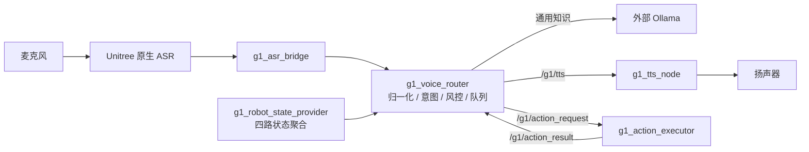

# 基于 ROS 2 的 G1-EDU 校园实验室智能接待与讲解系统 V1.0

**G1-EDU ROS 2 Voice Interaction and Smart Reception System**

> 运行在 Unitree G1-EDU 人形机器人上的 ROS 2 语音交互与状态感知系统：真实麦克风语音 → 语音识别 → 意图识别 → 本地知识库 / 外部大语言模型 → 机器人本体状态校验 → 白名单动作执行 → 语音播报。用于校园实验室的接待讲解、技术问答、机器人状态查询与动作演示。
>
> 个人独立开发与维护，V1.0 于 2026-11-03 冻结。

| 项目 | 值 |
|---|---|
| Version | V1.0（2026-11-03 冻结） |
| Platform | Unitree G1-EDU / Jetson Orin NX / ARM64 |
| OS / ROS | Ubuntu 22.04.5 LTS / ROS 2 Humble（CycloneDDS） |
| Language | C++17 |
| 单元测试 | 453 项 / 7 个套件（G1 ARM64：0 errors、0 failures） |
| 生产 Router SHA256 | `6ab99de8ceb287d1fdb58b66399874c60b41734775a74a0c2745bf64223d6bb7` |
| Status | Frozen Release（未指定开源许可证） |

> **这是开发工作仓库**。可以直接交付/上传 GitHub 的自包含版本在
> [`releases/G1-EDU-Smart-Reception-V1.0/`](releases/G1-EDU-Smart-Reception-V1.0/)，
> 完整项目门户文档是其中的 [`README.md`](releases/G1-EDU-Smart-Reception-V1.0/README.md)。
> 本仓库根目录保留开发期资料：阶段报告、运行证据、调研材料、工作副本。

---

## 1. 系统做什么



| 能力 | 说明 | 验证级别 |
|---|---|---|
| 语音问答 | ASR → 意图 → 模型 → TTS | 真机 |
| 实验室介绍 | 本地知识库（FAQ 21 / 方向 3 / 项目 1 / 设备 1） | 真机 |
| 状态查询 | 电量、IMU 数据接收、整体运行状态（四态判定） | 真机 |
| 动作演示 | 6 个白名单动作，`hand_on_heart`/33 永久禁用 | 仅 `wave` 真机通过 |
| 连续对话 | 有界 FIFO（3）+ 单 worker + 1200 ms 去重 | 真机 + 隔离验证 |
| 长期运行 | user 级 systemd、崩溃自愈、开机自恢复、日志轮转、磁盘监测 | 真机 |

**边界**：不依赖深度相机；无视觉识别、人脸识别、自主导航、语义地图；V1.0 的大模型运行在机器人**外部主机**，不是 Jetson 本地。

---

## 2. 工程亮点（为什么不是“接个大模型”）

1. **不让模型碰实时数据**：电量/IMU/运行状态一律来自机器人本体话题，四态判定（VALID/STALE/UNAVAILABLE/INVALID），过期就说“无法确认”。
2. **不让模型碰动作 ID**：动作只能来自固定白名单，否定句/疑问句不触发，执行器再做一次 FSM 与手臂状态检查，不确定完成时保持锁定而不重试。
3. **不让回复乱序**：ROS 回调只入队，唯一 worker 串行处理，`/g1/tts` 的顺序恒等于提问顺序。
4. **不让事实被编造**：进入模型前做程序化风控（价格、实验室事实、实时状态三类拦截）。
5. **能连续跑一整天**：systemd 五服务 + target + Linger、logrotate（`copytruncate`）、磁盘检查 timer，全部真机验证。

每一处的取舍与代价，见交付版 README 的「核心模块设计」与「技术选型与设计决策」。

---

## 3. 仓库结构

```text
g1_dev/
├── README.md                     ← 本文件（仓库导览）
├── releases/
│   └── G1-EDU-Smart-Reception-V1.0/   ← 【交付版】源码 + 部署 + 文档 + 软著 + 清单
│       ├── README.md                  ← 项目门户（先看这个）
│       ├── ros2_ws/ action_ws/        ← 三个 ROS 2 包
│       ├── integrations/              ← TTS 节点
│       ├── deployment/                ← systemd / logrotate / 脚本 / 脱敏模板
│       ├── docs/                      ← 架构·开发·部署·测试·里程碑·素材
│       ├── software_copyright/        ← 软著材料 01–10
│       ├── manifests/                 ← 文件台账与 SHA256
│       └── private_archive/           ← 生产二进制与真实配置（禁止上传）
├── docs/                         ← 开发期文档（交接、里程碑、设计索引）
├── evidence/                     ← 运行证据原始文件（含内网信息，默认不上传）
├── research/                     ← 设备与 SDK 调研
└── workspace/                    ← 开发期工作副本与知识库来源资料
```

---

## 4. 快速开始

```bash
# 只看交付内容与文档
cd releases/G1-EDU-Smart-Reception-V1.0 && less README.md

# 编译 / 部署 / 排障
#   docs/deployment/environment_setup.md  环境与依赖
#   docs/deployment/build_guide.md        两个工作区分别构建
#   docs/deployment/startup_guide.md      systemd 启动与自检
#   docs/deployment/rollback_guide.md     单服务回滚
```

在 G1 上跑测试基线：

```bash
cd ~/unitree_ros2/example
colcon test --packages-select g1_voice_router && colcon test-result --verbose
# 期望：7 tests, 0 errors, 0 failures, 0 skipped（453 项断言）
```

---

## 5. 测试基线（V1.0）

| 套件 | 用例数 |
|---|---:|
| ASRTextNormalizer | 22 |
| ActionCommandMapper | 39 |
| InteractionManager | 76 |
| IntentRecognizer | 96 |
| FactRiskGuard | 119 |
| KnowledgeBase | 57 |
| RobotStateEvaluator | 44 |
| **合计** | **453** |

> 单元测试 ≠ Mock 隔离测试（DOMAIN_ID=77）≠ ARM64 编译 ≠ 真机测试，四者在文档中分别标注。

---

## 6. 已知限制（摘要）

ASR 专有名词变体不封闭（`手机接口` 故意不纠正）；动作结果协议无请求 ID，不支持并发动作；`completion_unknown` 类结果会被 Router 当成超时；`TtsMaker ret=0` ≠ 播放完成，配置里的 `volume` 未生效；仅 `wave` 完成真机动作验收；IMU 只回答“是否收到数据”；无视觉与导航能力；大模型不在机器人本地。

完整清单：交付版 README §16（13 条）与 `docs/testing/known_issues.md`（15 条，含缓解与根治方向）。

---

## 7. 安全与隐私

| 内容 | 说明 |
|---|---|
| `evidence/**` | 含内网 IP、主机名与 `/home/...` 路径，**默认不上传** |
| `releases/**/private_archive/**` | 生产二进制与真实配置，**禁止上传**（已在 `.gitignore`） |
| `docs/milestones/**` | 历史报告原样保留，含当时的内网地址，公开前需评估 |
| 源码 `ollama_url` 默认值 | 仍为内网地址（与冻结二进制保持一致，便于哈希校验），使用时用参数覆盖 |
| 许可证 | **未指定开源许可证**；`package.xml` 中的 `<license>` 是模板遗留占位 |

---

## 8. 发布

- 本仓库有远端 `origin`，但归档与文档重构过程**未执行**任何 `git commit` / `git push`。
- 上传前请先看交付版 [`docs/GITHUB_PREPARE_CHECKLIST.md`](releases/G1-EDU-Smart-Reception-V1.0/docs/GITHUB_PREPARE_CHECKLIST.md)。
- 文档重构的完整说明见 [`README_REVIEW_REPORT.md`](releases/G1-EDU-Smart-Reception-V1.0/README_REVIEW_REPORT.md)。
