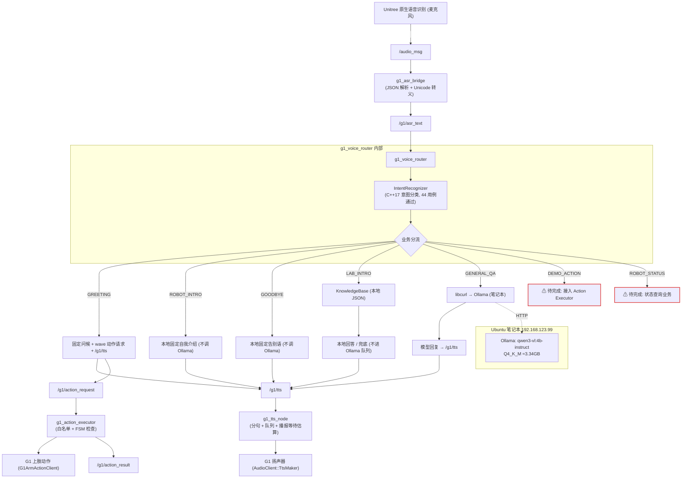

# G1-EDU 校园实验室智能接待系统 · 工程交接文档

- 文档名：`G1_AGENT_HANDOVER_20261101.md`
- 生成日期：2026-11-01
- 生成方式：由新任 Agent 在**只读审计**后编写。本文档生成过程未修改 G1 上任何代码、配置、进程，未执行动作、未播放语音、未修改任何系统设置。
- 实际保存路径：`/home/mick/Mick_Grey/g1_dev/teach/G1_AGENT_HANDOVER_20261101.md`

> **重要路径更正**：本任务书及部分历史文档（如 `g1_kb_review/INDEX.md`）中写的 `/home/mick/Mick_Grey/teach/` 目录**当前并不存在**（已实测确认）。项目全部本地资料实际位于：
>
> **`/home/mick/Mick_Grey/g1_dev/teach/`**
>
> 下文所有本地路径一律以 `g1_dev/teach` 为准。旧文档中的 `/home/mick/Mick_Grey/teach/` 应理解为同一项目迁移前的旧位置。

---

## 信息可靠性标注约定

本文所有陈述均按以下级别标注：

| 标注 | 含义 |
|---|---|
| 【已验证 2026-11-01】 | 本次交接审计通过实际命令验证 |
| 【历史记录】 | 来自 2026-10-31 及之前的开发/交付报告 |
| 【Agent 报告】 | 来自此前 Agent 的报告，本次未重新验证 |
| 【未验证】 | 本次未检查 |
| 【待开发】 | 尚未实现的功能 |

---

## 0. 只读审计结果摘要（2026-11-01 实测）

| # | 审计项 | 结果 | 级别 |
|---|---|---|---|
| 1 | G1 SSH 连接 | `unitree@192.168.123.164` 可免密连接 | 【已验证】 |
| 2 | G1 主机名/架构 | `ubuntu` / `aarch64` / Ubuntu 22.04.5 | 【已验证】 |
| 3 | ROS 2 环境 | Humble，`source ~/unitree_ros2/setup.sh` 后 `ros2 node list` 正常 | 【已验证】 |
| 4 | 当前运行进程 | **g1_voice_router、g1_asr_bridge、g1_tts_node、g1_action_executor 均未在运行**。仅有 Unitree 原生 `/ros_bridge` 节点及大量 Unitree 原生话题 | 【已验证】 |
| 5 | 历史 PID 10751/10753 | **已失效**。当前机器上没有任何接待相关进程（机器人可能已重启过） | 【已验证】 |
| 6 | G1 源码 SHA256 | 6 个核心文件哈希已采集，与本地工作副本 `g1_kb_work/g1_voice_router/` 完全一致 | 【已验证】 |
| 7 | install 目录 | `install/g1_voice_router/lib/g1_voice_router/voice_router` 为 symlink-install 软链接，指向 `build/g1_voice_router/voice_router`（编译于 2026-10-31 15:09，即 P0 修复后版本） | 【已验证】 |
| 8 | 知识库 FAQ 数量 | **21 条**（G1 源码 JSON 与 install JSON 哈希一致；`labs=3, research_directions=3, projects=1, equipment=1, categories=5, sources=15`） | 【已验证】 |
| 9 | 测试结果复跑 | 本次未复跑。57/57、44/44、隔离域 8/8 为【历史记录】 | 【未验证】 |
| 10 | Ollama | `http://192.168.123.99:11434` 可达；模型 `qwen3-vl:4b-instruct`（Q4_K_M，3,337,225,651 字节，digest `84f7ed80…`） | 【已验证】 |
| 11 | P0-15 是否已修改 | **未修改**。在 G1 源码 `src/`、`include/` 中 grep `risk/price/价格/fact_check/verify_fact` 等关键词无任何命中；代码中无高风险事实检查逻辑 | 【已验证】 |
| 12 | TTS 配置 | `~/unitree_ros2/example/config/tts_config.json`：`speaker_id=0, volume=80, pause_ms=1500` | 【已验证】 |
| 13 | G1 备份目录 | `~/g1_backups/` 下两个备份目录均存在 | 【已验证】 |
| 14 | lidar_ws | `~/lidar_ws/src/` 含 `g1_action_executor`、`g1_sports_show`、`lidar_check`，且存在 install 目录 | 【已验证】 |
| 15 | ASR/TTS/Action Executor 进程 | 均未运行（见第 4 项） | 【已验证】 |

**核心结论：P0 修复后的代码已编译进 build/install 产物，但当前机器人上没有任何接待系统节点在运行。"生产版本切换"问题已演变为"整个系统当前未启动"，新 Agent 接手后无需区分新旧进程，直接按第 11 节命令启动即可。**

---

## 1. 项目概述与交付目标

### 1.1 项目名称

《基于 ROS 2 的 G1-EDU 校园实验室智能接待与讲解系统 V1.0》

### 1.2 应用场景

学校实验室开放日、科技展览、实验室参观接待。机器人作为**固定点位**的智能接待员，实现：

- 语音问候（GREETING）
- 实验室介绍（LAB_INTRO）
- 机器人自我介绍（ROBOT_INTRO）
- 实验室知识问答（KnowledgeBase + GENERAL_QA）
- 预设动作演示（DEMO_ACTION）
- 机器人自身状态查询（ROBOT_STATUS）
- 语音告别（GOODBYE）

### 1.3 交付目标

**2026 年 11 月 19 日前**完成一个能在 Unitree G1-EDU 真机上演示基本接待流程的软件系统，并整理软件著作权申请相关材料。

### 1.4 项目边界（非常重要，新 Agent 不要越界）

- 当前**不依赖深度相机**。
- **暂不实现**自主导航。
- **暂不实现**人脸识别。
- **不将视觉感知作为项目交付前提**。
- 优先复用现有语音、动作和状态接口。
- G1 深度相机此前存在硬件/驱动层异常，**不要把修复相机列为主项目前置任务**。

---

## 2. 用户开发背景和协作偏好

用户是大二软件工程专业学生，目标是**具身智能模型部署工程师**，更重视机器人端软件集成和模型部署，而非模型训练研究。

硬性协作要求（新 Agent 必须遵守）：

1. 机器人端默认 **C++**；Python 仅用于确有必要的离线脚本、训练、导出或辅助诊断。
2. **教学式开发**：引入新概念时先解释用途和原理，再结合 G1 项目实现；解释要通俗、详细、有实际例子。
3. 给出**可直接执行的完整命令**；解释关键代码、接口和运行逻辑。
4. 每阶段明确说明：改了什么、为什么改、如何测试。
5. 不重复已完成的环境安装；不随意推倒重写已验证代码。
6. **修改前先读取当前真实源码**（以 G1 实际部署源码为准，用 SHA256 核对）。
7. **重要修改必须备份**（G1 上备份到 `~/g1_backups/`，命名带时间戳和修改说明）。
8. 每次集中完成**一个清晰的小目标**。
9. 不要只给提示词让用户复制，要帮用户真正理解架构。
10. 不未经分析就引入新的大型框架和依赖。
11. 真机安全第一：见第 19 节。

---

## 3. G1 硬件及软件环境

| 项目 | 值 | 级别 |
|---|---|---|
| 机器人 | Unitree G1-EDU | 【历史记录】 |
| 机载计算单元 | Jetson Orin NX | 【历史记录】 |
| 架构 | ARM64 / aarch64 | 【已验证】 |
| 系统 | Ubuntu 22.04.5 LTS | 【已验证】 |
| ROS 2 | Humble | 【已验证】 |
| JetPack | 6.2.3 | 【历史记录】 |
| CUDA / TensorRT | 12.6 / 10.3 | 【历史记录】 |
| Kernel | 5.15.185-tegra | 【历史记录】 |
| 机器人 IP | 192.168.123.164（SSH 用户 `unitree`） | 【已验证】 |
| RMW | rmw_cyclonedds_cpp | 【已验证（setup.sh 实测内容）】 |
| ROS_DOMAIN_ID | 0（隔离测试曾用 77/42/43） | 【历史记录】 |
| DDS 网络接口 | eth0 | 【已验证（setup.sh 实测内容）】 |

环境初始化脚本（G1 上 `~/unitree_ros2/setup.sh`，【已验证】实测内容）：

```bash
source /opt/ros/humble/setup.bash
source $HOME/unitree_ros2/cyclonedds_ws/install/setup.bash
export RMW_IMPLEMENTATION=rmw_cyclonedds_cpp
export CYCLONEDDS_URI='<CycloneDDS><Domain><General><Interfaces>
                            <NetworkInterface name="eth0" priority="default" multicast="default" />
                        </Interfaces></General></Domain></CycloneDDS>'
```

**任何 ROS 2 操作前必须先执行 `source ~/unitree_ros2/setup.sh`。**

---

## 4. Ubuntu 笔记本环境和 Ollama

### 4.1 笔记本

- 用途：ROS 2 开发、模型部署、推理服务、代码开发。
- CPU：Intel i7-13650HX；GPU：RTX 4070 Laptop（8GB 显存）；内存 16GB（历史值）。
- 系统：Ubuntu 24.04.5 LTS。
- NVIDIA：驱动 595.99.02，CUDA Driver API 13.2。
- 历史开发环境（仅记录，**不需要重装**）：Python 3.12.3、PyTorch 2.14.1+cu130、ONNX 1.23.2、ONNX Runtime 1.31.0、Ultralytics 8.4.183。

### 4.2 Ollama 模型服务器

- 已从 Windows 迁移到 Ubuntu 笔记本，**今后默认以笔记本为外部模型服务器，不再依赖 Windows，不要重新部署或迁移**。
- 模型：`qwen3-vl:4b-instruct`，量化 Q4_K_M，文件约 3.34GB。
- 【已验证 2026-11-01】`/api/tags` 返回：size=3,337,225,651，digest `84f7ed8042fa7cdbd902f7dcb7d0370e032095047cc3244179f263b77b5bc318`，context_length=262144，capabilities 含 vision/tools。历史已验证 RTX 4070 GPU 推理，显存占用约 4GB。
- API 地址：`http://192.168.123.99:11434/api/chat`
- 笔记本 Ethernet：`192.168.123.99`；G1：`192.168.123.164`；两者网络通信已验证成功。
- Voice Router 可通过 ROS 参数覆盖 Ollama URL：

```bash
ros2 run g1_voice_router voice_router --ros-args -p ollama_url:=http://192.168.123.99:11434/api/chat
```

- Voice Router 内置默认参数（【已验证】读自源码 `src/voice_router.cpp`）：
  - `ollama_url` = `http://192.168.123.99:11434/api/chat`
  - `model` = `qwen3-vl:4b-instruct`
  - `request_timeout_seconds` = 60（允许 5–300，越界回落 60）
  - `knowledge_file` = `<g1_voice_router share 目录>/config/lab_knowledge.json`（通过 `ament_index_cpp` 定位）
  - `system_prompt` = 中文语音助手提示词（要求简体中文、口语化、不编造机器人实时状态等）

---

## 5. ROS 2 工作区及目录结构

### 5.1 工作区关系与 source 顺序

```text
G1 机器人上：
~/unitree_ros2/cyclonedds_ws     # Unitree 消息定义工作区（unitree_api_msgs 等），最先被 setup.sh source
~/unitree_ros2/example           # 主开发工作区：g1_asr_bridge、g1_voice_router、g1_tts_node（unitree_ros2_example 包）
~/lidar_ws                       # 用户自定义工作区：g1_action_executor、g1_sports_show、lidar_check
~/unitree_sdk2_transfer/unitree_sdk2-main   # Unitree SDK2 源码（独立二进制示例，仅诊断用，勿混入 ROS 运行链路）
```

依赖关系：

1. 自定义包依赖 Unitree 消息，因此**先 source `~/unitree_ros2/setup.sh`**（它已包含 cyclonedds_ws）。
2. `~/unitree_ros2/example` 与 `~/lidar_ws` 相互独立，分别用各自 `install/setup.bash`。
3. 若同时使用 example 和 lidar_ws 的包（例如 voice_router + action_executor），需要先后 source 两个工作区的 `install/setup.bash`。

### 5.2 主要项目包分布（G1 上）

```text
~/unitree_ros2/example/
├── g1_asr_bridge/                        # ASR JSON 解析桥
│   └── src/asr_json_bridge.cpp
├── g1_voice_router/                      # 语音路由（本项目核心，P0 修复对象）
│   ├── include/g1_voice_router/
│   │   ├── intent_recognizer.hpp
│   │   └── knowledge_base.hpp
│   ├── src/
│   │   ├── intent_recognizer.cpp
│   │   ├── knowledge_base.cpp
│   │   └── voice_router.cpp
│   ├── config/lab_knowledge.json
│   └── test/
│       ├── intent_recognizer_test.cpp
│       └── knowledge_base_test.cpp
├── src/src/g1/audio_client/g1_tts_node.cpp   # TTS 节点（unitree_ros2_example 包内）
└── config/tts_config.json

~/lidar_ws/src/
├── g1_action_executor/                   # 动作执行器
├── g1_sports_show/                       # 运动会流程调度（独立业务，勿混入接待）
└── lidar_check/
```

### 5.3 本地（笔记本）资料目录

实际根目录：`/home/mick/Mick_Grey/g1_dev/teach/`（**注意：`/home/mick/Mick_Grey/teach/` 不存在**）

```text
/home/mick/Mick_Grey/g1_dev/teach/
├── G1_AGENT_HANDOVER_20261101.md     # 本文档
├── lab_research/                     # 原始调研资料（8 份 md）
│   ├── LAB_RESEARCH_REPORT.md  LAB_PROFILE.md  SOURCES.md  FACT_CHECK.md
│   ├── FAQ_DRAFT.md  UNVERIFIED.md  TALK_SCRIPTS.md  README.md
├── g1_kb_work/                       # P0 修复工作副本 + 交付报告 + 证据
│   ├── DELIVERY_REPORT.md            # 知识库接入与 P0 修复交付报告（506 行）
│   ├── g1_voice_router/              # 与 G1 部署源码逐字节一致的工作副本（SHA256 已核对一致）
│   ├── original/g1_voice_router/     # 改造前原始源码副本
│   ├── backups/                      # 本地备份（含 20261031_224715_before_p0fix）
│   └── evidence_p0fix/               # P0 修复测试证据（gtest 日志、TTS 捕获）
└── g1_kb_review/                     # 只读审查包（供独立审查）
    ├── G1_KB_REVIEW_BUNDLE.md  INDEX.md  SHA256SUMS
    ├── SOURCE_APPENDIX.md  KNOWLEDGE_BASE_APPENDIX.md  CODE_DIFF_APPENDIX.md
    ├── RESEARCH_APPENDIX.md  TEST_EVIDENCE_APPENDIX.md
    ├── remote_snapshot/  backup_snapshot/  diffs/  research_materials/  evidence/
```

注意：`g1_kb_review`、`g1_kb_work` 中可能包含较早版本快照，**一律以 G1 当前实际部署源码为准，并用 SHA256 核对**（本次审计已核对一致）。`teach/` 目录本身是 git 仓库（最近提交均为 "update"），但 G1 上的 `g1_voice_router` 目录在 G1 侧 git 中是**未跟踪目录**，不能依赖 `git restore` 回滚，只能靠物理备份。

---

## 6. 系统总体架构

【历史记录】架构与话题名，且话题名/发布订阅代码已由本次源码阅读核对（`voice_router.cpp` 订阅 `/g1/asr_text`，发布 `/g1/tts` 与 `/g1/action_request`）。**当前所有业务节点均未运行**（【已验证】）。



图例：实线 = 已实现链路；红色 = 意图已分类但完整业务**待开发**；虚线 = 跨机器 HTTP 调用。**Ollama 运行在笔记本，不运行在 G1 上。**

---

## 7. 各软件包职责

### 7.1 g1_asr_bridge

- 源码：`~/unitree_ros2/example/g1_asr_bridge/src/asr_json_bridge.cpp`；可执行文件 `asr_json_bridge`。
- 输入 `/audio_msg`（Unitree 原生语音识别 JSON），输出 `/g1/asr_text`（std_msgs/String）。
- 职责：解析 JSON 提取 `text` 字段，转换 Unicode 转义，支持 UTF-8 输出。
- 真实 ASR 桥接链路此前验证过可用【历史记录】。

### 7.2 g1_voice_router（核心）

订阅 `/g1/asr_text` → IntentRecognizer 意图分类 → 业务分流；发布 `/g1/tts` 与 `/g1/action_request`。内部工作线程队列处理请求（含对话历史）。已实现 7 类意图：GREETING、LAB_INTRO、ROBOT_INTRO、DEMO_ACTION、ROBOT_STATUS、GOODBYE、GENERAL_QA。

**关键原则：意图可分类 ≠ 对应完整业务已实现。** 详见第 8 节。

### 7.3 IntentRecognizer

- C++17 独立意图分类模块，经历多轮迭代。
- 第一版问题（【历史记录】）：
  - "脑机接口是什么"被误判 LAB_INTRO；"具身智能是什么"被误判 LAB_INTRO。
  - 关键词宽泛匹配造成意图抢占。
- 2026-10-31 第一轮 P0 修复收窄分类逻辑后 44/44 通过。
- **修复原则（必须长期遵守）**：
  - 区分通用技术概念与实验室特定事实："脑机接口是什么"、"具身智能是什么" → GENERAL_QA；"我们实验室如何开展具身智能研究" → LAB_INTRO。
  - "展示一下具身智能开放平台"属于信息介绍 → LAB_INTRO，不是动作。
  - 只有明确动作请求 → DEMO_ACTION；明确状态查询 → ROBOT_STATUS。
- **已知遗留小问题**：
  1. IntentRecognizer 能识别"您好啊"，但 `match_greeting_reply()` 未必包含相同表达——可能分类正确但固定问候无对应回复。待审查。
  2. 旧 `normalize_intent_text` 对全部字节执行 `std::tolower`，存在 UTF-8/locale 风险。**未经测试不得修改**。

### 7.4 KnowledgeBase

- C++17 本地知识库，数据文件 `config/lab_knowledge.json`。
- 设计：JSON 配置、启动时加载一次、常驻内存、FAQ+结构化检索、保留事实来源 ID、未知内容明确兜底、`ament_index_cpp` 定位 share 配置、支持 `knowledge_file` 参数覆盖。
- 加载失败时节点仍能启动，LAB_INTRO 返回硬编码兜底（已实测【历史记录】）。

### 7.5 g1_tts_node

- 源码：`~/unitree_ros2/example/src/src/g1/audio_client/g1_tts_node.cpp`；安装位置 `~/unitree_ros2/example/install/unitree_ros2_example/`（【已验证】存在 `g1_tts_node`）。
- 订阅 `/g1/tts`，调用 Unitree 原生 `AudioClient::TtsMaker(sentence, speaker_id)`。
- 能力：中文分句、逐条发送、播报等待时间估算、`pause_ms` 配置、消息队列。
- 配置 `~/unitree_ros2/example/config/tts_config.json`（【已验证】）：`speaker_id=0, volume=80, pause_ms=1500`。
- **注意：`TtsMaker()` 成功返回 ≠ 扬声器播放完成。** 过去用分句+估算等待解决过句子截断问题，不得随意更改播放逻辑，不得为观感随意取消安全等待；必须区分"播放等待"、"动作执行完成"、"机械运动结束"三件事。

### 7.6 g1_action_executor（`~/lidar_ws/src/g1_action_executor/`）

- 订阅 `/g1/action_request`，调用 Unitree 官方 G1ArmActionClient；含 FSM 检查、动作状态监测、低状态模式检查、等待动作开始/结束；发布 `/g1/action_result`。
- 已验证动作白名单【历史记录】：

| 动作 | ID |
|---|---|
| wave | 26 |
| wave_low | 25 |
| hands_up | 15 |
| clap | 17 |
| heart | 20 |
| victory | 30 |

- **ID33 `hand_on_heart` 真机执行时出现异常后退表现，已移除，严禁重新加入。**
- 动作后有 3 秒 `post_action_settle` 缓冲——这是**调度安全间隔**，不等于机械姿态复位，不能混淆。

### 7.7 g1_sports_show（`~/lidar_ws/src/g1_sports_show/`）

- 独立运动会流程调度节点：start/pause/resume/cancel/status；发布 `/g1/action_request`、`/g1/tts`、`/g1/sports_show/state`。
- 运动会六段流程已实现并验证【历史记录】。
- **不要与实验室接待业务合并成同一个节点，不要未经评估直接重写。**

---

## 8. 已实现功能（按意图逐一标注）

| 意图 | 意图分类 | 业务实现 | 说明 |
|---|---|---|---|
| GREETING | ✅ 已实现 | ✅ 基本实现 | 固定问候 + 发布 wave 动作请求 + `/g1/tts`。运行时挥手未在真机验证过【历史记录】 |
| ROBOT_INTRO | ✅ | ✅ | 本地固定自我介绍，不调 Ollama |
| GOODBYE | ✅ | ✅ | 本地固定告别语，不调 Ollama |
| LAB_INTRO | ✅ | ✅ | 本地 KnowledgeBase 查询（介绍/研究方向/项目/设备/人物/地点/FAQ），资料缺失兜底，不进 Ollama 队列 |
| GENERAL_QA | ✅ | ⚠️ 部分实现 | libcurl 调 Ollama，请求与对话历史已跑通；**事实可靠性未解决（P0-15）** |
| DEMO_ACTION | ✅ 已分类 | ❌ **待完成** | 分类≠调度完成；需接入 Action Executor + 安全门控 |
| ROBOT_STATUS | ✅ 已分类 | ❌ **待完成** | 完整状态查询业务未实现 |

已通过隔离域文本测试验证的 LAB_INTRO / GENERAL_QA 路径【历史记录】；真实麦克风→TTS 全链路**未验证**。

---

## 9. 当前生产运行状态

【已验证 2026-11-01】：

- **G1 上没有任何接待系统节点在运行**。`ps` 与 `ros2 node list` 确认：无 `voice_router`、`asr_json_bridge`、`g1_tts_node`、`action_executor` 进程；仅有 Unitree 原生 `/ros_bridge` 及原生话题（`/audio_msg`、`/lowstate`、`/sportmodestate`、`/arm/action/state` 等）。
- 2026-10-31 报告中的生产进程 PID 10751/10753 **已失效**（期间机器人很可能重启过）。
- 编译产物状态：`install/g1_voice_router/lib/g1_voice_router/voice_router` 是指向 `build/g1_voice_router/voice_router` 的软链接（symlink install），build 二进制编译于 **2026-10-31 15:09 UTC，即 P0 修复后版本**。二进制 SHA256：`dc242b16281ebc0164d56c539c82fc885eb484eaf70bebf791f2d925c9798c85`。
- 源码文件 mtime 均为 2026-10-31 15:09 左右，与 build 时间一致。
- `install/.../share/g1_voice_router/config/lab_knowledge.json` 与源码 config JSON 哈希一致（`5acfbe54…`）。
- 笔记本 Ollama 服务在运行，模型在位（见 4.2）。
- `/g1/tts`、`/g1/action_request` 当前无订阅者（对应节点未运行）。

**结论：下一次联调时直接按第 11 节命令逐个启动节点即可，不存在"旧生产进程待切换"问题；但仍建议启动前核对一次 SHA256。**

---

## 10. 重要源码路径

### G1 上（权威源码，改动以此为准）

```text
/home/unitree/unitree_ros2/example/g1_voice_router/
├── src/intent_recognizer.cpp        11b1692f…
├── src/knowledge_base.cpp           973bbf3f…
├── src/voice_router.cpp             8964681d…
├── include/g1_voice_router/intent_recognizer.hpp  a208e31f…
├── include/g1_voice_router/knowledge_base.hpp     9dc97054…
└── config/lab_knowledge.json        5acfbe54…

/home/unitree/unitree_ros2/example/g1_asr_bridge/src/asr_json_bridge.cpp
/home/unitree/unitree_ros2/example/src/src/g1/audio_client/g1_tts_node.cpp
/home/unitree/unitree_ros2/example/config/tts_config.json
/home/unitree/lidar_ws/src/g1_action_executor/
/home/unitree/lidar_ws/src/g1_sports_show/
/home/unitree/unitree_sdk2_transfer/unitree_sdk2-main/   # SDK2，仅独立诊断用
```

### 笔记本上

```text
/home/mick/Mick_Grey/g1_dev/teach/lab_research/          # 调研资料
/home/mick/Mick_Grey/g1_dev/teach/g1_kb_work/g1_voice_router/   # 与 G1 逐字节一致的工作副本
/home/mick/Mick_Grey/g1_dev/teach/g1_kb_work/DELIVERY_REPORT.md # 交付报告（506 行）
/home/mick/Mick_Grey/g1_dev/teach/g1_kb_review/          # 审查包
```

### 源码 SHA256（【已验证 2026-11-01】，G1 与本地副本一致）

```text
11b1692f4dd040a7c548b17dfbd13c4ea2b7394fa80c2d4d3dda38fdcf85364e  src/intent_recognizer.cpp
973bbf3f7d5eaae68f43b2205f957e19849b71e82f73e86480b4bb7fe6a0ecfe  src/knowledge_base.cpp
8964681d6b1ff14c99880a6fe43cd1e5eb87cbd4c7dc62426f889c43eed3932a  src/voice_router.cpp
a208e31fdf4970177438b98fb2def583b6ae459f22d9cec22387fc706ae709c5  include/g1_voice_router/intent_recognizer.hpp
9dc97054f6c5a10ad9dc46e8482ae9c9618bf3062e1d3ab4201cac9161729fa6  include/g1_voice_router/knowledge_base.hpp
5acfbe5406fb35d449369e556a7692f5129471671c047a3a6cee94ed276f8e24  config/lab_knowledge.json
dc242b16281ebc0164d56c539c82fc885eb484eaf70bebf791f2d925c9798c85  build/g1_voice_router/voice_router（P0 修复后 ARM64 二进制）
```

---

## 11. 启动和编译命令

以下命令均与当前实际环境对应（setup.sh 内容已实测；启动/构建命令来自交付报告【历史记录】且路径已核对）。

### 11.1 启动 Voice Router（G1 上）

```bash
ssh unitree@192.168.123.164
source ~/unitree_ros2/setup.sh
source ~/unitree_ros2/example/install/setup.bash
ros2 run g1_voice_router voice_router
```

可选：显式指定知识库路径：

```bash
ros2 run g1_voice_router voice_router --ros-args \
  -p knowledge_file:=$HOME/unitree_ros2/example/install/g1_voice_router/share/g1_voice_router/config/lab_knowledge.json
```

可选：覆盖 Ollama 地址：

```bash
ros2 run g1_voice_router voice_router --ros-args \
  -p ollama_url:=http://192.168.123.99:11434/api/chat
```

建议用 `tmux` 或 `nohup` 保持会话。

### 11.2 启动其他节点（G1 上，各自终端）

```bash
# ASR 桥接
source ~/unitree_ros2/setup.sh
source ~/unitree_ros2/example/install/setup.bash
ros2 run g1_asr_bridge asr_json_bridge

# TTS 节点
source ~/unitree_ros2/setup.sh
source ~/unitree_ros2/example/install/setup.bash
ros2 run unitree_ros2_example g1_tts_node   # 以实际可执行入口为准，install 下存在 g1_tts_node

# Action Executor（lidar_ws）
source ~/unitree_ros2/setup.sh
source ~/lidar_ws/install/setup.bash
ros2 run g1_action_executor <入口>   # 启动前先阅读该包 README/CMakeLists 确认可执行名，勿凭空猜测
```

### 11.3 编译（G1 上，ARM64 原生）

```bash
source ~/unitree_ros2/setup.sh
source ~/unitree_ros2/example/install/setup.bash
cd ~/unitree_ros2/example
colcon build --packages-select g1_voice_router
colcon test --packages-select g1_voice_router
colcon test-result --verbose
```

（当前使用 symlink install，build 后 install 即自动生效。）

### 11.4 隔离域测试（避免干扰真实机器人 DDS）

```bash
ROS_DOMAIN_ID=77 source ~/unitree_ros2/setup.sh   # 新终端，隔离域
# 在该终端内启动测试节点并 echo 话题，用完关闭终端即可
```

### 11.5 SDK2 独立示例（仅诊断，需清除 ROS 库环境）

```bash
env -u LD_LIBRARY_PATH -u LD_PRELOAD \
  ~/unitree_sdk2_transfer/unitree_sdk2-main/build/bin/g1_arm_action_example --network eth0 --list
```

### 11.6 快速文本链路测试（不依赖麦克风）

```bash
# 终端 A：启动 voice_router
# 终端 B：
source ~/unitree_ros2/setup.sh
ros2 topic pub --once /g1/asr_text std_msgs/msg/String "{data: '实验室是做什么的'}"
# 终端 C：观察输出
ros2 topic echo /g1/tts
ros2 topic echo /g1/action_request
```

**注意：话题 echo 只证明消息流转，不等于扬声器真实播放。**

---

## 12. ROS 话题和接口说明

| 话题 | 方向 | 类型 | 生产者 → 消费者 | 状态 |
|---|---|---|---|---|
| `/audio_msg` | G1 内部 | Unitree 原生 | 原生 ASR → g1_asr_bridge | 原生话题存在【已验证】，桥未运行 |
| `/g1/asr_text` | 订阅 | std_msgs/String | g1_asr_bridge → g1_voice_router | 接口在源码中确认【已验证】 |
| `/g1/tts` | 发布 | std_msgs/String | g1_voice_router → g1_tts_node | 同上 |
| `/g1/action_request` | 发布 | std_msgs/String | g1_voice_router → g1_action_executor | 同上 |
| `/g1/action_result` | 发布 | std_msgs/String | g1_action_executor → （调度方） | 历史记录 |
| `/g1/sports_show/state` | 发布 | — | g1_sports_show | 历史记录（运动会业务） |
| `/lowstate` `/sportmodestate` `/arm/action/state` | G1 原生 | Unitree 消息 | 原生 → （未来 ROBOT_STATUS 用） | 话题存在【已验证】，消费端待开发 |

`/g1/action_request` 消息为固定白名单动作名（见 7.6 白名单表），**不得让大模型直接生成动作命令**。

---

## 13. 知识库数据结构及来源

### 13.1 实际数据规模（【已验证 2026-11-01】，G1 上解析统计）

```text
schema_version: 1        knowledge_version: 1.0.0        updated_at: 2026-10-31
school_name: 重庆理工大学
college_name: 重庆理工大学两江人工智能学院
lab_name: 脑机交互智能研究中心；人形机器人具身智能感知与自主学习重庆市重点实验室
location: 重庆市渝北区龙兴镇普福大道459号（重庆理工大学两江校区）
labs: 3        research_directions: 3        projects: 1
equipment: 1   categories: 5                faq: 21       sources: 15
```

FAQ 条目字段：`id, questions[], keywords[], answer, source_ids[], category`。

关键约束：`schema_version` 必须为整数 1；来源 ID 全局唯一；条目 `source_ids` 必须引用存在来源；播报字段（answer/introduction/location/fallback_answer）**禁止出现 URL**；空字段查询阶段直接兜底。

### 13.2 来源分级（【历史记录】，来自交付报告）

- 13 个 A 级来源、1 个 B 级（S14 CCBR 2025 会议公开简介）、1 个 C 级（S04 华龙网报道，与 A 级互证）。
- 主要来源：重庆市科技局 2025 拟认定重点实验室名单（S01）、学院获批新闻（S02）、中心成立报道（S04/S05）、学院简介（S06）、2025 招生简章（S07）、建院 8 周年开放日（S09）、教师公开页面（S10–S13）、CCBR 2025（S14）、机器人大赛获奖新闻（S16）、学院首页（S21）。
- 内容处理原则：只写已核验、可公开介绍、无未解决冲突的事实；**"智慧医疗/大健康"三领域冲突表述已排除，未经核验不得加回**；播报不含"首个"等宣传词；未写设备品牌/型号/数量；项目状态标注"按公开周期推断"。

### 13.3 事实红线（必须遵守）

- 区分：已核实事实 / 官方公开信息 / 公开论文支持 / 多来源交叉验证 / 尚未核实 / 由公开周期推断。**不得把推断伪装成事实**。
- "重点实验室什么时候成立"≠学院成立时间；"什么时候获批"依据公开材料回答获批时间，不得与成立混为一谈。
- "脑机中心有多少人"无来源支持 → 必须兜底。
- 没有确认的设备品牌、型号、数量不能编造。

---

## 14. 已解决的关键问题（真实排错经验，勿重蹈覆辙）

### 14.1 SDK2 动态库冲突 → `free(): invalid pointer`

SDK2 独立动作示例运行时，ROS 的 `LD_LIBRARY_PATH` 加载了 ROS Humble 的 libddsc，而 libddscxx 来自 SDK2，导致崩溃。解决：运行 SDK2 独立二进制时清除相关环境变量（见 11.5）。**不要全局修改 setup.sh。**

### 14.2 ROS 2 节点与 SDK2 的关系

当前 Action Executor 复用 Unitree 官方 ROS 2 动作客户端，**不要**未经必要改用独立 SDK2 二进制。

### 14.3 G1 语音回复截断

TTS 采用分句 + 播报等待时间估算解决过句子截断问题。不要随意更改原有播放逻辑。

### 14.4 外部大模型迁移

Windows → Ubuntu 笔记本 Ollama 迁移已完成，G1 eth0 ↔ 笔记本 Ethernet 通信已验证。无需再装模型/CUDA/做网络迁移。

### 14.5 深度相机

G1 深度相机存在硬件/驱动层异常，尚未恢复。当前项目不依赖深度相机；**不要把修相机列为主项目前置任务**。

---

## 15. 重要备份位置

### G1 上（【已验证 2026-11-01】均存在）

```text
/home/unitree/g1_backups/g1_voice_router_20261031_132307_before_kb/        # 知识库接入前
/home/unitree/g1_backups/g1_voice_router_20261031_144805_before_p0fix/     # P0 修复前
```

### 笔记本上

```text
/home/mick/Mick_Grey/g1_dev/teach/g1_kb_work/original/g1_voice_router/             # 改造前原始源码
/home/mick/Mick_Grey/g1_dev/teach/g1_kb_work/backups/g1_voice_router_20261031_224715_before_p0fix/
/home/mick/Mick_Grey/g1_dev/teach/g1_kb_review/backup_snapshot/  remote_snapshot/  diffs/
```

后续重要修改约定：在 G1 上新建 `~/g1_backups/g1_voice_router_<时间戳>_<说明>/`，同步在笔记本 `g1_kb_work/backups/` 留副本。

---

## 16. P0 修复历史和测试结果

### 16.1 背景

2026-10-31 第一轮 P0 修复，目标：P0-1 KnowledgeBase 检索误命中、P0-2 IntentRecognizer 意图抢占、P0-5 FAQ 同分依赖 JSON 顺序。

### 16.2 修改文件（7 个）

`knowledge_base.hpp`、`knowledge_base.cpp`、`intent_recognizer.cpp`、`voice_router.cpp`、`lab_knowledge.json`、`knowledge_base_test.cpp`、`intent_recognizer_test.cpp`。

### 16.3 修复内容

1. 引入实体表和实体掩码，减少宽泛实体抽取错误。
2. 区分成立/获批/人数等问题意图。
3. 增加意图相容判断。
4. FAQ 同分不再简单依赖 JSON 顺序。
5. 同分且无法区分时返回安全兜底。
6. 增加诊断字段：`matched_id`、`match_type`、`match_score`。
7. 增加复合问题澄清机制。

### 16.4 测试结果（【历史记录】，本次未复跑）

- KnowledgeBase 单测：37 → **57/57 通过**。
- IntentRecognizer 单测：25 → **44/44 通过**。
- G1 ARM64 原生 `colcon build` 通过；`colcon test` 通过。
- `ROS_DOMAIN_ID=77` 隔离域运行时测试 **8/8 通过**，期间生产进程未受影响。
- 关键回归用例：

| 输入 | 预期结果 |
|---|---|
| 重点实验室什么时候成立 | 区分获批与成立 |
| 开放平台是什么 | 命中平台介绍 |
| 脑机中心有多少人 | 无资料则兜底 |
| 实验室有哪些设备 | 命中设备 |
| 实验室主要研究什么设备 | 返回澄清 |
| 脑机接口是什么 | GENERAL_QA |
| 具身智能是什么 | GENERAL_QA |
| 学院有哪些专业 | LAB_INTRO，资料不足则兜底 |
| 实验室当前状态怎么样 | ROBOT_STATUS |
| 给我们表演一个动作 | DEMO_ACTION |
| 展示一下具身智能开放平台 | LAB_INTRO |

证据文件：`/home/mick/Mick_Grey/g1_dev/teach/g1_kb_work/evidence_p0fix/`（gtest 日志、TTS 话题捕获 `tts_1..8.txt` 等）及 `g1_kb_review/TEST_EVIDENCE_APPENDIX.md`。

---

## 17. 目前存在的问题

### 17.1 P0-15：GENERAL_QA 事实可靠性【待开发，本次已验证未做任何修改】

普通问答直接发给 Ollama，不带本地 KnowledgeBase 内容。历史证据：用户问"宇树机器人多少钱"，模型生成过"19999 元"，而当时核验的公开资料为 ¥9.9 万元起（该历史报价仅作不可靠性证据，**不得当作当前报价**）。

需要设计高风险事实检查，覆盖：价格、实验室人员、科研项目状态、科研成果、设备品牌/型号/数量、机器人实时状态。无可靠资料的高风险问题应安全兜底。普通通用知识（"脑机接口是什么"、"具身智能是什么"、"多模态融合是什么"）仍应允许 Ollama 回答。

**注意：曾给旧 Agent 下达 P0-15 任务但未收到完成报告；本次审计已 grep 确认 G1 源码无相关实现。新 Agent 需要从零设计。**

### 17.2 P0-16：真实语音接待闭环【待验证】

单测与隔离域文本测试已过，但以下**从未完整验证**：真实麦克风 ASR；ASR→Voice Router；KnowledgeBase→TTS 实际播报；Ollama→TTS 实际播报；GREETING 实际挥手；DEMO_ACTION 实际执行；连续提问；重复输入；请求队列拥堵；Ollama 断网恢复；节点重启后知识库加载。**话题 echo ≠ 扬声器真实播放。**

### 17.3 已知代码级小问题【待审查，未经测试不得改】

1. `match_greeting_reply()` 可能不含"您好啊"等已被识别的表达（分类对但回复缺失）。
2. `normalize_intent_text` 对全部字节 `std::tolower` 的 UTF-8/locale 风险。

### 17.4 其他待实现功能

1. ROBOT_STATUS：基于 `/lowstate`、`/sportmodestate`、`/arm/action/state` 的可靠状态查询，只回答有数据支持的状态。
2. DEMO_ACTION：接入已验证动作白名单和 Action Executor，必须有安全门控。
3. 交互任务管理：避免连续提问造成回复与动作错位。
4. 日志管理：记录每轮交互、意图、查询结果、动作反馈、异常。
5. 软著材料：系统架构、功能说明、操作说明、测试材料。

---

## 18. 下一步开发计划（建议优先级）

1. **第一优先级 · 只读检查**：确认部署状态（本文档第 0 节已完成大部分；启动前再核对 SHA256 即可）。当前无运行节点，无旧版本切换问题。
2. **第二优先级 · P0-15 事实可靠性**：高风险事实检查 + 安全兜底。
3. **第三优先级 · 生产版本启动**：确认备份后，按第 11 节启动 voice_router（可用 `tmux`），先文本链路验证再开其他节点。
4. **第四优先级 · 真实语音闭环**：逐个验证 ① 麦克风 ASR ② 本地问候 ③ 知识库问答 ④ Ollama 通用问答 ⑤ 实际扬声器 TTS ⑥ 单独安全验证动作演示。
5. **第五优先级 · ROBOT_STATUS**：读真实话题，只答有数据支持的状态。
6. **第六优先级 · DEMO_ACTION**：接入现有 Action Executor + 白名单，严禁大模型直接发动作命令。
7. **第七优先级 · 完整场景测试**：模拟真实参观者跑通连贯接待流程。
8. **第八优先级 · 软著材料**：源码、用户手册、设计说明、测试报告、操作截图、模块说明。

---

## 19. 真机安全注意事项

1. **所有状态区分**：已通过实际命令验证 / 历史记录 / Agent 报告 / 尚未验证 / 待开发。不要把话题 echo 说成真实播放，不要把 `TtsMaker` 返回说成播报完成，不要把 `post_action_settle` 说成机械复位。
2. 禁止随意执行：动作请求、语音播放（尤其真机旁有人时）、停止/重启不属于本项目的 Unitree 原生服务。
3. 动作只允许使用第 7.6 节白名单；**ID33 hand_on_heart 永久禁用**。
4. 隔离测试用独立 `ROS_DOMAIN_ID`（如 77），避免干扰真机 DDS。
5. 测试期间不得修改：防火墙、系统服务、DDS 配置、Ollama 配置、`~/unitree_ros2/setup.sh`。
6. 修改代码前：读取 G1 真实源码 → SHA256 核对 → 物理备份 → 小步修改 → colcon build + test → 隔离域验证 → 再上生产。
7. 不要为了观感取消 TTS/动作安全等待；不要在主项目里顺带修深度相机。
8. G1 侧 `g1_voice_router` 不在 git 跟踪中，回滚只能靠 `~/g1_backups/` 物理备份。

---

## 20. 新 Agent 接手后的第一步行动

1. 读本文档第 0 节审计摘要与第 9 节运行状态。
2. 重新执行一次只读核对（机器人可能随时重启）：

```bash
# 1) 连通性 + 进程
ssh unitree@192.168.123.164 "ps aux | grep -E 'voice_router|asr_json_bridge|g1_tts|action_executor' | grep -v grep"
# 2) 源码完整性（应与第 10 节哈希一致）
ssh unitree@192.168.123.164 "sha256sum ~/unitree_ros2/example/g1_voice_router/src/*.cpp \
  ~/unitree_ros2/example/g1_voice_router/include/g1_voice_router/*.hpp \
  ~/unitree_ros2/example/g1_voice_router/config/lab_knowledge.json"
# 3) 二进制时间戳（应为 2026-10-31 15:09 之后的编译产物）
ssh unitree@192.168.123.164 "readlink -f ~/unitree_ros2/example/install/g1_voice_router/lib/g1_voice_router/voice_router; stat -c '%y %n' \$(readlink -f ~/unitree_ros2/example/install/g1_voice_router/lib/g1_voice_router/voice_router)"
# 4) Ollama 可达性（笔记本上执行）
curl -s -m 5 http://192.168.123.99:11434/api/tags | head -c 300
```

3. 阅读本地资料（按顺序）：`g1_kb_work/DELIVERY_REPORT.md` → `g1_kb_review/INDEX.md` 与 `G1_KB_REVIEW_BUNDLE.md`（重点第 10/12 节）→ `lab_research/`。
4. 若哈希与本文档不一致：**先停下查明原因**，不要直接改代码；必要时从 `~/g1_backups/` 恢复路径评估。
5. 第一个开发小目标建议：**P0-15 高风险事实检查**（纯 C++、无新依赖、可单测、不动硬件）。
6. 严格遵守第 2 节协作要求与第 19 节安全事项。

---

## 附：本文档自身信息

- 路径：`/home/mick/Mick_Grey/g1_dev/teach/G1_AGENT_HANDOVER_20261101.md`
- 行数与 SHA256 以交付时汇报为准（文档内自记录哈希无法自洽，略）。
