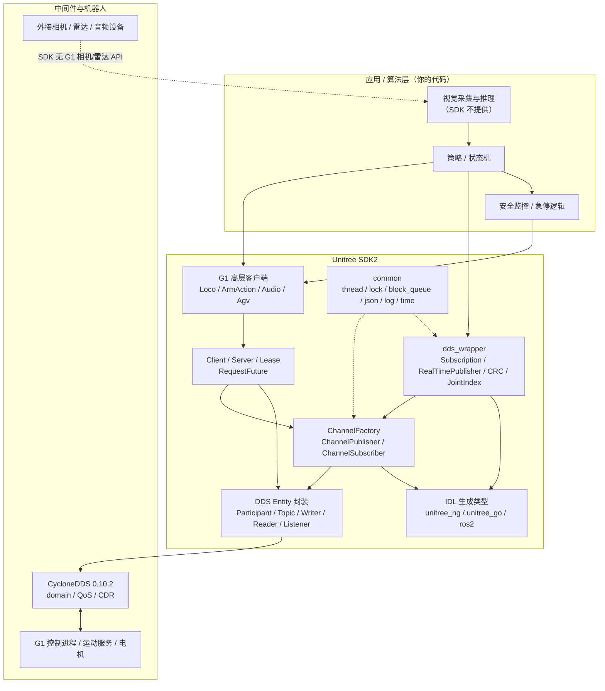
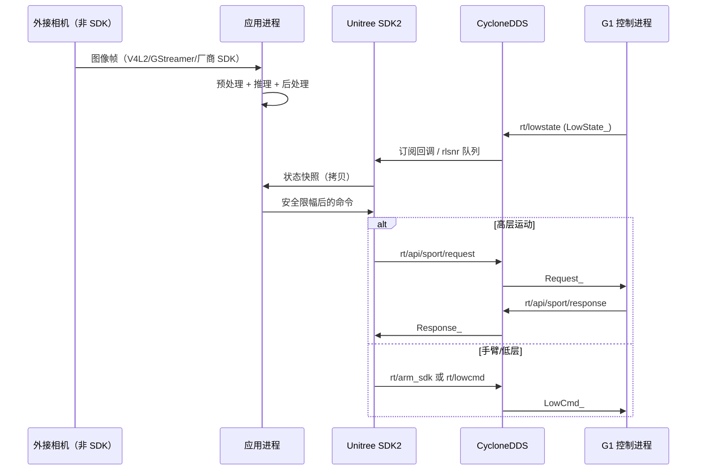

# 00 · SDK 总览与模块依赖

## 1. 身份与版本

| 项 | 值 | 证据 |
|---|---|---|
| 项目名 | `unitree_sdk2` | `CMakeLists.txt:2` |
| CMake 版本 | `2.0.0` | `CMakeLists.txt:2` |
| git describe | `2.0.2-75-gd1abf00` | `git describe --tags --long` |
| HEAD | `d1abf001220d3e5f59e00a0c4aaa595e00089a4a` | `git rev-parse HEAD` |
| 最近提交 | 2026-10-15 `add as2 example` | `git log -1` |
| C++ 标准 | C++17，关闭编译器扩展 | `CMakeLists.txt:8-10` |
| 交付形态 | 头文件 + 预编译静态库 `libunitree_sdk2.a`（x86_64/aarch64） | `lib/` 目录 |
| DDS | CycloneDDS / cyclonedds-cxx 0.10.2，随附动态库 | `thirdparty/include/dds/version.h:15`、`thirdparty/lib/` |
| 示例 | `BUILD_EXAMPLES` 默认 ON | `CMakeLists.txt:5` |

> 重要：仓库不包含 `libunitree_sdk2.a` 的 C++ 实现源码。所有“内部行为”结论只能来自头文件中的内联代码、生成代码或二进制可见信息；其余标为未验证。

---

## 2. 目录职责

```text
unitree_sdk2/
├── CMakeLists.txt              # 顶层构建、依赖、安装规则
├── cmake/
│   ├── unitree_sdk2Targets.cmake
│   └── unitree_sdk2Config.cmake.in
├── include/unitree/
│   ├── common/                 # 基础库：DDS 封装、线程、锁、队列、JSON、日志
│   ├── idl/
│   │   ├── hg/                 # G1/H1/H2 等 humanoid 的 IDL 生成类型
│   │   ├── hg_doubleimu/       # 双 IMU 变体
│   │   ├── go2/                # GO2/B2 等四足/手部相关类型
│   │   └── ros2/               # ROS 2 风格标准消息的 DDS 生成类型（非 ROS 2 包）
│   ├── dds_wrapper/            # 便捷封装：Subscription/Publisher/CRC/手柄/G1 定义
│   └── robot/
│       ├── channel/            # ChannelFactory/Publisher/Subscriber/Namer
│       ├── client/             # RPC 客户端、LeaseClient
│       ├── server/             # RPC 服务端、LeaseServer、ServerStub
│       ├── future/             # RequestFuture / RequestFutureQueue
│       ├── internal/           # Request/Response IDL、错误码、内部 API
│       ├── g1/                 # G1 高层 API：loco/arm/audio/agv/terminations
│       ├── go2/ b2/ ...        # 其他机型 API（视频、运动切换、状态等）
│       └── ...
├── lib/{x86_64,aarch64}/libunitree_sdk2.a
├── thirdparty/                 # CycloneDDS 头文件与 so
├── example/                    # 各机型示例（g1/ 为重点）
├── licenses/                   # 第三方许可
└── README.md                   # 构建说明（注意其引用的 cmake_sample 不存在）
```

### 2.1 与 G1-EDU 直接相关的目录

| 路径 | 作用 | 备注 |
|---|---|---|
| `include/unitree/robot/g1/loco/` | 高层移动/FSM/站立高度/速度 RPC | 服务名 `sport` |
| `include/unitree/robot/g1/arm/` | 预置手臂动作 RPC | 服务名 `arm` |
| `include/unitree/robot/g1/audio/` | TTS、PCM 播放、音量、LED | 服务名 `voice` |
| `include/unitree/robot/g1/agv/` | G1D 底盘移动/升降 | 服务名 `agv` |
| `include/unitree/robot/g1/common/terminations.hpp` | 姿态/速度/温度/连接安全判据 | 只读工具函数 |
| `include/unitree/dds_wrapper/robots/g1/` | G1 关节索引、发布/订阅封装、CRC、手柄 | 非 RPC 路径 |
| `include/unitree/idl/hg/` | G1 低层消息、IMU、手部、BMS | `LowState_`/`LowCmd_` 等 |
| `example/g1/` | G1 示例 | 高风险运动示例集中地 |

---

## 3. 分层架构



### 3.1 三条主要数据路径

| 路径 | 方向 | 机制 | 典型话题/服务 | 用途 |
|---|---|---|---|---|
| 高频状态 | 机器人 → 应用 | DDS 订阅 | `rt/lowstate`、`rt/secondary_imu`、`rt/sportmodestate`【推断】 | 状态估计、安全检查、控制反馈 |
| 高频命令 | 应用 → 机器人 | DDS 发布 | `rt/lowcmd`、`rt/arm_sdk`、`rt/user_lowcmd`、`rt/hand_sdk` | 低层关节/手臂/手部控制 |
| 高层 RPC | 应用 ↔ 机器人 | Request/Response over DDS | `rt/api/sport/request`、`rt/api/arm/request`、`rt/api/voice/request` | 运动模式、预置动作、语音/LED、底盘 |

---

## 4. 模块依赖与证据入口

| 模块 | 关键类型/函数 | 源码入口 | 依赖 |
|---|---|---|---|
| 通道工厂 | `ChannelFactory::Instance/Init/Release` | `include/unitree/robot/channel/channel_factory.hpp:19-56` | `DdsFactoryModel` |
| 发布者 | `ChannelPublisher<MSG>::InitChannel/Write` | `channel_publisher.hpp:18-31` | ChannelFactory |
| 订阅者 | `ChannelSubscriber<MSG>::InitChannel/GetLastDataAvailableTime` | `channel_subscriber.hpp:22-55` | ChannelFactory、`DdsReaderListener` |
| DDS 实体 | `DdsWriter::Write`、`DdsReaderListener` | `common/dds/dds_entity.hpp:172-350` | CycloneDDS |
| 主题通道 | `DdsTopicChannel::SetWriter/SetReader` | `common/dds/dds_topic_channel.hpp:37-77` | DDS Entity |
| RPC 客户端 | `ClientBase::Call`、`Client::RegistApi` | `client/client_base.hpp:32-40`、`client/client.hpp:38-46` | Channel、RequestFuture |
| RPC 服务端 | `ServerBase::Start`、`Server::RegistHandler` | `server/server_base.hpp:17-23`、`server/server.hpp:47-48` | ServerStub、LeaseServer |
| 租约 | `LeaseClient`、`LeaseServer` | `client/lease_client.hpp:32-58`、`server/lease_server.hpp:30-53` | RPC |
| G1 高层 | `LocoClient`、`G1ArmActionClient`、`AudioClient`、`AgvClient` | `robot/g1/**` | Client |
| 消息 | `LowState_`、`LowCmd_`、`IMUState_`、`SportModeState_` | `idl/hg/*.hpp` | CycloneDDS IDL |
| 包装 | `SubscriptionBase`、`RealTimePublisher` | `dds_wrapper/common/*.h` | Channel、CRC |
| 安全判据 | `bad_orientation`、`lost_connection` 等 | `robot/g1/common/terminations.hpp:18-86` | LowState、Eigen |
| 构建 | imported target `unitree_sdk2` | `CMakeLists.txt:51-56`、`cmake/unitree_sdk2Targets.cmake` | ddsc、ddscxx、Threads |

---

## 5. 支持的机型与代码分布

| 机型 | API 目录 | IDL | 示例 | 说明 |
|---|---|---|---|---|
| G1 / G1D | `robot/g1/` | `idl/hg/` | `example/g1/` | 本文重点；G1D 有 `rt/hispeed_state`、`rt/waistpitch*`、AGV 底盘 |
| H1 / H2 | `robot/h1/`、`robot/h2/` | `idl/hg/` | `example/h1/`、`h2/` | 人形，接口相似但不要混用 |
| GO2 / GO2W | `robot/go2/` | `idl/go2/` | `example/go2/`、`go2w/` | 有视频客户端、丰富 `SportModeState_` |
| B2 / B2W | `robot/b2/` | `idl/go2/` | `example/b2/`、`b2w/` | 前/后视频、运动切换、机器人状态 |
| A2 / AS2 / R1 | `robot/a2/`、`as2/`、`r1/` | 混合 | 对应目录 | 本次未深入分析 |

> **不要跨机型复用消息。** 同名话题可能对应不同 IDL 类型，详见 [03_message_types.md](03_message_types.md) 与 [09_ros2_integration.md](09_ros2_integration.md)。

---

## 6. G1 能力边界速查

| 能力 | SDK 原生 | 入口 | 证据/备注 |
|---|---|---|---|
| 读取关节/IMU/手柄 | 是 | `rt/lowstate` → `LowState_` | 示例 `g1_ankle_swing_example.cpp:197-198` |
| 读取躯干副 IMU | 是 | `rt/secondary_imu` → `IMUState_` | 示例 `g1_ankle_swing_example.cpp:19,200` |
| 读取 FSM 状态 | 是 | `LocoClient::GetFsmId`（已确认）；`rt/sportmodestate` 见注释但发布未验证 | RPC `g1_loco_client.hpp:40`；注释 `g1_arm_action_error.hpp:13` |
| 高层移动/站立/FSM | 是 | `LocoClient`（`sport` 服务） | `g1_loco_api.hpp:11-33` |
| 预置手臂动作 | 是 | `G1ArmActionClient`（`arm` 服务） | `g1_arm_action_api.hpp:10-19` |
| 手臂关节连续控制 | 是（DDS） | `rt/arm_sdk` + `LowCmd_` | 示例 `g1_arm7_sdk_dds_example.cpp:11` |
| 全身低层关节控制 | 是（DDS，高风险） | `rt/lowcmd` + `LowCmd_` | 示例 `g1_ankle_swing_example.cpp:18` |
| 用户全身控制模式 | 是（DDS，高风险） | `rt/user_lowcmd` + `SwitchToUserCtrl` | 示例 `g1_userctrl_dds_example.cpp:13,138` |
| 手部力矩控制 | 是（DDS） | `rt/hand_sdk` + `unitree_go::MotorCmds_` | 示例 `g1_hand_sdk_example.cpp:27` |
| Dex3 灵巧手 | 是（DDS） | `rt/dex3/{left,right}/cmd` + `HandCmd_` | 示例 `g1_dex3_example.cpp:32-36,269` |
| 语音 TTS / PCM 播放 / LED | 是（RPC） | `AudioClient`（`voice` 服务） | `g1_audio_api.hpp:10-21` |
| 麦克风 PCM 采集 | **否** | 示例用 UDP 组播 `239.168.123.161:5555` | `g1_audio_client_example.cpp:12-19,48-70` |
| 相机图像 | **否（G1）** | 仅 GO2/B2 有视频客户端 | `go2/video/video_client.hpp:15-27`、`b2/front_video/front_video_client.hpp:15-29` |
| 激光雷达/点云 | **否** | 无对应客户端/话题封装 | 全仓库未发现 G1 雷达 API |
| 里程计/机身速度 | **否（G1 的 SportModeState 无此字段）** | 需外部估计 | `idl/hg/SportModeState_.hpp:23-26` |
| ROS 2 原生节点 | **否** | 无 `package.xml` | 需自建桥接 |

---

## 7. G1 数据流（视觉部署视角）



**关键事实**：相机帧与机器人状态来自两个完全不同的时钟/链路；SDK 不提供统一的时间戳或同步机制。部署层必须自己定义“用哪一帧图像配哪一时刻的状态”，详见 [10_model_deployment_integration.md](10_model_deployment_integration.md)。

---

## 8. 未分析/未验证的范围

| 范围 | 原因 |
|---|---|
| `libunitree_sdk2.a` 内部实现 | 只有二进制；无源码、无调试符号保证 |
| 默认 QoS（reliability/history/durability） | 在预编译库中设置；头文件只暴露 QoS 参数结构 |
| `ChannelFactory::Release()` 具体行为 | 声明可见，实现不可见 |
| `ClientBase::Call` 内部匹配/超时/重试 | 实现不可见；只能从错误码与示例推断 |
| `RecurrentThread` 析构是否 join | 声明可见，析构实现不可见 |
| G1 相机/雷达/里程计 | SDK 未提供，无法从本仓库验证替代路径 |
| ROS 2 实际互通 | 无 ROS 2 环境、无 `package.xml`、未运行 |
| 实机时序/频率/延迟 | 未连接机器人 |
| H1/H2/GO2/B2/A2/AS2/R1 细节 | 超出本次 G1-EDU 重点，仅做边界说明 |
| 厂商固件版本差异 | 仓库不包含机器人固件信息 |

---

## 9. 一句话总结

**这个 SDK 是“G1 的 DDS 通信与关节/高层接口库”，不是“视觉 SDK”，也不是“ROS 2 包”。** 视觉部署的第一项工程决策不是选模型，而是确定相机从哪来、时间戳怎么打、状态与控制如何解耦——这三件事 SDK 都不替你完成。
