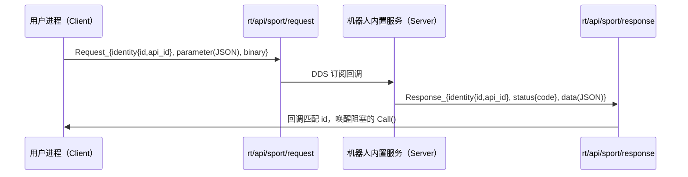

# 02 · DDS RPC：Client / Server / Lease

> 适用对象：G1-EDU 上位机开发者；需要在 C++ 中调用机器人内置服务（高等级运动、手臂动作、语音等），或需要理解 `LocoClient::Move()` 为什么“发出去就返回”。
>
> 证据标记见 [README.md](README.md)。本文结论来自头文件与示例；文档示例已编译通过，但**未连接机器人、未抓包、未运行**。

---

## 1. 模块定位

Unitree SDK2 有两条并行的数据通路：

| 通路 | 传输 | 典型用途 | 是否有请求-响应语义 |
|---|---|---|---|
| Topic 发布/订阅 | DDS Topic（`rt/...`） | 低层关节命令、机器人状态、手柄、传感器 | 否，单向 |
| RPC | 一对 DDS Topic（`rt/api/<service>/request` 与 `/response`） | 高层运动、手臂动作、语音、motion switcher | 是，带请求 ID、超时、可选租约 |

RPC 不是 HTTP/gRPC，而是**在 DDS 之上模拟请求-响应**：



关键点：

- 客户端只**认识 API ID 和 JSON 字符串**，不共享 C++ 服务对象。
- 每个客户端在 `Init()` 中把允许调用的 API ID 注册到本地表；未注册的 ID 会在本地被拒绝（`3103`）。
- 默认超时 1 s；G1 的 loco 示例主动改成 10 s（`example/g1/high_level/g1_loco_client_example.cpp:54`）。
- 请求和响应都带 `identity.id`，用于把响应匹配回具体的阻塞调用。
- **G1 的公开客户端全部关闭了 lease**（构造函数第二参 `false`），因此不要假设高层服务需要租约。

---

## 2. 源码位置

| 文件 | 作用 | 关键符号 |
|---|---|---|
| `unitree_sdk2/include/unitree/robot/channel/channel_namer.hpp` | RPC Topic 命名规则 | `ROBOT_SDK_CHANNEL_PREFIX`、`..._SUFFIX_CLIENT/SERVER` |
| `unitree_sdk2/include/unitree/robot/channel/channel_labor.hpp` | 组合一对收发通道 | `ChannelLabor::InitChannel`、`Send` |
| `unitree_sdk2/include/unitree/robot/client/client_base.hpp` | 超时、底层 `Call` 重载 | `ROBOT_CLIENT_TIMEOUT`、`SetTimeout` |
| `unitree_sdk2/include/unitree/robot/client/client.hpp` | 客户端主类、API 注册、lease 接入 | `Client`、`RegistApi`、`CheckApi` |
| `unitree_sdk2/include/unitree/robot/client/client_stub.hpp` | 发送请求、响应 Future 队列 | `ClientStub::Send`、`SendRequest` |
| `unitree_sdk2/include/unitree/robot/client/lease_client.hpp` | 租约申请/续约线程 | `LeaseClient`、`WaitApplied` |
| `unitree_sdk2/include/unitree/robot/server/server.hpp` | 服务端注册处理器 | `Server`、`RegistHandler`、`StartLease` |
| `unitree_sdk2/include/unitree/robot/server/server_base.hpp` | 服务端启动与响应发送 | `Start`、`SendResponse` |
| `unitree_sdk2/include/unitree/robot/server/lease_server.hpp` | 服务端租约缓存与校验 | `LeaseServer`、`CheckRequestLeaseDenied` |
| `unitree_sdk2/include/unitree/robot/internal/internal_idl_decl/` | 生成的消息类型 | `Request_`、`Response_`、`RequestHeader_` 等 |
| `unitree_sdk2/include/unitree/robot/internal/internal_error.hpp` | RPC 错误码 | `3102`–`3107`、`3201`–`3207` |
| `unitree_sdk2/include/unitree/common/block_queue.hpp` | 响应队列/服务端队列 | `BlockQueue::Put/Get` |

精确行号：

- Topic 前缀 `rt/api/`：`channel_namer.hpp:10`；客户端后缀 `/request`、`/response`：`channel_namer.hpp:11-12`。
- 默认超时常量：`client_base.hpp:14`（注释写 1 s，数值 1000000，单位为 µs）。
- `ClientBase::SetTimeout`：`client_base.hpp:28-29`；底层 `Call` 重载：`client_base.hpp:32-40`。
- `Client` 的 `Call` 包装：`client.hpp:38-44`；`RegistApi`：`client.hpp:46`；`CheckApi`：`client.hpp:47`。
- `LeaseClient` 类：`lease_client.hpp:32-58`；`WaitApplied/GetId/Applied`：`lease_client.hpp:40-42`。
- `Server::StartLease`：`server.hpp:34-35`；`RegistHandler`：`server.hpp:47`。
- `ServerBase::Start`：`server_base.hpp:17`；`SendResponse`：`server_base.hpp:23`。
- `Request_` 字段访问器：`Request_.hpp:42-53`；`Response_`：`Response_.hpp:42-53`。
- `RequestIdentity_::id()`：`RequestIdentity_.hpp:35-36`；`api_id()`：`RequestIdentity_.hpp:38-39`（注意 `api_id` 是 **int64**）。
- `RequestPolicy_::priority()`：`RequestPolicy_.hpp:35-36`；`noreply()`：`RequestPolicy_.hpp:38-39`。
- `ResponseStatus_::code()`：`ResponseStatus_.hpp:32-33`。

---

## 3. 命名与消息结构

### 3.1 Topic 命名

```text
客户端发送：rt/api/<service_name>/request
客户端接收：rt/api/<service_name>/response
服务器发送：rt/api/<service_name>/response
服务器接收：rt/api/<service_name>/request
```

【源码】`channel_namer.hpp:10-12` 只给出前缀与两个后缀；`ClientChannelNamer`/`ServerChannelNamer` 的具体拼接实现位于预编译库，未看到源码。由 `ChannelLabor::InitChannel` 的调用方式可确认客户端与服务端使用**相反**的收发 Topic（`channel_labor.hpp` 中 `GetSendChannelName`/`GetRecvChannelName`），【推断】拼接结果为上述形式。

已确认的实际服务名（全部来自头文件常量）：

| 服务名 | 常量位置 | API 版本 | 对应 G1 客户端 |
|---|---|---|---|
| `sport` | `g1/loco/g1_loco_api.hpp:11` | `1.0.0.0` (`:14`) | `LocoClient` |
| `arm` | `g1/arm/g1_arm_action_api.hpp:10` | `1.0.0.14` (`:13`) | `G1ArmActionClient` |
| `voice` | `g1/audio/g1_audio_api.hpp:11` | `1.0.0.0` (`:14`) | `AudioClient` |
| `agv` | `g1/agv/g1_agv_api.hpp:15` | `1.0.0.1` (`:18`) | `AgvClient` |
| `motion_switcher` | `b2/motion_switcher/motion_switcher_api.hpp:15` | `1.0.0.1` (`:20`) | `MotionSwitcherClient`（位于 `b2`，G1 示例会用到） |
| `videohub` | `go2/video/video_api.hpp:13` | `1.0.0.0` (`:16`) | `VideoClient`（GO2 示例；G1 是否有该服务未验证） |

> 同一个服务名 `sport` 在 G1/H1/H2/R1/B2/GO2 下由不同头文件定义，**API ID 与版本并不通用**。不要跨机型复制客户端。

### 3.2 Request / Response

```text
Request_
├── header_
│   ├── identity_ : RequestIdentity_ { int64 id; int64 api_id; }
│   ├── lease_    : RequestLease_    { int64 id; }
│   └── policy_   : RequestPolicy_   { int32 priority; bool noreply; }
├── parameter_ : string   // 通常为 JSON；许多 API 允许空串
└── binary_    : vector<uint8_t>

Response_
├── header_
│   ├── identity_ : RequestIdentity_ { id, api_id }  // 回显请求
│   └── status_   : ResponseStatus_  { int32 code; }
├── data_   : string            // 通常为 JSON
└── binary_ : vector<uint8_t>
```

【源码】字段与访问器见 `Request_.hpp:24-53`、`Response_.hpp:24-53`、`RequestHeader_.hpp:25-54`、`ResponseHeader_.hpp:23-45`；`RequestLease_::id()` 为 int64（`RequestLease_.hpp:32`）。`noreply=true` 时服务端是否真的不回复、客户端是否立即返回，**仅确认字段存在，尚未验证实现**。

### 3.3 一次调用的完整语义

1. 用户调用 `LocoClient::GetFsmId(fsm_id)` 等封装方法。
2. 封装方法构造 JSON（可为空），调用 `Client::Call(apiId, parameter, data)`。
3. `CheckApi` 在本地查表：该 API 是否在 `Init()` 中注册、租约是否有效。
4. 构造 `Request_`，写入自增的 `identity.id` 与 `api_id`，通过 `rt/api/<service>/request` 发布。
5. 服务端回调处理，向 `/response` 发布 `Response_`，回显同一 `identity`。
6. 客户端接收回调按 `id` 找到等待中的 Future，唤醒 `Call`。
7. `Call` 返回 `status.code`（0 为成功）；封装方法在成功时解析 `data`。

【源码】步骤 2–4 由 `client.hpp`/`client_base.hpp` 的声明确认；步骤 5–6 的 Future 机制由 `client_stub.hpp` 的 `RequestFuturePtr` 与 `future/request_future.hpp` 确认；步骤 7 由各客户端实现（如 `g1_loco_client.hpp:40-52`）确认。内部排队与匹配实现位于预编译库，未逐行验证。

---

## 4. 核心 API 表

### 4.1 `ClientBase`

| 项目 | 内容 |
|---|---|
| 名称 | `unitree::robot::ClientBase` |
| 声明位置 | `include/unitree/robot/client/client_base.hpp:20-47` |
| 作用 | 所有 RPC 客户端的基类：超时配置、同步 `Call` |
| 构造 | `explicit ClientBase(const std::string& name)`，`name` 为服务名 |
| 生命周期 | 由派生客户端持有；构造不建立通道，`Init()` 才建立 |
| 线程安全 | 【未验证】未见锁；建议同一客户端实例不要被多线程同时 `Call` |

| 方法 | 声明 | 参数 | 返回 | 副作用 | 说明 |
|---|---|---|---|---|---|
| `SetTimeout(int64_t)` | `client_base.hpp:28` | 超时，单位 µs | void | 修改成员 | 影响后续同步调用；对负值不写入（反汇编确认） |
| `SetTimeout(float)` | `client_base.hpp:29` | 超时，单位 s | void | 修改成员 | 反汇编显示内部乘 1,000,000 后转 int64；示例 `10.f` 即 10 s |
| `Call(apiId, parameter, data, priority, leaseId)` | `client_base.hpp:32` | API ID、JSON 入参、输出 JSON、优先级、lease ID | `int32_t` 状态码 | 发 DDS 请求，阻塞等待 | 受保护；`Client` 提供省略后两参的包装 |
| `Call(apiId, parameter, priority, leaseId)` | `client_base.hpp:33` | 无输出 | `int32_t` | 同上 | 适用于无返回数据的 API |
| 二进制入参重载 | `client_base.hpp:35-36` | `vector<uint8_t>` 入参/出参 | `int32_t` | 同上 | 用于大块二进制数据 |
| 字符串参数 + 二进制载荷 | `client_base.hpp:38` | `parameter` + `binary` | `int32_t` | 同上 | `Client` 在 `client.hpp:44` 提供三参包装 |
| 显式超时重载 | `client_base.hpp:40` | 额外 `timeout`（µs） | `int32_t` | 同上 | 单次覆盖默认超时 |

`Client` 把上述底层重载包装成更简洁的 `Call(apiId, parameter, data)` 等 5 个重载（`client.hpp:38-44`），派生客户端实际调用的是这一层。G1 的 `AudioClient::PlayStream` 使用 `Call(apiId, parameter, pcm_data)`（`g1_audio_client.hpp:77`），即字符串 JSON + 二进制载荷的重载，**不是**“G1 高层未使用二进制通路”。

### 4.2 `Client`

| 项目 | 内容 |
|---|---|
| 名称 | `unitree::robot::Client` |
| 声明位置 | `client.hpp:21-56` |
| 构造 | `Client(const std::string& name, bool enableLease = false)` |
| 作用 | 增加 API 注册表、版本、可选 lease |
| 典型派生 | `g1::LocoClient`、`g1::G1ArmActionClient`、`g1::AudioClient`、`g1::AgvClient`、`b2::MotionSwitcherClient` |

| 方法 | 声明 | 作用 | 备注 |
|---|---|---|---|
| `SetApiVersion` | `client.hpp:34` | 记录本客户端期望的 API 版本 | 由派生类 `Init()` 调用 |
| `GetApiVersion` | `client.hpp:30` | 返回本地版本字符串 | 纯本地 |
| `GetServerApiVersion` | `client.hpp:31` | 查询服务端版本 | 【未验证】内部交互方式与失败行为 |
| `RegistApi(apiId, priority=0)` | `client.hpp:46` | 把 API ID 加入本地白名单 | 必须在使用前调用 |
| `CheckApi` | `client.hpp:47` | 检查注册与 lease | 【推断】未注册返回 `3103`（错误码常量见 `internal_error.hpp`，未见实现） |
| `WaitLeaseApplied` | `client.hpp:27` | 阻塞直到 lease 生效 | 仅在 `enableLease=true` 时有意义 |
| `GetLeaseId` | `client.hpp:28` | 当前 lease ID | 无 lease 时行为未验证 |
| `Noop` | `client.hpp:36` | 空调用/探活 | 【推断】用于连接或版本握手 |

宏 `UT_ROBOT_CLIENT_REG_API_NO_PROI(apiId)` 展开为 `RegistApi(apiId, 0)`（`client.hpp:8-9`）。G1 客户端全部使用该宏，即 priority 恒为 0。

### 4.3 `LeaseClient`

| 项目 | 内容 |
|---|---|
| 声明位置 | `lease_client.hpp:32-58` |
| 作用 | 向服务端申请带期限的控制权租约，并由后台线程续约 |
| 构造 | `LeaseClient(const std::string& name)` |
| 关键方法 | `Init`、`WaitApplied`、`GetId`、`Applied`（`:40-42`） |
| 线程 | 内部 `common::ThreadPtr` + `Mutex`；`Apply/Renewal/ThreadFunction` 均为私有 |
| 使用条件 | `Client(name, true)` 才会创建 `LeaseClient` |

【源码】成员与线程声明见 `lease_client.hpp:32-58`；续约周期、失败重试、退出条件在预编译库中，**尚未验证**。

### 4.4 `Server` / `ServerBase` / `LeaseServer`

| 类 | 声明位置 | 作用 | 关键接口 |
|---|---|---|---|
| `ServerBase` | `server_base.hpp:10-28` | 服务端抽象：启动、发送响应 | `Start(bool enableProiQueue=false)` `:17`；`SendResponse` `:23` |
| `Server` | `server.hpp:26-70` | 注册 API 处理器、版本、lease | `StartLease` `:34-35`；`RegistHandler` `:47`；`RegistBinaryHandler` `:48` |
| `LeaseServer` | `lease_server.hpp:30-53` | 租约申请/续约/校验 | `Init` `:36`；`CheckRequestLeaseDenied` `:38` |

服务端处理函数签名：

```cpp
using RequestHandler = std::function<int32_t(
    const std::string& parameter, std::string& data)>;
using BinaryRequestHandler = std::function<int32_t(
    const std::vector<uint8_t>& parameter, std::vector<uint8_t>& data)>;
```

【源码】`server.hpp:23-24`。返回值即 `ResponseStatus_.code`；`data` 被填入响应。

`Start(bool enableProiQueue=false)` 的 `enableProiQueue` 含义（优先级队列）**仅确认参数存在，尚未验证实现**。服务端处理器在哪个线程执行、是否串行，需看库内部；【推断】由 `Start` 创建的接收线程串行调用，不能假设可重入。

> 对 G1-EDU 部署而言，通常**不需要自己实现 Server**：`sport`/`arm`/`voice` 等由机器人本体提供。自建 Server 的典型场景是上位机向其他进程暴露能力，属于 P2。

---

## 5. 超时、错误与返回值

### 5.1 超时

- 默认 `ROBOT_CLIENT_TIMEOUT = 1000000`，注释明确 1 s（`client_base.hpp:14`）。
- `SetTimeout(float)` 以秒为单位：示例 `client.SetTimeout(10.f)`（`example/g1/high_level/g1_loco_client_example.cpp:54`）；对静态库反汇编可见内部乘 1,000,000 后转 int64，可作为单位佐证。
- 【推断】超时后 `Call` 返回 `3104`（常量名为 `UT_ROBOT_ERR_CLIENT_API_TIMEOUT`），且不自动重发；`ClientStub` 的实现位于预编译库，未反汇编验证重试逻辑。
- 【未验证】超时后迟到的响应如何丢弃；由请求 ID 匹配机制推断会被忽略，但未读实现。

### 5.2 错误码

| 码 | 常量 | 含义 | 常见原因 |
|---|---|---|---|
| 0 | `UT_ROBOT_OK` | 成功 | — |
| 3001 | `UT_ROBOT_ERR_UNKNOWN` | 未知错误 | 服务端未分类异常 |
| 3102 | `..._CLIENT_SEND` | 请求发送失败 | DDS 写失败、网络未初始化 |
| 3103 | `..._CLIENT_API_NOT_REG` | API 未注册 | 忘记 `Init()` 或 ID 不在白名单 |
| 3104 | `..._CLIENT_API_TIMEOUT` | 调用超时 | 服务不存在、服务忙、网络断 |
| 3105 | `..._CLIENT_API_NOT_MATCH` | 响应不匹配 | 请求/响应 ID 或 API ID 不一致 |
| 3106 | `..._CLIENT_API_DATA` | 响应数据错误 | JSON 解析失败、字段缺失 |
| 3107 | `..._CLIENT_LEASE_INVALID` | 租约无效 | lease 过期，需重新申请 |
| 3201 | `..._SERVER_SEND` | 响应发送失败 | 服务端 DDS 写失败 |
| 3202 | `..._SERVER_INTERNAL` | 服务端内部错误 | 处理器异常 |
| 3203 | `..._SERVER_API_NOT_IMPL` | API 未实现 | 版本不匹配/机型不支持 |
| 3204 | `..._SERVER_API_PARAMETER` | 参数错误 | JSON 字段或取值非法 |
| 3205 | `..._SERVER_LEASE_DENIED` | 租约被拒 | 其他客户端持有控制权 |
| 3206/3207 | `LEASE_NOT_EXIST/EXIST` | 租约不存在/已存在 | 重复申请或已过期 |

【源码】`internal_error.hpp:11-28`。表中“含义”来自常量名与错误字符串；“常见原因”除超时/未注册外多为【推断】，服务端具体在何种条件返回 3202/3203/3204、3105/3106 的具体触发条件均需服务实现或反汇编，**未验证**。

### 5.3 `Call` 返回值的工程含义

- `ret != 0` 时，输出参数（如 `fsm_id`）**不应被使用**。G1 客户端只在 `ret == 0` 时解析 JSON（如 `g1_loco_client.hpp:43-48`）。
- 【未验证】`Call` 返回 0 仅代表 RPC 层成功，不代表动作已完成。`SetFsmId(500)` 返回 0 只说明服务接受了请求。

---

## 6. 线程、回调与阻塞

| 关注点 | 结论 | 证据 |
|---|---|---|
| `Call` 是否阻塞 | 是，直到响应或超时 | `ClientStub::Send` 带 `waitTimeout`，`RequestFuture` |
| 响应回调线程 | DDS 接收线程 | `ChannelSubscriber` 回调模型，见 [01](01_channel_communication.md) |
| 能否在回调里 `Call` | 【未验证】高风险 | 若回调运行在单线程 listener 上，可能阻塞后续消息 |
| 同一客户端并发 `Call` | 【未验证】不建议 | 客户端内部 map/超时成员未见锁 |
| 多客户端实例 | 可各自 `Init()`，但会增加通道与线程 | 每个 `ChannelSubscriber` 独立 |
| 服务端处理器并发 | 【未验证】 | `Start(enableProiQueue)` 语义未读实现 |

工程建议（【推断】，非 SDK 合同）：

1. 控制线程与视觉/推理线程分离；RPC 调用放在专门的控制线程。
2. 绝不在 DDS 订阅回调中做耗时推理或同步 `Call`。
3. 为 `Call` 设置明确超时；超时后按“控制权可能已丢失”处理，而不是盲目重试运动指令。
4. `Init()` 只调用一次；重复 `Init()` 会重复注册/重建通道，行为未验证。

---

## 7. 最小只读示例

以下示例只读取 FSM 状态，不发送运动指令。【已验证：编译通过】未运行；接口来自 `g1_loco_client.hpp:40-52` 与 `g1_loco_client_example.cpp`。

```cpp
// read_fsm_state.cpp — 只读示例，已编译通过、未运行
#include <iostream>
#include <unitree/robot/channel/channel_factory.hpp>
#include <unitree/robot/g1/loco/g1_loco_client.hpp>

int main(int argc, char** argv)
{
    const std::string iface = (argc > 1) ? argv[1] : "lo";

    // 必须最先初始化；domainId 与机器人配置一致
    unitree::robot::ChannelFactory::Instance()->Init(0, iface);

    unitree::robot::g1::LocoClient client;
    client.Init();
    client.SetTimeout(2.f);   // 秒；服务不在线时尽快失败

    int fsm_id = -1;
    int32_t ret = client.GetFsmId(fsm_id);
    if (ret != 0) {
        std::cerr << "GetFsmId failed, code=" << ret << std::endl;
        return 1;
    }

    int fsm_mode = -1;
    int32_t ret2 = client.GetFsmMode(fsm_mode);
    std::cout << "fsm_id=" << fsm_id
              << " fsm_mode=" << (ret2 == 0 ? std::to_string(fsm_mode) : "N/A")
              << std::endl;

    unitree::robot::ChannelFactory::Instance()->Release();
    return 0;
}
```

编译见 [11_build_and_link.md](11_build_and_link.md)。运行前确认：

- `networkInterface` 是**能看到机器人 DDS 流量**的网卡；示例默认 `lo` 只适用于本机回环测试。
- domain ID 与机器人一致（默认 0，以现场配置为准）。
- 不要同时运行会抢占控制权的官方 App/手柄逻辑。

---

## 8. 常见问题

| 现象 | 可能原因 | 排查 |
|---|---|---|
| 所有调用返回 `3104` | 服务名不存在、网卡错误、domain 不匹配 | 先用 `tcpdump`/`ros2 topic list`（若已桥接）确认 `rt/api/sport/request` 有流量 |
| 返回 `3103` | 未 `Init()` 或 API ID 未注册 | 检查派生类 `Init()` 是否被调用 |
| 返回 `3105` | 多线程共用客户端导致响应错配 | 串行化调用或每线程独立客户端（未验证） |
| 返回 `3203` | 机器人固件不支持该 API/版本 | 对比头文件版本与服务端版本 |
| `SetFsmId` 成功但机器人不动 | 控制权在 App/手柄；FSM 条件不满足 | 先只读 `GetFsmId/GetFsmMode`，再查 [05](05_g1_high_level_control.md) |
| 调用耗时远超预期 | 默认 1 s 超时 + 服务忙 | 显式 `SetTimeout`，并避免在高频循环中同步调用 |
| 程序退出卡住 | 后台线程/通道未释放 | 调用 `ChannelFactory::Release()`；避免在回调中退出 |

---

## 9. G1-EDU 部署能力划分

| 能力 | 归属 | 说明 |
|---|---|---|
| 调用 `sport` 服务读 FSM、设速度 | SDK 原生 | `LocoClient` 已封装；但“是否允许运动”由现场状态决定 |
| 调用 `arm` 服务执行预设动作 | SDK 原生 | `G1ArmActionClient`；部分动作有跌倒风险 |
| 调用 `voice` 服务播报 | SDK 原生 | `AudioClient`；音频流播放存在已知参数问题，见 [05](05_g1_high_level_control.md) |
| 自定义 RPC 服务 | 开发者适配 | 可用 `Server` 暴露推理结果；非部署必需 |
| 用 RPC 传图像/大块数据 | 不推荐 | 高层视频服务只在 GO2/B2 提供，SDK 内仅 GO2 有示例；G1 需外接相机，见 [07](07_sensors_and_camera.md) |
| 服务端内部实现、优先级队列 | 未知 | 预编译库，无源码 |

---

## 10. 相关文档

- 通道与回调模型：[01_channel_communication.md](01_channel_communication.md)
- 消息字段：[03_message_types.md](03_message_types.md)
- G1 高层 API ID 与语义：[05_g1_high_level_control.md](05_g1_high_level_control.md)
- 构建与链接：[11_build_and_link.md](11_build_and_link.md)
- 网络与 DDS 配置：[12_network_and_deployment.md](12_network_and_deployment.md)
