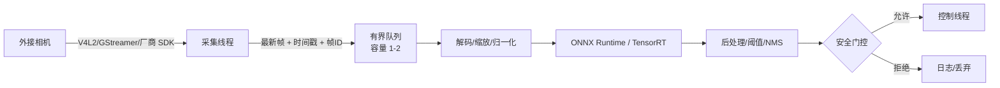

# 07 · 传感器、相机与图像通路

> 结论先行：**Unitree SDK2 没有为 G1 提供相机/图像 API**。G1 的图像必须来自外接相机或机器人未在 SDK 中暴露的通道；SDK 内的视频客户端只存在于 GO2（`videohub`）与 B2（`front_videohub` / `back_videohub`），不能假定 G1 可用。
>
> 证据标记见 [README.md](README.md)；本文未安装任何第三方库、未接相机、未抓图。

---

## 1. 证据：为什么说 G1 没有相机 API

检索范围与结果：

| 检索 | 结果 |
|---|---|
| `include/unitree/robot/g1/**` 中 `camera/video/image` | **0 处** |
| `example/g1/**` 中 `camera/video/image` | **0 处** |
| 全 SDK 的视频客户端 | 3 个：`go2/video/video_client.hpp`（`go2::VideoClient`）、`b2/front_video/front_video_client.hpp`（`b2::FrontVideoClient`）、`b2/back_video/back_video_client.hpp`（`b2::BackVideoClient`）；**无 G1 命名空间下的视频客户端** |
| 全 SDK 的视频示例 | 仅 `example/go2/go2_video_client.cpp`；B2 视频客户端只有头文件，无示例 |
| G1 相关 IDL | `LowState_/LowCmd_/IMUState_/HandState_/HandCmd_/BmsState_/SportModeState_`，**无 Image/CameraInfo** |
| ROS 2 IDL | 无 `sensor_msgs/Image`、`CameraInfo`（见 [09](09_ros2_integration.md)） |

**结论（源码已确认）**：不能通过 SDK 的 G1 命名空间获取相机帧；也不存在 `g1::VideoClient` 这样的类。

> 机器人本体可能通过 App/WebRTC/RTSP 等方式提供图像，但这不在本 SDK 的公开头文件中。本文不猜测其地址、协议或凭据。

---

## 2. SDK 内确实可用的传感器数据

| 数据 | 来源 | 类型 | 频率 | 用途 | 证据 |
|---|---|---|---|---|---|
| 关节位置/速度/力矩/温度 | `rt/lowstate` | `LowState_` | 未承诺 | 状态监控、控制反馈 | [03](03_message_types.md) |
| 躯干 IMU | `rt/lowstate.imu_state` | `IMUState_` | 未承诺 | 姿态 | 同上 |
| 副 IMU | `rt/secondary_imu` | `IMUState_` | 未承诺 | 冗余姿态 | 常量 `g1_ankle_swing_example.cpp:19`，订阅 `:199-200` |
| 手柄原始字节 | `rt/lowstate.wireless_remote` | `uint8_t[40]` | 随状态 | 遥控 | `hg/LowState_.hpp:34`；解析 `g1_sub.h:69-72` |
| 手柄解析值 | `rt/wirelesscontroller` | `unitree_go::WirelessController_` | 未承诺 | 遥控 | 通用示例；G1 发布未验证 |
| 手部压力 | `HandState_.press_sensor_state` | 12 点 | 随手部状态 | 抓取反馈 | `hg/HandState_.hpp` |
| 麦克风 PCM | UDP 组播 `239.168.123.161:5555` | 16 kHz/16-bit/单声道 | 连续流 | 语音 | `g1_audio_client_example.cpp:12-19,48-70` |
| ASR 文本 | `rt/audio_msg` | `std_msgs::String_` | 事件 | 语音指令 | `g1_audio_client_example.cpp:20-24` |
| G1D 高度 | `rt/hispeed_state` | `Point32_.y()` | 未承诺 | 升降柱 | `g1d_height_control.cpp:18,35-40` |
| 电池 | **未确认** | `BmsState_` | — | 电量 | 类型存在，无 G1 Topic |
| 激光雷达 | **无 G1 API** | — | — | — | GO2 才有 `LidarState_` 等类型 |

### 2.1 麦克风通路的细节

【示例】`example/g1/audio/g1_audio_client_example.cpp`：

- 组播地址 `239.168.123.161`，端口 `5555`（`:13-14`）。
- 预期格式：`16000 * 2 * seconds` 字节，即 16 kHz、16-bit、单声道（`:16-18`）。
- 通过 `IP_ADD_MEMBERSHIP` 加入组播，`recvfrom` 收 160 ms 一块（`:48-70`）。
- 本机 IP 必须在 `192.168.123.*` 网段（`:35-45`），否则组播接口选择失败。
- ASR 结果从 `rt/audio_msg`（`std_msgs::String_`）返回（`:20-24`）。

这是**音频输入**，不是相机。它说明 G1 的部分传感器走“DDS 之外”的 UDP 通路，不能假设所有传感器都能用 `ChannelSubscriber` 订阅。

---

## 3. GO2 / B2 视频客户端：只作为对照，不要套到 G1

【源码】`include/unitree/robot/go2/video/video_client.hpp`：

```cpp
class VideoClient : public Client {
public:
    void Init();
    int32_t GetImageSample(std::vector<uint8_t>&);
};
```

- 服务名 `videohub`，API 版本 `1.0.0.0`，API ID `1001`（`go2/video/video_api.hpp:13-19`）。
- 返回的是 `std::vector<uint8_t>`，走 RPC 的 `binary` 字段，不是 DDS 图像 Topic。

【示例】`example/go2/go2_video_client.cpp`：

```cpp
ret = video_client.GetImageSample(image_sample);
if (ret == 0) {
    ...
    std::ofstream image_file(image_name, std::ios::binary);
    image_file.write(reinterpret_cast<const char*>(image_sample.data()), image_sample.size());
}
sleep(3);
```

- 示例把返回字节直接写成 `.jpg`，说明**很可能是 JPEG 码流**（【推断】，非文档保证）。
- 示例每 3 秒取一帧，**不保证帧率、分辨率、时间戳、色彩格式**。
- 没有解码步骤；能保存不等于能解码，解码器需自备。

其他 GO2 类型：

| 类型 | 字段 | 说明 |
|---|---|---|
| `Go2FrontVideoData_` | `time_frame` + `video720p/360p/180p` 三个 `vector<uint8_t>` | 定义存在，但 SDK 示例未使用 |
| `AudioData_` | `time_frame` + `data` | 音频帧 |
| `LidarState_` | 固件/转速/点云统计/IMU | 状态，不是点云 |
| `HeightMap_` | 分辨率/宽高/`vector<float>` | 高度图 |
| `PointCloud2_` | ROS 2 兼容点云 | 类型存在 |

**这些都不能证明 G1 有对应服务或 Topic。**

### 3.1 B2 的前/后视频客户端

【源码】除 GO2 外，B2 命名空间下还有两个结构相同的视频客户端：

| 类 | 头文件 | 服务名 | API 版本 | API ID |
|---|---|---|---|---|
| `b2::FrontVideoClient` | `b2/front_video/front_video_client.hpp:15` | `front_videohub`（`front_video_api.hpp:13`） | `1.0.0.0`（`:16`） | `1001`（`:19`） |
| `b2::BackVideoClient` | `b2/back_video/back_video_client.hpp:15` | `back_videohub`（`back_video_api.hpp:13`） | `1.0.0.0`（`:16`） | `1001`（`:19`） |

两者的公开接口与 `go2::VideoClient` 相同（`Init()` + `GetImageSample(std::vector<uint8_t>&)`），SDK 内**没有**对应示例。它们同样不能证明 G1 有视频服务：G1 的 `include/unitree/robot/g1/**` 下没有任何 video 客户端或服务常量。

---

## 4. G1 外接相机的工程契约

既然 SDK 不管相机，部署项目必须自己定义“相机 → 推理”的契约。建议先填下表，再写代码：

| 项目 | 必须明确 | 常见错误 |
|---|---|---|
| 设备 | 型号、接口（USB3/GigE/MIPI）、供电 | 到现场才发现驱动不兼容 |
| 驱动 | V4L2 / 厂商 SDK / GStreamer / RTSP | 把 OpenCV 当驱动 |
| 格式 | Bayer / YUYV / MJPG / H.264 / RGB | 假设“拿到的就是 RGB” |
| 分辨率 | 采集分辨率 vs 模型输入分辨率 | 在推理线程里做大图缩放 |
| 帧率 | 相机帧率 vs 推理帧率 | 用相机帧率倒推推理能力 |
| 时间戳 | 相机硬件时间 / 主机单调时间 | 用 `system_clock` 做延迟统计 |
| 帧 ID | 单调递增序号 | 丢帧无法检测 |
| 丢帧策略 | 丢最旧 / 阻塞 / 全保留 | 无界队列导致内存暴涨 |
| 色彩 | BGR/RGB、gamma、白平衡 | 训练/推理色彩空间不一致 |
| 曝光 | 自动/手动、上限 | 运动模糊导致模型失效 |
| 同步 | 多相机/IMU 硬件同步 | 软件时间戳漂移 |
| 生命周期 | 谁打开、谁关闭、异常重启 | 设备被多个进程占用 |

### 4.1 推荐的数据流



关键原则：

1. **采集线程只做采集**：不解码、不推理、不做 DDS 同步调用。
2. **有界队列 + 丢最旧**：推理慢时保证“总是处理最新帧”，而不是排队延迟越来越大。
3. **时间戳贯穿全链路**：采集时间 → 预处理完成 → 推理完成 → 控制下发，分别记录，才能定位延迟。
4. **推理结果与控制解耦**：推理线程产出“建议动作”，控制线程做限幅、超时、仲裁后才下发。
5. **不要在 DDS 回调中推理**：见 [08](08_concurrency_and_lifecycle.md)。

### 4.2 图像消息怎么传

SDK 没有 G1 的 `Image` 类型。可选方案：

| 方案 | 适用 | 代价 |
|---|---|---|
| 进程内共享内存/指针 | 单进程采集+推理 | 需自己管理生命周期 |
| 自定义 DDS IDL | 多进程 | 需生成类型、定义分辨率/编码/时间戳 |
| ROS 2 `sensor_msgs/Image` | 已有 ROS 2 桥 | SDK 未提供该类型；需外部 ROS 2 环境 |
| 文件/共享内存队列 | 调试、离线 | 延迟高，不适合闭环 |
| 厂商 SDK 的零拷贝 Buffer | RealSense 等 | 绑定厂商 API |

【推断】对 G1-EDU 单机部署，**单进程 + 有界队列 + 共享指针**通常比“图像走 DDS”更简单、延迟更低。是否采用多进程取决于故障隔离需求。

---

## 5. 只读外接相机示例（第三方依赖）

以下示例使用 OpenCV 的 `VideoCapture`，**OpenCV 不属于 Unitree SDK**。本机未安装 OpenCV，编译尝试因缺 `opencv2/opencv.hpp` 失败，属于环境不满足，未运行。它只演示“取帧 + 时间戳 + 有界丢帧”的骨架，不涉及机器人控制。

```cpp
// camera_probe.cpp — 第三方依赖，未验证
// 依赖：OpenCV (opencv4)。仅用于确认设备可读、格式与帧率。
#include <chrono>
#include <iostream>
#include <opencv2/opencv.hpp>

int main(int argc, char** argv)
{
    const std::string dev = (argc > 1) ? argv[1] : "/dev/video0";
    cv::VideoCapture cap(dev, cv::CAP_V4L2);
    if (!cap.isOpened()) {
        std::cerr << "cannot open " << dev << std::endl;
        return 1;
    }

    cap.set(cv::CAP_PROP_FRAME_WIDTH, 640);
    cap.set(cv::CAP_PROP_FRAME_HEIGHT, 480);
    cap.set(cv::CAP_PROP_FPS, 30);

    std::cout << "width=" << cap.get(cv::CAP_PROP_FRAME_WIDTH)
              << " height=" << cap.get(cv::CAP_PROP_FRAME_HEIGHT)
              << " fps=" << cap.get(cv::CAP_PROP_FPS) << std::endl;

    cv::Mat frame;
    for (int i = 0; i < 10; ++i) {
        if (!cap.read(frame) || frame.empty()) {
            std::cerr << "frame grab failed" << std::endl;
            break;
        }
        const auto t = std::chrono::steady_clock::now().time_since_epoch();
        const auto ms = std::chrono::duration_cast<std::chrono::milliseconds>(t).count();
        std::cout << "frame " << i << " " << frame.cols << "x" << frame.rows
                  << " ts_ms=" << ms << std::endl;
    }
    return 0;
}
```

说明：

- `CAP_V4L2` 是 Linux 后端；其他平台/相机需换后端。
- 实际分辨率/帧率可能被驱动改写，必须打印确认，不能相信请求值。
- 该示例不做解码/推理/控制，也不证明延迟满足要求。
- 若相机只输出 MJPG/H.264，OpenCV 可能内部解码；解码耗时需单独测量。

---

## 6. 图像参数对模型部署的影响

| 参数 | 风险 | 建议 |
|---|---|---|
| 分辨率 | 训练/推理分辨率不一致导致精度下降 | 在预处理中显式 resize，并记录插值方式 |
| 编码 | JPEG 解码有 CPU 开销与压缩伪影 | 闭环优先用未压缩格式；带宽受限才用 MJPG |
| 色彩 | BGR vs RGB 顺序错误 | 用已知颜色标定板验证 |
| 时间戳 | 用错时钟导致延迟统计错误 | 统一用 `steady_clock` 单调时钟 |
| 曝光 | 自动曝光在运动/光照变化时抖动 | 固定曝光或限制范围 |
| 帧率 | 实际帧率低于请求值 | 以实测为准，推理队列按最慢环节设计 |
| 丢帧 | 无检测导致“看到的不是当前” | 帧 ID + 丢帧计数 |
| 同步 | 图像与关节状态不同步 | 记录两者的采集时间，按时间对齐 |

---

## 7. 端到端延迟预算（模板）

不要相信“SDK 很快”这类结论。用下表逐段测量：

| 阶段 | 测量点 | 目标（示例，非 SDK 承诺） |
|---|---|---|
| 相机曝光 | 硬件时间戳 | 由场景决定 |
| 采集到用户态 | `capture_done` | 越小越好 |
| 解码 | `decode_done - capture_done` | 视编码而定 |
| 预处理 | `pre_done - decode_done` | 固定尺寸下测 |
| 推理 | `infer_done - pre_done` | 由模型/硬件决定 |
| 后处理 | `post_done - infer_done` | 通常较小 |
| 决策/仲裁 | `decision_done` | 固定逻辑 |
| 控制下发 | `write_done` | DDS 写延迟 |
| 机器人响应 | 状态变化 | 需实测 |

【示例】`go2_video_client.cpp` 每 3 秒取一帧，**不能**作为延迟参考。

---

## 8. 常见问题

| 现象 | 可能原因 | 处理 |
|---|---|---|
| 以为 G1 有相机 API | 把 GO2 示例套过来 | 确认命名空间；G1 无 `VideoClient` |
| `videohub` 调用超时 | G1 没有该服务 | 不要依赖；改外接相机 |
| 外接相机打不开 | 设备被占用/权限/驱动 | `v4l2-ctl --list-devices`（系统工具，非 SDK） |
| 图像颜色不对 | BGR/RGB 混淆 | 用纯色目标验证 |
| 推理延迟越来越大 | 无界队列 | 有界队列 + 丢最旧 |
| 画面与关节状态不同步 | 时间基准不同 | 统一单调时钟 + 记录采集时间 |
| 组播音频收不到 | 网段不是 `192.168.123.*` | 检查网卡与组播路由 |
| 手部压力无数据 | 手型/长度不同 | 按 `vector.size()` 处理 |

---

## 9. G1-EDU 部署能力划分

| 能力 | 归属 | 说明 |
|---|---|---|
| 读 IMU/关节/手柄 | SDK 原生 | `rt/lowstate` |
| 读麦克风/ASR | SDK 原生（示例） | UDP 组播 + `rt/audio_msg` |
| 读相机 | **非 SDK** | 外接相机 + 第三方驱动 |
| 图像解码 | 第三方 | OpenCV/FFmpeg/厂商 SDK，需自行安装与授权 |
| 图像消息定义 | 开发者适配 | SDK 无 G1 Image 类型 |
| 推理 | 第三方 | ONNX Runtime/TensorRT，见 [10](10_model_deployment_integration.md) |
| 传感器时间同步 | 开发者适配 | SDK 无统一时间戳 |

---

## 10. 相关文档

- 状态字段：[04_robot_state.md](04_robot_state.md)
- 并发与队列：[08_concurrency_and_lifecycle.md](08_concurrency_and_lifecycle.md)
- ROS 2 类型与桥接：[09_ros2_integration.md](09_ros2_integration.md)
- 模型部署整合：[10_model_deployment_integration.md](10_model_deployment_integration.md)
- 已知限制：[known_limitations.md](known_limitations.md)
