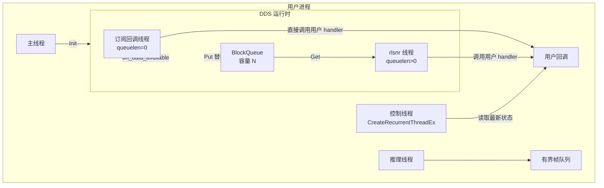

# 08 · 并发、回调与生命周期

> 目标：解释“回调在哪个线程跑、锁住了什么、什么时候会丢数据、为什么退出会卡住”，并给出可执行的关闭顺序。
>
> 本文基于头文件与示例；线程实现、析构细节位于预编译库的部分均标记为【未验证】。

---

## 1. 一张图看懂线程



两个关键事实：

1. **`queuelen == 0`（默认）**：用户回调直接在 CycloneDDS 的 listener 调度线程上执行。回调阻塞会阻塞该 reader 的后续数据处理。
2. **`queuelen > 0`**：SDK 创建独立 `rlsnr` 线程，DDS 线程只负责把消息 `new` 一份放进 `BlockQueue`，用户回调在 `rlsnr` 线程执行。

【源码】`include/unitree/common/dds/dds_entity.hpp`：

- `SetQueue(len)`：`len<=0` 直接返回，不建队列/线程（`:252-256`）。
- 队列线程名 `rlsnr`，循环 `Get` 后调用 `OnDataAvailable`（`:262-285`）。
- `on_data_available`：`reader.take()` 取样本，更新最后数据时间；有队列则 `Put(new MSG(m), true)`，无队列则直接回调（`:307-338`）。
- 队列满时 `Put(..., replace=true)` 弹出最旧元素并返回 false，SDK 打印 `earliest mesage was evicted` 警告（`:325-335`）。

---

## 2. 回调线程与锁

### 2.1 `ChannelSubscriber`

| 项目 | 结论 | 证据 |
|---|---|---|
| 回调线程（无队列） | DDS listener 线程 | `dds_entity.hpp:331-334` |
| 回调线程（有队列） | `rlsnr` 线程 | `dds_entity.hpp:288` |
| 回调参数 | `const void*`，仅在回调期间有效 | `dds_entity.hpp:333` |
| 回调异常 | 【未验证】未捕获；异常穿出可能导致线程终止 | 头文件无 try/catch |
| 队列满 | 丢最旧，保留最新 | `block_queue.hpp:24-58` |
| 队列线程退出 | `mQuit=true` + `Interrupt` + `Wait` | `dds_entity.hpp:232-240` |
| 析构阻塞 | 若回调正在执行，`Wait` 会等待其返回 | `dds_entity.hpp:236-238` |

**推论**：回调必须是短、非阻塞、不抛异常的。不要在回调里：

- 做推理、解码、写文件；
- 调用 RPC（`Call` 可能阻塞到超时）；
- 获取可能被控制线程长期持有的锁；
- 调用 `ChannelFactory::Release()` 或销毁订阅者。

### 2.2 `SubscriptionBase`（dds_wrapper）

【源码】`include/unitree/dds_wrapper/common/Subscription.h`：

- 构造时把 `last_update_time_` 初始化为“当前 − timeout”，因此**首帧前 `isTimeout()` 为 true**（`:30`）。
- 默认回调在锁内复制消息：`lock_guard` → `pre_communication()` → `msg_ = *msg` → `post_communication()`（`:35-41`）。
- `msg_` 是 **public** 成员（`:69`），外部可以直接读，但不加锁；多线程读取时必须自己加 `mutex_`。
- `wait_for_connection()` 在超时状态下每 100 ms 重试，**没有总超时**（`:53-67`）。如果没有数据，会永久阻塞；2 秒后开始打印 “Waiting for connection”。
- `timeout_ms_` 默认 1000（`:76`）。

**风险**：`wait_for_connection()` 会永远阻塞；部署程序应自己加总超时，或改用带截止时间的轮询。

### 2.3 `RealTimePublisher`

【源码】`include/unitree/dds_wrapper/common/Publisher.h:38-174`。

| 项目 | 结论 |
|---|---|
| 构造 | 立即启动 `publishingLoop` 线程（`:46-50`） |
| 发布节奏 | 非实时线程写 `msg_`，调用 `unlockAndPublish()` 后，发布线程才复制并 `Write` |
| `trylock()` | 仅当 `turn_ == REALTIME` 且拿到锁时返回 true（`:77-90`） |
| `unlockAndPublish()` | 设 `turn_=NON_REALTIME`，解锁（`:95-99`） |
| `lock()` | 自旋 + 1 ms 睡眠直到拿到锁（`:108-112`） |
| 发布循环 | 等 `NON_REALTIME` → 复制 `msg_` → 设 `REALTIME` → 解锁 → `Write(outgoing, 0)`（`:133-162`） |
| 析构 | `stop()` → 自旋等 `is_running_==false` → `join`（`:56-63`） |
| `Write` 超时 | 0，不等待 reader 匹配 |

**风险**：

- 析构可能长时间自旋：如果发布线程卡在 `lock()` 或 `pre_communication()`，`is_running_` 不会变 false。
- `pre_communication()` 在持锁期间执行；不要在其中做耗时操作。
- `Write(outgoing, 0)` 不等待匹配，**没有订阅者时消息直接丢弃**。
- 析构函数没有超时；退出路径必须保证发布线程能走到循环末尾。

---

## 3. `ChannelFactory` 生命周期

### 3.1 单例与初始化

```cpp
static ChannelFactory* Instance() {
    static ChannelFactory inst;
    return &inst;
}
```

【源码】`channel_factory.hpp:19-23`。C++11 起局部静态初始化线程安全。

| 操作 | 行为 | 风险 |
|---|---|---|
| `Init(domainId, iface)` | 创建 participant/publisher/subscriber | 重复调用行为未验证 |
| `CreateSendChannel` | 创建 topic + writer，**固定睡眠 100 ms** | 每个发布者增加 100 ms 启动时间 |
| `CreateRecvChannel` | 创建 topic + reader/listener | `queuelen` 决定线程模型 |
| `Release()` | 销毁工厂 | **必须在所有 channel 释放后调用** |

【源码】100 ms 延迟在 `dds_topic_channel.hpp:22`（`UT_DDS_WAIT_MATCHED_TIME_MICRO_SEC 100000`）与 `:45`（`SetWriter` 内 `MicroSleep`）。

### 3.2 未初始化就创建通道

`CreateSendChannel`/`CreateRecvChannel` 直接解引用 `mDdsFactoryPtr`，**没有空指针检查**（`channel_factory.hpp:32-45`）。未调用 `Init()` 就创建通道会崩溃。

### 3.3 `Release()` 的顺序

工厂不持有 channel；channel 由调用者的 `shared_ptr` 持有（`dds_factory_model.hpp:22-27`）。`Release()` 销毁 participant，而 channel 内的 reader/writer 仍引用该 participant 的实体。

**安全顺序**：

```text
1. 通知所有线程退出（原子标志）
2. 停止/join 控制线程、推理线程
3. 停止发布者（RealTimePublisher::stop / 释放 publisher）
4. CloseChannel / 释放所有 subscriber（等待 rlsnr 退出）
5. 释放所有 channel shared_ptr
6. ChannelFactory::Instance()->Release()
```

【推断】颠倒顺序可能导致回调访问已销毁的 participant 或对象；具体崩溃形态未验证。

---

## 4. 线程池/周期线程

### 4.1 `CreateRecurrentThreadEx`

```cpp
ThreadPtr CreateRecurrentThreadEx(
    const std::string& name, int32_t cpuId,
    uint64_t intervalMicrosec, func, args...);
```

【源码】`include/unitree/common/thread/recurrent_thread.hpp:74-75`；周期单位是**微秒**。示例 `2000` = 500 Hz（`g1_ankle_swing_example.cpp:202-203`）。

| 项目 | 结论 |
|---|---|
| 返回类型 | `ThreadPtr`（`shared_ptr<Thread>`） |
| CPU 绑定 | `UT_CPU_ID_NONE` 表示不绑定 |
| 周期为 0 | 走 `ThreadFunc_0` 分支（忙循环？未验证） |
| 停止 | `RecurrentThread` 有 `Wait()`，析构行为在库中【未验证】 |
| 丢弃指针 | 若析构会停止线程，则线程结束；否则泄漏。**不要依赖**，显式保留并停止 |

### 4.2 周期线程里的常见错误

| 错误 | 后果 |
|---|---|
| 周期函数执行时间 > 周期 | 实际频率下降，相位漂移 |
| 在周期函数里 `sleep` | 同上 |
| 与回调共享数据但不加锁 | 数据竞争 |
| 在周期函数里做 RPC | 抖动、超时、阻塞整个控制链 |
| 退出时只设标志不 join | 对象析构时线程仍访问成员 → use-after-free |

---

## 5. 异步语义总结

| 操作 | 是否阻塞 | 成功含义 | 数据到达通知 |
|---|---|---|---|
| `ChannelPublisher::Write(msg, 0)` | 否 | 已交给 DDS | 无 |
| `Write(msg, wait>0)` | 最多 ~1 s 等匹配 | 至少有一个 reader 或超时后仍写 | 无 |
| `ChannelSubscriber` 回调 | 由 DDS/rlsnr 线程调用 | 收到一帧 | 回调 |
| `Client::Call` | 是，默认 1 s | 收到匹配响应 | 返回值 |
| `LeaseClient::WaitApplied` | 是 | 租约生效 | 返回 |
| `RealTimePublisher::unlockAndPublish` | 否 | 标记可发布 | 发布线程异步写 |
| `wait_for_connection()`（wrapper） | **可能永久** | 收到过数据 | 返回 |

**没有“发送完成”回调，也没有“机器人已执行”确认。** 执行确认只能通过状态 Topic 观察。

---

## 6. 安全的关闭骨架

以下示例只订阅状态并打印，不发送任何控制命令。【已验证：编译通过】未运行。

```cpp
// graceful_shutdown.cpp — 只读
#include <atomic>
#include <chrono>
#include <csignal>
#include <iostream>
#include <memory>
#include <thread>

#include <unitree/robot/channel/channel_factory.hpp>
#include <unitree/robot/channel/channel_subscriber.hpp>
#include <unitree/idl/hg/LowState_.hpp>

using LowState = unitree_hg::msg::dds_::LowState_;
static std::atomic<bool> g_run{true};

static void OnSigint(int) { g_run = false; }

int main(int argc, char** argv)
{
    const std::string iface = (argc > 1) ? argv[1] : "lo";
    std::signal(SIGINT, OnSigint);

    unitree::robot::ChannelFactory::Instance()->Init(0, iface);

    auto sub = std::make_shared<
        unitree::robot::ChannelSubscriber<LowState>>("rt/lowstate");

    std::atomic<uint64_t> count{0};
    sub->InitChannel([&](const void*) {
        count.fetch_add(1, std::memory_order_relaxed);
    }, 1);

    while (g_run) {
        std::this_thread::sleep_for(std::chrono::milliseconds(100));
        std::cout << "frames=" << count.load() << std::endl;
    }

    // 1) 先停止业务线程（本示例无）
    // 2) 再关闭订阅，等待 rlsnr 退出
    sub->CloseChannel();
    sub.reset();

    // 3) 最后释放工厂
    unitree::robot::ChannelFactory::Instance()->Release();
    std::cout << "closed" << std::endl;
    return 0;
}
```

注意：

- `std::signal` 处理函数只写 `std::atomic<bool>`（严格说应使用 `volatile sig_atomic_t`；这里为演示简化）。不要在信号处理里 `cout`、加锁或调用 DDS。
- `CloseChannel()` 只是 `mChannelPtr.reset()`（`channel_subscriber.hpp:42-45`）；真正的 listener 线程退出发生在 channel 析构时。
- 如果回调正在执行长任务，`sub.reset()` 会等待其结束。

---

## 7. 生命周期检查清单

| 检查项 | 正确做法 |
|---|---|
| 初始化 | `Init()` 只调用一次，且在创建任何 channel 之前 |
| 发布者 | 每个发布者启动约 100 ms；启动阶段预留时间 |
| 订阅者队列 | 状态显示用 1；控制反馈需评估是否允许丢帧 |
| 回调 | 短、非阻塞、不抛异常、不调用 RPC |
| 共享状态 | 互斥锁或双缓冲；不要直接暴露内部消息引用 |
| 周期线程 | 保留 `ThreadPtr`，退出时显式停止/等待 |
| 发布线程 | 退出前 `stop()`，并确保 `is_running_` 能变 false |
| 关闭顺序 | 线程 → 发布 → 订阅 → channel → `Release()` |
| 异常路径 | 用 RAII 管理 channel；避免 `Release()` 后再析构 channel |
| fork/exec | `Init()` 后不要 `fork()`；DDS 线程与锁状态不可复制 |
| 多进程 | 每个进程独立 `Init()`，用 DDS 通信，不共享内存中的 SDK 对象 |

---

## 8. 常见问题

| 现象 | 可能原因 | 处理 |
|---|---|---|
| 回调里调用 `Call` 后死锁/超时 | 回调线程被阻塞，响应无法处理 | 回调只入队，业务线程处理 |
| 程序退出卡住 | `rlsnr` 等待回调结束；发布线程未停 | 先停业务，再关订阅/发布 |
| 退出时崩溃 | `Release()` 早于 channel 析构 | 按第 6 节顺序 |
| 数据延迟越来越大 | 队列太长/回调太慢 | 队列 1 + 丢最旧；回调减负 |
| 高频丢帧 | `queuelen` 小且消费慢 | 这是设计行为；控制算法需容忍 |
| 首帧前就判断超时 | `SubscriptionBase` 初始时间已过期 | 先等首帧 |
| `wait_for_connection` 永不返回 | 无数据/网卡错 | 自己加截止时间 |
| 重复 `Init()` 后异常 | 行为未验证 | 只初始化一次 |
| CPU 占用高 | 自旋锁/忙循环/500 Hz 复制大消息 | 降频、双缓冲、避免复制整条消息 |

---

## 9. G1-EDU 部署建议

| 场景 | 建议 |
|---|---|
| 状态监控 | 独立线程 + 队列 1 + 原子快照 |
| 视觉推理 | 独立线程 + 有界帧队列；不与 DDS 回调共享锁 |
| 控制输出 | 独立周期线程；所有输入来自快照 |
| 日志 | 异步日志/独立线程；不要在回调里写磁盘 |
| 退出 | 统一信号处理 + 明确关闭顺序 |
| 多进程 | 进程间只通过 DDS；不要共享 SDK 对象 |
| 热重启 | 先完整 `Release()`，再重新 `Init()`；行为需实测 |

---

## 10. 相关文档

- 通道与队列：[01_channel_communication.md](01_channel_communication.md)
- RPC 阻塞语义：[02_dds_rpc_client_server.md](02_dds_rpc_client_server.md)
- 低层控制线程：[06_g1_low_level_control.md](06_g1_low_level_control.md)
- 模型部署流水线：[10_model_deployment_integration.md](10_model_deployment_integration.md)
