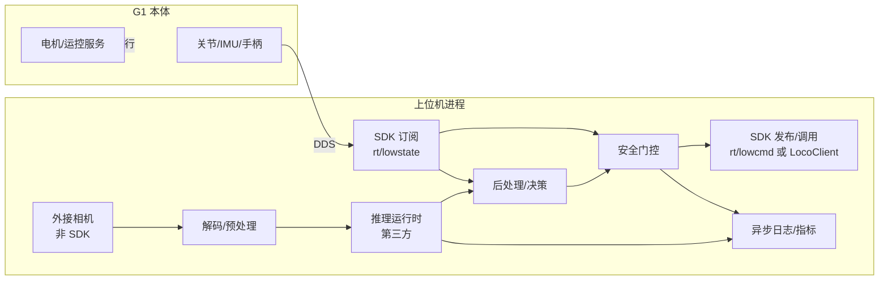

# 10 · 具身模型部署整合

> 目标：把“相机/传感器 → SDK → 预处理 → 推理 → 后处理 → 控制”串成一条**可观测、可降级、不阻塞通信**的工程链路。
>
> 重要前提：Unitree SDK **不提供**推理运行时、图像采集 API 或模型管理。ONNX Runtime / TensorRT / OpenCV 都是第三方依赖，本仓库未安装、未集成、未测试。

---

## 1. SDK 在链路中的位置



SDK 只负责两端的“通信与控制接口”：

- 输入侧：`rt/lowstate`、`rt/secondary_imu`、`rt/audio_msg` 等；
- 输出侧：`LocoClient`（高层）或 `rt/lowcmd`/`rt/arm_sdk`/`rt/hand_sdk`（低层）。

中间的一切（相机、解码、模型、后处理、调度）都要自己实现。

---

## 2. 先定义契约，再写代码

### 2.1 传感器契约

| 字段 | 必须定义 | 示例 |
|---|---|---|
| 来源 | 设备/驱动/Topic | USB 相机 `/dev/video0` |
| 格式 | 编码、像素格式 | MJPG → BGR |
| 分辨率 | 采集 vs 模型输入 | 1280×720 → 640×640 |
| 帧率 | 相机 vs 推理 | 30 fps → 15 fps |
| 时间戳 | 时钟源 | `steady_clock` 毫秒 |
| 帧 ID | 单调序号 | `uint64_t` |
| 丢帧策略 | 丢旧/阻塞 | 队列 1，丢最旧 |
| 生命周期 | 谁打开/关闭 | 采集线程独占 |

### 2.2 模型契约

| 字段 | 必须定义 |
|---|---|
| 输入张量 | 名称、形状、dtype、布局（NCHW/NHWC）、归一化 |
| 输出张量 | 名称、形状、dtype、语义 |
| 预处理 | resize/裁剪/颜色/均值方差 |
| 后处理 | 阈值/NMS/解码/坐标变换 |
| 批大小 | 1（闭环优先） |
| 精度 | FP32/FP16/INT8，是否量化 |
| 最大延迟 | P50/P95/P99 |
| 资源 | GPU 显存、CPU 线程、功耗 |

### 2.3 控制契约

| 输出类型 | 接口 | 频率 | 安全层 |
|---|---|---|---|
| 高层速度 | `LocoClient::SetVelocity` | 5–20 Hz | 限幅、超时、门控 |
| 预设动作 | `G1ArmActionClient::ExecuteAction` | 事件 | FSM 检查、holding 处理 |
| 手臂关节 | `rt/arm_sdk` | 50–500 Hz | 权重渐变、限位、看门狗 |
| 全身关节 | `rt/lowcmd` | 200–500 Hz | 独立安全控制器 |
| 手部 | `rt/hand_sdk`/Dex3 | 1–50 Hz | 力矩限幅 |

**推理频率与控制频率不需要相同。** 常见做法：推理 10–30 Hz，控制 50–500 Hz，控制层在两次推理之间保持/插值。

---

## 3. 图像与状态的时间对齐

### 3.1 时间戳

SDK 的 `LowState_` **没有统一时间戳字段**，只有 `tick` 计数（见 [03](03_message_types.md)）。相机帧也没有 SDK 时间。

因此：

- 用主机 `std::chrono::steady_clock` 在“收到帧/收到状态”时打时间戳；
- 记录 `capture_ts`、`infer_start`、`infer_end`、`control_ts`；
- 不要用 `system_clock` 做延迟统计（会受 NTP 跳变影响）；
- 不要伪造“机器人硬件时间”。

### 3.2 对齐策略

| 策略 | 适用 | 说明 |
|---|---|---|
| 最新帧 + 最新状态 | 低速动作 | 简单，但两者可能差几十 ms |
| 时间戳最近邻 | 中等动态 | 需要状态缓存 |
| 线性插值 | 高速运动 | 需要状态历史与时间戳 |
| 硬件同步 | 多相机/高精度 | SDK 不提供，需外接触发 |

【推断】对 G1 的 10–30 Hz 视觉策略，**时间戳最近邻 + 状态缓存 100–200 ms** 通常足够；高速运动控制必须实测。

---

## 4. 并发设计

### 4.1 推荐线程划分

| 线程 | 职责 | 频率 | 禁止事项 |
|---|---|---|---|
| DDS 回调线程 | 只复制状态到快照 | 随消息 | 推理、RPC、写文件 |
| 采集线程 | 取帧、打时间戳、入队 | 相机帧率 | 解码大图、推理 |
| 预处理线程 | 解码/resize/归一化 | 推理频率 | 阻塞等待 |
| 推理线程 | 前向 | 模型能力 | 控制下发 |
| 后处理/决策线程 | 解析输出、安全门控 | 推理频率 | 直接发关节命令 |
| 控制线程 | 限幅、插值、下发 | 50–500 Hz | 长时间阻塞 |
| 日志线程 | 异步写盘/指标 | 事件/周期 | 在回调中同步写 |

### 4.2 队列规则

```text
相机队列：容量 1–2，满则丢最旧
状态快照：容量 1（只保留最新）
推理结果队列：容量 1–2，满则丢最旧
控制命令：不排队，控制线程每次取最新
日志队列：可有界，满则丢弃低优先级日志
```

**不要用无界队列**。推理变慢时，无界队列会让延迟无限增长，最终“执行的是几秒前的决策”。

### 4.3 不要在 DDS 回调里推理

原因：

- `queuelen=0` 时回调在 DDS listener 线程，阻塞会影响该 reader 的后续消息；
- `queuelen>0` 时回调在 `rlsnr` 线程，阻塞会导致队列丢帧；
- 推理可能耗时数十到数百 ms，远超状态周期。

正确做法：回调只做 `copy + timestamp + enqueue`。

---

## 5. 推理适配层

### 5.1 抽象接口

把推理运行时隔离在接口后，便于替换 ONNX Runtime/TensorRT/远端服务：

```cpp
struct Tensor {
    std::vector<int64_t> shape;
    // 实际项目按 dtype 选择 float16/uint8 等
    std::vector<float> data;
};

class InferenceEngine {
public:
    virtual ~InferenceEngine() = default;
    virtual bool warmup() = 0;
    virtual bool infer(const Tensor& input, Tensor& output) = 0;
    virtual std::string name() const = 0;
};
```

【推断】接口是工程建议，不是 SDK 类型。具体实现由所选运行时决定。

### 5.2 ONNX Runtime / TensorRT 的工程要点

| 主题 | 建议 |
|---|---|
| 模型格式 | ONNX 便于跨平台；TensorRT engine 绑定 GPU/版本 |
| 精度 | FP16 通常够用；INT8 需校准集与精度回归 |
| 输入布局 | 确认 NCHW/NHWC 与模型一致，避免隐式转置 |
| 预处理 | 尽量在 GPU 上做 resize/归一化，减少 PCIe 拷贝 |
| 内存 | 复用输入/输出 buffer；避免每帧分配 |
| 批处理 | 闭环优先 batch=1；吞吐场景再考虑动态 batch |
| 线程 | 一个推理线程串行使用 engine；多线程共享需运行时支持 |
| 预热 | 启动后先跑若干次空推理，避免首帧超时 |
| 错误 | 区分“模型错误”“输入错误”“GPU OOM”，分别降级 |
| 版本 | 固定 CUDA/cuDNN/TensorRT 版本，记录在部署清单 |

### 5.3 模型输入尺寸与相机分辨率

| 方案 | 优点 | 缺点 |
|---|---|---|
| 相机直接输出模型尺寸 | 无 resize | 相机可能不支持/裁剪视野 |
| 相机大图 → GPU resize | 灵活 | 增加预处理延迟 |
| 相机大图 → ROI 裁剪 | 保留细节 | 需要目标检测/跟踪 |
| 多尺度 | 适应远近 | 推理次数增加 |

**必须测量** resize 的耗时与插值对精度的影响；不能假设“缩放很快”。

---

## 6. 结果到控制的桥

### 6.1 高层速度输出

```text
模型输出（例如目标速度 vx, vy, wz）
  → 限幅（|vx|≤vmax, |wz|≤wmax）
  → 变化率限制
  → 超时检查（结果太旧则丢弃）
  → 安全门控（FSM/姿态/连接）
  → LocoClient::SetVelocity(vx, vy, wz, duration)
```

注意：

- `SetVelocity` 默认 duration=1 s（[05](05_g1_high_level_control.md)）；连续控制需显式传更长 duration 或周期性重发。
- 返回 0 只代表命令被接受，不代表机器人已执行。
- 必须有“停止”路径：模型无输出/超时/门控失败时发零速度或进入安全状态。

### 6.2 低层关节输出

```text
模型输出（关节目标/力矩）
  → 维度与关节顺序校验（29 DOF，见 03）
  → 位置/力矩限幅
  → 每周期增量限制
  → 平滑/插值
  → 看门狗（状态新鲜、控制循环存活）
  → rt/lowcmd 或 rt/arm_sdk
```

低层输出必须假设“模型可能输出 NaN/Inf/越界”。在进入控制前做有限性检查。

### 6.3 动作/任务输出

```text
模型输出（动作 ID/名称）
  → 白名单（只允许经验证的动作）
  → FSM 检查（500/501/801，801 下 mode 0/3）
  → 执行
  → 订阅 rt/arm/action/state 确认
```

不要允许模型直接输出任意字符串拼进 JSON（`ExecuteAction(name)` 存在注入风险，见 [05](05_g1_high_level_control.md)）。

---

## 7. 安全与降级

### 7.1 分层保护

| 层 | 职责 | 失败时 |
|---|---|---|
| 模型层 | 输入校验、输出有限性 | 丢弃该帧 |
| 决策层 | 置信度阈值、动作白名单 | 保持/停止 |
| 控制层 | 限幅、限速、看门狗 | 零速度/保持 |
| 机器人层 | `terminations.hpp` 谓词 | 停止/退出 |
| 物理层 | 急停、吊装、围栏 | 断电/制动 |

### 7.2 必须处理的失败

| 失败 | 检测 | 响应 |
|---|---|---|
| 相机断流 | 帧超时 | 停止新决策 |
| 状态断流 | `lost_connection` | 停止控制 |
| 推理超时 | 计时 | 丢弃结果，保持上一安全命令 |
| 输出 NaN/Inf | `std::isfinite` | 丢弃 |
| 输出越界 | 限幅 | 钳制并记录 |
| 控制循环超时 | 周期监测 | 进入安全状态 |
| 进程崩溃 | 外部监控 | 物理急停/服务端超时（未验证） |
| GPU OOM | 运行时错误 | 降级到小模型/停止 |

### 7.3 不要做的事

- 不要用模型输出直接覆盖安全层；
- 不要在门控失败时“再试一次”运动命令；
- 不要把“RPC 返回 0”当作“动作已完成”；
- 不要在没有看门狗的情况下持续发布低层命令。

---

## 8. 可观测性

### 8.1 必记指标

| 指标 | 说明 |
|---|---|
| `capture_fps` / `infer_fps` | 实际吞吐 |
| `queue_drop_count` | 丢帧数 |
| `pre_ms` / `infer_ms` / `post_ms` | 分段延迟 |
| `e2e_ms` | 采集到控制下发 |
| `state_age_ms` | 状态新鲜度 |
| `gpu_mem_mb` / `gpu_util` | GPU 资源 |
| `control_jitter_ms` | 控制周期抖动 |
| `gate_reject_count` | 门控拒绝次数 |
| `rpc_timeout_count` | RPC 超时 |

### 8.2 日志

- 异步、限速、结构化（JSON/key=value）；
- 记录模型版本、配置哈希、代码版本；
- 不要在每个控制周期写磁盘；
- 崩溃时保留最后 N 帧元数据（不含敏感图像）。

---

## 9. 资源释放

| 资源 | 释放时机 |
|---|---|
| 相机 | 停止采集线程后 `release()` |
| 推理 engine/context | 停止推理线程后释放 |
| GPU buffer | 与 engine 同生命周期 |
| DDS 订阅/发布 | 先停业务线程，再 `CloseChannel` |
| `ChannelFactory` | 所有 channel 释放后 `Release()` |
| 日志 | flush 后关闭 |
| 线程 | 全部 join，避免析构时仍运行 |

顺序错误会导致 use-after-free、析构卡死或 DDS 崩溃，详见 [08](08_concurrency_and_lifecycle.md)。

---

## 10. 最小流水线骨架（无推理依赖）

以下示例只演示“采集线程 → 有界队列 → 处理线程 → 停止”的结构，不包含相机、模型或机器人控制。可直接用标准 C++ 编译。【已验证：编译通过】未运行。

```cpp
// pipeline_skeleton.cpp — 无第三方依赖
#include <atomic>
#include <chrono>
#include <condition_variable>
#include <deque>
#include <iostream>
#include <mutex>
#include <thread>

struct Frame {
    uint64_t id;
    std::chrono::steady_clock::time_point ts;
    // 实际项目放图像 buffer / 共享指针
};

template <typename T>
class LatestQueue {
public:
    explicit LatestQueue(size_t cap) : cap_(cap) {}

    void push(T v) {
        std::lock_guard<std::mutex> lk(m_);
        if (q_.size() >= cap_) q_.pop_front();
        q_.push_back(std::move(v));
        cv_.notify_one();
    }

    bool pop(T& out) {
        std::unique_lock<std::mutex> lk(m_);
        cv_.wait(lk, [&] { return stop_ || !q_.empty(); });
        if (stop_ && q_.empty()) return false;
        out = std::move(q_.front());
        q_.pop_front();
        return true;
    }

    void stop() {
        std::lock_guard<std::mutex> lk(m_);
        stop_ = true;
        cv_.notify_all();
    }

private:
    size_t cap_;
    std::deque<T> q_;
    std::mutex m_;
    std::condition_variable cv_;
    bool stop_{false};
};

int main() {
    LatestQueue<Frame> q(1);
    std::atomic<bool> run{true};
    std::atomic<uint64_t> produced{0}, consumed{0}, dropped{0};

    std::thread producer([&] {
        uint64_t id = 0;
        while (run) {
            Frame f{id++, std::chrono::steady_clock::now()};
            q.push(f);
            produced++;
            std::this_thread::sleep_for(std::chrono::milliseconds(33));
        }
    });

    std::thread consumer([&] {
        Frame f;
        while (q.pop(f)) {
            // 这里替换为预处理 + 推理 + 后处理
            consumed++;
            std::this_thread::sleep_for(std::chrono::milliseconds(50));
        }
    });

    std::this_thread::sleep_for(std::chrono::seconds(3));
    run = false;
    q.stop();
    producer.join();
    consumer.join();

    std::cout << "produced=" << produced
              << " consumed=" << consumed << std::endl;
    return 0;
}
```

要点：

- 队列容量 1：消费慢时自动丢旧帧，处理的是“最新可用的”。
- `stop()` 唤醒消费者，避免退出时永久阻塞。
- 生产/消费计数用于计算实际丢帧率（本例未单独统计被覆盖的帧）。
- 真实图像用 `shared_ptr<const Frame>` 传递，避免大块拷贝。

---

## 11. 部署检查清单

| 类别 | 检查项 |
|---|---|
| 相机 | 设备稳定、格式/分辨率/帧率实测、曝光固定、时间戳 |
| 模型 | 输入输出契约、预处理一致、精度回归、预热 |
| 推理 | 延迟 P95、显存、线程、错误码 |
| 控制 | 频率、限幅、看门狗、停止路径 |
| 安全 | 门控、状态新鲜度、急停、人工值守 |
| 观测 | 指标、日志、崩溃留存 |
| 资源 | 队列上限、内存/显存、退出顺序 |
| 版本 | SDK 版本、模型版本、CUDA/TensorRT 版本 |

---

## 12. 相关文档

- 相机与传感器：[07_sensors_and_camera.md](07_sensors_and_camera.md)
- 并发与生命周期：[08_concurrency_and_lifecycle.md](08_concurrency_and_lifecycle.md)
- 高层控制：[05_g1_high_level_control.md](05_g1_high_level_control.md)
- 低层控制：[06_g1_low_level_control.md](06_g1_low_level_control.md)
- 部署优先级：[g1_deployment_priority.md](g1_deployment_priority.md)
- 已知限制：[known_limitations.md](known_limitations.md)
