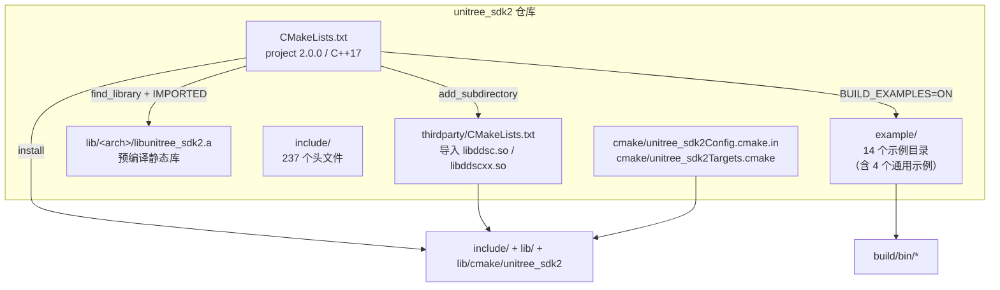

# 11 · 构建、安装与链接

> 目标：把“能不能编、编出来链接谁、装到哪里、运行时去哪找 `.so`”讲清楚。本文的 CMake 配置、安装与运行库路径结论来自静态分析，**没有执行 cmake/make/install**；当前分析主机没有安装 `cmake`（`cmake --version` 返回 command not found）。2026-10-24 已用 `g++` 直接编译 11 个 G1 示例用于验证头文件/静态库/链接参数，结果见 [13_examples_index.md](13_examples_index.md) §9；CMake 构建与安装仍未验证。
>
> 适用对象：在 G1-EDU 上部署自研 C++ 推理/控制程序的构建与运维人员。

---

## 1. 结论先行

| 结论 | 证据等级 | 说明 |
|---|---|---|
| SDK 以**预编译静态库**交付，仓库内没有 SDK 主体源码 | 【源码】 | 只有 `lib/x86_64/libunitree_sdk2.a` 与 `lib/aarch64/libunitree_sdk2.a`；`include/` 是 237 个头文件 |
| SDK 库本身是 C++17、静态链接；DDS 是**动态库** | 【源码】 | `CMakeLists.txt:8-10`、`:51-54`；`thirdparty/lib/*/libddsc.so`、`libddscxx.so` |
| 构建示例时 `BUILD_EXAMPLES` 默认 `ON`，会编译**所有机器人**的示例，而不只是 G1 | 【源码】 | `CMakeLists.txt:5`、`:59-61`；`example/CMakeLists.txt:1-16` |
| README 中的 `example/cmake_sample` 在当前 checkout 中**不存在** | 【源码】 | `README.md:55` 引用了它，但 `find` 无结果；不能照抄该目录 |
| README 写 CMake ≥ 3.10，但第三方 CMake 使用了 3.13 才有的 `target_link_directories` | 【源码】/【推断】 | `README.md:13`；`thirdparty/CMakeLists.txt:10,22`；顶层的 `cmake_minimum_required(3.5)` 也不代表实际最低版本 |
| SDK 消费目标是导入目标 `unitree_sdk2`，接口链接 `ddsc ddscxx Threads::Threads` | 【源码】 | `CMakeLists.txt:51-57`；安装后的 `cmake/unitree_sdk2Targets.cmake:64-70` |
| 仓库没有为运行时库路径做 `ldconfig`/RPATH 配置 | 【源码】 | 安装规则 `CMakeLists.txt:64-82` 只拷贝文件；运行时能否找到 `libddsc.so.0` 取决于部署方式【未验证】 |
| G1 高层客户端方法基本是头文件内联封装，RPC 主体在静态库中 | 【源码】/【推断】 | 头文件已确认；`nm` 可见 `ClientBase::Call`，未见 `LocoClient` 独立符号（类名为 `unitree::robot::g1::LocoClient`，不存在 `G1LocoClient`），符合内联封装【推断】 |
| 当前主机 GCC 13.3，而 SDK README 声明用 GCC 9.4 预编译 | 【源码】 | `README.md:7`；本机 `gcc --version`；跨编译器 ABI 兼容性未实测【未验证】 |

---

## 2. 构建系统全貌



构建配置的三个入口：

| 文件 | 作用 | 关键行 |
|---|---|---|
| `CMakeLists.txt` | 顶层：版本、C++ 标准、导入库、安装 | `:2`、`:5`、`:8-10`、`:35-45`、`:51-57`、`:63-82` |
| `thirdparty/CMakeLists.txt` | 按 `${CMAKE_SYSTEM_PROCESSOR}` 导入 DDS 共享库与头文件 | `:3-27`、`:30-35` |
| `cmake/unitree_sdk2Targets.cmake` | 安装后供 `find_package` 使用的导入目标定义 | `:48-70` |

---

## 3. 版本与平台事实

| 项 | 值 | 证据 |
|---|---|---|
| 项目版本 | `2.0.0` | `CMakeLists.txt:2` |
| git 版本 | `2.0.2-75-gd1abf00` | `git describe`；HEAD `d1abf001220d3e5f59e00a0c4aaa595e00089a4a`（2026-10-15） |
| C++ 标准 | C++17，关闭编译器扩展，强制要求 | `CMakeLists.txt:8-10` |
| 默认构建类型 | `Release` | `CMakeLists.txt:13-21` |
| 预编译架构 | `x86_64`、`aarch64` | `lib/`、`thirdparty/lib/`；`file` 确认 ELF x86-64 / ARM aarch64 |
| SDK 库类型 | 静态归档 `libunitree_sdk2.a`（27/28 MB） | `CMakeLists.txt:51`；`ls -lh lib/*` |
| DDS 库类型 | 共享库，SONAME 为 `libddsc.so.0`、`libddscxx.so.0` | `readelf -d thirdparty/lib/x86_64/libddsc.so`、`libddscxx.so` |
| CMake 最低声明 | 顶层 3.5；部分示例子目录 3.10 | `CMakeLists.txt:1`；`example/r1/CMakeLists.txt:1`、`example/h2/CMakeLists.txt:1` |

### 3.1 架构选择机制

【源码】`CMakeLists.txt:38-39`：

```cmake
set(UNITREE_SDK_PATH ${CMAKE_CURRENT_LIST_DIR}/lib/${CMAKE_SYSTEM_PROCESSOR})
find_library(UNITREE_SDK_LIB unitree_sdk2 PATHS ${UNITREE_SDK_PATH} NO_DEFAULT_PATH)
```

- 原生 x86_64 主机上 `${CMAKE_SYSTEM_PROCESSOR}` 为 `x86_64`，能找到库。
- 原生 aarch64（如 Jetson、G1 板载计算机）上应为 `aarch64`。
- **交叉编译**时若工具链把 `CMAKE_SYSTEM_PROCESSOR` 设成 `arm64`、`aarch64_be` 或空，则路径不存在，配置阶段直接 `FATAL_ERROR`（`CMakeLists.txt:41-42`）。交叉编译必须显式设置成 `aarch64`，或在工具链中覆盖该变量后自行验证【推断】。
- 仓库只提供两种架构；没有 `riscv64`、`armv7` 等预编译库。

---

## 4. 依赖矩阵

### 4.1 代码实际引用的第三方依赖

【源码】对 `include/` 与 `example/g1/` 搜索第三方头文件，实际命中：

| 依赖 | 引用位置 | 性质 |
|---|---|---|
| Eigen3 | `include/unitree/robot/g1/common/terminations.hpp:8`、`include/unitree/dds_wrapper/robots/g1/g1_pub.h:6`、`g1_sub.h:6`、`example/g1/dex3/g1_dex3_example.cpp:14` | **头文件依赖**；使用这些 G1 辅助头文件就必须能找到 `<eigen3/Eigen/Dense>` |
| Boost.ProgramOptions | `example/g1/high_level/g1_arm_action_example.cpp:7`、`example/g1/low_level/terminations.cpp:2` | 仅这两个示例 |
| yaml-cpp | `example/g1/low_level/g1_dual_arm_example.cpp:1` | 仅双臂行为库示例 |
| fmt | G1 目录无直接引用 | R1 示例链接 `fmt`，与 G1 无关 |

这说明：

- **Eigen 不是“可装可不装”的摆设**：只要包含 `g1_pub.h`、`g1_sub.h` 或 `terminations.hpp`，编译期就需要 Eigen 头文件。
- Eigen 是 header-only，不需要链接库；SDK 的 CMake 目标没有为它添加 include 路径，Ubuntu 上依赖 `/usr/include/eigen3` 被默认包含（`#include <eigen3/Eigen/Dense>`）。
- Boost/yaml-cpp 只影响特定示例，不影响核心通信与控制客户端。
- fmt 与 G1 核心链路无关。

### 4.2 SDK 自带示例的依赖

| 依赖 | 是否必需 | 影响的 G1 目标 | 证据 |
|---|---|---|---|
| CMake | 必需 | 全部 | `README.md:13`；实际建议 ≥3.13【推断】 |
| C++17 编译器（g++/clang++） | 必需 | 全部 | `CMakeLists.txt:8-10` |
| pthread | 必需 | 全部 | `CMakeLists.txt:49`；`thirdparty/CMakeLists.txt:1` |
| 随附 DDS 共享库 | 必需 | 全部 | `thirdparty/CMakeLists.txt:3-27` |
| Boost.ProgramOptions | 可选 | `g1_termination`、`g1_arm_action_example` | `example/g1/CMakeLists.txt:22-29` |
| yaml-cpp ≥0.6 | 可选 | `g1_dual_arm_example` | `example/g1/CMakeLists.txt:31-41` |
| Eigen3 头文件 | **使用 G1 辅助头文件时必需** | `g1_pub.h`、`g1_sub.h`、`terminations.hpp`、`g1_dex3_example` | 见 4.1；header-only，无需链接 |
| fmt | 可选/无关 | G1 无直接引用；R1 示例直接链接 `fmt` | `example/r1/CMakeLists.txt:19` |

### 4.3 README 与源码的差异

| README 说法 | 源码事实 | 影响 |
|---|---|---|
| 安装 `libyaml-cpp-dev libeigen3-dev libboost-all-dev libfmt-dev` | G1 使用辅助头文件时需要 Eigen3；Boost/yaml-cpp 仅特定示例；fmt 与 G1 无关 | 装齐最省事，但要知道 Eigen 是编译期硬依赖 |
| CMake 3.10+ | `target_link_directories` 需要 3.13+ | 旧环境可能配置失败【推断】 |
| 参考 `example/cmake_sample` | 目录不存在 | 需要按本文第 6 节自行写消费工程 |
| `sudo make install` 到系统目录 | 也支持 `CMAKE_INSTALL_PREFIX` | 机器人上建议固定前缀，避免污染系统 |
| 预编译环境 GCC 9.4 / Ubuntu 20.04 | 当前主机 GCC 13.3、无 cmake | 未在本机验证编译【未验证】 |

---

## 5. 构建方式

> 以下命令是**建议流程**，本次工作没有执行（只读约束 + 主机缺 cmake）。执行 `install` 会写系统目录，必须由部署方自行授权。

### 5.1 只构建库和示例（仓库内）

```bash
cd /path/to/unitree_sdk2
cmake -S . -B build -DCMAKE_BUILD_TYPE=Release
cmake --build build -j"$(nproc)"
```

产物：

- 可执行文件在 `build/bin/`（`CMakeLists.txt:29`）。
- SDK 静态库不会在 build 目录重新生成，仍是仓库里的 `lib/<arch>/libunitree_sdk2.a`。
- DDS `.so` 来自 `thirdparty/lib/<arch>/`。

风险：

- `BUILD_EXAMPLES` 默认 `ON`（`CMakeLists.txt:5`），会尝试构建 GO2/B2/H1/R1/H2/A2/AS2 等全部示例；任一示例的依赖缺失都可能让整体 build 失败。
- 只想验证 G1 时，也没有“仅 G1”的 CMake 选项；要么装齐依赖，要么关闭示例后单独构建自己的程序。

### 5.2 只准备 SDK（不构建示例）

```bash
cmake -S . -B build -DBUILD_EXAMPLES=OFF -DCMAKE_BUILD_TYPE=Release
cmake --build build -j"$(nproc)"
```

`BUILD_EXAMPLES=OFF` 仍会执行 `find_library` 与 DDS 导入（`CMakeLists.txt:34-57`），因此仍要求架构目录下存在预编译库。

### 5.3 安装到固定前缀（推荐机器人部署）

```bash
cmake -S . -B build -DBUILD_EXAMPLES=OFF \
      -DCMAKE_INSTALL_PREFIX=/opt/unitree_robotics
cmake --build build -j"$(nproc)"
sudo cmake --install build
```

安装内容（`CMakeLists.txt:64-82`、`thirdparty/CMakeLists.txt:28-35`）：

```text
/opt/unitree_robotics/
├── include/
│   ├── unitree/...                 # SDK 头文件
│   ├── dds/ ddsc/ ddscxx/          # 随附 DDS 头文件
├── lib/
│   ├── libunitree_sdk2.a
│   ├── libddsc.so, libddsc.so.0 -> libddsc.so
│   ├── libddscxx.so, libddscxx.so.0 -> libddscxx.so
└── lib/cmake/unitree_sdk2/
    ├── unitree_sdk2Config.cmake
    ├── unitree_sdk2ConfigVersion.cmake
    └── unitree_sdk2Targets.cmake
```

注意：

- `unitree_sdk2Targets.cmake` 把 DDS 路径**硬编码为 `${_IMPORT_PREFIX}/lib/...`**（`:51,58,66`），而安装目录由 `GNUInstallDirs` 决定（`CMakeLists.txt:24`）。Ubuntu 上 `lib` 一致；若在 `lib64` 布局的系统上安装，可能出现“库在 `lib64`、config 找 `lib`”的错位【推断】。
- `unitree_sdk2ConfigVersion.cmake` 使用 `COMPATIBILITY ExactVersion`（`CMakeLists.txt:74-78`）：`find_package(unitree_sdk2 2.0.0)` 只接受精确 2.0.0；不带版本号的 `find_package(unitree_sdk2 REQUIRED)` 不受此限。

---

## 6. 在自己的工程中链接

### 6.1 推荐：`find_package`

```cmake
cmake_minimum_required(VERSION 3.13)
project(g1_infer LANGUAGES CXX)

set(CMAKE_CXX_STANDARD 17)
set(CMAKE_CXX_STANDARD_REQUIRED ON)
set(CMAKE_CXX_EXTENSIONS OFF)

find_package(unitree_sdk2 REQUIRED)

add_executable(g1_state_probe src/main.cpp)
target_link_libraries(g1_state_probe PRIVATE unitree_sdk2)
```

配置：

```bash
cmake -S . -B build \
      -DCMAKE_PREFIX_PATH=/opt/unitree_robotics \
      -DCMAKE_BUILD_TYPE=Release
cmake --build build -j"$(nproc)"
```

【源码】`unitree_sdk2` 目标已经携带：

- 头文件目录 `include/`（`CMakeLists.txt:55-57`；安装配置 `unitree_sdk2Targets.cmake:67`）。
- 链接依赖 `ddsc;ddscxx;Threads::Threads`（`unitree_sdk2Targets.cmake:68`）。
- 语言 `CXX`（`:69`）。

因此用户工程**不需要**再手动 `-I` DDS 头文件或 `-lddsc`；重复添加反而可能引入顺序/路径问题。

> 【未验证】`find_package` 在目标机上的实际行为未运行验证。若报 `unitree_sdk2Config.cmake` 找不到，先确认 `CMAKE_PREFIX_PATH` 指向前缀而不是 `lib/cmake/...` 子目录。

### 6.2 手工 `g++` 链接（无 CMake 时）

```bash
g++ -std=c++17 -O2 \
    -I/opt/unitree_robotics/include \
    src/main.cpp \
    -L/opt/unitree_robotics/lib \
    -lunitree_sdk2 -lddscxx -lddsc -pthread \
    -Wl,-rpath,/opt/unitree_robotics/lib \
    -o g1_state_probe
```

要点：

1. **静态库顺序**：`-lunitree_sdk2` 必须出现在源文件/目标文件之后，且位于 `-lddscxx -lddsc` 之前；否则静态库中未解析的 DDS 符号不会被后续库补上。
2. `-pthread` 必需：SDK 内部使用 `std::thread`、互斥量与条件变量。
3. 建议显式 `-Wl,-rpath,...`，否则运行时可能找不到 `libddsc.so.0`。
4. 不建议同时链接系统安装的 CycloneDDS 与 SDK 随附版本（见 8.3）。

### 6.3 头文件最小集合

按功能选择，均位于 `<prefix>/include/`：

| 功能 | 头文件 |
|---|---|
| 通信初始化 / 发布 / 订阅 | `unitree/robot/channel/channel_factory.hpp`、`channel_publisher.hpp`、`channel_subscriber.hpp` |
| RPC 客户端 | `unitree/robot/client/client.hpp`（`ClientBase` 在 `client_base.hpp`） |
| G1 高层运动 | `unitree/robot/g1/loco/g1_loco_client.hpp` |
| G1 手臂动作 | `unitree/robot/g1/arm/g1_arm_action_client.hpp` |
| G1 音频 | `unitree/robot/g1/audio/g1_audio_client.hpp` |
| 运动模式切换 | `unitree/robot/b2/motion_switcher/motion_switcher_client.hpp` |
| 低层状态 | `unitree/idl/hg/LowState_.hpp`、`unitree/idl/hg/IMUState_.hpp` |
| 低层命令 | `unitree/idl/hg/LowCmd_.hpp`、`unitree/idl/hg/MotorCmd_.hpp` |
| G1 关节索引/封装 | `unitree/dds_wrapper/robots/g1/defines.h`、`g1_pub.h`、`g1_sub.h`（header-only） |
| 安全判据 | `unitree/robot/g1/common/terminations.hpp`（header-only，需 Eigen3） |
| 周期线程 | `unitree/common/thread/thread.hpp` |

> `unitree/dds_wrapper/...` 与 `terminations.hpp` 是模板/内联代码，包含即可用；`ChannelFactory`、`ClientBase` 等非模板实现来自 `libunitree_sdk2.a`。二者版本必须匹配。
>
> 这些辅助头文件包含 `<eigen3/Eigen/Dense>`（`g1_pub.h:6`、`g1_sub.h:6`、`terminations.hpp:8`），编译时需要 Eigen3 头文件；SDK 的 CMake 目标不会自动添加 Eigen 的 include 目录。

---

## 7. 链接与运行时依赖

### 7.1 `unitree_sdk2` 目标契约

```cmake
add_library(unitree_sdk2 STATIC IMPORTED GLOBAL)
set_target_properties(unitree_sdk2 PROPERTIES
        IMPORTED_LOCATION ${UNITREE_SDK_LIB})
target_link_libraries(unitree_sdk2 INTERFACE ddsc ddscxx Threads::Threads)
target_include_directories(unitree_sdk2 INTERFACE
        $<BUILD_INTERFACE:${CMAKE_CURRENT_SOURCE_DIR}/include>
        $<INSTALL_INTERFACE:include>)
```

【源码】`CMakeLists.txt:51-57`。含义：

- 用户程序最终链接的是 `libunitree_sdk2.a` + `libddscxx.so` + `libddsc.so` + pthread。
- 头文件搜索路径自动传递。
- 没有编译宏、没有额外的 `-std` 传递；用户工程必须自己设置 C++17（`CMakeLists.txt` 的 `CMAKE_CXX_STANDARD` 不会通过导入目标传播）。

### 7.2 DDS 库事实

【源码】`readelf` 结果：

| 库 | SONAME | 直接依赖 |
|---|---|---|
| `libddsc.so` | `libddsc.so.0` | `libpthread.so.0`、`libdl.so.2`、`libc.so.6`、`ld-linux` |
| `libddscxx.so` | `libddscxx.so.0` | `libddsc.so.0`、`libstdc++.so.6`、`libgcc_s.so.1`、`libc.so.6` |

注意：

- `thirdparty/CMakeLists.txt:8,20` 把导入目标标记为 `IMPORTED_NO_SONAME TRUE`，但文件本身**有 SONAME**。这不会改变 DT_NEEDED（仍是 `.so.0`），但会让链接方式依赖 `-L` 搜索路径，而不是绝对路径。
- 仓库中的 `libddsc.so.0` 是指向 `libddsc.so` 的符号链接（不是独立版本文件），安装后符号链接是否保留取决于 CMake 对 `install(FILES)` 的处理；不能假设目标机一定有 `.so.0` 链接【未验证】。
- `libddsc.so` 自带 `RUNPATH=$ORIGIN/../lib`，只影响它自己的依赖解析，不能帮助你的可执行文件找到它。

### 7.3 运行时查找路径

仓库没有 RPATH 设置、没有 `ldconfig` 配置、没有 `install` 后钩子。因此：

| 部署方式 | 运行时是否需要额外处理 |
|---|---|
| 在仓库 build 目录直接运行示例 | CMake 通常会把链接时共享库目录写入 build RPATH；实际是否生效未验证【未验证】 |
| 安装到 `/opt/unitree_robotics` 并链接 | 消费工程可能继承该目录到 build RPATH；安装/拷贝到别处后可能失效【推断】 |
| 直接把可执行文件拷到另一台机器 | 大概率找不到 `libddsc.so.0`，需要 `LD_LIBRARY_PATH` 或随包携带库 |
| 系统级安装到 `/usr/local` | 可用 `ldconfig` 刷新缓存，但会修改系统环境，需部署方授权 |

推荐的部署期自检：

```bash
ldd ./g1_state_probe | grep -E 'unitree|ddsc'
readelf -d ./g1_state_probe | grep -E 'RPATH|RUNPATH|NEEDED'
```

若 `libddsc.so.0 => not found`，临时方案：

```bash
export LD_LIBRARY_PATH=/opt/unitree_robotics/lib:$LD_LIBRARY_PATH
```

> 【未验证】以上诊断命令本次未运行，因为未构建可执行文件。`libddscxx.so` 单独 `ldd` 时已经显示 `libddsc.so.0 => not found`，说明搜索路径问题在仓库内就存在，最终程序必须显式解决。

---

## 8. 架构、ABI 与版本风险

### 8.1 架构不匹配

| 现象 | 原因 | 处理 |
|---|---|---|
| 配置报 “Unitree SDK library for the architecture is not found” | `${CMAKE_SYSTEM_PROCESSOR}` 不在 `lib/` 下 | 检查 `uname -m` 与 CMake 变量；交叉编译显式设 `aarch64` |
| 链接报 “file in wrong format” | 用了 x86_64 库给 aarch64 目标 | 换 `lib/aarch64` 与 `thirdparty/lib/aarch64` |
| 运行报 “cannot execute binary file” | 可执行文件架构与机器不符 | 用对应工具链重编 |

### 8.2 C++ ABI

【源码】`nm -C lib/x86_64/libunitree_sdk2.a` 中可见 `std::__cxx11::basic_string...`，即 SDK 使用 **libstdc++ C++11 ABI**（`_GLIBCXX_USE_CXX11_ABI=1`）。

- 用户工程与所有依赖必须使用同一 ABI；不要关闭 `_GLIBCXX_USE_CXX11_ABI`。
- SDK 预编译于 GCC 9.4（`README.md:7`），本机 GCC 13.3。通常新 libstdc++ 向后兼容旧目标文件，但未实测【推断】。
- 不要混用不同 SDK 版本的头文件与 `.a`；头文件中的类布局/内联代码必须与库一致。

### 8.3 DDS 版本冲突

- SDK 随附 CycloneDDS 0.10.2；ROS 2 通常也带 CycloneDDS，但版本与编译选项可能不同。
- 同一个进程若同时加载两份 `libddsc`，可能出现符号覆盖、类型注册冲突或崩溃【推断】。
- 推荐把 ROS 2 桥接放到**独立进程**，通过 DDS/共享内存/自定义 IPC 与 SDK 进程通信；不要在同一个可执行文件里同时链接 ROS 2 的 `rmw_cyclonedds` 和 SDK 的 `libddsc`。
- 若必须同进程，先验证 `ldd` 只解析到一份 `libddsc.so.0`，并确认版本/类型哈希一致【未验证】。

### 8.4 编译器与标准库混用

- 用 clang++ 链接 GCC 编译的静态库，通常可行但需要相同 libstdc++ ABI【未验证】。
- 不要在用户工程里定义与 SDK 头文件冲突的宏（如修改 `_GLIBCXX_USE_CXX11_ABI`、`UNITREE_*` 私有宏）。
- Release/Debug 混用一般不影响 ABI，但 SDK 库没有区分构建类型；不要假设存在 Debug 版本。

---

## 9. 常见构建/链接错误排查

| 错误/现象 | 可能原因 | 排查 |
|---|---|---|
| `CMake Error: ... unitree_sdk2Config.cmake` 找不到 | 未安装 / `CMAKE_PREFIX_PATH` 错 | 指向安装前缀；确认 `lib/cmake/unitree_sdk2/` 存在 |
| `Unitree SDK library for the architecture is not found` | 架构变量不对 / 库缺失 | `ls lib/$(uname -m)`；交叉编译检查工具链 |
| `undefined reference to unitree::robot::ChannelFactory::Init` | 没链接 `unitree_sdk2`，或链接顺序错 | 把 `-lunitree_sdk2` 放在对象文件之后 |
| `undefined reference to dds_*` / `org::eclipse::cyclonedds::*` | 没链接 `ddscxx`/`ddsc` | 使用 `find_package`，或补 `-lddscxx -lddsc` |
| `cannot find -lunitree_sdk2` | `-L` 路径错 / 架构目录错 | 用完整前缀与架构目录 |
| `cannot find -lfmt`（构建全量示例时） | R1 示例直接链接 `fmt`，未做 `find_package` 保护 | 只构建 G1 用户工程；或安装 fmt；与 G1 核心无关 |
| 运行时报 `libddsc.so.0: cannot open shared object file` | 运行时搜索路径缺失 | `LD_LIBRARY_PATH`、RPATH 或安装到默认路径 |
| `fatal error: eigen3/Eigen/Dense: No such file` | 未装 Eigen3，或 include 根路径不含 `/usr/include` | 安装 `libeigen3-dev`；或把 Eigen 所在父目录加入 include 路径 |
| `GLIBCXX_3.4.xx not found` | 目标机 libstdc++ 比构建机旧 | 在目标机编译，或使用匹配的旧工具链 |
| 编译报 C++17 特性不可用 | 用户工程未设置标准 | `set(CMAKE_CXX_STANDARD 17)` / `-std=c++17` |
| 安装后 `libddsc.so.0` 断链 | 安装未保留符号链接 / 只拷贝了 `.so` | 手工补链接或改用 `LD_LIBRARY_PATH` 指向包含实际文件的目录 |

---

## 10. 面向 G1-EDU 的构建建议

### 10.1 推荐工程布局

```text
g1_project/
├── CMakeLists.txt
├── src/
│   ├── main.cpp
│   ├── dds_state_reader.cpp
│   ├── inference_engine.cpp
│   └── safety_gate.cpp
└── third_party/
    └── onnxruntime/            # 自行准备，SDK 不提供
```

- SDK 通过 `find_package(unitree_sdk2 REQUIRED)` 引入，不要把 SDK 源码复制进工程。
- 推理运行时（ONNX Runtime/TensorRT/OpenCV）是独立依赖，需自行安装；SDK 不包含任何推理或图像解码库。
- 保持 C++17；若推理库要求 C++14/20，需在工程层统一，不能改变 SDK 的 ABI。

### 10.2 部署产物清单

| 文件 | 是否必须随包 | 说明 |
|---|---|---|
| 自研可执行文件 | 是 | 动态链接 `libddsc*.so` |
| `libddsc.so.0`、`libddscxx.so.0` | 是 | 若目标机未安装 SDK 运行库 |
| 模型文件 | 是 | SDK 不管理 |
| 配置文件 | 是 | 域 ID、网卡、超时、限幅参数 |
| `libunitree_sdk2.a` | 否 | 已静态链接进可执行文件 |
| SDK 头文件 | 否 | 仅编译期需要 |

### 10.3 最小验证步骤（不动机器人）

1. 在目标机安装/解包 SDK 到固定前缀。
2. 编译一个**只读订阅**程序（订阅 `rt/lowstate` 或调用 `GetFsmId`）。
3. `ldd` 确认 DDS 库解析成功。
4. 在机器人处于安全状态（支撑/吊装、急停可用）时运行，确认能收到状态。
5. 再接入推理与控制；控制输出必须有限幅、超时和看门狗。

> 第 2–4 步本次均未执行；属于部署方在授权后应做的验证。

---

## 11. 能力归属划分

| 能力 | SDK 原生 | 开发者适配 | 第三方 | 未确认 |
|---|---|---|---|---|
| 预编译 SDK 库与头文件 | 是 | — | — | — |
| CMake 包配置 | 是（`find_package`） | 需自己写消费工程 | — | 安装后实际查找行为 |
| DDS 运行库 | 是（随附） | 需解决运行时路径 | — | 目标机符号链接保留情况 |
| 构建 G1 示例 | 是 | 需装 Boost/yaml-cpp 可选依赖 | — | 全量示例是否全部可编 |
| 推理/视觉依赖 | 否 | 是 | ONNX/TensorRT/OpenCV | — |
| ROS 2 构建系统 | 否 | 是 | ROS 2 | 与 SDK DDS 共存 |
| 交叉编译工具链 | 否 | 是 | 厂商工具链 | `CMAKE_SYSTEM_PROCESSOR` 取值 |

---

## 12. 未验证项与风险清单

| 项 | 状态 | 影响 |
|---|---|---|
| 本机无 cmake，未执行 CMake 配置/安装 | 【未验证】 | 第 5 节命令需在使用前实测；g++ 直接编译结果见 [13](13_examples_index.md) §9 |
| GCC 13.3 链接 GCC 9.4 预编译静态库 | 【未验证】 | 可能出现 ABI/符号问题 |
| 安装后 `libddsc.so.0` 符号链接是否保留 | 【未验证】 | 运行时可能找不到库 |
| build/install RPATH 是否自动包含 DDS 目录 | 【未验证】 | 拷贝部署可能失效 |
| `find_package(unitree_sdk2)` 在 aarch64 目标机行为 | 【未验证】 | 需现场确认前缀与架构 |
| 全量示例在无 Boost/yaml/fmt 环境下的构建结果 | 【未验证】 | 可能中断整体 build |
| 与 ROS 2 CycloneDDS 同进程共存 | 【未验证】/【推断】有冲突风险 | 建议独立进程桥接 |

---

## 13. 相关文档

- 通信初始化与线程：`01_channel_communication.md`、`08_concurrency_and_lifecycle.md`
- 网络/域/网卡部署：`12_network_and_deployment.md`
- 示例与依赖：`13_examples_index.md`
- 已知限制：`known_limitations.md`
