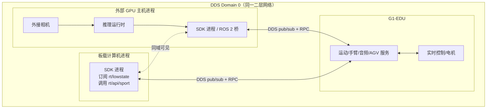
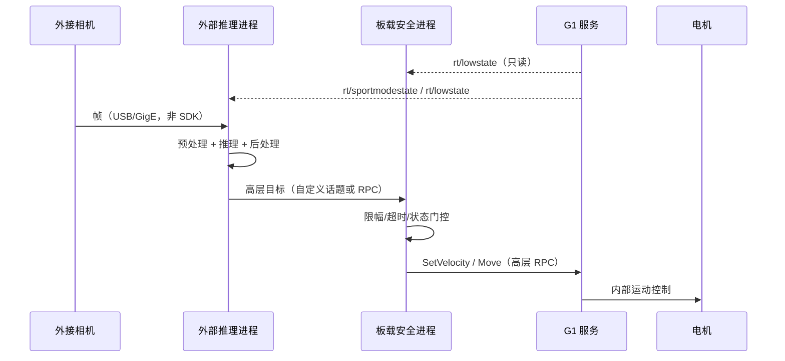

# 12 · 网络、DDS 域与部署拓扑

> 目标：回答 G1-EDU 部署时最容易踩的四个问题：**连哪张网卡、用哪个域、会不会串机器人、断网后机器人会不会继续动**。
>
> 本文以 SDK 头文件、示例和随附 CycloneDDS 0.10.2 为依据；DDS 默认行为（组播发现、端口、QoS）属于外部实现知识，标为【推断】，未在本工作区实测。

---

## 1. 结论先行

| 结论 | 证据等级 | 说明 |
|---|---|---|
| 所有 G1 示例都用 DDS 域 `0` 初始化 | 【示例】 | 如 `g1_ankle_swing_example.cpp:180`、`g1_loco_client_example.cpp:48`；机器人服务端实际域配置未在 SDK 中暴露 |
| `ChannelFactory::Init` 支持三种形式：域+网卡、配置文件、`JsonMap` | 【源码】 | `channel_factory.hpp:25-27` |
| 第二参数在示例中传的是**网卡名**（如 `eth0`），但它在库内的解析方式未公开 | 【示例】/【未验证】 | 示例参数名 `networkInterface`；`DdsFactoryModel::Init` 形参名却是 `ddsConfig`（`dds_factory_model.hpp:17`） |
| G1 高层示例的默认网卡是 `"lo"`，不是自动选择外网口 | 【示例】 | `g1_loco_client_example.cpp:21`；在机器人上直接运行很可能连不上，必须显式覆盖 |
| 部分示例不传网卡，走空字符串默认值 | 【示例】 | `g1_hand_sdk_example.cpp:58-62`、`g1_agv_client_example.cpp:15`；多网卡主机上结果不确定 |
| `ChannelFactory` **没有公开 QoS 设置接口** | 【源码】 | `channel_factory.hpp:16-57` 仅有 Init/Create/Release；QoS 由库内默认值或 JSON 配置决定 |
| 两个机器人若在同一 DDS 域、同一二层网络，话题名相同，存在**串数据/串控制**风险 | 【推断】 | 话题名固定为 `rt/...`，不含机器人 ID；未实测 |
| 断网后高层 `Move` 的连续运动不会被 DDS 自动取消 | 【源码】/【推断】 | `Move` 连续模式时长 864000 s（`g1_loco_client.hpp:232-236`）；断链保护需应用层实现 |
| SDK 没有 DDS Security（认证/加密）相关 API | 【源码】 | 在 `include/unitree` 搜索 `dds security/encrypt/authentication` 无结果 |
| G1 的相机/雷达数据不经过这套 DDS；视觉链路需另建 | 【源码】/【示例】 | 见 `07_sensors_and_camera.md` |

---

## 2. 通信模型与部署拓扑

### 2.1 逻辑拓扑



三个要点：

1. **DDS 是总线，不是点对点连接**。同一域内的任何 participant 都能发现同名话题；没有“只发给某台机器人”的地址概念。
2. **RPC 也是 DDS 话题**：`rt/api/<service>/request|response`（见 `02_dds_rpc_client_server.md`）。
3. **G1 的相机不在总线内**。外接相机走 USB/GigE/厂商 SDK，视觉数据由你自己的进程搬运。

### 2.2 三种典型部署

| 方案 | 计算位置 | 优点 | 缺点/风险 | 建议 |
|---|---|---|---|---|
| A. 全部板载 | G1 板载计算机 | 无网络不确定性、延迟最低 | 算力/散热/内存受限 | 控制与安全优先选 A |
| B. 外部 GPU 主机 | 外部主机做感知/推理，DDS 发高层指令 | 算力强、迭代快 | 网络抖动/断链；高层连续指令可能继续执行 | 必须加板载看门狗与指令超时 |
| C. 分层 | 板载跑状态监控、安全门、低层控制；外部只发目标 | 兼顾算力与安全 | 架构复杂、需定义契约 | **推荐的视觉模型部署形态** |

方案 B/C 的关键不是“能不能通信”，而是**外部进程死掉后机器人是否安全**。详见第 8 节。

---

## 3. 初始化：域与网卡

### 3.1 API

【源码】`include/unitree/robot/channel/channel_factory.hpp:25-27`：

```cpp
void Init(int32_t domainId, const std::string& networkInterface = "");
void Init(const std::string& configFileName = "");
void Init(const common::JsonMap& jsonMap);
```

| 形式 | 用途 | 证据 |
|---|---|---|
| `Init(domainId, networkInterface)` | 最常用；域 + 网卡名/配置串 | 所有 G1 示例 |
| `Init(configFileName)` | 读取 JSON 参数文件 | `channel_factory.hpp:26`；库内字符串含 `dds_parameter.json`（`dds_easy_model.hpp:9`） |
| `Init(jsonMap)` | 程序内构造配置 | `channel_factory.hpp:27` |

【源码】`ChannelFactory` 持有 `mInited` 标志（`:54`），但没有公开查询接口；是否允许重复 `Init` 由预编译实现决定【未验证】。工程上应保证**进程启动时初始化一次**，且在任何 Channel 创建之前完成。

### 3.2 域 ID

- 所有 G1 示例使用 `Init(0, ...)`；高层 RPC 与低层话题都在同一个域。
- 机器人服务端监听哪个域，SDK 没有提供查询或修改 API。实际部署应以“示例 + 机器人默认配置”为准，并通过只读 RPC 验证【未验证】。
- 域不同 = 互相不可见。不要为了“隔离”随意改客户端域，除非确认机器人侧也改到同一域。

### 3.3 网卡参数

示例中的写法：

| 示例 | 初始化 | 备注 |
|---|---|---|
| `g1_loco_client_example.cpp` | `Init(0, args["network_interface"])`（`:48-49`），默认 `"lo"`（`:21`） | 可用 `--network_interface=eth0` 覆盖 |
| `g1_ankle_swing_example.cpp` | `Init(0, argv[1])`（`:180`），必须传参（`:363-366`） | 低层控制示例 |
| `g1_arm7_sdk_dds_example.cpp` | `Init(0, argv[1])`（`:68`），必须传参（`:62-66`） | 手臂 SDK |
| `g1_hand_sdk_example.cpp` | 有参数则 `Init(0, argv[1])`，否则 `Init(0)`（`:58-62`） | 空字符串走默认 |
| `g1_dex3_example.cpp` | `Init(0, argv[1])`（`:268`），必须传参 | 灵巧手 |
| `g1d_waist_example.cpp` | `Init(0, argv[1])`（`:33`） | G1D 腰部 |
| `g1_agv_client_example.cpp` | `Init(0)`（`:15`） | 不指定网卡 |
| `g1_arm_action_example.cpp` | `Init(0, vm["network"])`（`:37`），默认空串（`:22`） | Boost 参数 |
| `terminations.cpp` | `Init(0, vm["network"])`（`:23`），默认空串（`:15`） | 安全判据示例 |

【示例】`g1_hand_sdk_example.cpp:12-13` 的注释直接写明：

```text
./hand_sdk_example              # use default network interface
./hand_sdk_example eth0         # specify a network interface
```

这说明传网卡名是预期用法；但**“默认网卡”具体选哪张，由 DDS/系统路由决定**，SDK 没有文档化的选择规则【未验证】。

### 3.4 `"lo"` 默认值的陷阱

`g1_loco_client_example.cpp:21` 默认 `network_interface = "lo"`。这通常适用于“机器人服务就在本机回环”的场景；如果 SDK 进程在外部主机、或机器人服务绑定在 `eth0`，【推断】直接运行会表现为：

- `client.Init()` 不报错；
- 只读 RPC 一直超时（默认 1 s，`client_base.hpp:14`）或返回错误；
- 订阅 `rt/lowstate` 收不到数据。

处理：显式传实际网卡，例如：

```bash
./g1_loco_client --network_interface=eth0 --get_fsm_id
```

【未验证】网卡名需按目标机 `ip link` 的实际名称替换；不要照抄 `eth0`。

### 3.5 空字符串意味着什么

`Init(0)` 的默认参数是 `""`（`channel_factory.hpp:25`）。它会被传给底层 DDS 配置。可能的结果：

- 由 CycloneDDS 按系统路由/默认接口选择；
- 在多网卡、VPN、Docker bridge、双网卡机器人上选错接口；
- 表现为“本机订阅正常、外部主机收不到”或反之。

因此生产部署**总是显式指定网卡**，不要依赖空字符串。

### 3.6 JSON 配置形式

【源码】`dds_parameter.hpp:7-17` 定义了配置键：

```text
Participant, DomainId, Config, Name, Topic, TopicName,
Publisher, Subscriber, Writer, Reader, Qos
```

`DdsEasyModel` 默认配置文件名是 `dds_parameter.json`（`dds_easy_model.hpp:9`）。仓库内没有该 JSON 的示例文件，字段嵌套/取值格式未验证。除非需要精细 QoS，否则优先用 `Init(domainId, interface)`。

---

## 4. 域隔离与多机器人串扰（高风险）

### 4.1 为什么会串

DDS 的匹配条件是：**同一域 + 同名话题 + 类型兼容 + QoS 兼容**。G1 的话题名是固定的：

```text
rt/lowstate
rt/lowcmd
rt/sportmodestate
rt/api/sport/request
rt/api/sport/response
...
```

这些名字里**没有机器人序列号**。因此：

- 同一域内两台 G1，状态订阅者会把两台的状态混在一起；
- 向 `rt/api/sport/request` 发指令，两台机器人上的 sport 服务都可能收到并执行；
- 向 `rt/lowcmd` 发布，所有订阅该话题的机器人都会收到（若处于可接收模式）。

【推断】以上是 DDS 名称匹配的直接结果；本次没有两台机器人可实测。风险等级：**高**，尤其涉及运动指令。

### 4.2 隔离手段

| 手段 | 可行性 | 说明 |
|---|---|---|
| 每台机器人独立 VLAN / 独立交换机 | 推荐 | 最可靠，不依赖 SDK 配置 |
| 每台机器人独立物理网段 | 推荐 | 现场最简单 |
| 修改机器人 DDS 域 | 需厂商支持 | SDK 客户端可改域，但机器人服务端域配置不在本 SDK 内【未验证】 |
| 依赖话题前缀/分区 | 不可行 | SDK 的 `ChannelNamer` 固定生成 `rt/...`，没有分区参数（见 `01_channel_communication.md`） |
| 依赖客户端 ID 过滤 | 不可行 | DDS 按话题匹配，不按客户端过滤 |

**不要**把两台 G1 接在同一交换机、同一域上做“联调”，除非只做只读且确认没有控制发布者。

### 4.3 多进程同机

- 每个进程调用一次 `ChannelFactory::Init`，各自创建 participant；同一域内可以共存。
- 多个进程同时向 `rt/lowcmd` 发布是危险的：最终电机收到的是混合/竞争后的指令。
- 建议用进程监管保证**同一时刻只有一个低层命令发布者**；调试工具默认只读。

---

## 5. 网络规划：组播、端口、容器与 Wi-Fi

### 5.1 发现机制

CycloneDDS 默认使用组播进行 participant 发现【推断】。这意味着：

- 机器人与主机必须在同一二层网络，或网络设备正确转发组播；
- 交换机开启 IGMP snooping 时，要确保组播加入正常；
- VPN、NAT、云主机通常阻断组播，DDS 发现会失败；
- 双网卡主机可能从错误网卡发出发现报文，导致“单向可见”。

【推断】CycloneDDS 域 0 的默认发现组播地址/端口通常为 `239.255.0.1:7400`，域 ID 每增加 1，端口偏移 250。该数值来自 CycloneDDS 通用默认值，**未在本 SDK 构建上抓包验证**；现场应以 `tcpdump` 为准。

### 5.2 防火墙

DDS 不只是“一个固定端口”：

- 发现使用组播端口；
- 用户数据使用动态分配的 unicast UDP 端口；
- 因此按端口白名单放行很脆弱。

建议：

1. 控制网独立，不与办公网/互联网互通；
2. 在交换机层做 VLAN/ACL，而不是在主机上精细开洞；
3. 必须用主机防火墙时，先抓包确认实际端口范围，再做同网段放行；
4. 不要把 DDS 网卡暴露到公网。

### 5.3 Docker / 容器

- 默认 `bridge` 网络通常无法收发组播，DDS 发现失败；
- 使用 `--network host` 或 macvlan，并显式传宿主网卡名；
- 容器内 `lo` 只覆盖容器自身，不能代表宿主；
- 容器化后要重新验证 `rt/lowstate` 能否收到【未验证】。

### 5.4 Wi-Fi

- 组播在 Wi-Fi 上常被降速、丢包或过滤；
- 机器人运动控制不建议走 Wi-Fi；
- 视觉调试若必须无线，至少把控制链路留在有线，且设置指令超时。

### 5.5 带宽粗算

| 数据 | 频率/规模 | 量级 | 说明 |
|---|---|---|---|
| `rt/lowstate` / `rt/lowcmd` | 示例控制周期 500 Hz（`g1_ankle_swing_example.cpp:202-203`，非 Topic 实测频率） | 约 KB/s～百 KB/s 级【推断】 | 消息为固定小结构，带宽不是瓶颈 |
| 高层 RPC | 事件触发 | 极小 | 1 s 默认超时 |
| 外接 1080p30 RGB 原始帧 | 1920×1080×3×30 | ≈186 MB/s ≈1.5 Gbps | 不可能与 1 GbE 控制网共享 |
| 压缩视频 | 取决于编码器 | 数 Mbps～数十 Mbps | 必须与 DDS 控制流量做 QoS/隔离 |

结论：**控制流怕的是抖动和丢包，不是吞吐；视觉流怕的是抢占带宽**。两者应分网卡/VLAN，至少在交换机上做优先级。

---

## 6. QoS：SDK 不暴露，互通需实测

【源码】`ChannelFactory` 的公开接口只有：

```cpp
void Init(...);
void Release();
template<typename MSG> ChannelPtr<MSG> CreateSendChannel(const std::string& name);
template<typename MSG> ChannelPtr<MSG> CreateRecvChannel(const std::string& name,
                                                         std::function<void(const void*)> callback,
                                                         int32_t queuelen = 0);
```

（`channel_factory.hpp:25-45`）

没有 `SetQos`、没有 reliability/durability/history 参数。`DdsFactoryModel` 内部持有各类 QoS（`dds_factory_model.hpp:47-52`），但 `ChannelFactory` 未暴露 setter。

影响：

- SDK 进程之间的 QoS 由库内默认值决定，用户无法从公开 API 调整；
- 与 ROS 2、其他 DDS 实现互通时，QoS 不兼容会导致“能发现、收不到数据”；
- `ChannelSubscriber` 的 `queuelen` 只是**应用层队列长度**，不是 DDS History/Reliability（见 `08_concurrency_and_lifecycle.md`）。

【未验证】SDK 默认 QoS 的具体取值（Reliable/BestEffort、Volatile/TransientLocal、History depth）。在 ROS 2 桥接前，必须用实际订阅测试确认；不能假设与 ROS 2 默认值一致。

若确实需要 QoS 配置，只能走 `Init(configFileName)` / `Init(JsonMap)` 的 JSON 路径；字段格式无仓库示例，属于未验证区域。

---

## 7. 多主机/多进程数据流

### 7.1 推荐的外部推理数据流



关键设计：

- **推理进程不直接发低层命令**；由板载安全进程做最后一道门。
- 外部进程只发“目标”，不发“持续使能”。板载进程维护心跳，超时即 `StopMove`/`Damp`（需确认当前 FSM 与安全策略）。
- 视觉时间戳与 DDS 状态时间戳分别记录，不要混用。

### 7.2 时间与时钟

- `LowState_` 只有 `tick`（`unitree_hg/LowState_.hpp:28-36`），不是 Unix 时间；
- `IMUState_` 没有时间戳字段（`IMUState_.hpp:24-30`）；
- `SportModeState_` 只有 `task_time`（`SportModeState_.hpp:20-26`）；
- 因此接收端通常用**本机单调时钟**记录到达时间；多主机融合需要 PTP/chrony 同步主机时钟【推断】。

### 7.3 延迟预算

| 环节 | 典型值 | 证据 |
|---|---|---|
| 创建 publisher 后等待匹配 | 固定 100 ms | `dds_topic_channel.hpp:22,45` |
| RPC 默认超时 | 1 s | `client_base.hpp:14` |
| 状态“失联”判据 | 1000 ms | `terminations.hpp:81-86` |
| 低层控制周期 | 2 ms（500 Hz） | 示例 `g1_ankle_swing_example.cpp:202-203` |
| 高层 `Move` 连续模式时长 | 864000 s | `g1_loco_client.hpp:232-236` |

不要把推理放在 DDS 回调线程里；回调阻塞会导致该 reader 停止取数（`08_concurrency_and_lifecycle.md`）。

---

## 8. 断网/进程崩溃时的行为（安全关键）

### 8.1 高层连续运动不会自动停

【源码】`LocoClient::Move` 在连续模式下发送的时长是 864000 s：

```cpp
// g1_loco_client.hpp:232-236（摘要）
int32_t Move(float vx, float vy, float vyaw, bool continous_move)
{
    return SetVelocity(vx, vy, vyaw, continous_move ? 864000.f : 1.f);
}
```

含义：

- 调用一次 `Move(..., true)` 后，机器人按该速度持续运动；
- 如果外部主机断网/崩溃，SDK 不会发送“停止”；
- 机器人是否因 DDS 断链自动停止，取决于机器人内部策略，**SDK 不保证**【未验证】。

### 8.2 应用层看门狗

外部控制进程必须实现：

1. 板载进程周期性检查外部心跳（自定义 DDS 话题或 RPC）；
2. 超过 N 个周期未收到心跳 → `StopMove()`，必要时 `Damp()`；
3. 同时检查 `rt/lowstate` 新鲜度（`GetLastDataAvailableTime`，`channel_subscriber.hpp:47-55`）；
4. 任何异常/退出路径都执行停止与 `ChannelFactory::Release()`。

【未验证】`StopMove`/`Damp` 在当前 FSM 下是否一定生效；需在支撑/吊装条件下逐项验证。

### 8.3 低层命令断流

- `rt/lowcmd` 是持续流；发布者停止后，机器人固件是否有超时保护未在 SDK 中体现【未验证】；
- `rt/user_lowcmd` 还要求 FSM 处于 PASSIVE（`g1_userctrl_dds_example.cpp:97-101`）；
- 不要让“控制进程崩溃”成为唯一的停止机制。

---

## 9. 安全边界：DDS 没有认证

【源码】在 `include/unitree` 中搜索 `dds security`、`encrypt`、`authentication`、`access control`，无结果。结合 DDS 默认配置：

- 同一域内任何主机都可以订阅状态、调用 RPC、发布话题；
- 没有身份认证、访问控制、加密；
- 能发 `rt/lowcmd` 或调用运动 RPC 的一方，就具备让机器人运动的能力。

部署要求：

1. 控制网络物理隔离或严格 VLAN；
2. 不把机器人网络接入办公网/互联网；
3. 调试主机专机专用，禁止随意运行未知 SDK 程序；
4. 对运动服务做上层授权与急停，不依赖 DDS 安全；
5. 生产环境关闭不必要的调试发布者。

> 这不是“SDK 缺陷”，而是 DDS 默认安全模型的边界。需要加密/认证时，必须引入 DDS Security 或额外的网络层方案，且与现有 SDK 的兼容性未验证。

---

## 10. 部署检查清单

### 10.1 上机前

- [ ] 确认目标机架构（`uname -m`）与 SDK `lib/<arch>` 匹配。
- [ ] 确认使用哪张网卡连接机器人，记录名称与 IP。
- [ ] 确认机器人 `ping` 通，且没有其他设备占用同网段。
- [ ] 确认该网段只有一台 G1，或已做 VLAN 隔离。
- [ ] 确认没有其他进程在发布 `rt/lowcmd` / 调用运动 RPC。
- [ ] 机器人处于支撑/吊装状态，急停可用。

### 10.2 只读验证（不动机器人）

```bash
ip -br addr
ip route
ping -c 3 <robot-ip>
ss -lunp | head
```

然后运行只读程序：

- 订阅 `rt/lowstate`，打印 `tick`、IMU、关节数；
- 调用 `LocoClient::GetFsmId`、`GetStandHeight`；
- 观察 1 s 超时是否频繁。

【未验证】以上命令与程序本次均未在机器人上运行。

### 10.3 联调

- [ ] 记录网络拓扑、网卡、域 ID、SDK/机器人版本。
- [ ] 用 `tcpdump` 确认发现报文与实际数据端口。
- [ ] 测试断网：拔掉外部主机网线，确认板载看门狗在约定时间内停止运动。
- [ ] 测试进程崩溃：`kill -9` 外部进程，确认机器人安全。
- [ ] 测试多主机：确认没有第二台机器人/第二个发布者。
- [ ] 记录端到端延迟分布（P50/P95/P99），不只是平均值。

### 10.4 上线后

- [ ] 关闭调试 shell 与临时发布者。
- [ ] 固定网卡名/IP/域配置，纳入版本管理。
- [ ] 记录安全停止路径与责任人。
- [ ] 监控 `rt/lowstate` 新鲜度、RPC 错误码、DDS 重连。

---

## 11. 常见网络故障排查

| 现象 | 可能原因 | 排查 |
|---|---|---|
| `client.Init()` 成功但 RPC 全超时 | 域不对、网卡不对、机器人服务未启动 | 用只读订阅确认同一域/网卡能收到 `rt/lowstate` |
| 本机能收到，外部主机收不到 | 组播被阻断、选错网卡、防火墙 | `tcpdump -ni <if>` 看发现报文；换交换机/网段 |
| 外部主机能 ping 通但 DDS 不通 | 组播/VPN/NAT、Docker bridge | 改用 host 网络；检查 IGMP；抓包 |
| 两个程序都能发现，但收不到数据 | QoS 不兼容、类型不一致 | 核对消息类型与 QoS；先用 SDK 自带示例对测 |
| 数据时有时无 | Wi-Fi、丢包、回调阻塞、队列溢出 | 有线；检查回调耗时；调 `queuelen` |
| 机器人收到重复/冲突指令 | 同域多个发布者 | 进程排查；隔离网络；只保留一个控制源 |
| 两台机器人状态混在一起 | 同域同话题 | 立即隔离网络；不要继续发控制 |
| `libddsc.so.0` 找不到 | 运行时库路径 | 见 `11_build_and_link.md` 第 7 节 |
| 容器内完全收不到 | bridge 网络阻断组播 | `--network host`；显式网卡 |
| RPC 偶发超时 | 网络抖动、服务忙、1 s 超时太短 | 记录错误码；不要盲目加大超时掩盖问题 |

---

## 12. 能力归属划分

| 能力 | SDK 原生 | 开发者适配 | 第三方 | 未确认 |
|---|---|---|---|---|
| DDS 域/网卡初始化 | 是（`Init`） | 需选对参数 | — | 网卡名解析细节 |
| QoS 调整 | 否（未公开） | JSON 配置/改库 | DDS 工具 | 默认 QoS 值 |
| 多机器人隔离 | 否 | VLAN/物理隔离 | 交换机 | 机器人域配置 |
| 断链看门狗 | 否 | 是 | — | 固件自身保护 |
| DDS 加密/认证 | 否 | 是 | DDS Security | 与 SDK 兼容性 |
| 视觉传输 | 否（G1） | 是 | 相机厂商 SDK/GStreamer | — |
| ROS 2 互通 | 否 | 是（独立桥进程） | ROS 2 | QoS/类型兼容 |

---

## 13. 未验证项

| 项 | 状态 | 影响 |
|---|---|---|
| 机器人服务实际监听的 DDS 域 | 【未验证】 | 改域可能直接失联 |
| 网卡名字符串在库内的解析方式 | 【未验证】 | 非 `eth0` 命名/配置串可能不生效 |
| SDK 默认 QoS | 【未验证】 | 与 ROS 2/其他 DDS 互通可能失败 |
| 域 0 组播地址/端口 | 【推断】 | 防火墙配置需抓包确认 |
| 多机器人同域串扰 | 【推断】 | 高风险，必须按最坏情况隔离 |
| 断网后机器人固件行为 | 【未验证】 | 不能依赖自动停止 |
| 容器/双网卡场景 | 【未验证】 | 需现场验证 |

---

## 14. 相关文档

- 通信与回调：`01_channel_communication.md`
- RPC 错误码与超时：`02_dds_rpc_client_server.md`
- 状态新鲜度与安全判据：`04_robot_state.md`
- 高层连续运动语义：`05_g1_high_level_control.md`
- 并发与关闭顺序：`08_concurrency_and_lifecycle.md`
- ROS 2 共存：`09_ros2_integration.md`
- 构建与运行库路径：`11_build_and_link.md`
