# G1-EDU 部署优先级（P0 / P1 / P2）

> 目标：把“SDK 有什么”转换成“先学什么、先验证什么、什么可以晚点碰”。
> 本文的 P 级别表示**部署必要性**，不是 API 的重要性，也不是风险级别；风险另用 R0–R3 标注（见 [13](13_examples_index.md)）。
> 所有验证方法默认**只读**；涉及运动的验证必须另行授权，并在支撑/吊装、急停可用、场地隔离的条件下进行。

---

## 0. 前提与边界

- SDK 不提供 G1 相机、雷达、推理运行时、ROS 2 包；这些属于“自建适配层”，本文会明确标出【非 SDK】。
- 预编译静态库的内部行为不可见；所有“运行时保证”都必须实测。
- 本文不提供任何可直接运行的运动示例，只给出**只读验证**与工程检查方法。
- 参考文档：[README](README.md)、[00 总览](00_sdk_overview.md)、[api_index](api_index.md)、[known_limitations](known_limitations.md)。

---

## 1. 总览

```mermaid
flowchart LR
    subgraph P0[P0 · 跑通与可观测]
        A[通信初始化/通道]
        B[构建/链接/运行]
        C[网络/DDS 配置]
        D[生命周期/线程/退出]
        E[日志/错误/清理]
        F[相机采集/图像契约]
    end

    subgraph P1[P1 · 状态与集成]
        G[机器人状态订阅]
        H[IMU/手柄/其他传感器]
        I[异步/多线程架构]
        J[推理 I/O 适配]
        K[ROS 2 桥接]
        L[服务/IPC]
    end

    subgraph P2[P2 · 控制与优化]
        M[高层运动控制]
        N[低层/手臂/手部]
        O[复杂状态机]
        P[低延迟优化]
        Q[SDK 内部/仿真差异]
    end

    P0 --> P1 --> P2
```



| 级别 | 目标 | 完成标志 | 建议投入 |
|---|---|---|---|
| **P0** | 能安全地启动、收数据、看日志、正常退出 | 只读监控稳定运行 30 min，无崩溃/卡死 | 第 1 周 |
| **P1** | 状态可用于推理门控与集成 | 状态新鲜度、推理输入、ROS 2/服务链路可观测 | 第 2–3 周 |
| **P2** | 能控制机器人并优化 | 仅在安全评审通过后，单变量、低幅度验证 | 第 4 周以后 |

---

## 2. P0：跑通与可观测

### P0-1 通信初始化与通道

| 项 | 内容 |
|---|---|
| **真实 API** | `ChannelFactory::Instance()->Init(int32_t domainId, const std::string& networkInterface)`；`Init(const std::string& configFileName)`；`Init(const common::JsonMap&)`；`CreateSendChannel<MSG>`；`CreateRecvChannel<MSG>`；`ChannelPublisher<MSG>::InitChannel/Write/CloseChannel`；`ChannelSubscriber<MSG>::InitChannel/CloseChannel/GetLastDataAvailableTime` |
| **源码位置** | `unitree_sdk2/include/unitree/robot/channel/channel_factory.hpp:19-45`；`channel_publisher.hpp:14-41`；`channel_subscriber.hpp:14-60`；`common/dds/dds_topic_channel.hpp:22,45`；`common/dds/dds_entity.hpp:252-338` |
| **部署用途** | 所有 DDS 通信的前置；状态订阅、RPC、低层发布都依赖它 |
| **前置条件** | 知道机器人网段/网卡名；确认没有第二个控制进程；理解 `queuelen` 的两种回调模型 |
| **学习顺序** | 1. `Instance()` → `Init(domain, iface)`；2. 只读订阅；3. 发布自定义话题；4. `queuelen` 与回调线程 |
| **最小验证（只读）** | 写一个程序：`Init(0, "eth0")` → `ChannelSubscriber<LowState_>("rt/lowstate")`，`queuelen=1` 与 `0` 各跑 10 s，统计消息数、`GetLastDataAvailableTime()`、CRC；确认无消息时不会崩溃 |
| **风险 / 未确认** | Init 前创建通道是未定义行为（`channel_factory.hpp:32-45` 直接解引用）；默认网卡选择规则未文档化；`Init` 失败是否抛异常未验证；`CloseChannel` 后回调是否在途未验证 |
| **风险级别** | R0（只读）；若用于发布则 R2/R3 |

**最小只读骨架（已编译通过，仅示意，未运行）**：

```cpp
#include <unitree/robot/channel/channel_factory.hpp>
#include <unitree/robot/channel/channel_subscriber.hpp>
#include <unitree/idl/hg/LowState_.hpp>
#include <atomic>
#include <chrono>
#include <thread>
#include <iostream>

int main() {
  unitree::robot::ChannelFactory::Instance()->Init(0, "eth0"); // 换成实际网卡

  std::atomic<uint64_t> count{0};
  auto sub = std::make_shared<
      unitree::robot::ChannelSubscriber<unitree_hg::msg::dds_::LowState_>>(
      "rt/lowstate");
  sub->InitChannel([&count](const void*) { count.fetch_add(1); }, 1);

  std::this_thread::sleep_for(std::chrono::seconds(10));
  std::cout << "messages: " << count.load()
            << " last: " << sub->GetLastDataAvailableTime() << std::endl;
  sub->CloseChannel();
  unitree::robot::ChannelFactory::Instance()->Release();
}
```

> 这段代码已用 g++ 编译通过（未运行）；`Release()` 的时序和 `CloseChannel()` 的回调保证仍【未验证】。先用它测“能否稳定收数据”，不要接机器人控制。

**完成标准**：

- [ ] 能解释 `queuelen=0` 与 `>0` 的回调线程差异；
- [ ] 能读出 `LowState_` 的关节数、`mode_machine`、`tick`、CRC；
- [ ] 10 s 内消息数稳定，断网后能检测到超时；
- [ ] 退出时无卡死（至少重复 20 次）。

---

### P0-2 相机采集与解码【非 SDK】

| 项 | 内容 |
|---|---|
| **真实 API** | **SDK 没有 G1 相机 API**。视觉输入必须使用第三方相机 SDK/驱动（如 V4L2、GStreamer、厂商 SDK、OpenCV `cv::VideoCapture` 等）；这些不是 Unitree SDK 的一部分 |
| **源码位置** | 反证：`include/unitree/robot/g1/` 无 video/camera；视频客户端仅存在于 `go2/video/video_client.hpp` 与 `b2/{front_video,back_video}/`；`include/unitree/idl/ros2/` 无 `sensor_msgs/Image` |
| **部署用途** | 为推理提供图像帧；需要自己定义分辨率、编码、像素格式、时间戳、帧 ID |
| **前置条件** | 相机可在目标机（x86_64 或 aarch64）上出流；有稳定的驱动/权限；知道曝光/白平衡/帧率配置 |
| **学习顺序** | 1. 离线视频/单帧采集；2. 实时流；3. 时间戳与帧 ID；4. 零拷贝/共享内存（可选） |
| **最小验证（只读）** | 用离线视频或相机对着静态场景，采集 300 帧，记录分辨率、像素格式、帧率、时间戳单调性、丢帧数；确认解码后的图像尺寸与模型输入一致 |
| **风险 / 未确认** | G1 机身相机是否可通过非 SDK 通道访问【未验证】；USB/GMSL 带宽与供电；相机时钟与机器人时钟是否同步【未验证】；图像时间戳没有 SDK 统一来源 |
| **风险级别** | R0（只采集，不控制） |

**图像契约必须先定下来**（否则后面推理/控制全要返工）：

| 字段 | 建议 | 说明 |
|---|---|---|
| 分辨率 | 与模型输入一致或可无损缩放 | 记录原始分辨率，不要只存缩放后 |
| 像素格式 | BGR8 / RGB8 / NV12 / GRAY8 | 明确是否做了颜色空间转换 |
| 编码 | 原始 / JPEG / H.264 | 原始带宽大；编码增加延迟与解码步骤 |
| 时间戳 | 单调时钟，单位统一 | 与机器人 `tick` 的对应关系要明确 |
| 帧 ID | 单调递增 | 用于丢帧检测 |
| 相机标定 | 内参/畸变 | 视觉模型需要时提前采集 |

详见 [07](07_sensors_and_camera.md) §4、§6。

---

### P0-3 图像消息结构与编码【非 SDK】

| 项 | 内容 |
|---|---|
| **真实 API** | SDK 没有图像消息类型。可选：自定义 DDS IDL、共享内存、ZeroMQ、ROS 2 `sensor_msgs/Image`（需自建桥）；**这些都不是 SDK 原生 API** |
| **源码位置** | `include/unitree/idl/ros2/` 类型清单；无 Image/CompressedImage/CameraInfo |
| **部署用途** | 把相机帧从采集进程传到推理进程，或从推理进程传到控制/记录进程 |
| **前置条件** | 已确定分辨率/编码/时间戳；已评估带宽与延迟；已决定进程内还是跨进程 |
| **学习顺序** | 1. 进程内 `cv::Mat`/缓冲区；2. 同机共享内存；3. 跨机 DDS/网络 |
| **最小验证（只读）** | 用固定图像序列做端到端传输，校验：字节数、分辨率、像素格式、时间戳、帧 ID、CRC/哈希；统计 P50/P95 延迟 |
| **风险 / 未确认** | 大图像走 DDS 的默认 QoS/分片行为未验证；共享内存的生命周期/同步需自己实现；ROS 2 Image 与 SDK DDS 的兼容性未验证 |
| **风险级别** | R0 |

**不要做的事**：

- 不要发明 `unitree_hg::msg::dds_::Image_` 之类不存在的类型；
- 不要把 `std_msgs::msg::dds_::String_` 塞二进制图像（示例的音频事件才用它）；
- 不要假设 `VideoClient` 能用于 G1。

---

### P0-4 构建、链接与运行

| 项 | 内容 |
|---|---|
| **真实 API/目标** | CMake 导入目标 `unitree_sdk2`；`find_package(unitree_sdk2 REQUIRED)`；静态库 `libunitree_sdk2.a`；DDS 共享库 `libddsc.so.0`、`libddscxx.so.0` |
| **源码位置** | `CMakeLists.txt:38-82`；`cmake/unitree_sdk2Targets.cmake:48-70`；`cmake/unitree_sdk2Config.cmake.in`；`thirdparty/CMakeLists.txt:3-35`；`README.md:4-57` |
| **部署用途** | 在目标机/交叉编译环境生成可执行文件，并确保运行时找到 DDS `.so` |
| **前置条件** | CMake ≥ 3.10（README）/ 3.5（CMakeLists）；C++17；目标架构匹配；Eigen（若包含 G1 封装头）；Boost/yaml-cpp（仅部分示例） |
| **学习顺序** | 1. 构建 SDK/安装；2. 用 `find_package` 建最小程序；3. 手动 `g++` 链接（理解依赖）；4. 部署到目标机并检查 `ldd` |
| **最小验证（只读）** | 编译一个只包含 `ChannelFactory`/`ChannelSubscriber` 的程序，链接 `unitree_sdk2` + `ddsc` + `ddscxx` + `Threads`；在目标机运行 `ldd` 确认 DDS 库解析；不连机器人也能启动/退出 |
| **风险 / 未确认** | 预编译库用 GCC 9.4/Ubuntu 20.04，目标机 GCC 13 的 ABI 兼容性未验证；`CMAKE_SYSTEM_PROCESSOR` 交叉编译可能选错架构；Eigen 未在 CMake 中声明 |
| **风险级别** | R0 |

**最小 CMake（未验证）**：

```cmake
cmake_minimum_required(VERSION 3.10)
project(g1_probe CXX)
set(CMAKE_CXX_STANDARD 17)
find_package(unitree_sdk2 REQUIRED)
add_executable(g1_probe main.cpp)
target_link_libraries(g1_probe PRIVATE unitree_sdk2)
```

如果 `find_package` 失败，检查 `CMAKE_PREFIX_PATH` 是否指向安装前缀（`README.md:57`）。手动链接时需要同时带 DDS 库与 pthread；不要把静态库的依赖漏掉。

详见 [11](11_build_and_link.md)。

---

### P0-5 网络与 DDS 配置

| 项 | 内容 |
|---|---|
| **真实 API** | `ChannelFactory::Init(int32_t domainId, const std::string& networkInterface)`；`Init(configFileName)` / `Init(JsonMap)`（JSON 字段未验证） |
| **源码位置** | `channel_factory.hpp:25-27`；`common/dds/dds_easy_model.hpp:9`（默认 `dds_parameter.json`）；示例全部 `Init(0, ...)` |
| **部署用途** | 确保进程与机器人处于同一 DDS domain、同一网卡/网段；避免多机串扰 |
| **前置条件** | 机器人 IP/网段已知；主机网卡名确认；交换机/防火墙允许组播；没有第二台机器人同域 |
| **学习顺序** | 1. `ping` 机器人；2. `Init(0, iface)` + 只读订阅；3. 确认 domain/网卡；4. 多机隔离 |
| **最小验证（只读）** | `ping`；只读订阅 `rt/lowstate` 10 s；用 DDS 工具/抓包确认发现流量；断开网线确认 `lost_connection` 触发 |
| **风险 / 未确认** | 默认 `"lo"` 陷阱；`Init(0)` 的默认网卡规则未文档化；QoS 不可配；无 DDS Security；多机同域会串扰；Wi-Fi 组播不可靠 |
| **风险级别** | R0（只读）；多机/控制场景 R3 |

**现场检查清单**：

- [ ] 机器人 `ping` 通，且没有其他设备占用同网段；
- [ ] 主机只有一张网卡通向机器人，或已明确绑定；
- [ ] 没有第二个 `rt/lowcmd` 发布者；
- [ ] 防火墙/安全组允许 DDS 发现与数据端口；
- [ ] 记录 domain、网卡、机器人序列号；
- [ ] 多机器人时一机一域/一网。

详见 [12](12_network_and_deployment.md)。

---

### P0-6 C++ 生命周期、后台线程与退出

| 项 | 内容 |
|---|---|
| **真实 API** | `ChannelFactory::Release()`；`ChannelSubscriber::CloseChannel()`；`ChannelPublisher::CloseChannel()`；`CreateRecurrentThreadEx(name, cpuId, intervalMicrosec, fn, args...)`；`RecurrentThread` 析构；`RealTimePublisher` 的 `stop()`/析构；`SubscriptionBase` |
| **源码位置** | `channel_factory.hpp:29`；`channel_subscriber.hpp:42-45`；`channel_publisher.hpp:33-36`；`common/thread/recurrent_thread.hpp:68-79`；`dds_wrapper/common/Publisher.h:56-68,133-162`；`dds_wrapper/common/Subscription.h:28-67` |
| **部署用途** | 避免退出卡死、回调在途访问已销毁对象、周期线程泄漏、发布线程 join 失败 |
| **前置条件** | 明确每个线程的 owner；明确回调里访问的对象生命周期；知道 `Release()` 的实现不可见 |
| **学习顺序** | 1. 栈上对象 + 显式 Close；2. 周期线程的停止；3. `RealTimePublisher` 析构；4. `Release()` 顺序 |
| **最小验证（只读）** | 创建/销毁订阅 100 次；启动/停止周期线程 100 次；用 `top`/`/proc/<pid>/task` 观察线程数是否回到基线；`strace -f` 看退出是否卡在 futex/join |
| **风险 / 未确认** | `Release()` 是否等待回调结束未验证；`CloseChannel` 后回调是否在途未验证；`RecurrentThread` 析构是否 join 未验证；`RealTimePublisher` 析构每 100 ms 轮询 `is_running_`，若发布线程不退出可能无限等待 |
| **风险级别** | R0（不动机器人） |

**推荐关闭顺序（保守，需实测）**：

1. 停止产生命令的周期线程（置退出标志，等待线程结束）；
2. 发布“安全/零增益/释放”命令（如果控制场景且已授权）；
3. `CloseChannel()` 所有 publisher/subscriber；
4. `ChannelFactory::Release()`；
5. 等待所有 `std::thread`/`RecurrentThread` 结束；
6. 最后销毁消息缓冲区和回调捕获的对象。

> 不要先 `Release()` 再关闭通道；也不要在回调仍可能触发时销毁捕获对象。回调里只做拷贝和入队，不做推理/IO/锁等待。

详见 [08](08_concurrency_and_lifecycle.md) §3、§6。

---

### P0-7 日志、错误与退出清理

| 项 | 内容 |
|---|---|
| **真实 API** | `LOG_DEBUG/LOG_INFO/LOG_WARNING/LOG_ERROR/LOG_FATAL(logger, ...)`；`UT_THROW` / `CommonException`；RPC 返回码 `0/3102-3107/3201-3207/7301-7303/7400-7402/7404/9101-9103/100` |
| **源码位置** | `common/log/log_decl.hpp:59-83`；`common/exception.hpp`；`robot/internal/internal_error.hpp`；`g1_loco_error.hpp:9-12`；`g1_arm_action_error.hpp:9-16`；`g1_agv_error.hpp:13-15`；`g1_audio_error.hpp:9` |
| **部署用途** | 现场定位“没数据/调用失败/退出卡住”；给安全审计留痕 |
| **前置条件** | 有 logger 实例；日志目录可写；错误码表随代码版本管理 |
| **学习顺序** | 1. 看懂 `Call` 返回码；2. 记录初始化/订阅/超时；3. 退出时 flush 日志 |
| **最小验证（只读）** | 故意传错服务名/网卡，观察错误码与日志；拔网线观察超时日志；发送 SIGINT 观察退出日志是否完整 |
| **风险 / 未确认** | `LOG_*` 需要 `Logger` 实例，不是全局 printf；异常类型/消息格式未验证；错误码可能随固件变化 |
| **风险级别** | R0 |

**日志最小字段**：时间戳、进程/线程、机器人 ID、domain/网卡、话题/服务名、API ID、返回码、状态新鲜度。不要只打印“failed”。

---

### P0-8 完成标准（Go/No-Go）

- [ ] 能在目标机构建并运行只读程序；
- [ ] 能稳定接收 `rt/lowstate`，并能解释 `queuelen` 行为；
- [ ] 能检测掉线/超时；
- [ ] 能优雅退出，无卡死/线程泄漏；
- [ ] 能说清相机从哪来、图像契约是什么；
- [ ] 能说清 DDS domain/网卡/多机隔离方案；
- [ ] 日志能定位“没数据”和“调用失败”。

全部满足后，才进入 P1。

---

## 3. P1：状态与集成

### P1-1 机器人状态订阅

| 项 | 内容 |
|---|---|
| **真实 API** | `ChannelSubscriber<unitree_hg::msg::dds_::LowState_>("rt/lowstate")`；`LowState_::motor_state()[i].q/dq/tau/temperature`；`imu_state()`；`wireless_remote()`；`mode_machine()`；`tick()`；`crc()`；`GetLastDataAvailableTime()` |
| **源码位置** | `include/unitree/idl/hg/LowState_.hpp:28-36`；`dds_wrapper/robots/g1/g1_sub.h:44-82`；`robot/g1/common/terminations.hpp` |
| **部署用途** | 推理门控、安全监控、状态记录、控制反馈 |
| **前置条件** | P0-1 完成；知道 29 DOF 与 35 槽的区别；知道 `mode_machine` 含义 |
| **学习顺序** | 1. 解析关节/IMU；2. 新鲜度与 CRC；3. 安全判据；4. 与推理结果做门控 |
| **最小验证（只读）** | 记录 1 min 状态：频率、`tick` 连续性、关节范围、IMU 姿态、温度、CRC 通过率；断网 2 s 验证 `lost_connection` |
| **风险 / 未确认** | `LowState_` 无时间戳（只有 `tick`）；35 槽中 29–34 含义不可假设；`wireless_remote` 是原始字节；BMS 不在 `LowState_` 中 |
| **风险级别** | R0 |

**不要做的事**：不要把 `motor_state[29..34]` 当关节；不要把 `SportModeState_` 当里程计；不要把 `tick` 当纳秒时间戳。

详见 [04](04_robot_state.md)、[03](03_message_types.md) §2.1。

---

### P1-2 IMU、手柄与其他传感器

| 项 | 内容 |
|---|---|
| **真实 API** | `rt/secondary_imu` → `unitree_hg::msg::dds_::IMUState_`；`LowState_::imu_state()`；`LowState_::wireless_remote()`（40 字节，需解析）；`rt/arm/action/state`（JSON 文本） |
| **源码位置** | `g1_ankle_swing_example.cpp:19,199-200`；`g1_sub.h:44-82`；`unitree_joystick.hpp`；`g1_arm_action_client.hpp:17-22` |
| **部署用途** | 姿态/角速度输入、手柄急停、手臂动作状态；副 IMU 可用于躯干姿态 |
| **前置条件** | P1-1；知道 `IMUState_` 没有时间戳（`IMUState_.hpp:24-28`）；知道手柄解析是示例代码，不是 SDK 公共 API |
| **学习顺序** | 1. 主 IMU；2. 副 IMU；3. 手柄原始字节解析；4. 动作状态 |
| **最小验证（只读）** | 静态放置 1 min，比较主/副 IMU 的 RPY 与陀螺零偏；按手柄键观察字节变化；执行一次只读 `GetActionList` 并订阅动作状态 |
| **风险 / 未确认** | 副 IMU 安装方向/坐标系未文档化；手柄超时阈值 3000 ms 是 `g1_sub.h:79` 的封装默认值，不是 SDK 契约；`rt/arm/action/state` 的消息类型未声明 |
| **风险级别** | R0 |

**雷达/点云**：SDK 没有 G1 雷达 API；需要外接厂商 SDK。不要在本 SDK 里找 `LaserScan`/`PointCloud2`。

---

### P1-3 异步与多线程架构

| 项 | 内容 |
|---|---|
| **真实 API** | `ChannelSubscriber::InitChannel(handler, queuelen)`；`SubscriptionBase`（带锁的 `msg_`）；`RealTimePublisher`；`CreateRecurrentThreadEx`；`common/BlockQueue`（头文件存在，但属于通用工具） |
| **源码位置** | `channel_subscriber.hpp:22-28`；`common/dds/dds_entity.hpp:252-338`；`dds_wrapper/common/Subscription.h:28-79`；`Publisher.h:37-174`；`recurrent_thread.hpp:68-79` |
| **部署用途** | 把 DDS 回调与推理/控制解耦；避免阻塞通信线程；保证最新帧 |
| **前置条件** | P1-1；明确“最新值”还是“每帧都要”的语义；明确队列容量与丢弃策略 |
| **学习顺序** | 1. 回调只拷贝；2. `queuelen=1` 的有界队列；3. 双缓冲/最新帧；4. 周期线程与看门狗 |
| **最小验证（只读）** | 人为在回调里 sleep 50 ms，观察消息堆积/丢弃；对比 `queuelen=0/1/10` 的行为；用 `perf`/时间戳统计回调延迟 |
| **风险 / 未确认** | 队列满时替换最旧元素（不是阻塞）；回调线程数/调度策略由 DDS 决定；`SubscriptionBase::wait_for_connection` 无超时；示例普遍存在数据竞争 |
| **风险级别** | R0 |

**架构建议**：

```
DDS 回调线程（只拷贝/入队）
    → 有界 LatestQueue（容量 1–2，丢旧）
        → 推理线程（GPU/CPU）
            → 结果队列（带时间戳）
                → 控制线程（固定周期，读最新结果）
                    → DDS 发布
```

不要让推理跑在 DDS 回调线程里；不要在控制线程里做图像解码/日志 IO。

详见 [08](08_concurrency_and_lifecycle.md)、[10](10_model_deployment_integration.md) §5。

---

### P1-4 推理 I/O 适配【非 SDK】

| 项 | 内容 |
|---|---|
| **真实 API** | SDK 没有推理 API。需要自建 `InferenceEngine` 接口（加载/预热/推理/释放）和图像/状态输入契约；可参考 [10](10_model_deployment_integration.md) §3 的接口设计 |
| **源码位置** | 无（SDK 不含推理运行时）；输入侧参考 `LowState_`、`rt/secondary_imu`；输出侧参考 `LocoClient`/`rt/lowcmd` |
| **部署用途** | 把视觉/状态输入变成模型张量，把模型输出变成安全的目标/命令 |
| **前置条件** | P0-2/P0-3 的图像契约；P1-1 的状态；目标机 GPU/CPU 与驱动；模型输入输出 shape/精度 |
| **学习顺序** | 1. 离线单帧推理；2. 实时流；3. 批处理/异步；4. 结果限幅与降级 |
| **最小验证（只读）** | 用固定图片/状态序列跑 100 次，校验输出一致性、P50/P95 延迟、显存/内存；不接控制 |
| **风险 / 未确认** | 图像/状态时间戳对齐；模型输出单位/坐标系；GPU 上下文与 DDS 线程的亲和性；推理失败时的降级策略 |
| **风险级别** | R0（只推理，不控制） |

**关键原则**：推理输出**不能直接**映射成关节命令；必须经过限幅、速率限制、状态门控和安全监控。

---

### P1-5 ROS 2 桥接【非 SDK】

| 项 | 内容 |
|---|---|
| **真实 API** | SDK 不提供 ROS 2 节点/包。桥接需要自己实现：DDS 类型映射、topic 重映射、QoS 适配；可用 CycloneDDS/rosidl 或独立桥进程 |
| **源码位置** | 无 `package.xml`；`include/unitree/idl/ros2/` 只有少量类型；`unitree_api`/`unitree_hg` IDL 可被 ROS 2 工具生成消息（需验证） |
| **部署用途** | 让 ROS 2 生态（rviz、rosbag、Nav2）读取 G1 状态/发送目标 |
| **前置条件** | P0-5（domain/网卡）；P1-1（状态）；ROS 2 版本与 DDS 实现选择；QoS 实测 |
| **学习顺序** | 1. 只读桥（`rt/lowstate` → ROS 2 topic）；2. 类型映射；3. QoS 对齐；4. 控制桥（最后） |
| **最小验证（只读）** | 桥接后 `ros2 topic hz/echo` 能收到状态；对比 SDK 侧与 ROS 2 侧的消息数/时间戳；确认没有类型冲突 |
| **风险 / 未确认** | 同名不同型（G1/GO2）；QoS 不兼容会“发现但收不到”；ROS 2 默认 DDS 与 CycloneDDS 0.10.2 的兼容性；时间同步 |
| **风险级别** | R0（只读桥）；控制桥 R3 |

详见 [09](09_ros2_integration.md)。

---

### P1-6 服务/IPC

| 项 | 内容 |
|---|---|
| **真实 API** | `Server` / `ServerBase` / `Client` / `LeaseClient`；`RegistHandler` / `RegistBinaryHandler`；`Start(bool enableProiQueue)`；`StartLease` |
| **源码位置** | `robot/server/server.hpp:26-70`；`server_base.hpp:10-28`；`client/client.hpp:21-54`；`lease_client.hpp:32-58`；`channel_namer.hpp:10-12` |
| **部署用途** | 在板载/边缘侧暴露自定义能力（例如“推理结果查询”“安全状态”），或把控制服务封装成 RPC |
| **前置条件** | P0-1；理解 `rt/api/<service>/request|response`；明确 handler 线程模型（未验证） |
| **学习顺序** | 1. 只读 Client；2. 自定义 Server（无租约）；3. 租约；4. 超时/错误处理 |
| **最小验证（只读）** | 起一个自定义 Server + Client，回显字符串；测 1000 次调用的延迟/失败率；确认退出时无卡死 |
| **风险 / 未确认** | Server handler 的线程/队列模型未验证；租约续期/失联行为未验证；API ID 需自行分配，避免与服务冲突 |
| **风险级别** | R0（回显服务）；若封装控制 R3 |

**不要做的事**：不要用自定义 Server 冒充 `sport`/`arm` 服务；不要复用官方 API ID。

---

## 4. P2：控制与优化

> **进入 P2 的前提**：P0/P1 完成；有安全评审；有物理急停；机器人在支撑/吊装或隔离场地；单人操作；所有运动验证单变量、低幅度、可回滚。

### P2-1 高层运动控制

| 项 | 内容 |
|---|---|
| **真实 API** | `LocoClient::GetFsmId/GetFsmMode/GetBalanceMode/GetSwingHeight/GetStandHeight`（只读）；`SetFsmId/SetBalanceMode/SetSwingHeight/SetStandHeight/SetVelocity/SetTaskId/SwitchToUserCtrl/SwitchToInternalCtrl`；便捷方法 `Damp/Start/Squat/Sit/StandUp/ZeroTorque/StopMove/BalanceStand/ContinuousGait/Move/WaveHand/ShakeHand/SetSpeedMode` |
| **源码位置** | `g1_loco_client.hpp:40-305`；`g1_loco_api.hpp:11-41`；`g1_loco_error.hpp:9-12`；示例 `g1_loco_client_example.cpp:65-265` |
| **部署用途** | 让机器人站起、行走、停止、执行预设动作 |
| **前置条件** | P1-1 状态；P1-3 控制线程；`motion_switcher` 模式确认；FSM 状态确认；物理急停 |
| **学习顺序** | 1. 只读查询；2. `StandUp`/`BalanceStand`（低幅度）；3. `StopMove`/`Damp`；4. `Move`（低速、短时）；5. 任务动作 |
| **最小验证（授权后）** | 支撑/吊装下逐个 API：记录发送前 FSM、返回码、发送后 FSM、状态变化；`Move` 只用 0.05 m/s、1 s，且有看门狗 |
| **风险 / 未确认** | `HighStand/LowStand` 缺陷；`SwitchMoveMode` 空操作；`SwitchToUserCtrl` 参数语义；`Move(...,true)` 持续 10 天；`StopMove` 只 1 s；无完成反馈 |
| **风险级别** | R3 |

**禁止**：未授权时不要运行 `g1_loco_client_example` 的写命令；不要用 `ZeroTorque` 做“急停”；不要依赖 `StopMove` 作为安全停止。

详见 [05](05_g1_high_level_control.md)。

---

### P2-2 低层/手臂/手部控制

| 项 | 内容 |
|---|---|
| **真实 API** | `rt/lowcmd`（`LowCmd_`）；`rt/user_lowcmd`（`LowCmd_`）；`rt/arm_sdk`（`LowCmd_`，索引 29 权重）；`rt/hand_sdk`（`MotorCmds_`，`cmds[0].mode` 权重×100）；`rt/dex3/{left,right}/cmd`（`HandCmd_`）；`rt/waistpitchcmd`（`MotorCmd_`） |
| **源码位置** | 见 [06](06_g1_low_level_control.md) §1 表；`dds_wrapper/robots/g1/g1_pub.h:71-86`；`g1_hand_sdk_example.cpp:27-50`；`g1_dex3_example.cpp:269-276` |
| **部署用途** | 精细关节控制、手臂/手抓取、腰部调节 |
| **前置条件** | P2-1；控制权释放；`mode_machine` 校验；CRC；看门狗；关节限幅；授权/监护 |
| **学习顺序** | 1. 只订阅、不发布；2. 构造 `LowCmd_` 并校验 CRC（不发布）；3. 单关节、低增益、支撑下；4. 手臂权重渐变；5. 手部 |
| **最小验证（授权后）** | 先“只构造不发布”对比 CRC；再在支撑下用极小 `kp`/单关节验证；每次只改一个变量 |
| **风险 / 未确认** | `rt/arm_sdk` 权重瞬变；`rt/lowcmd` 与高层控制冲突；手部权重编码；Dex3 话题不一致；`g1d_arm` 未释放运控；无固件超时保证 |
| **风险级别** | R2（手臂/手/腰）、R3（全身低层） |

**禁止**：不要在未释放高层运控时发 `rt/lowcmd`；不要把示例的 `kp/kd/weight` 当安全值；不要在没有 CRC 校验的情况下发包。

详见 [06](06_g1_low_level_control.md)、[known_limitations](known_limitations.md) §4。

---

### P2-3 复杂状态机

| 项 | 内容 |
|---|---|
| **真实 API** | SDK 没有状态机 API。可用：`LocoClient::GetFsmId/GetFsmMode`、`MotionSwitcherClient::CheckMode`、`rt/arm/action/state`、`rt/sportmodestate`（类型推断）、状态新鲜度 |
| **源码位置** | `g1_loco_api.hpp:39-41`（`InternalFsmMode`）；`g1_arm_action_client.hpp:17-22`；`motion_switcher_client.hpp:23-25` |
| **部署用途** | 把“站立→行走→抓取→释放”组织成可恢复、可中止的流程 |
| **前置条件** | P2-1/P2-2；控制权仲裁；超时/重试/回滚策略 |
| **学习顺序** | 1. 只读状态机（记录状态转换）；2. 单步动作 + 超时；3. 失败回滚；4. 多步流程 |
| **最小验证（授权后）** | 支撑下走完一个最小流程（站起→保持→坐下），每步记录 FSM/返回码/状态；注入超时/断网，验证回滚 |
| **风险 / 未确认** | FSM 编号含义随固件变化；动作完成无回调；控制权可能被其他进程抢走；`GetPhase` 已废弃 |
| **风险级别** | R3 |

**原则**：状态机必须在**应用层**实现；不要把 SDK 当状态机；每个状态都要有超时和退出条件。

---

### P2-4 低延迟优化

| 项 | 内容 |
|---|---|
| **真实 API** | `CreateRecurrentThreadEx(name, cpuId, intervalMicrosec, ...)` 的 `cpuId`；`RealTimePublisher`；`ChannelPublisher::Write(msg, waitMicrosec)`；`SetTimeout`；DDS 配置（未公开 QoS） |
| **源码位置** | `recurrent_thread.hpp:68-79`；`Publisher.h:37-174`；`channel_publisher.hpp:23-31`；`client_base.hpp:28-29` |
| **部署用途** | 降低状态→推理→控制的端到端延迟与抖动 |
| **前置条件** | P1-3；能测量（时间戳、`perf`、`cyclictest`）；知道实时性的瓶颈在哪 |
| **学习顺序** | 1. 测量基线；2. 线程亲和/优先级；3. 队列深度；4. 网络/序列化 |
| **最小验证** | 先测 P50/P95/P99，再做单变量优化；不要在没有基线时“优化” |
| **风险 / 未确认** | SDK 不暴露 QoS；DDS 默认线程模型未验证；非 RT 内核的调度抖动；CPU 隔离/权限 |
| **风险级别** | R3（若涉及控制） |

**不要做的事**：不要盲目提高控制频率（500 Hz 示例不等于你的负载需要 500 Hz）；不要在控制线程里做日志/分配/锁竞争。

---

### P2-5 SDK 内部与仿真/实机差异

| 项 | 内容 |
|---|---|
| **真实 API** | 无（预编译库内部）；可观测的只有 `mode_machine`（0=仿真，实机非 0，`g1_pub.h:52-61`）、DDS 话题、`ChannelFactory` 行为 |
| **源码位置** | `lib/x86_64/libunitree_sdk2.a`、`lib/aarch64/libunitree_sdk2.a`；`g1_pub.h:52-61` |
| **部署用途** | 判断“仿真能跑、实机不行”的原因；决定是否值得逆向/替换 SDK |
| **前置条件** | P0/P1 完成；有仿真环境；能对比同一程序的 DDS 流量 |
| **学习顺序** | 1. 对比 `mode_machine`；2. 对比话题/类型/频率；3. 对比时间戳/延迟；4. 再考虑内部 |
| **最小验证** | 同一只读程序在仿真/实机各跑 10 min，比较消息数、字段范围、`mode_machine`、延迟 |
| **风险 / 未确认** | 静态库无源码；QoS/线程/释放语义未知；仿真器可能不实现全部 API |
| **风险级别** | R0（只读对比） |

**建议**：不要为了“搞清楚内部”去反编译/修改 SDK；先用黑盒观测和边界测试解决 90% 的问题。

---

## 5. 建议学习顺序（4 周模板）

| 周 | 目标 | 交付物 | 不做什么 |
|---|---|---|---|
| 第 1 周 | P0：构建、通信、状态订阅、退出 | 只读监控程序 + 运行记录 | 不发任何控制命令 |
| 第 2 周 | P1：状态解析、安全判据、异步架构 | 状态仪表盘 + 超时/掉线测试报告 | 不接推理到控制 |
| 第 3 周 | P1：相机/图像契约、推理离线、ROS 2 只读桥 | 离线推理报告 + 只读 ROS 2 桥 | 不做闭环控制 |
| 第 4 周 | P2（需授权）：单变量运动验证、看门狗、回滚 | 安全评审记录 + 单步验证报告 | 不做多步连续动作 |

如果第 1 周就不稳定，不要进入第 2 周；通信/生命周期问题会在后面放大。

---

## 6. 只读验证配方（可直接照做）

### 6.1 状态链路

1. `ping` 机器人；
2. 运行只读 `rt/lowstate` 订阅 10 min；
3. 记录：消息数、频率、`tick` 连续性、CRC 通过率、关节范围、温度；
4. 拔网线 2 s，确认 `lost_connection`；
5. 恢复网络，确认自动恢复；
6. 退出程序，确认无卡死。

### 6.2 生命周期

1. 循环 100 次：创建订阅 → 收 10 帧 → `CloseChannel` → 销毁；
2. 观察线程数（`/proc/<pid>/task`）是否回到基线；
3. 重复 100 次：启动/停止周期线程；
4. 发送 SIGINT，确认退出码/日志完整。

### 6.3 构建/运行

1. 在目标机 `ldd` 检查 DDS `.so`；
2. 用 `nm -C libunitree_sdk2.a | grep ChannelFactory` 确认符号存在；
3. 只读程序跑 30 min，观察内存/线程/句柄。

### 6.4 网络隔离

1. 只接一台机器人，确认只读订阅正常；
2. 接入第二台同型机器人（仅只读），观察是否串扰；
3. 若串扰，改为不同 domain/网段，重复验证。

> 第 2 步只读也可能收到两台状态；不要在有控制发布者的情况下做这个实验。

---

## 7. 反优先级：不要先做的事

| 不要先做 | 原因 | 先做 |
|---|---|---|
| 跑 `g1_loco_client_example` 的 `move`/`damp` | 直接动机器人，且默认 `"lo"` 可能让你误判 | P0 只读监控 |
| 跑 `g1_ankle_swing_example` | 全身低层 + 500 Hz + 释放模式死循环 | P2，且需授权/支撑 |
| 改 SDK 源码/反编译静态库 | 违反只读约束，且成本高 | 黑盒观测 |
| 直接上 ROS 2 控制桥 | QoS/类型/控制权问题会叠加 | 先做只读桥 |
| 把推理输出直接映射到 `rt/lowcmd` | 无安全门控，风险极高 | 先做状态门控 + 限幅 |
| 多机同域联调 | 话题无序列号，命令会串 | 一机一域/一网 |

---

## 8. 能力归属速查

| 能力 | SDK 原生 | 需要自建适配层 | 第三方/外部 |
|---|---|---|---|
| DDS 通信 | ✅ `ChannelFactory` | — | — |
| G1 状态 | ✅ `rt/lowstate` 等 | 解析/门控 | — |
| 高层运动 | ✅ `LocoClient` | 安全封装/状态机 | — |
| 低层控制 | ✅ `rt/lowcmd` 等 | 看门狗/限幅/CRC 校验 | — |
| 相机 | ❌ | 图像契约/传输 | 相机 SDK/驱动 |
| 图像消息 | ❌ | 自定义 IDL/共享内存 | ROS 2 类型（需桥） |
| 推理 | ❌ | `InferenceEngine` | TensorRT/ONNX Runtime 等 |
| ROS 2 | ❌ | 桥接节点 | ROS 2 |
| 定位/里程计 | ❌（G1 无） | 估计/融合 | 动捕/SLAM |
| 雷达 | ❌ | 驱动/消息 | 雷达厂商 SDK |
| 急停 | ❌（无专用 API） | 安全策略 | 物理急停/PLC |

---

## 9. 复核状态

| 项 | 状态 |
|---|---|
| API/行号 | 已按当前 checkout 核对 |
| 示例编译 | 11 个 G1 目标 g++ 编译通过；4 个因缺依赖未编译（见 [13](13_examples_index.md) §9） |
| 只读验证配方 | 设计完成，**未执行**（只读约束） |
| 运动验证 | **未执行**，需授权与安全措施 |
| 机器人固件行为 | **未验证** |
| 相机/推理/ROS 2 | 非 SDK 范围，**未验证** |

相关文档：[api_index](api_index.md)、[known_limitations](known_limitations.md)、[08 并发](08_concurrency_and_lifecycle.md)、[10 模型部署](10_model_deployment_integration.md)、[11 构建](11_build_and_link.md)、[12 网络](12_network_and_deployment.md)、[13 示例](13_examples_index.md)。
