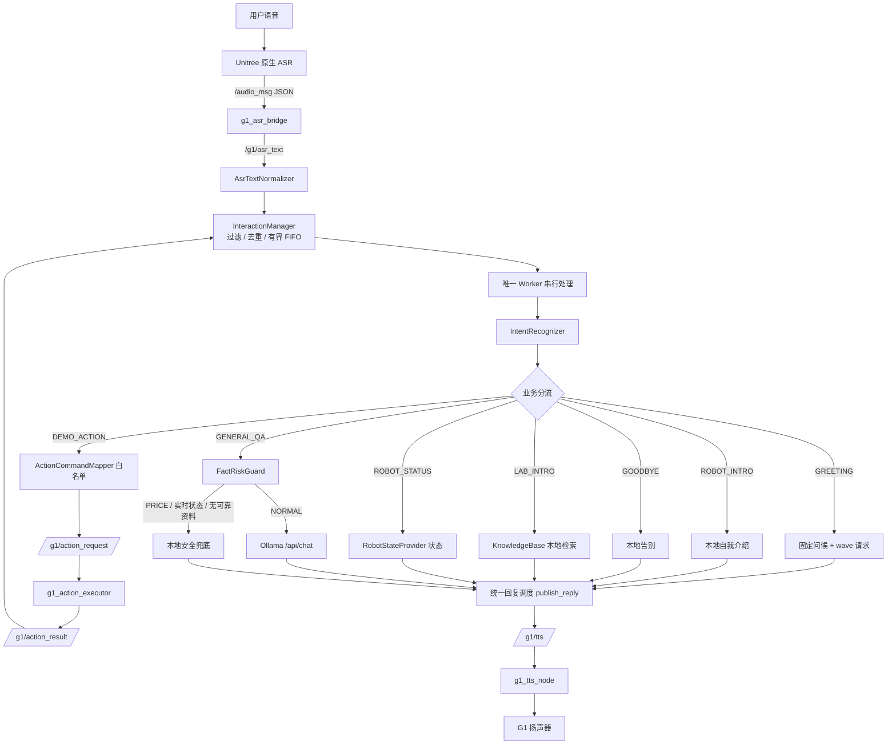
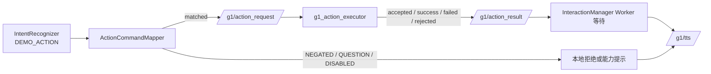
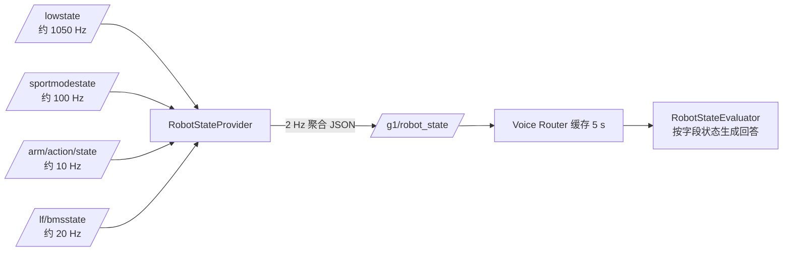
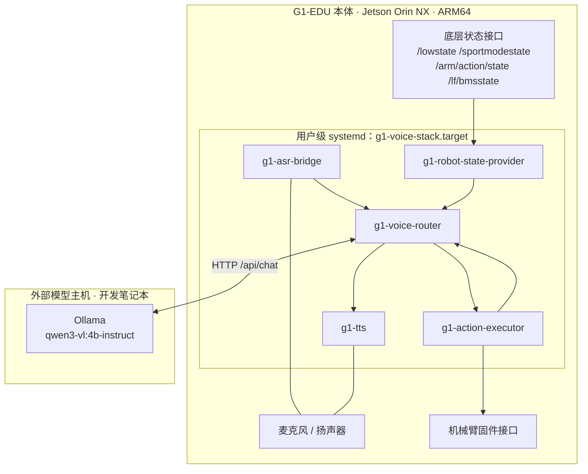
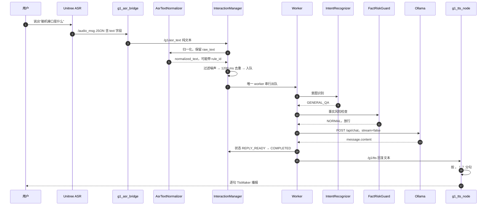
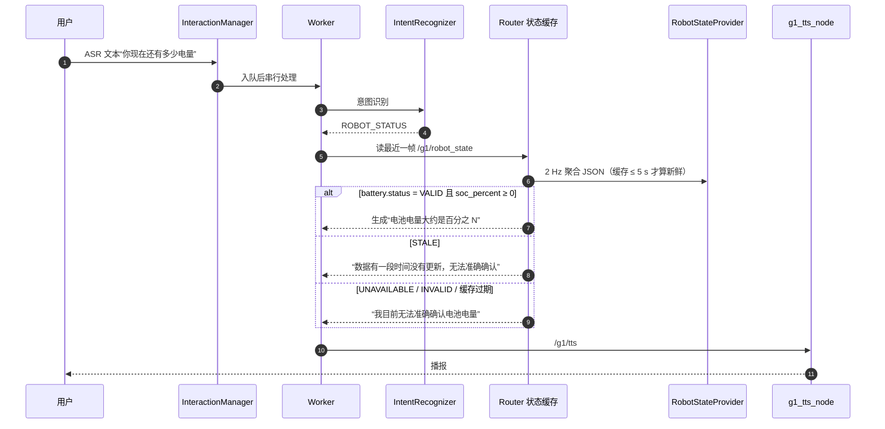
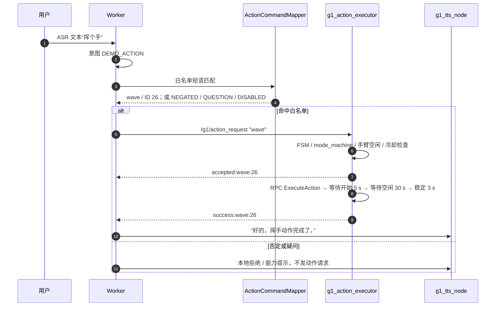

# 基于 ROS 2 的 G1-EDU 校园实验室智能接待与讲解系统 V1.0

**G1-EDU ROS 2 Voice Interaction and Smart Reception System**

> 一个运行在 Unitree G1-EDU 人形机器人上的 ROS 2 模块化语音交互与状态感知系统。真实麦克风语音经语音识别（Automatic Speech Recognition，ASR）、文本归一化、意图识别、本地知识库与外部大语言模型（Large Language Model，LLM）生成回答，实时状态类问题一律由机器人本体数据回答，动作类口令经固定白名单交给独立执行器在真机上完成，最终由文本转语音（Text To Speech，TTS）播报。
>
> 本项目为个人独立开发与维护，V1.0 于 2026-11-03 冻结。

| 项目 | 值 |
|---|---|
| Version | V1.0（2026-11-03 冻结） |
| Platform | Unitree G1-EDU |
| Compute | Jetson Orin NX 16GB / ARM64 |
| OS | Ubuntu 22.04.5 LTS |
| ROS | ROS 2 Humble（CycloneDDS） |
| Language | C++17 |
| Status | Frozen Release |
| 生产 Router SHA256 | `6ab99de8ceb287d1fdb58b66399874c60b41734775a74a0c2745bf64223d6bb7` |
| 单元测试 | 453 项 / 7 个套件（G1 ARM64 `colcon`：0 errors、0 failures） |

> 说明：本项目尚未指定开源许可证，也未做产品化包装；上表是工程状态标识，不是商业产品声明。仓库内不含真实内网地址、账号与密钥。

---

## 目录

- [1. 实机展示](#1-实机展示)
- [2. 项目背景与设计目标](#2-项目背景与设计目标)
- [3. 核心功能](#3-核心功能)
- [4. 系统总体架构](#4-系统总体架构)
- [5. 关键业务流程](#5-关键业务流程)
- [6. 核心模块设计](#6-核心模块设计)
- [7. 技术选型与设计决策](#7-技术选型与设计决策)
- [8. 硬件与软件环境](#8-硬件与软件环境)
- [9. 项目目录与源码导航](#9-项目目录与源码导航)
- [10. 编译、部署与运行](#10-编译部署与运行)
- [11. ROS 2 接口文档](#11-ros-2-接口文档)
- [12. 动作安全设计与白名单](#12-动作安全设计与白名单)
- [13. 测试与验收证据](#13-测试与验收证据)
- [14. 性能与资源](#14-性能与资源)
- [15. 常见问题与故障排查](#15-常见问题与故障排查)
- [16. 已知限制](#16-已知限制)
- [17. 路线图](#17-路线图)
- [18. 参考资料与第三方依赖](#18-参考资料与第三方依赖)
- [附录 A：术语表](#附录-a术语表)
- [附录 B：文档索引](#附录-b文档索引)

---

## 1. 实机展示

当前归档**未包含**实拍照片与演示视频。不做任何替代性配图（不使用网络上其他 G1 机器人的照片冒充本项目，也不生成虚假运行截图）。

素材目录已建立：[`docs/assets/`](docs/assets/README.md)，按下列文件名放入后即可在下方替换占位。

| 素材 | 建议文件 | 建议内容 | 状态 |
|---|---|---|---|
| G1-EDU 整机照片 | `docs/assets/g1_edu_full.jpg` | 实验室环境下的整机侧前视角 | 待补充 |
| 真实挥手照片 | `docs/assets/g1_wave.jpg` | 对应 P0-20.1 `success:wave:26` 的现场 | 待补充 |
| 接待现场照片 | `docs/assets/reception_scene.jpg` | 参观者与机器人对话（需肖像授权） | 待补充 |
| 节点与话题截图 | `docs/assets/terminal_nodes.png` | `ros2 node list` / `ros2 topic info`（需遮挡内网信息） | 待补充 |
| 运行日志截图 | `docs/assets/terminal_log.png` | `event=COMPLETED total_ms=...` 一行 | 待补充 |
| 演示视频 | `docs/assets/demo.mp4` | 30–90 秒，含 1 次挥手 | 待补充 |

放置后的引用写法（取消注释即可）：

```markdown

```

素材规范与脱敏要求见 [`docs/assets/README.md`](docs/assets/README.md)。

---

## 2. 项目背景与设计目标

### 2.1 场景与真实痛点

实验室开放日、科技展览、招生接待的场景里，讲解是**重复劳动**，而“接一个大模型上去”会立刻暴露下面四个问题——它们不是假设，本项目在 P0-15 ~ P0-21 中逐条遇到过：

1. **模型会编造实验室事实**。接入通用模型后，它对实验室人数、设备型号、科研成果、尤其是**产品价格**给出看起来合理但错误的答案。真实案例：模型对 G1 给出了错误报价。
2. **模型会编造机器人自己的状态**。“你还有多少电”如果交给模型，它会顺着上下文编一个数字，而不是读电池管理系统（Battery Management System，BMS）。
3. **动作有物理后果**。人形机器人的动作指令一旦被错误解析（否定句、疑问句、模型幻觉出的动作编号），可能产生碰撞或异常姿态；本项目在真机上确实观察到过某个动作异常后退。
4. **演示时长以小时计**。进程崩溃、日志写满磁盘、开机后没人手动拉起服务，这些在 10 分钟 Demo 里不会发生，在整天接待里一定发生。

### 2.2 设计目标与对应手段

| 目标 | 具体手段 | 落到哪个模块 |
|---|---|---|
| 说得准 | 固定事实走本地知识库，开放知识才交给模型 | `KnowledgeBase` + 业务分流 |
| 不敢编 | 进入模型之前做程序化风险拦截，而不是靠提示词劝阻 | `FactRiskGuard` |
| 不会乱 | 单 worker 串行 + 有界队列 + 文本去重，回复顺序等于提问顺序 | `InteractionManager` |
| 不会乱动 | 固定白名单 + 否定/疑问拦截 + 执行器二次校验 | `ActionCommandMapper` + `g1_action_executor` |
| 有据可查 | 每个状态字段带 `status`、`received_age_ms`、`source_topic` | `RobotStateProvider` / `RobotStateEvaluator` |
| 能长期跑 | user 级 systemd 守护、开机自恢复、日志轮转、磁盘监测 | `deployment/` |

### 2.3 七个“为什么”

1. **为什么选 G1-EDU**：官方提供 ROS 2 接口（语音、BMS、IMU、机械臂动作状态），可以在不改底层运动控制的前提下做上层集成；人形形态适合“接待 + 讲解 + 演示动作”这类场景。
2. **为什么以语音为主入口**：参观者双手可能拿着东西、注意力在展品上，语音是门槛最低的交互；同时也逼迫系统必须处理 ASR 的不确定性（错字、断句、噪声），这正是工程难点所在。
3. **为什么用 ROS 2 组织模块**：机器人原生数据本身就是话题（`/lowstate`、`/lf/bmsstate`、`/arm/action/state`），直接订阅即可，不必自建 IPC；节点之间用话题解耦后，ASR 桥、状态 Provider、TTS、动作执行器可以**分别重启、分别回滚**，而不会拖垮整个业务进程。发布/订阅而非服务调用的原因是：语音输入是**流式事件**，不需要应答；状态聚合是**周期性快照**，天然适合“发布方定频、订阅方缓存”。
4. **为什么本地知识库与大模型并存**：实验室事实是封闭集合且必须准确，适合结构化本地检索；开放域技术问题（“脑机接口是什么”）用模型更自然。二者不能混：一旦让模型回答实验室事实，就会用“看起来合理”的话污染事实。
5. **为什么状态要独立 Provider**：`/lowstate` 实测约 1050 Hz、结构复杂（35 路电机 + IMU）。直接放进语音进程会让 1 kHz 回调与 HTTP 请求抢同一个执行上下文；独立进程可以做三件事：**降频**（2 Hz 聚合发布）、**判有效性**（VALID/STALE/UNAVAILABLE/INVALID）、**独立重启**（不影响语音链路）。
6. **为什么动作走程序级白名单**：模型输出不可控，且动作 ID 与固件强绑定。把“能做什么”从模型手里收回代码里，模型只负责“理解用户想干什么”，具体执行哪个 ID 由映射表决定；即使映射表被误改，出口还有一次白名单校验。
7. **为什么必须做进程守护与日志管理**：五个节点里任何一个崩溃，接待就中断；日志以 `append:` 方式持续增长，一天接待足以把 `voice_router.log` 写到几十 MB。systemd 解决“崩了自动起、开机自动起”，logrotate 解决“写满了不炸”。

### 2.4 明确的边界

- 当前核心交互链路**不依赖深度相机**，也没有视觉识别、人脸识别、自主导航、语义地图。
- V1.0 的大模型运行在**机器人之外的主机**上（HTTP 调用），不是 Jetson 本地推理。
- 系统只做“接待问答 + 状态播报 + 白名单动作演示”，不做运动控制、不做导航、不做远程后台。

---

## 3. 核心功能

### 3.1 功能矩阵

| 功能 | 用户能做什么 | 系统如何实现 | 当前验证级别 |
|---|---|---|---|
| 语音问答 | 询问通用技术问题（如“脑机接口是什么”） | ASR → Router → FactRiskGuard → Ollama → TTS | 真机（P0-16、P0-21） |
| 实验室介绍 | 询问实验室方向、设备、项目 | `KnowledgeBase` 本地匹配，未命中走安全兜底 | 真机（P0-21） |
| 机器人自我介绍 | “你是什么机器人” | 本地固定话术，不调用模型 | 真机（P0-16） |
| 电量查询 | “你现在还有多少电量” | `RobotStateProvider` 读 `/lf/bmsstate` 的 SOC，带有效性判定 | 真机（P0-20.1 播报 93%） |
| IMU 数据接收查询 | “IMU 数据还在更新吗” | Provider `imu.data_available` + 时效 | 真机（P0-21） |
| 运行状态查询 | “你现在整体运行状态怎么样” | 四路数据聚合为一段话 | 真机（P0-20.1 / P0-21） |
| 动作能力介绍 | “你会做哪些动作” | 本地能力提示，不执行动作 | 真机（P0-21，动作请求 0 次） |
| 动作语音指令 | “挥个手” | `ActionCommandMapper` → `/g1/action_request` → 执行器 → 结果回传 | `wave` 真机通过；其余 5 个仅 Mock |
| 连续对话 | 连续提多个问题 | 有界 FIFO + 单 worker 串行 | 真机 + DOMAIN_ID=77 隔离验证 |
| 队列过载保护 | 快速连问 | 拒绝**最新**请求并播报忙碌提示，提示不插队 | 隔离验证（顺序已验） |
| 异常恢复 | 节点崩溃后自愈 | systemd `Restart=always` + `RestartSec=3` | 真机（kill 后拉起） |
| 开机自恢复 | 整机断电重启后自动可用 | `g1-voice-stack.target` + Linger | 真机（P0-18.3） |
| 日志轮转 | 控制日志增长 | logrotate + 每小时 timer + 磁盘检查 timer | 真机（P0-18.4） |

### 3.2 四种验证级别的区别

| 级别 | 含义 | 能证明什么 | 不能证明什么 |
|---|---|---|---|
| 单元测试 | 纯 C++，不依赖 ROS、不依赖网络 | 分支、边界、状态机正确性 | 话题连通、真机行为 |
| Mock 隔离测试 | `ROS_DOMAIN_ID=77`，用 Mock Ollama 与 Mock 执行器 | 端到端消息流、拦截效果、顺序 | 真实模型时延、真实动作 |
| ARM64 编译 | 在 G1 上 `colcon build` | 依赖、ABI、交叉编译问题 | 运行行为 |
| 真机测试 | 真实麦克风、扬声器、机械臂、BMS | 物理链路与现场可用性 | 覆盖率（样本少） |

> 单元测试 ≠ Mock 测试 ≠ 真机测试。本 README 全篇按这四个级别标注，不混用。

---

## 4. 系统总体架构

### 4.1 主链路



关键点：**所有回复只有一条出口**（`publish_reply()` → `/g1/tts`），无论是本地固定话术、知识库答案、状态播报还是模型输出，都排在同一条串行队列上，因此不会出现“回答 A 的声音配回答 B 的内容”。

### 4.2 动作子链路



### 4.3 状态子链路



### 4.4 部署拓扑



> 图中每个节点都是真实运行的 ROS 2 节点，没有把规划中的模块画进架构。
> Ollama 位于**机器人外部主机**，V1.0 未在 Jetson 上部署本地模型。

---

## 5. 关键业务流程

### 5.1 普通知识问答：“脑机接口是什么？”



实测（P0-21 真实一轮）：`request_id=1 event=COMPLETED total_ms=7021`，日志可见 `PROCESSING → WAITING_OLLAMA → COMPLETED` 的完整状态迁移。

### 5.2 机器人状态查询：“你现在还有多少电量？”



硬约束：**状态问题永不进入 Ollama**。数据不可用时宁可说“无法确认”，绝不把上一帧旧值当作当前值播报；解析失败时数值一律输出 `null`，不用 `0` 伪装测量值。

### 5.3 动作执行：“挥个手”



五条硬约束：

1. **白名单**：动作名只能来自 6 个已登记动作，模型无权决定 ID；
2. **不并发**：Worker 串行等待，同一时刻只有一个动作在途；执行器侧还有 busy 标志与 3 s 冷却；
3. **不重试**：结果超时或缺失时只播报“未收到结果，我不会自动重复执行”；
4. **失败即锁定**：执行器在“RPC 未确认 / 稳定期状态突变 / 完成超时”时不释放 busy，必须人工确认机器人状态；
5. **可关联但无请求 ID**：结果按“动作名 + 发送前序号快照”匹配，协议本身没有请求 ID（见 §16）。

---

## 6. 核心模块设计

每个模块按同一模板说明：**工程问题 → 设计方案 → 工作机制 → 实际收益 → 当前限制**，并给出输入、输出、依赖与源码位置。

### 6.1 AsrTextNormalizer（ASR 文本归一化器）

| 项 | 内容 |
|---|---|
| 输入 | ASR 原始文本 |
| 输出 | `{raw_text, normalized_text, changed, rule_id, reason}` |
| 依赖 | 无（纯函数，可单测） |
| 源码 | `ros2_ws/src/g1_voice_router/src/asr_text_normalizer.cpp` + `include/.../asr_text_normalizer.hpp` |

- **工程问题**：ASR 对专有名词有稳定错识，错词直接进模型会答非所问。真实证据：P0-20.1 出现 `脑急接口`，P0-21 真机出现 `脑筋接口`，用户被迫说第二遍。
- **设计方案**：有限词典 + 明确别名，只做字符串级替换，不做模糊匹配、不做编辑距离、不调模型。
- **工作机制**：
  1. 命中控制词（`不要 / 不用 / 别 / 停止 / 取消 / 不准 / 不许 / 别动`）→ 整句跳过归一化，返回 `CONTROL_TOKEN_PROTECTED`；
  2. `ASR001`：`脑急接口` / `脑筋接口` → `脑机接口`；
  3. `ASR002`：`语数之一` / `语数g1` → `宇树G1`，**仅当**同时出现机器人语境词（机器人/g1/宇树/动作/挥手/演示/多少钱/价格/型号/参数）才替换，否则返回 `UNITREE_ALIAS_WITHOUT_CONTEXT` 并保留原文；
  4. 原始文本永久保留，日志只输出长度 + FNV-1a 摘要 + 归一化结果。
- **实际收益**：把“同一句要说两遍”的现场问题变成可复现的代码规则；日志可按 `raw_digest` 回查原始识别结果。
- **当前限制**：覆盖不封闭；`手机接口` 是合法提问，**故意不纠正**（P0-21 专项真机测试正是这一变体，未触发 ASR001 分支）；不做数字与数值修正。

### 6.2 IntentRecognizer（意图识别器）

| 项 | 内容 |
|---|---|
| 输入 | 归一化后的用户文本 |
| 输出 | `{intent, normalized_text}` |
| 依赖 | 无（纯逻辑） |
| 源码 | `src/intent_recognizer.cpp` + `include/.../intent_recognizer.hpp`；测试 96 项 |

七类意图（以源码枚举为准）：

| 意图 | 典型问法 | 处理路径 |
|---|---|---|
| `GREETING` | 你好 / 早上好 / 嗨 | 固定话术 + 触发 `wave` |
| `LAB_INTRO` | 介绍一下你们的实验室 | `KnowledgeBase` 本地检索 |
| `ROBOT_INTRO` | 你是什么机器人 | 本地固定话术 |
| `DEMO_ACTION` | 挥个手 / 你会做哪些动作 | `ActionCommandMapper` |
| `ROBOT_STATUS` | 还有多少电 / IMU 还在更新吗 / 整体状态 | 状态缓存 + 本地生成回答 |
| `GOODBYE` | 再见 / 拜拜 | 本地固定话术 |
| `GENERAL_QA` | 脑机接口是什么 / 什么是具身智能 | `FactRiskGuard` → 模型或兜底 |

- **关于“价格”**：`PRICE` **不是意图**，它是 `FactRiskGuard` 的风险类型。价格问题在意图层属于 `GENERAL_QA`，随后被风控拦截。这一点常被误解，文档按源码如实说明。
- **语义边界**（最容易写错的地方）：
  - 知识问法（含“是什么 / 如何 / 原理”，且不含“现在 / 当前 / 目前”）优先判知识；
  - “实验室当前状态怎么样”归 `LAB_INTRO` 而不是 `ROBOT_STATUS`；
  - IMU 类问法要求同时具备传感器词与接收/更新/正常/状态类词才判 `ROBOT_STATUS`，“IMU 是什么”仍走 `GENERAL_QA`；
  - “你会做哪些动作”判 `DEMO_ACTION`，但只做能力介绍，不发动作请求。
- **实际收益**：把“能不能答”提前变成“该谁答”，本地业务与模型业务彻底分离，避免模型抢答固定事实。
- **当前限制**：规则式（关键词 + 形式判断），无模型分类；新问法需要补规则并补测试，96 项测试就是这套边界的回归网。

### 6.3 InteractionManager（交互任务管理器）

| 项 | 内容 |
|---|---|
| 输入 | 归一化文本 + 当前单调时钟毫秒 |
| 输出 | `AdmissionResult{accepted, status, request_id, reason, queue_depth}` |
| 依赖 | 无（标准库并发原语） |
| 源码 | `src/interaction_manager.cpp`、`src/interaction_filter.cpp`、`include/.../interaction_types.hpp`；测试 76 项 |

- **工程问题**：ROS 回调随时可能触发，一句话可能被拆成两条、可能重复、可能是纯噪声。如果在回调里直接跑 HTTP 和 TTS，会同时踩三个坑：回复乱序、动作与回答错配、慢请求把回调线程堵死。
- **设计方案**：回调只做“归一化 → 过滤 → 去重 → 入队”，业务全部交给**唯一** worker 串行执行。
- **工作机制**：
  - **有界 FIFO**：`max_pending = 3`（不含正在处理的一条）；队列满时拒绝**最新**请求，返回 `REJECTED + QUEUE_FULL`，不静默丢弃；
  - **文本去重**：1200 ms 窗口内同一归一化文本判 `DUPLICATE`；历史表 ≥ 64 条或每 32 次提交清理一次过期项，保证内存有界；
  - **噪声过滤**：仅过滤独立的语气词（`嗯/啊/呃/唔/哦/额` 及其组合，≤ 4 字）与空文本/纯标点；`你好`、`IMU`、`G1`、`停止` 等短有效输入一律保留；
  - **请求生命周期**：`RECEIVED → QUEUED → PROCESSING → (WAITING_OLLAMA | ACTION_WAITING) → REPLY_READY → COMPLETED`，终态还有 `FAILED / TIMEOUT / REJECTED / FILTERED / DUPLICATE`；非法状态转移被 `can_transition()` 拒绝；
  - **忙碌提示不插队**：队列满时的提示进入容量 2 的独立提示队列，且只在 `pending_count() == 0` 时由 worker 统一发布；
  - **HTTP 可中断**：libcurl 进度回调检查停机标志，SIGINT 后实测 0.79 s 内中止请求；
  - **停机清理**：`stop()` 标记停机、唤醒等待中的动作、把排队请求标 `REJECTED`，再 join worker。
- **实际收益**：回复顺序严格等于请求接收顺序；动作执行期间后续问题排队而不是插话；停机不会挂在网络调用上（systemd `TimeoutStopSec=15` 内一定退出）。
- **当前限制**：单 worker 意味着**吞吐上限就是单请求耗时**（模型问答 5.5–7.0 s 期间其他问题只能等）；队列只有 3 个等待位，密集提问会明确拒绝而不是排队更长。

### 6.4 FactRiskGuard（事实风险保护）

| 项 | 内容 |
|---|---|
| 输入 | 用户文本 + 知识库指针（可为 `nullptr`） |
| 输出 | `{risk, blocked, use_local_answer, reason, fallback_answer, local_answer, kb_*}` |
| 依赖 | `KnowledgeBase` |
| 源码 | `src/fact_risk_guard.cpp`；测试 119 项 |

- **工程问题**：模型会编造价格、人数、成果、设备型号，以及机器人自身的实时状态。提示词只能“劝阻”，代码才能“保证”。
- **设计方案**：在文本进入模型之前做四分类：
  - `PRICE`：命中价格词（多少钱/价格/报价/售价/打折…）→ 直接兜底，0 次模型调用；
  - `REALTIME_STATUS`：命中传感器词（电量/电池/电压/续航/关节温度/IMU/惯导/摔倒没有…）**无条件**拦截；泛化状态词（正常吗/运行状态/什么状态/温度…）需**同时**有机器人语境（机器人/g1/宇树/关节/自身/你/您）才拦截；动作执行状态问法（“做完了吗”+“动作/执行/挥手…”）单独成一条规则；
  - `LAB_FACT`：命中实验室实体词（实验室/学院/脑机中心/你们学校…）→ 先查知识库，只有 `found && !fallback*` 才用本地答案，否则兜底；
  - `NORMAL`：其余放行给模型。
- **工作机制中的关键豁免**：知识问法（“IMU 是什么”“如何使用 IMU 估计姿态”“动作规划是什么”）先判 `NORMAL`，避免把技术概念问题误拦；“机器人目前是什么状态”含“是什么”但属于状态询问，单独豁免。
- **实际收益**：P0-17.1 修复后，实时状态问题不再漏放给模型；价格类问题在真机上稳定兜底；知识型问题不再被过度拦截（配置了 8 项防过度拦截用例）。
- **当前限制**：白名单式规则，仍可能把个别可回答问题拦成兜底（宁可少答，不可乱答）；`REALTIME_STATUS` 的兜底话术是 V1.0 的通用话术，真正带数值的回答由 `ROBOT_STATUS` 分支负责。

### 6.5 KnowledgeBase（本地知识库）

| 项 | 内容 |
|---|---|
| 输入 | 用户文本 |
| 输出 | `{found, answer, category, matched_id, match_type, match_score}` |
| 依赖 | `nlohmann/json` + `config/lab_knowledge.json` |
| 源码 | `src/knowledge_base.cpp`（约 1.5k 行，全项目最大单文件）；测试 57 项 |

- **工程问题**：实验室固定事实必须准确、可追溯、可离线，不能交给模型生成。
- **数据规模**（`config/lab_knowledge.json` 实际计数）：FAQ 21 条、研究方向 3 条、项目 1 条、设备 1 条、分类 5 条、实验室 3 条、来源 15 条。
- **匹配策略**：结构化字段检索 + FAQ 相似度 + 实体掩码 + 意图相容判断；分数相同且无法区分时**安全兜底**而不是猜。
- **命中与未命中**：命中返回带 `matched_id` 的答案（可在 `sources` 里回溯来源）；未命中返回统一兜底“暂无经过核实的公开资料”，该兜底同时被 `FactRiskGuard` 视为“不可靠”，不会转手交给模型。
- **实际收益**：答案稳定、可离线、每条事实可回溯；模型下线时实验室介绍仍可用。
- **当前限制**：知识库是静态 JSON，更新需要替换文件并重启 Router（`knowledge_file` 参数可指向外部路径）；未收录问题一律兜底。

### 6.6 RobotStateProvider / RobotStateEvaluator（机器人状态）

| 项 | 内容 |
|---|---|
| 输入 | `/lowstate`、`/sportmodestate`、`/arm/action/state`、`/lf/bmsstate` |
| 输出 | `/g1/robot_state`（`schema_version=1` 的聚合 JSON，2 Hz） |
| 依赖 | `rclcpp`、`unitree_hg`、`nlohmann/json` |
| 源码 | `src/robot_state_provider.cpp`、`src/robot_state_provider_node.cpp`、`src/robot_state_evaluator.cpp`；测试 44 项 |

- **工程问题**：状态数据源频率差 100 倍（1 kHz vs 10 Hz）、结构复杂、会断流、会过期、可能格式异常；语音业务既不该被 1 kHz 回调淹没，也不该把过期值当实时值。
- **设计方案**：Provider 独立进程订阅四路，回调只做**轻量缓存更新**（`/lowstate` 回调只遍历电机统计有效通道与温度最大值，不拷贝大数组、不做序列化）；500 ms 定时器做一次聚合与 JSON 序列化。
- **每字段独立状态**：

| 状态 | 含义 | 允许播报具体值 |
|---|---|---|
| `VALID` | 收到且字段合法、在时效窗口内 | 是 |
| `STALE` | 曾收到有效数据，但已超过时效窗口 | 否，只说明“未更新” |
| `UNAVAILABLE` | 从未收到或来源缺失 | 否 |
| `INVALID` | 结构非法、字段缺失、数值越界、SOC 跳变 | 否 |

- **时效窗口**（按实测频率取周期的 20~100 倍）：`/lowstate` 1000 ms、`/sportmodestate` 1000 ms、`/arm/action/state` 1000 ms、`/lf/bmsstate` 2000 ms；Router 侧缓存再有 5000 ms 上限，超时即视为 Provider 掉线。
- **SOC 来源与校验**：只取 `/lf/bmsstate` 的 `soc` 字段，**不用电压反推**；范围校验 0–100；60 s 窗口内跳变 ≥ 15 个百分点判异常（依据 P0-18 60 秒 1229 样本实测：窗口内零跳变）。
- **JSON 约定**：数值字段仅在 `VALID` 时输出数字，其余一律 `null`；附 `received_age_ms`、`quality_reason`、`source_topic`。
- **IMU 边界**：只说“是否持续收到有效 IMU 数据”，**不代表**传感器健康或姿态估计准确。
- **实际收益**：状态类回答从“模型编数字”变成“本体数据 + 明确时效”；Provider 崩溃只影响状态问答，不影响语音问答与动作。
- **当前限制**：关节温度单位未确认、索引与关节名映射未知，`temperature_max_raw` 只做内部诊断，禁止对外播报；`/dog_odom` 在 P0-17 审计中存在，但**未纳入 V1.0 状态回答**。

### 6.7 ActionCommandMapper（动作命令映射器）

| 项 | 内容 |
|---|---|
| 输入 | 归一化文本（去标点、ASCII 小写） |
| 输出 | `{matched, action_name, action_id, match_type, reject_reason}` |
| 依赖 | 无 |
| 源码 | `src/action_command_mapper.cpp`；测试 39 项 |

- **工程问题**：口语表达极多样（“挥挥手 / 打个招呼 / 低位挥手”），而机器人只能执行固定动作；模型输出不可控，可能给出不存在的 ID 或在否定语境下仍给动作。
- **判定顺序**：永久禁用表达 → 否定/停止 → 疑问/能力询问 → 最长短语匹配 → **出口白名单二次校验**。
- **否定与疑问**：`不要挥手` → `NEGATED`（不执行，也不假装停止）；`挥手的原理是什么` → `QUESTION`（转知识）；`你会做哪些动作` → `QUESTION`（能力提示）。
- **歧义处理**：“给我们表演一个动作”不猜动作，返回澄清提示。
- **永久禁用**：`hand_on_heart` 及其口语变体（把手放在心口/贴胸/摸心口…）直接 `DISABLED`，任何情况下不执行。
- **实际收益**：模型与语音噪声都无法直接触达动作 ID；白名单外 ID 在出口被拦下。
- **当前限制**：短语表是枚举式，未收录的新说法退化为“能力提示”而不是执行；不做语义相似度匹配（这是有意的取舍：宁可让用户重说，也不猜动作）。

### 6.8 Action Executor（动作执行器，独立 ROS 2 包）

| 项 | 内容 |
|---|---|
| 输入 | `/g1/action_request`（规范动作名） |
| 输出 | `/g1/action_result`（字符串协议） |
| 依赖 | Unitree `G1ArmActionClient`、`unitree_hg` 消息 |
| 源码 | `action_ws/src/g1_action_executor/src/arm_action_executor.cpp`（736 行） |

- **与 Router 的分工**：Router 决定“用户想做什么”，Executor 决定“现在能不能做、怎么做、做没做完”。
- **前置检查清单**（任一不通过即 `rejected`，不会动作）：
  1. 命令非空且在白名单内；
  2. `/sportmodestate` 已收到，FSM ∈ {500, 501, 801}；801 时 mode ∈ {0, 3}；
  3. `victory` 与 `heart` 额外要求 `mode_machine ∈ {5, 6}`（固件要求），其余四个动作不检查；
  4. `/arm/action/state` 已收到、`holding == false`、`id == 0`（真实空闲）；
  5. 无正在执行的动作、队列为空、距上一次接受 ≥ 3 s 冷却。
- **执行与超时**：同步 RPC 放在独立工作线程（主线程继续处理 ROS 与状态回调）；等待动作开始 5 s、等待回到空闲 30 s、动作后稳定期 3 s，最坏约 38 s，Router 侧等待 45 s。
- **结果协议**：`accepted:<name>:<id>`、`success:<name>:<id>`、`failed:...`、`rejected: <原因>`、`completion_unknown:...`、`completed_with_rpc_error:...`。
- **失败即锁定**：若 RPC 成功但未观察到动作开始、或稳定期内状态再次变化、或完成超时，执行器**不释放 busy**，必须人工确认机器人状态后再恢复。
- **实际收益**：物理动作的安全检查集中在执行器，业务层不可能绕过；异常情况下宁可“卡住等人”，也不自动重试。
- **当前限制**：结果协议无请求 ID，且 `completion_unknown` / `completed_with_rpc_error` 这两类前缀 Router 不认识（详见 §16）。

### 6.9 TTS 集成

| 项 | 内容 |
|---|---|
| 输入 | `/g1/tts`（`std_msgs/String`） |
| 输出 | `AudioClient::TtsMaker(sentence, speaker_id)` |
| 源码 | `integrations/unitree_audio/g1_tts_node.cpp`（基于 Unitree 官方 `audio_client` 示例修改） |

- **链路**：`/g1/tts` → 内部有界队列（容量 10，满则丢弃最新）→ 单 worker → 分句 → 逐句 `TtsMaker`。
- **分句**：按中文 `。！？` 与英文 `.!?` 切分；每句调用一次 `TtsMaker`，任一句 `ret != 0` 则跳过该条剩余句子。
- **句间节奏**：按 UTF-8 字符数估算播放时长（约 250 ms/字符，最少 1 s），句间再等 `pause_ms`（配置 1500 ms）；等待可被停机打断。
- **配置**：`speaker_id=0`、`pause_ms=1500`、启动提示语 `text`（默认空）。配置文件里虽然写了 `volume`，但节点**只读取、未实际应用**（启动日志会明确警告 `JSON volume is loaded but not applied by this node`），音量需在设备侧设置。
- **重要限制**：`TtsMaker ret=0` 仅代表**调用成功**，不代表扬声器播放完成；系统没有真实播放完成事件，句间等待是估算值。
- **实际收益**：长回答被拆成短句，首句更快出声，听感不“糊”；队列满时丢新句而不是无限堆积。

### 6.10 系统运维模块

| 项 | 内容 |
|---|---|
| 组成 | 7 个 `service`（5 个常驻 + 2 个 oneshot）+ `g1-voice-stack.target` + 2 个 `timer` |
| 源码 | `deployment/systemd/`、`deployment/scripts/`、`deployment/logrotate/`、`deployment/monitoring/` |

- **user 级 systemd**：不引入 root 依赖；`PartOf=g1-voice-stack.target` 让“停整套”一次生效；`Restart=always` + `RestartSec=3` + `StartLimitIntervalSec=60`/`Burst=5` 防止崩溃循环打满 CPU。
- **启动顺序**：Provider → TTS → Router → ASR Bridge → Action Executor（`After=` 声明）；但**启动服务不会触发任何动作**，这一点是刻意设计。
- **Linger**：`loginctl enable-linger` 让用户级服务在无人登录时也能开机启动。
- **优雅停机**：`KillSignal=SIGINT` + `TimeoutStopSec=15`；Router 收到 SIGINT 后置停机标志、中断进行中的 HTTP、唤醒动作等待、join worker，实测三种场景停机均 < 1 s。
- **日志**：systemd `StandardOutput=append:` 直接写 `~/g1_logs_systemd/*.log`；logrotate 每日或 20 MB 触发，保留 7 份、14 天，`copytruncate` 保证进程不用重开文件；每小时 timer 检查一次。
- **磁盘监测**：`check_disk.sh` 只读，输出一行状态（`OK <80% / WARNING ≥80% / CRITICAL ≥90%`），每 6 小时一次。
- **实际收益**：整机重启后无需人工介入即可恢复接待能力；日志与磁盘不会在长活动中失控。
- **当前限制**：`Restart=always` 会在 3 s 后拉起崩溃节点，但**不修复根因**；若 Router 反复崩溃触及 `StartLimitBurst`，systemd 会停止重启，需要人工排查。

---

## 7. 技术选型与设计决策

### 7.1 选型对照

| 技术 | 在项目中的用途 | 选择原因 | 代价 |
|---|---|---|---|
| ROS 2 Humble | 节点通信、话题、参数 | 与 G1 官方软件栈一致，原生数据就是话题 | 版本绑定，升级成本高 |
| C++17 | 机器人端核心业务 | 部署简单（无运行时依赖）、并发可控、便于与 SDK 集成 | 开发效率低于脚本语言，字符串处理更啰嗦 |
| CycloneDDS | ROS 2 中间件 | 当前生产通信环境实测使用，与 Unitree 原生应用互通 | 网卡绑定与 Domain 配置需要谨慎 |
| Ollama（HTTP） | 通用问答 | 服务化调用、模型可替换、不占 Jetson 资源 | 依赖局域网，断网时退化为本地能力 |
| Unitree SDK / `unitree_ros2` | 语音（ASR/TTS）、动作、状态消息 | 官方通道，无法绕过 | 部分接口无回调、无状态、无请求 ID |
| systemd（user） | 服务生命周期 | 崩溃自愈、开机恢复、统一日志与停机控制 | unit 内硬编码绝对路径 |
| logrotate | 日志管理 | 长期运行磁盘保护，`copytruncate` 适配 `append:` 句柄 | 复制与截断之间有毫秒级丢日志窗口 |

### 7.2 七条设计原则

1. **实时状态必须来自真实数据**：模型只负责措辞，不负责数值；数值只在 `VALID` 时出现。
2. **普通知识与实时状态分开处理**：前者可交给模型，后者必须查 Provider。
3. **模型不决定动作 ID**：模型理解语言，白名单决定动作，执行器决定能否执行。
4. **所有 TTS 回复进入统一调度**：保证顺序，避免“回答 A 的声音配回答 B 的内容”。
5. **动作必须过白名单**，且否定句、疑问句、永久禁用表达一律不触发。
6. **失败不重试**：物理动作不确定时，重复执行比不执行更危险。
7. **Mock 与真机严格区分**：Mock 证明分支与消息流，真机证明物理链路；文档中不混用两者结论。

---

## 8. 硬件与软件环境

### 8.1 G1 机器人端

| 项目 | 配置 |
|---|---|
| 平台 | Unitree G1-EDU |
| 计算平台 | Jetson Orin NX |
| 内存 | 16 GB |
| 系统 | Ubuntu 22.04.5 LTS |
| ROS | ROS 2 Humble |
| JetPack | 6.2.3 |
| CUDA / TensorRT | 12.6 / 10.3（本项目未直接调用） |
| DDS | CycloneDDS（`rmw_cyclonedds_cpp`） |
| 架构 | ARM64 / aarch64 |
| 生产 Domain | `ROS_DOMAIN_ID=0`（测试统一用 77） |

### 8.2 本地开发电脑

| 项目 | 配置 |
|---|---|
| CPU | Intel i7-13650HX |
| GPU | NVIDIA RTX 4070 Laptop 8GB |
| 系统 | Ubuntu 24.04.5 LTS |
| 用途 | 代码开发、x86 单元测试、模型服务 |

### 8.3 模型服务端

| 项目 | 说明 |
|---|---|
| 位置 | **与机器人直连的外部主机**（V1.0 未部署在 Jetson 上） |
| 服务 | Ollama，HTTP `POST /api/chat` |
| 模型 | `qwen3-vl:4b-instruct`（Q4_K_M，约 3.34 GB） |
| 请求参数 | `stream=false`、`temperature=0.2`、`num_predict=160` |
| 配置方式 | ROS 参数 `ollama_url`；文档统一使用 `http://<LLM_HOST>:11434/api/chat` 占位 |
| 超时 | 连接 3 s、整体 60 s（`request_timeout_seconds`，合法范围 5–300） |

> 公开文档不写入真实内网地址、账号、密码或完整私人路径。

---

## 9. 项目目录与源码导航

```text
G1-EDU-Smart-Reception-V1.0/
├── README.md                        ← 本文件：项目门户
├── CHANGELOG.md                     ← 变更记录
├── CONTRIBUTING.md                  ← 继续开发时的架构红线
├── V1.0_RELEASE_NOTES.md            ← 冻结说明、二进制哈希、回滚点
├── PROJECT_ARCHIVE_REPORT.md        ← 归档整理报告
│
├── ros2_ws/src/
│   ├── g1_voice_router/             ← 主业务包
│   │   ├── include/g1_voice_router/ ← 10 个头文件（类型、接口）
│   │   ├── src/                     ← 11 个源文件（+1 历史副本，不参与构建）
│   │   ├── test/                    ← 7 个测试目标（共 453 项断言）
│   │   └── config/lab_knowledge.json← 本地知识库
│   └── g1_asr_bridge/               ← 原生 ASR JSON → /g1/asr_text
│
├── action_ws/src/
│   └── g1_action_executor/          ← 独立 ROS 2 包（白名单动作执行）
│
├── integrations/unitree_audio/      ← TTS 节点源码与配置
│   ├── g1_tts_node.cpp
│   └── config/tts_config.json
│
├── deployment/
│   ├── scripts/                     ← 5 个启动脚本
│   ├── systemd/                     ← 7 service（5 常驻 + 2 oneshot）+ 2 timer + target
│   ├── logrotate/                   ← 轮转配置与激活说明
│   ├── monitoring/                  ← 磁盘检查脚本
│   └── config_examples/             ← 脱敏模板（占位符）
│
├── docs/
│   ├── architecture/                ← 总体/通信/时序/状态/拓扑
│   ├── development/                 ← 代码结构/模块设计/设计决策/依赖/交接
│   ├── deployment/                  ← 环境/编译/启动/服务/回滚
│   ├── testing/                     ← 单元/Mock/真机/已知问题
│   ├── milestones/                  ← P0-15 ~ P0-21 阶段报告 + 索引
│   ├── assets/                      ← 实拍素材（待补充）
│   └── GITHUB_PREPARE_CHECKLIST.md  ← 上传前检查
│
├── software_copyright/              ← 软著材料 01–10 + 架构图
├── manifests/                       ← 文件台账、SHA256 清单、依赖说明
└── private_archive/                 ← 生产二进制与真实配置（禁止上传）
```

### 9.1 关键代码定位

| 要找什么 | 文件 |
|---|---|
| 业务编排总入口 | `ros2_ws/src/g1_voice_router/src/voice_router.cpp` |
| 意图判断规则 | `src/intent_recognizer.cpp` |
| 队列/去重/状态机 | `src/interaction_manager.cpp` + `include/.../interaction_types.hpp` |
| 噪声过滤与文本归一化 | `src/interaction_filter.cpp` |
| 事实风险拦截 | `src/fact_risk_guard.cpp` |
| 实验室知识库 | `src/knowledge_base.cpp` + `config/lab_knowledge.json` |
| 状态聚合 | `src/robot_state_provider.cpp`、`src/robot_state_evaluator.cpp` |
| 动作白名单 | `src/action_command_mapper.cpp` |
| 动作执行与安全检查 | `action_ws/.../arm_action_executor.cpp` |
| 语音合成 | `integrations/unitree_audio/g1_tts_node.cpp` |
| 进程与日志运维 | `deployment/` |

### 9.2 建议阅读顺序（按依赖从底到顶）

1. `include/g1_voice_router/interaction_types.hpp` — 请求生命周期与统计定义（先看状态机）
2. `src/interaction_filter.cpp` — 什么算噪声、怎么归一化
3. `src/interaction_manager.cpp` — 有界队列、去重、状态转移
4. `src/intent_recognizer.cpp` — 七类意图与语义边界（最易写错）
5. `src/fact_risk_guard.cpp` — 四类风险与豁免规则
6. `src/robot_state_evaluator.cpp` — 四态判定与“状态变一句话”
7. `src/action_command_mapper.cpp` — 白名单与拒绝策略
8. `src/voice_router.cpp` — 所有分支的编排（对照 [`docs/architecture/interaction_sequence.md`](docs/architecture/interaction_sequence.md)）
9. `action_ws/.../arm_action_executor.cpp` — 真机侧安全检查与超时
10. `integrations/unitree_audio/g1_tts_node.cpp` — 分句与节奏估算

---

## 10. 编译、部署与运行

> 以下命令均取自 `deployment/scripts/`、`deployment/systemd/` 与阶段报告的构建记录。路径按 G1 上的 `unitree` 账号书写，若你的账号不同请整体替换 `$HOME`。

### 10.1 环境准备

```bash
# ROS 2 与 Unitree 环境
source /opt/ros/humble/setup.bash
source ~/unitree_ros2/setup.sh
source ~/unitree_ros2/cyclonedds_ws/install/setup.bash
export ROS_DOMAIN_ID=0
export RMW_IMPLEMENTATION=rmw_cyclonedds_cpp

# 构建依赖
sudo apt install -y build-essential cmake libcurl4-openssl-dev python3-colcon-common-extensions
```

> `setup.sh` 由 Unitree 提供，**不要全局修改**。若遇 SDK2 动态库冲突，用 `env -u LD_LIBRARY_PATH -u LD_PRELOAD <cmd>` 做单次隔离。细节见 [`docs/deployment/environment_setup.md`](docs/deployment/environment_setup.md)。

### 10.2 放置源码（两个工作区）

```bash
cd G1-EDU-Smart-Reception-V1.0

cp -r ros2_ws/src/g1_voice_router      ~/unitree_ros2/example/
cp -r ros2_ws/src/g1_asr_bridge        ~/unitree_ros2/example/
cp -r action_ws/src/g1_action_executor ~/lidar_ws/src/
cp integrations/unitree_audio/g1_tts_node.cpp ~/unitree_ros2/example/src/src/g1/audio_client/
cp integrations/unitree_audio/config/*.json   ~/unitree_ros2/example/config/
```

`unitree_ros2/example` 与 `lidar_ws` 是**两个独立工作区**，必须分别构建、分别 source（执行器的启动脚本额外 source `lidar_ws`）。

### 10.3 构建

```bash
cd ~/unitree_ros2/example
colcon build --packages-select g1_voice_router g1_asr_bridge --symlink-install

cd ~/lidar_ws
colcon build --packages-select g1_action_executor --symlink-install
```

### 10.4 测试

```bash
cd ~/unitree_ros2/example
colcon test --packages-select g1_voice_router
colcon test-result --verbose
# 期望：Summary: 7 tests, 0 errors, 0 failures, 0 skipped
```

### 10.5 以 systemd 启动（推荐）

```bash
# 首次部署
mkdir -p ~/g1_systemd/scripts ~/.config/systemd/user
cp deployment/scripts/*.sh ~/g1_systemd/scripts/ && chmod +x ~/g1_systemd/scripts/*.sh
cp deployment/systemd/g1-* ~/.config/systemd/user/

systemctl --user daemon-reload
systemctl --user enable --now g1-voice-stack.target

systemctl --user is-active g1-voice-stack.target
ps -eo pid,args | grep '[g]1_voice_router/voice_router'   # 必须只有 1 个
```

开机自启还需要一次性授权：`loginctl enable-linger "$USER"`。

### 10.6 查看状态与日志

```bash
for s in g1-robot-state-provider g1-tts g1-voice-router g1-asr-bridge g1-action-executor; do
  printf '%s pid=%s %s\n' "$s" \
    "$(systemctl --user show -p MainPID --value $s.service)" \
    "$(systemctl --user show -p ActiveState --value $s.service)"
done

tail -f ~/g1_logs_systemd/voice_router.log
journalctl --user -u g1-voice-router.service -n 100 --no-pager
```

### 10.7 单节点重启、停止与恢复

```bash
systemctl --user restart g1-voice-router.service   # 生产更新只允许单节点重启
systemctl --user stop g1-voice-stack.target        # 停整套（含 5 个节点）
systemctl --user start g1-voice-stack.target       # 恢复
```

### 10.8 手工调试（排障用）

```bash
systemctl --user stop g1-voice-stack.target   # 先停整套，避免同域出现两个 Router

source /opt/ros/humble/setup.bash
source ~/unitree_ros2/setup.sh
source ~/unitree_ros2/example/install/setup.bash
source ~/lidar_ws/install/setup.bash

ros2 run g1_voice_router robot_state_provider
ros2 run unitree_ros2_example g1_tts_node
ros2 run g1_voice_router voice_router --ros-args -p ollama_url:=http://<LLM_HOST>:11434/api/chat
ros2 run g1_asr_bridge asr_json_bridge
ros2 run g1_action_executor g1_action_executor_node
```

### 10.9 部署注意事项

- **不要**同时启动两份 Voice Router：同域双订阅会让一句话被处理两次、动作请求翻倍（P0-20 期间真实复现）。
- **不要**随意改生产 `ROS_DOMAIN_ID`：生产 0、测试 77，混用会导致“看不到消息”或“看到别人的消息”。
- 真机动作必须现场确认安全后再触发；启动执行器本身不会产生动作。
- 未验证的版本不要直接覆盖生产二进制，先备份并记录 SHA256，见 [`docs/deployment/rollback_guide.md`](docs/deployment/rollback_guide.md)。
- 具体某条命令若在你的环境不适用（账号名、工作区路径不同），以 `deployment/systemd/*.service` 的 `ExecStart` 为准。

---

## 11. ROS 2 接口文档

### 11.1 业务话题（本项目定义）

| Topic | Message Type | Publisher | Subscriber | 作用 |
|---|---|---|---|---|
| `/g1/asr_text` | `std_msgs/msg/String` | `g1_asr_bridge` | `g1_voice_router` | ASR 文本输入 |
| `/g1/tts` | `std_msgs/msg/String` | `g1_voice_router` | `g1_tts_node` | 待播报文本 |
| `/g1/action_request` | `std_msgs/msg/String` | `g1_voice_router` | `g1_action_executor` | 动作请求（规范动作名，如 `wave`） |
| `/g1/action_result` | `std_msgs/msg/String` | `g1_action_executor` | `g1_voice_router` | 动作结果字符串协议 |
| `/g1/robot_state` | `std_msgs/msg/String` | `g1_robot_state_provider` | `g1_voice_router` | 聚合状态 JSON（2 Hz） |

### 11.2 直接依赖的 Unitree 原生话题

| Topic | Message Type | 发布者 | 订阅者 | 作用 |
|---|---|---|---|---|
| `/audio_msg` | `std_msgs/msg/String` | Unitree 原生语音服务 | `g1_asr_bridge`（BEST_EFFORT） | 原生 ASR 输出（JSON，含 `text` 字段） |
| `/lowstate` | `unitree_hg/msg/LowState` | Unitree 原生 | Provider、Executor（SensorDataQoS） | 关节与 IMU 原始状态，约 1050 Hz |
| `/sportmodestate` | `unitree_hg/msg/SportModeState` | Unitree 原生 | Provider、Executor | 运动模式与 FSM，约 100 Hz |
| `/lf/bmsstate` | `unitree_hg/msg/BmsState` | Unitree 原生 | Provider | 电池 SOC/SOH/电压，约 20 Hz |
| `/arm/action/state` | `std_msgs/msg/String` | Unitree 原生 | Provider、Executor | 机械臂动作状态 JSON，约 10 Hz |

> `/dog_odom` 等里程计话题在 P0-17 审计中出现，但**未被 V1.0 的任何节点订阅**，因此不计入本项目的接口面。

### 11.3 消息负载格式

`/g1/robot_state`（`schema_version=1`，节选自真实抓取）：

```json
{
  "schema_version": 1,
  "battery": {"status": "VALID", "received_age_ms": 12, "source_topic": "/lf/bmsstate",
              "quality_reason": "none", "soc_percent": 92, "soh_percent": 94, "voltage_mv": 51870},
  "imu":     {"status": "VALID", "received_age_ms": 8,  "source_topic": "/lowstate",
              "quality_reason": "none", "data_available": true},
  "runtime": {"status": "VALID", "received_age_ms": 5,
              "quality_reason": "none", "lowstate_available": true, "sportmode_available": true},
  "action":  {"status": "VALID", "received_age_ms": 33, "source_topic": "/arm/action/state",
              "quality_reason": "none", "is_executing": false, "action_id": 0, "action_name": ""},
  "joints":  {"status": "VALID", "received_age_ms": 8,  "source_topic": "/lowstate",
              "quality_reason": "none", "available_motor_count": 29,
              "temperature_max_raw": 41, "unit_confirmed": false}
}
```

`/g1/action_result` 的字符串协议：

| 前缀 | 含义 | Router 是否识别 |
|---|---|---|
| `accepted:<name>:<id>` | 通过安全检查，已入执行队列 | 识别但忽略（继续等待终态） |
| `success:<name>:<id>` | 观测到动作开始并回到空闲且稳定 | 是 → 播报“动作完成了” |
| `failed:<name>:<id>:rpc_error=<n>` | RPC 报错且未观测到动作开始 | 是 → 播报“没有执行成功” |
| `rejected: <原因>` | 前置检查未通过（FSM/模式/手臂占用/冷却） | 是 → 播报“当前状态不允许” |
| `completion_unknown:...` | 开始未观测到 / 稳定期状态突变 / 完成超时 | **否** → Router 等满 45 s 后按超时处理 |
| `completed_with_rpc_error:...` | RPC 报错但状态证明动作已完成 | **否** → 同上 |

### 11.4 检查命令

```bash
# 需先 source /opt/ros/humble/setup.bash 与 Unitree setup.sh
ros2 topic list | grep '/g1/'
ros2 topic info /g1/robot_state
ros2 topic echo /g1/robot_state --once
ros2 topic info /g1/action_request    # 发布者应只有 g1_voice_router
ros2 node list
```

正常情况：`/g1/asr_text`、`/g1/tts`、`/g1/robot_state` 各 1 发布 / 1 订阅；`/g1/action_request` 1 发布 / 1 订阅。

---

## 12. 动作安全设计与白名单

### 12.1 白名单与验收状态

| 动作 | ID | 固件附加检查 | 真机验收 |
|---|---:|---|---|
| `wave` | 26 | — | ✅ P0-20.1 通过（`success:wave:26`，现场确认挥手） |
| `wave_low` | 25 | — | ⚠️ 仅白名单登记 + Mock，未单独真机验收 |
| `hands_up` | 15 | — | ⚠️ 仅白名单登记 + Mock，未单独真机验收 |
| `clap` | 17 | 固件内名称为 `clamp`，对外映射为 `clap` | ⚠️ 仅白名单登记 + Mock，未单独真机验收 |
| `heart` | 20 | 要求 `mode_machine ∈ {5,6}` | ⚠️ 仅白名单登记 + Mock，未单独真机验收 |
| `victory` | 30 | 要求 `mode_machine ∈ {5,6}` | ⚠️ 仅白名单登记 + Mock，未单独真机验收 |

**`hand_on_heart` / ID 33 永久禁用**：真机执行曾出现异常后退表现，任何名称、任何口语变体都不得重新映射。

### 12.2 为什么不让模型输出动作 ID

模型可能输出不存在的 ID、输出 33、或在否定语境下仍给出动作；而动作 ID 与固件版本强绑定，一旦错位就是物理风险。白名单把“能做什么”从模型手里收回代码：模型可以理解“我想看个动作”，但**具体执行什么**由 `ActionCommandMapper` 决定，**能不能执行**由 `g1_action_executor` 决定。

### 12.3 结果关联的风险与当前策略

- **协议没有请求 ID**：结果只有 `success:<name>:<id>`，无法从消息本身判断它属于哪一次请求。
- **当前策略**：单 worker 串行 + 动作名匹配 + 发送前序号快照（`action_result_seq_`）+ 45 s 超时 + 不重试。
- **残留风险**：同名动作连续执行时，理论上可能把延迟到达的旧结果误配给新请求；`completion_unknown` 类结果则必然退化为 45 s 超时（用户听到“未收到结果”）。
- **根治方向**：结果协议增加请求 ID（见 §17）。

### 12.4 动作链路上的四道闸门

1. `ActionCommandMapper`：否定/疑问/禁用表达不产生请求；
2. 白名单二次校验：出口 ID 必须在 6 个之内，且不等于 33；
3. 执行器前置检查：FSM、`mode_machine`、手臂 `holding`/`id`、busy、冷却；
4. 失败锁定：不确定完成状态时保持锁定并提示人工确认，绝不自动重发。

---

## 13. 测试与验收证据

### 13.1 单元测试（453 项，G1 ARM64 实测）

| 测试套件 | 用例 | 覆盖重点 |
|---|---:|---|
| `asr_text_normalizer_test`（ASRTextNormalizer） | 22 | 两条别名规则、控制词保护、无语境保留、原文留存 |
| `action_command_mapper_test`（ActionCommandMapper） | 39 | 白名单短语、最长匹配、否定/疑问、禁用 ID 33、歧义 |
| `interaction_manager_test`（InteractionManager） | 76 | 过滤/去重/有界队列/状态机/停机/提示顺序 |
| `intent_recognizer_test`（IntentRecognizer） | 96 | 七类意图边界、知识 vs 状态、IMU 问法 |
| `fact_risk_guard_test`（FactRiskGuard） | 119 | 价格/实时状态/实验室事实/豁免/防过度拦截 |
| `knowledge_base_test`（KnowledgeBase） | 57 | 命中、未命中、同分兜底、来源回溯 |
| `robot_state_evaluator_test`（RobotStateEvaluator） | 44 | 四态判定、时效、SOC 跳变、JSON 序列化/解析 |
| **合计** | **453** | — |

`colcon test-result`：**7 tests, 0 errors, 0 failures, 0 skipped**（2026-11-03 在 G1 上重新执行）。

### 13.2 Mock 隔离测试（DOMAIN_ID=77）

覆盖别名归一化、状态路由、价格拦截、动作成功/失败/超时/禁用/去重、队列满顺序、SIGINT 停机。8 条端到端用例详见 [`docs/testing/mock_tests.md`](docs/testing/mock_tests.md)。

### 13.3 真机验证

| 项目 | 时间 | 结果 |
|---|---|---|
| 语音闭环（P0-16） | 2026-11-01 | 通过；GREETING 触发挥手 4/4 |
| 非动作回归（P0-20.1） | 2026-11-02 | 5 项通过，`ACTION_SENT` 计数 0 |
| 单次 `wave`（P0-20.1） | 2026-11-02 | `accepted:wave:26` → 约 13 s → `success:wave:26`，现场确认挥手 |
| 六项生产演示（P0-21） | 2026-11-03 | 实验室介绍 / 电量 / IMU / 整体状态 / 动作能力均正确；“脑机接口”因 ASR 变体答偏（已补规则） |
| ASR001 专项复核（P0-21 补充） | 2026-11-03 | **真机未触发该分支**（ASR 输出“手机接口”），仅有单元测试证据 |
| 整机重启自恢复（P0-18.3） | 2026-11-02 | boot 记录 12:53，五服务 `ActiveEnter=12:54:07`，`NRestarts=0` |
| 日志轮转（P0-18.4） | 2026-11-02 | 阈值轮转/截断/延迟压缩/保留清理实测通过，五节点 PID 不变 |

> **单元测试 ≠ Mock 测试 ≠ 真机测试**。上表按证据类型分行，未混用。
> 详细记录：[`docs/testing/hardware_validation.md`](docs/testing/hardware_validation.md)、[`docs/milestones/`](docs/milestones/)。

### 13.4 证据目录（本仓库根 `evidence/`）

| 目录 | 内容 |
|---|---|
| `p015` ~ `p0172` | 早期闭环、风控修复、意图边界修复的日志与测试输出 |
| `p018*` | Provider 部署、systemd、重启恢复、日志轮转 |
| `p019` / `p020` / `p0201` | 交互管理、动作闭环、生产切换与 wave 验收 |
| `p021` | 最终验收：Router/TTS 日志、systemd 快照、动作计数 |
| `p0fix` | `ctest` 详细输出与 TTS 分句实测 |

---

## 14. 性能与资源

所有数值标注测量环境；未测项不估算。

| 指标 | 数值 | 环境 / 来源 |
|---|---|---|
| 真实 Ollama 问答总耗时 | 5.5 s / 7.0 s（两次真实请求 `total_ms`） | G1 真机 + 外部模型（P0-20.1、P0-21 日志） |
| HTTP 整体超时 | 60 s（`request_timeout_seconds`，合法 5–300） | 源码默认值 |
| HTTP 连接超时 | 3 s | 源码 `CURLOPT_CONNECTTIMEOUT_MS` |
| 模型输出上限 | `num_predict=160`、`temperature=0.2`、`stream=false` | 源码请求体 |
| 上下文窗口 | system prompt + 最近 6 轮对话（最多 13 条） | 源码裁剪逻辑 |
| 动作结果等待超时 | 45 s（`action_timeout_seconds`） | Router 参数 |
| 执行器内部超时 | 开始 5 s / 完成 30 s / 稳定 3 s，最坏约 38 s | 执行器常量 |
| 执行器冷却 | 3 s（同域内两次接受的最小间隔） | 执行器常量 |
| 队列等待上限 | 3（不含处理中的一条） | `kDefaultMaxPending` |
| 去重窗口 | 1200 ms | `kDefaultDedupeWindowMs` |
| Worker 数量 | 1 | 设计约束 |
| 状态缓存有效期 | 5000 ms | `kRobotStateCacheTimeoutMs` |
| 状态发布频率 | 2 Hz（500 ms 定时器） | Provider |
| 单字段状态时效 | lowstate/sportmode/arm 1000 ms；bms 2000 ms | `StateTimeouts` |
| 停机耗时 | 空闲 0.29 s / HTTP 中 0.79 s / 动作等待 0.29 s | DOMAIN_ID=77 实测 |
| 开机恢复 | boot 12:53 → 五服务 12:54:07（分钟级时间戳） | P0-18.3 |
| 崩溃重启间隔 | 3 s（`RestartSec`），60 s 内最多 5 次 | systemd effective 配置 |
| 日志轮转 | 每日或 20 MB，保留 7 份 / 14 天，压缩 | logrotate 配置 |
| 磁盘检查 | 每 6 小时（`OnBootSec=5min`） | systemd timer |
| TTS 节奏 | 250 ms/字符（最低 1 s）+ 句间 1500 ms | 源码估算逻辑 |

> 未测量：CPU/内存占用曲线、>1 小时连续接待压力、并发上限、真实播放完成时刻。这些不做估算。

---

## 15. 常见问题与故障排查

### 15.1 Voice Router 无法启动

- **现象**：`systemctl --user status g1-voice-router` 反复 restart，接待完全无响应。
- **可能原因**：知识库文件缺失或 JSON 非法；参数越界（`request_timeout_seconds` 不在 5–300）；两个 Router 抢同一份资源。
- **检查**：`journalctl --user -u g1-voice-router -n 50 --no-pager`。
- **正常输出**：出现 `KnowledgeBase loaded: ... (FAQ=21, ...)`、`Ollama URL: ...`、`Model: ...`、`Listening on /g1/asr_text`。
- **异常判断**：出现 `KnowledgeBase load failed` 或参数警告即异常。
- **处理**：修正 `lab_knowledge.json` 路径或参数后单服务重启。
- **安全影响**：改 unit 文件属于运维改动，先备份再改。

### 15.2 ROS 2 Topic 看不到消息

- **检查**：`ros2 topic list | grep '/g1/'`、`ros2 topic info /g1/asr_text`。
- **正常**：1 publisher / 1 subscriber。
- **常见原因**：`ROS_DOMAIN_ID` 不一致（生产 0 / 测试 77）；未 source 对应工作区；节点没起来。
- **安全影响**：切换 Domain 会让生产节点与测试节点互相隔离，操作前确认当前演示是否在用。

### 15.3 CycloneDDS 网络绑定不正确

- **现象**：节点互相看不见，`ros2 node list` 为空或只有本机节点。
- **检查**：`echo $RMW_IMPLEMENTATION`、`echo $CYCLONEDDS_URI`、`ip addr`。
- **正常**：`rmw_cyclonedds_cpp`，网卡与 Unitree 原生应用一致。
- **处理**：按 `~/unitree_ros2/setup.sh` 的方式加载环境，不要在排障时随意改 DDS XML。
- **安全影响**：改 DDS 配置可能让机器人原生应用与本系统失联，属于高风险操作。

### 15.4 ASR 有识别结果但 Router 没收到

- **检查**：`ros2 topic echo /g1/asr_text --once`；对照 Router 日志是否有 `event=QUEUED`。
- **正常**：echo 有文本，Router 立刻打 `request_id=... event=QUEUED`。
- **异常判断**：有文本但无 `QUEUED` → 检查是否两个 Router、Router 是否崩溃、是否被过滤（`event=FILTERED`）或去重（`event=DUPLICATE`）。
- **安全影响**：`/audio_msg` 是原生话题，重启 ASR 相关服务前确认不影响其他使用者。

### 15.5 Ollama 请求超时或连不上

- **检查**：`curl -s http://<LLM_HOST>:11434/api/tags`。
- **正常**：返回模型列表 JSON。
- **现象**：Router 播报“抱歉，我暂时无法连接到对话模型”，日志 `event=FAILED reason=OLLAMA_ERROR`。
- **处理**：查网络与模型主机状态；模型主机恢复后无需重启 Router。
- **安全影响**：不需要改模型服务配置，先查连通性。

### 15.6 TTS 发布了但没声音

- **检查**：`ros2 topic echo /g1/tts --once`；`tail ~/g1_logs_systemd/tts.log`。
- **正常**：日志出现 `Message split into N sentence(s)` 与 `TtsMaker returned ret=0`。
- **异常判断**：`ret != 0` 表示调用失败；`ret=0` 但无声 → 查设备音量（配置文件中的 `volume` **不会**被节点应用）、`speaker_id`、扬声器连接。
- **注意**：`ret=0 ≠ 播放完成`，不要据此判断“已经播完”。

### 15.7 Action Request 发了但 Action Result 没回来

- **检查**：`ros2 topic echo /g1/action_result`；执行器日志 `[Action Result]`。
- **正常**：先 `accepted:` 再 `success:`/`failed:`。
- **异常**：只看到 `completion_unknown:` 时 Router 不认识该前缀，会等满 45 s 后播报超时。
- **处理**：**不要立刻重发口令**；先查执行器是否仍锁定（`action_busy_`）、机械臂是否 `holding`，人工确认机器人状态后再执行。
- **安全影响**：此时机器人可能处于动作中间态，重复下发有物理风险。

### 15.8 动作口令被误识别或未触发

- **现象**：说“挥手”却回答知识问题；说“不要挥手”担心会动。
- **检查**：日志 `intent=` 与 `event=ACTION_NOT_EXECUTED reason=`。
- **已知**：ASR 对短词不稳（P0-16 曾把短问候识为唤醒模式）；否定句按设计不执行；未收录说法只给能力提示。
- **处理**：换完整说法（“挥个手”“轻轻挥手”）。

### 15.9 电池状态读不到

- **检查**：`ros2 topic echo /g1/robot_state --once`，看 `battery.status`。
- **正常**：`VALID` 且 `soc_percent` 为整数。
- **异常**：`UNAVAILABLE` → 查 `/lf/bmsstate` 是否有发布者；`STALE` → 查 `received_age_ms`；`INVALID` → 看 `quality_reason`（越界或 SOC 跳变）。
- **处理**：Provider 掉线时重启 `g1-robot-state-provider.service`；数据源问题需查机器人底层。

### 15.10 systemd 服务未自动恢复

- **检查**：`systemctl --user show -p NRestarts --value g1-voice-router.service`；`systemctl --user list-timers`。
- **可能原因**：未启用 Linger（无人登录时用户级服务不启动）；触及 `StartLimitBurst`（60 s 内 5 次）。
- **处理**：`loginctl enable-linger "$USER"`；`systemctl --user reset-failed` 后重启。
- **安全影响**：`reset-failed` 前先看清崩溃原因，避免掩盖真实故障。

### 15.11 日志文件过大

- **检查**：`du -sh ~/g1_logs_systemd/`；`systemctl --user list-timers | grep log-rotate`；`systemctl --user status g1-log-rotate.service`。
- **正常**：每小时 timer 触发，日志按日/20 MB 轮转并压缩。
- **处理**：不要 `rm` 正在写入的日志；用 logrotate 手动跑一次：`systemctl --user start g1-log-rotate.service`。

### 15.12 两个 Router 同时运行

- **现象**：一句话被回答两次、动作执行两次（P0-20 测试期间真实复现）。
- **检查**：`ps -eo pid,args | grep '[g]1_voice_router/voice_router'`，应只有一行。
- **处理**：按 PID 精确停止多余进程，确认只剩 1 个；再检查是否有人手工 `ros2 run` 未停。
- **安全影响**：双 Router 会让动作请求翻倍，是明确的物理安全风险。

---

## 16. 已知限制

1. **ASR 专有名词误识**：已观测 `脑急接口`、`脑筋接口`、`手机接口`；只对前两类做归一化，第三类是合法词组，**故意不纠正**。
2. **归一化不做模糊匹配**：只覆盖有真实日志证据的明确别名，覆盖范围不封闭。
3. **ASR001 缺少真机证据**：P0-21 专项真机输入输出为“手机接口”，未触发该分支，目前只有单元测试证据。
4. **Action Result 无请求 ID**：不支持并发动作；同名动作连续执行存在延迟结果误配的理论风险。
5. **结果协议不完全对齐**：执行器的 `completion_unknown:` / `completed_with_rpc_error:` 前缀 Router 不识别，会退化为 45 s 超时提示。
6. **IMU 仅回答数据接收与时效**：不构成传感器健康诊断，也不代表姿态估计准确。
7. **`TtsMaker ret=0` ≠ 播放完成**：系统没有真实播放完成事件，句间等待为估算值；配置文件中的 `volume` 未被节点应用。
8. **动作真机覆盖不足**：仅 `wave` 有完整真机验收，其余 5 个仅白名单登记 + Mock 验证。
9. **核心交互不依赖深度相机**：无视觉识别、人脸识别、自主导航、语义地图。
10. **大模型不在机器人本地**：V1.0 的 Ollama 运行在外部主机；断网时仅本地能力（问候/知识库/状态/动作/兜底）可用。
11. **状态字段覆盖有限**：关节温度单位未确认、索引与关节名映射未知，禁止对外播报；里程计未纳入。
12. **业务单点**：Router 崩溃会中断全部业务，依赖 systemd 3 s 后拉起；重启窗口内约 1–2 s 无响应。
13. **未做长时间压力测试**：>1 小时连续接待的稳定性与资源曲线无专项数据。

---

## 17. 路线图

以下均为**未实现**的后续方向，属于 V1.0 之后的独立升级项，与本版本状态无关：

- G1 本地部署小参数大模型（脱离外部主机）
- 中文对话人格与话术定制
- 基于实验室语料的 SFT / LoRA 微调
- 更自然的 TTS 与情感化播报
- TTS 真实播放完成反馈（需要底层事件支持）
- Action Result 协议增加请求 ID，支持可靠并发/队列
- 统一动作结果前缀，消除 `completion_unknown` 的超时退化
- 其余 5 个白名单动作逐项真机验收
- 深度相机/视觉能力恢复后的扩展（当前不作为依赖）

---

## 18. 参考资料与第三方依赖

| 项目 | 官方链接 | 在本项目中的用途 | 版本 / 来源 |
|---|---|---|---|
| ROS 2 Humble | https://docs.ros.org/en/humble/ | 中间件、构建、话题与参数 | Humble（系统安装），Apache-2.0 |
| Unitree `unitree_ros2` | https://github.com/unitreerobotics/unitree_ros2 | 消息定义、`setup.sh`、示例节点 | 官方仓库，**不随本仓库分发** |
| Unitree SDK2 | https://github.com/unitreerobotics/unitree_sdk2 | `AudioClient::TtsMaker`、`G1ArmActionClient` | 官方仓库，**不随本仓库分发** |
| CycloneDDS | https://github.com/eclipse-cyclonedds/cyclonedds | ROS 2 的 DDS 实现 | 生产使用 `rmw_cyclonedds_cpp`，Eclipse 许可证 |
| Ollama | https://github.com/ollama/ollama | 外部模型 HTTP 服务（`/api/chat`） | 服务端部署，MIT |
| nlohmann/json | https://github.com/nlohmann/json | 知识库、状态 JSON、动作状态解析 | header-only，随工作区提供，MIT |
| libcurl | https://curl.se/libcurl/ | Ollama HTTP 客户端 | 系统包 `libcurl4-openssl-dev`，curl 许可证 |

来源说明：

- `g1_tts_node.cpp` 基于 Unitree 官方 `audio_client` 示例修改，**不是本项目原创实现**；本项目在其上增加了配置读取、分句与节奏控制。
- `arm_action_executor.cpp` 使用 Unitree 官方 `G1ArmActionClient`，安全检查、状态机与超时逻辑为本项目编写。
- 依赖清单与获取方式见 [`manifests/dependencies.md`](manifests/dependencies.md)。

### 许可证

**本项目尚未指定开源许可证**。代码与文档版权归作者所有，未经授权不得再分发；第三方组件遵循各自许可证。
注意：`package.xml` 中的 `<license>` 字段为历史遗留占位值，不代表本项目已选择该许可证。

---

## 附录 A：术语表

| 缩写 / 术语 | 全称 | 在本项目中的含义 |
|---|---|---|
| ASR | Automatic Speech Recognition，自动语音识别 | 由 Unitree 原生服务提供，输出 JSON 到 `/audio_msg` |
| TTS | Text To Speech，文本转语音 | `g1_tts_node` 调用 `AudioClient::TtsMaker` |
| LLM | Large Language Model，大语言模型 | 外部 Ollama 上的 `qwen3-vl:4b-instruct` |
| DDS | Data Distribution Service，数据分发服务 | ROS 2 底层通信，本项目使用 CycloneDDS |
| QoS | Quality of Service，服务质量 | 决定可靠性/历史深度，如 BEST_EFFORT、SensorDataQoS |
| FIFO | First In First Out，先进先出 | `InteractionManager` 的队列语义 |
| BMS | Battery Management System，电池管理系统 | `/lf/bmsstate` 的 SOC/SOH/电压来源 |
| SOC / SOH | State of Charge / State of Health，荷电状态 / 健康度 | 电量百分比与电池健康百分比 |
| IMU | Inertial Measurement Unit，惯性测量单元 | `/lowstate.imu_state`，本项目只判断数据是否持续到达 |
| FSM | Finite State Machine，有限状态机 | `/sportmodestate` 中的运动状态编号，动作执行前的检查项 |
| RPC | Remote Procedure Call，远程过程调用 | `G1ArmActionClient::ExecuteAction` 的同步调用 |
| mock | 模拟实现 | DOMAIN_ID=77 下替代 Ollama / 执行器的测试桩 |

---

## 附录 B：文档索引

| 主题 | 文档 |
|---|---|
| 架构总览 / 通信 / 时序 / 状态 / 拓扑 | [`docs/architecture/`](docs/architecture/) |
| 代码结构 / 模块设计 / 设计决策 / 依赖 | [`docs/development/`](docs/development/) |
| 环境 / 编译 / 启动 / 服务管理 / 回滚 | [`docs/deployment/`](docs/deployment/) |
| 单元 / Mock / 真机 / 已知问题 | [`docs/testing/`](docs/testing/) |
| 阶段报告 P0-15 ~ P0-21 | [`docs/milestones/`](docs/milestones/) |
| 软件著作权材料 01–10 | [`software_copyright/`](software_copyright/) |
| 文件台账 / SHA256 / 依赖 | [`manifests/`](manifests/) |
| GitHub 上传前检查 | [`docs/GITHUB_PREPARE_CHECKLIST.md`](docs/GITHUB_PREPARE_CHECKLIST.md) |
| 实拍素材约定 | [`docs/assets/README.md`](docs/assets/README.md) |
| 继续开发的架构红线 | [`CONTRIBUTING.md`](CONTRIBUTING.md) |
| 冻结说明与回滚点 | [`V1.0_RELEASE_NOTES.md`](V1.0_RELEASE_NOTES.md) |
| 文档重构报告 | [`README_REVIEW_REPORT.md`](README_REVIEW_REPORT.md) |
