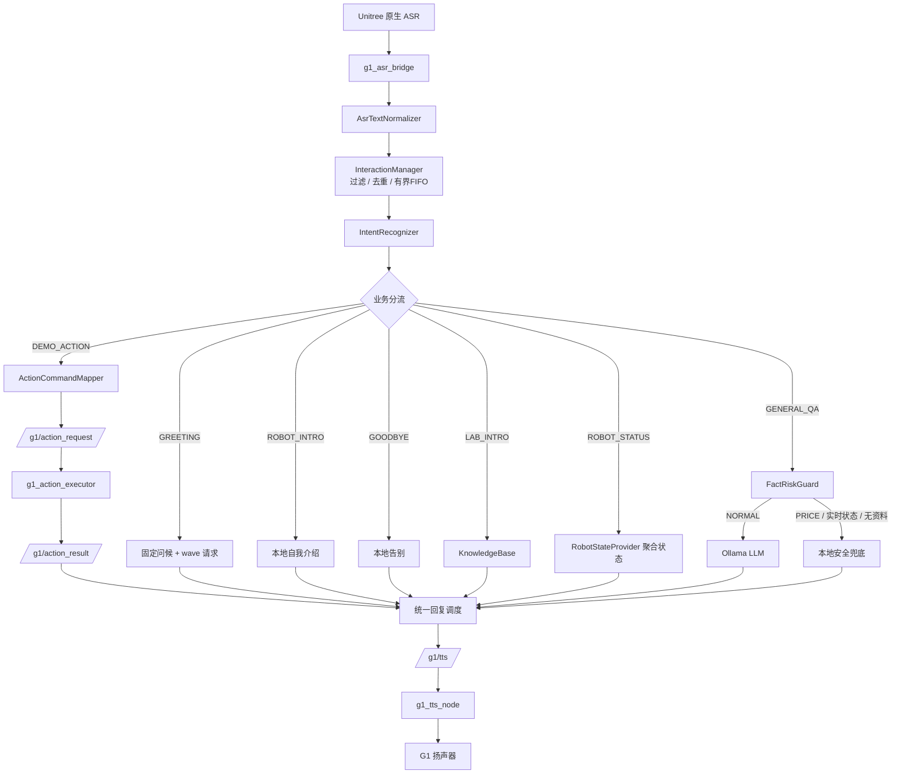

# 基于 ROS 2 的 G1-EDU 校园实验室智能接待与讲解系统 V1.0

> 在 Unitree G1-EDU 人形机器人上实现的实验室智能接待系统：真实语音输入 → 意图理解 → 本地知识库 / 机器人真实状态 / 外部大模型 → 语音播报 + 白名单动作演示。
>
> 面向学校实验室开放日、科技展览、参观接待等场景，机器人作为固定点位接待员。

---

## 1. 项目简介

### 1.1 背景与问题

实验室开放日接待存在三个现实问题：

1. **讲解重复且占用人力**：同一套介绍每天要重复几十遍。
2. **问答不可控**：直接接大模型时，模型会编造实验室人数、科研成果、设备型号、产品价格。
3. **动作不安全**：语音控制人形机器人时，任意动作指令可能造成碰撞或危险姿态。

本项目的目标不是"做一个会聊天的机器人"，而是**做一个说错话会兜底、下错令不会动的接待机器人**。

### 1.2 核心思路

```text
普通知识 → 交给大模型
具体事实 → 必须有本地可靠来源，否则明说不知道
实时状态 → 只读真实 ROS 话题，绝不生成
动作执行 → 只能映射到固定白名单，程序侧二次校验
```

### 1.3 为什么用 ROS 2

- 机器人原生语音、BMS、IMU、关节、动作状态本身就是 ROS 2 话题，直接订阅即可，不重复造轮子。
- 节点解耦：ASR、TTS、状态聚合、动作执行、业务路由分属不同进程/工作区，可单独重启与回滚。
- DDS 域隔离：生产用 `ROS_DOMAIN_ID=0`，测试用 `77`，可在同一台机器上安全做隔离验证。

### 1.4 为什么模块化

每个判定逻辑都做成**不依赖 ROS 的纯 C++ 静态库**（意图、知识库、风险保护、动作映射、文本归一化、任务管理），因此可以脱离机器人跑单元测试——这是 453 项测试能在开发机和 ARM64 上快速回归的前提。

### 1.5 运行位置

- 业务代码全部运行在 **G1 板载 Jetson Orin NX（ARM64）**。
- **大模型不跑在机器人上**，运行在与机器人直连的 Ubuntu 笔记本，通过 HTTP 访问。
- 当前系统**不依赖深度相机**，不包含视觉感知、人脸识别、自主导航能力。

---

## 2. 核心功能

| 模块 | 作用 |
|---|---|
| **ASR 输入** | 订阅 Unitree 原生语音识别结果，解析 JSON 取出文本 |
| **ASR 文本归一化** | 有限词典纠正专有名词误识（如"脑急接口/脑筋接口"→"脑机接口"），保留原文，不做模糊匹配 |
| **IntentRecognizer** | 意图分类：问候、告别、实验室介绍、自我介绍、动作演示、状态查询、通用问答 |
| **InteractionManager** | 过滤、去重、有界 FIFO、统一单 worker 调度，保证"问一句答一句" |
| **KnowledgeBase** | 本地实验室知识库（FAQ + 结构化事实 + 来源 ID），未命中明确兜底 |
| **FactRiskGuard** | 程序侧拦截价格、实时状态、实验室事实类高风险问题，不允许模型编造 |
| **RobotStateProvider** | 聚合电池/IMU/关节/动作/里程计为带有效性标记的 JSON |
| **ActionCommandMapper** | 语音动作命令 → 固定白名单动作 ID，永久禁用危险动作 |
| **Action Executor** | 接收动作请求，检查 FSM/机械臂状态后执行，回传结果 |
| **Ollama 接口** | 通用知识问答（外部模型服务） |
| **TTS 输出** | 中文分句、逐句发送、按字数估算播放等待 |
| **systemd 运维** | 五节点用户级服务、开机自恢复、日志轮转、磁盘监测 |

---

## 3. 系统架构



节点通信与数据通路详见 [`docs/architecture/`](docs/architecture/)。

---

## 4. 硬件与软件环境

### 4.1 机器人（生产环境）

| 项目 | 配置 |
|---|---|
| 机器人 | Unitree G1-EDU |
| 主控 | Jetson Orin NX（16GB），ARM64 / aarch64 |
| 系统 | Ubuntu 22.04.5 LTS |
| ROS 2 | Humble |
| JetPack | 6.2.3 |
| CUDA / TensorRT | 12.6 / 10.3（本项目未直接调用） |
| DDS | CycloneDDS（`rmw_cyclonedds_cpp`），生产域 `ROS_DOMAIN_ID=0` |

### 4.2 开发电脑

| 项目 | 配置 |
|---|---|
| 系统 | Ubuntu 24.04.5 LTS |
| CPU / GPU | i7-13650HX / RTX 4070 Laptop 8GB |
| 用途 | 代码开发、单元测试（x86）、模型服务 |

### 4.3 模型服务环境（与机器人分离）

| 项目 | 配置 |
|---|---|
| 位置 | 开发笔记本，与 G1 通过以太网直连 |
| 服务 | Ollama，`/api/chat` |
| 模型 | `qwen3-vl:4b-instruct`（Q4_K_M，约 3.34GB） |

> G1 本机**不运行** Ollama。生产 Router 通过 ROS 参数 `ollama_url` 指向笔记本，仓库内示例统一使用占位符（见 `deployment/config_examples/`）。

---

## 5. 项目目录结构

```text
G1-EDU-Smart-Reception-V1.0/
├── README.md / CHANGELOG.md / CONTRIBUTING.md / .gitignore
├── ros2_ws/src/
│   ├── g1_voice_router/          # 主业务包（11 源文件 + 1 历史副本 / 10 头文件 / 7 测试）
│   └── g1_asr_bridge/            # ASR JSON → /g1/asr_text
├── action_ws/src/
│   └── g1_action_executor/       # 独立 ROS 2 包，白名单动作执行
├── integrations/unitree_audio/   # TTS 节点源码与配置（基于 Unitree 官方示例）
├── deployment/
│   ├── scripts/                  # start_*.sh（systemd ExecStart 调用的启动脚本）
│   ├── systemd/                  # 5 个 service + target + 2 个 timer
│   ├── logrotate/                # 日志轮转配置与激活说明
│   ├── monitoring/               # 磁盘检查脚本
│   └── config_examples/          # 脱敏配置模板（.example）
├── docs/
│   ├── architecture/             # 总体架构、状态机、数据通路、部署拓扑
│   ├── development/              # 开发与交接文档
│   ├── deployment/               # 部署与运维手册
│   ├── testing/                  # 测试报告摘要
│   ├── milestones/               # P0-15 ~ P0-21 历史交付报告（原样保留）
│   └── GITHUB_PREPARE_CHECKLIST.md
├── software_copyright/           # 软著申请材料（10 份 + Mermaid 图）
├── manifests/                    # 源码/二进制清单、依赖、文件台账
└── private_archive/              # 生产二进制与真实配置（**禁止上传**）
```

---

## 6. 编译与部署

> `g1_voice_router`、`g1_asr_bridge`、TTS 属于 `unitree_ros2/example` 工作区；`g1_action_executor` 属于 `lidar_ws` 工作区。两者必须分别构建、分别 source。

### 6.1 依赖安装

```bash
sudo apt install -y build-essential cmake libcurl4-openssl-dev python3-colcon-common-extensions
# Unitree 官方组件需按官方说明安装（不随本仓库分发）：
#   ~/unitree_ros2（含 cyclonedds_ws、setup.sh）
#   ~/unitree_sdk2（含 AudioClient，TTS 依赖）
```

### 6.2 放入工作区

```bash
cp -r ros2_ws/src/g1_voice_router   ~/unitree_ros2/example/
cp -r ros2_ws/src/g1_asr_bridge     ~/unitree_ros2/example/
cp -r action_ws/src/g1_action_executor ~/lidar_ws/src/
cp integrations/unitree_audio/g1_tts_node.cpp \
   ~/unitree_ros2/example/src/src/g1/audio_client/
cp integrations/unitree_audio/config/*.json ~/unitree_ros2/example/config/
cp deployment/scripts/*.sh ~/g1_systemd/scripts/ && chmod +x ~/g1_systemd/scripts/*.sh
cp deployment/systemd/g1-* ~/.config/systemd/user/
```

### 6.3 构建

```bash
source /opt/ros/humble/setup.bash
source ~/unitree_ros2/setup.sh

cd ~/unitree_ros2/example
colcon build --packages-select g1_voice_router g1_asr_bridge --symlink-install

cd ~/lidar_ws
colcon build --packages-select g1_action_executor --symlink-install
```

### 6.4 测试

```bash
cd ~/unitree_ros2/example
colcon test --packages-select g1_voice_router
colcon test-result --verbose     # 期望 7 tests, 0 errors, 0 failures
```

### 6.5 启动（systemd，推荐）

```bash
systemctl --user daemon-reload
systemctl --user start g1-voice-stack.target

# 状态检查
systemctl --user is-active g1-voice-stack.target
for s in g1-robot-state-provider g1-tts g1-voice-router g1-asr-bridge g1-action-executor; do
  printf '%s pid=%s %s\n' "$s" \
    "$(systemctl --user show -p MainPID --value $s.service)" \
    "$(systemctl --user show -p ActiveState --value $s.service)"
done
```

### 6.6 手工启动（仅排障）

```bash
# 先停整套服务，避免同域出现两个 Router
systemctl --user stop g1-voice-stack.target
source ~/unitree_ros2/setup.sh; source ~/unitree_ros2/example/install/setup.bash
source ~/lidar_ws/install/setup.bash

ros2 run g1_asr_bridge asr_json_bridge
ros2 run g1_voice_router voice_router --ros-args -p ollama_url:=http://<LLM_HOST>:11434/api/chat
ros2 run unitree_ros2_example g1_tts_node
ros2 run g1_voice_router robot_state_provider
ros2 run g1_action_executor g1_action_executor_node
```

### 6.7 日志与停止

```bash
tail -f ~/g1_logs_systemd/voice_router.log
tail -f ~/g1_logs_systemd/tts.log
journalctl --user -u g1-voice-router.service -n 100

systemctl --user stop g1-voice-stack.target
systemctl --user restart g1-voice-router.service     # 只重启单节点
```

### 6.8 常见故障

| 现象 | 排查 |
|---|---|
| 无任何回复 | 五服务是否 active；是否有两个 Router 进程 |
| "暂时无法连接对话模型" | `curl http://<LLM_HOST>:11434/api/tags` |
| 状态回答为兜底 | `ros2 topic echo /g1/robot_state --once` 的 `status` 是否 VALID |
| 动作不执行 | Executor 日志中 FSM/Arm State；`/g1/action_result` 内容 |
| 播报重复 | 是否两个 TTS 订阅者或两个 Router |
| 停服务慢 | `TimeoutStopSec` 应为 15s；实测 SIGINT 退出 < 1s |

---

## 7. ROS 话题接口

| 话题 | 类型 | 方向 | 说明 |
|---|---|---|---|
| `/audio_msg` | `std_msgs/String` | Unitree → ASR Bridge | 原生语音识别 JSON |
| `/g1/asr_text` | `std_msgs/String` | ASR Bridge → Router | 识别文本 |
| `/g1/tts` | `std_msgs/String` | Router → TTS | 待播报文本 |
| `/g1/action_request` | `std_msgs/String` | Router → Executor | 规范动作名（如 `wave`） |
| `/g1/action_result` | `std_msgs/String` | Executor → Router | `accepted:/success:/failed:/timeout:/rejected:` 格式 |
| `/g1/robot_state` | `std_msgs/String` | Provider → Router | `schema_version=1` 聚合状态 JSON |
| `/lowstate`、`/sportmodestate`、`/arm/action/state`、`/dog_odom`、`/lf/bmsstate` | Unitree 消息 | 原生 → Provider | 状态数据源 |

**生产接线约束（实测）**：`/g1/action_request` 发布者恒为 1（Router）、订阅者恒为 1（Executor）；`/g1/action_result` 发布者恒为 1（Executor）、订阅者恒为 1（Router）。

动作请求负载是**规范动作名**，不是任意文本，也不含 ID；ID 由 Executor 内部白名单解析。

---

## 8. 动作白名单

| 动作名称 | Action ID | 真机验收状态 |
|---|---:|---|
| `wave` | 26 | ✅ 已验证（P0-20.1，`success:wave:26`） |
| `wave_low` | 25 | ⚠️ 仅白名单登记，未单独真机验收 |
| `hands_up` | 15 | ⚠️ 仅白名单登记，未单独真机验收 |
| `clap` | 17 | ⚠️ 仅白名单登记，未单独真机验收 |
| `heart` | 20 | ⚠️ 仅白名单登记，未单独真机验收 |
| `victory` | 30 | ⚠️ 仅白名单登记，未单独真机验收 |

**`hand_on_heart` / ID 33 永久禁用**：真机执行曾出现异常后退表现，不得以任何名称重新映射。

> 软件白名单 ≠ 真机验收。白名单代表"允许调用"，真机验收代表"实际测试过"。除 `wave` 外其余动作在 V1.0 中未逐项真机验证，演示前需单独安排安全测试。

---

## 9. 测试情况（V1.0 实测）

| 测试套件 | 用例数 |
|---|---:|
| `asr_text_normalizer_test` | 22 |
| `action_command_mapper_test` | 39 |
| `interaction_manager_test` | 76 |
| `intent_recognizer_test` | 96 |
| `fact_risk_guard_test` | 119 |
| `knowledge_base_test` | 57 |
| `robot_state_evaluator_test` | 44 |
| **合计** | **453** |

- G1 ARM64：`colcon test-result` = `7 tests, 0 errors, 0 failures`。
- 隔离验证：`ROS_DOMAIN_ID=77` + Mock Ollama / Mock Action Executor / Mock RobotStateProvider，覆盖归一化、状态路由、动作成功/失败/超时/去重、队列满顺序、SIGINT 停机。
- 真机 `wave`：请求 1 次，`success:wave:26`，现场确认真实挥手，TTS 反馈"好的，挥手动作完成了。"。
- 其余动作的真机状态见 `docs/milestones/` 各阶段报告，未验收的一律标 ⚠️。

详见 [`docs/testing/`](docs/testing/) 与 [`software_copyright/08_软件测试报告.md`](software_copyright/08_软件测试报告.md)。

---

## 10. 版本与已知限制

**当前版本**：V1.0（2026-11-03 冻结）

生产 Router SHA256：

```text
6ab99de8ceb287d1fdb58b66399874c60b41734775a74a0c2745bf64223d6bb7
```

### 已知限制

1. **ASR 专有名词误识**：真实日志中出现过 `脑急接口`、`脑筋接口`、`手机接口` 三种变体；已用有限词典覆盖前两种，"手机接口"因本身是合法提问**不做纠正**。
2. **归一化不做模糊匹配**：只覆盖有真实日志证据的明确别名，宁可答错也不误改用户正常提问。
3. **Action Result 没有请求 ID**：只能按"动作名 + 串行"关联，**不支持并发动作**，同名动作连续执行存在理论上的延迟结果误配风险。
4. **IMU 仅回答数据接收与时效**：不构成传感器健康诊断，不宣称姿态估计准确。
5. **TTS 无可靠播放完成事件**：`TtsMaker ret=0` 只代表调用成功，**不等于扬声器播放完成**；句间等待是按字数估算的。
6. **不依赖深度相机**：V1.0 核心语音交互不含视觉。
7. **大模型在笔记本**：G1 本地未部署 LLM，断网时仅本地能力可用（知识库、状态、动作、固定话术）。
8. 除 `wave` 外其余白名单动作未逐项真机验收。

---

## 11. 后续规划（未实现）

- G1 本地部署小参数大模型（脱离笔记本）
- 面向实验室场景的模型微调
- 更自然的 TTS 与真实播放状态回传
- 动作执行协议增加请求 ID，支持可靠的并发/队列
- 其余白名单动作逐项真机验收
- 深度相机/视觉能力恢复后的扩展（当前不作为依赖）

---

## 12. 许可证与贡献

**本项目当前未指定开源许可证。** 未经作者书面授权，不得将本项目视为已授予公开再分发许可。

贡献前请阅读 [`CONTRIBUTING.md`](CONTRIBUTING.md)。安全相关约束（不得绕过 FactRiskGuard / InteractionManager、不得新增未验证动作 ID）为强制要求。

上传 GitHub 前请务必阅读 [`docs/GITHUB_PREPARE_CHECKLIST.md`](docs/GITHUB_PREPARE_CHECKLIST.md)：仓库内仍包含内网 IP、主机名等内部信息，公开前需人工确认或脱敏；`private_archive/` 默认不应上传；运行证据统一放在仓库根 `evidence/`（本目录不再重复保存）。
