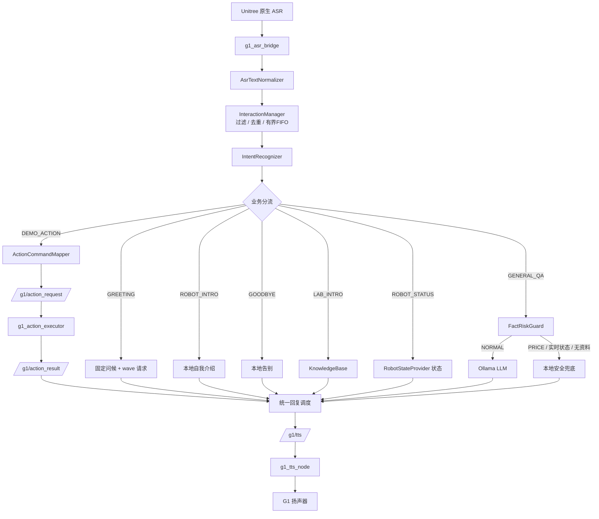
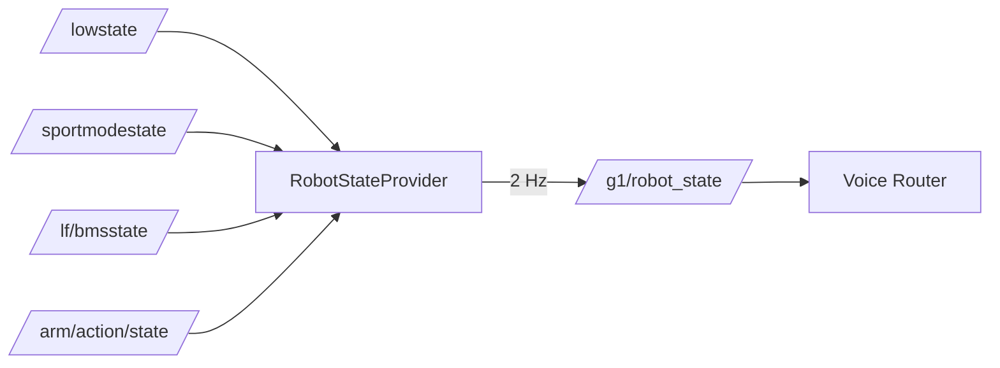
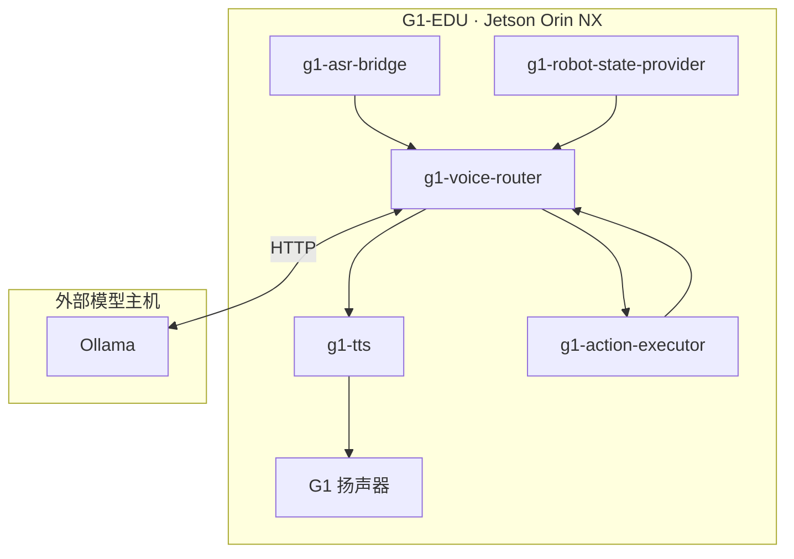
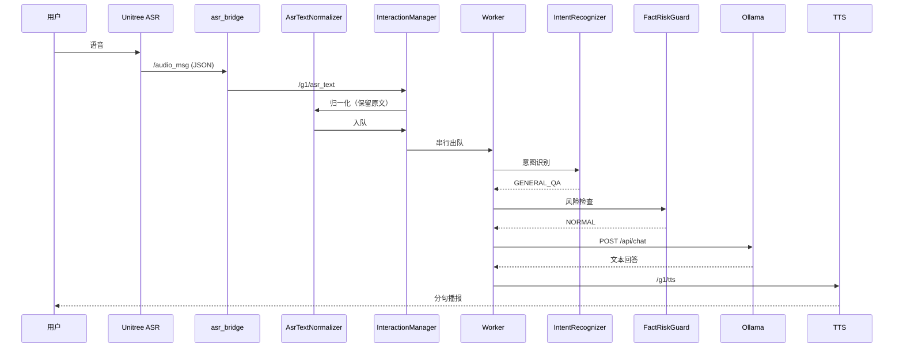
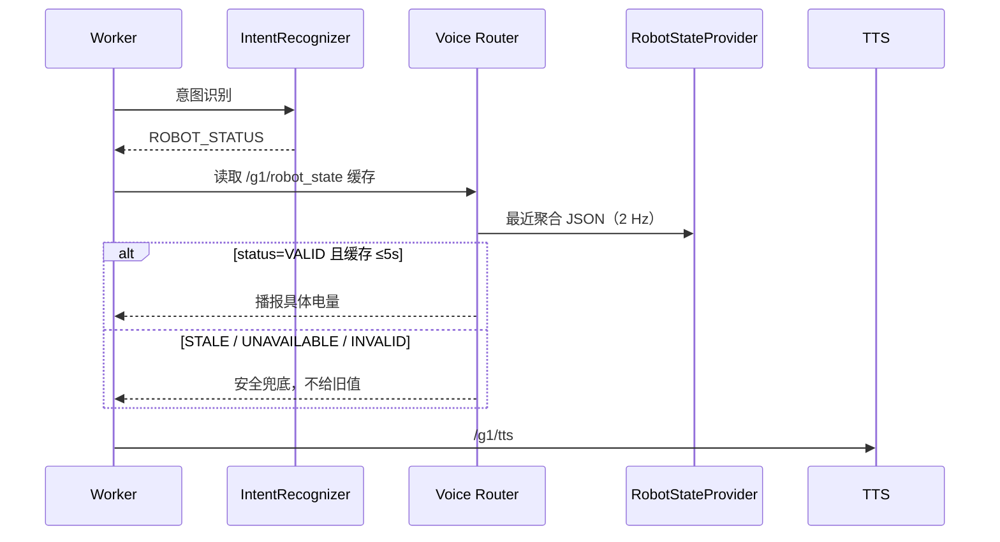
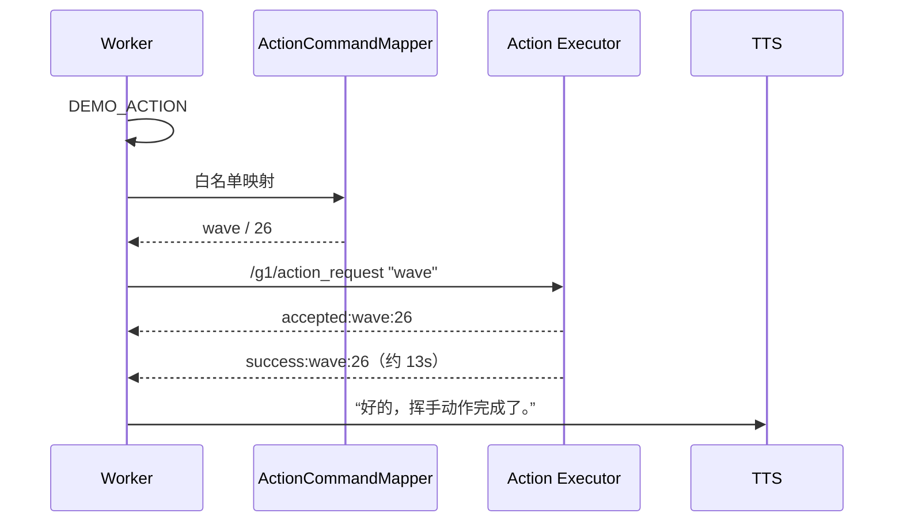

# 基于 ROS 2 的 G1-EDU 校园实验室智能接待与讲解系统 V1.0

**G1-EDU ROS 2 Voice Interaction and Smart Reception System**

> 一个运行在 Unitree G1-EDU 人形机器人上的 ROS 2 模块化语音交互与状态感知系统：真实语音输入经 ASR（Automatic Speech Recognition，自动语音识别）、意图识别、本地知识库、外部大语言模型、真实机器人状态数据与白名单动作执行，完成校园实验室场景下的接待、讲解、状态查询与动作演示。

| 项目 | 值 |
|---|---|
| Version | V1.0（2026-11-03 冻结） |
| Platform | Unitree G1-EDU |
| Compute | Jetson Orin NX / ARM64 |
| OS | Ubuntu 22.04.5 LTS |
| ROS | ROS 2 Humble（CycloneDDS） |
| Language | C++17 |
| Status | Frozen Release |
| 生产 Router SHA256 | `6ab99de8ceb287d1fdb58b66399874c60b41734775a74a0c2745bf64223d6bb7` |

> 说明：本项目尚未指定开源许可证，也未提供正式产品化包装；上表为工程状态标识，不是商业产品声明。

---

## 目录

- [1. 实机展示](#1-实机展示)
- [2. 项目背景与设计目标](#2-项目背景与设计目标)
- [3. 核心功能](#3-核心功能)
- [4. 系统总体架构](#4-系统总体架构)
- [5. 关键业务流程](#5-关键业务流程)
- [6. 核心模块设计](#6-核心模块设计)
- [7. 技术选型与设计决策](#7-技术选型与设计决策)
- [8. 硬件与软件环境](#8-硬件与软件环境)
- [9. 项目目录与源码导航](#9-项目目录与源码导航)
- [10. 编译、部署与运行](#10-编译部署与运行)
- [11. ROS 2 接口文档](#11-ros-2-接口文档)
- [12. 动作安全设计与白名单](#12-动作安全设计与白名单)
- [13. 测试与验收证据](#13-测试与验收证据)
- [14. 性能与资源](#14-性能与资源)
- [15. 常见问题与故障排查](#15-常见问题与故障排查)
- [16. 已知限制](#16-已知限制)
- [17. 路线图](#17-路线图)
- [18. 参考资料与第三方依赖](#18-参考资料与第三方依赖)

---

## 1. 实机展示

当前归档**未包含**实拍照片与演示视频。仓库提供了素材目录与命名约定，补充后替换下方占位即可。

<!-- 补充实拍后在此插入图片标签，路径形如 docs/assets/g1_edu_full.jpg -->

| 素材 | 建议文件 | 状态 |
|---|---|---|
| G1-EDU 整机照片 | `docs/assets/g1_edu_full.jpg` | 待补充 |
| 真实挥手照片 | `docs/assets/g1_wave.jpg` | 待补充 |
| 接待现场照片 | `docs/assets/reception_scene.jpg` | 待补充 |
| 节点/话题终端截图 | `docs/assets/terminal_nodes.png` | 待补充 |
| 演示视频 | `docs/assets/demo.mp4` | 待补充 |

素材要求与注意事项见 [`docs/assets/README.md`](docs/assets/README.md)。

---

## 2. 项目背景与设计目标

### 2.1 场景与问题

实验室开放日、科技展览、参观接待的典型困境：

1. **讲解重复**：同一套介绍每天重复几十遍，占用讲解人力。
2. **问答不可控**：直接接大模型时，模型会编造实验室人数、科研成果、设备型号、产品价格——这不是假设，本项目真实遇到过模型给出错误报价。
3. **动作有物理风险**：语音控制人形机器人时，任意动作指令都可能造成碰撞或危险姿态。
4. **长期运行**：演示不是跑 10 分钟，而是整场活动数小时，进程崩溃、日志撑爆磁盘都必须考虑。

### 2.2 设计目标

| 目标 | 手段 |
|---|---|
| 说得准 | 本地知识库 + 外部模型分工：固定事实走本地，通用知识走模型 |
| 不敢编 | FactRiskGuard（事实风险保护）在进入模型前做程序化拦截 |
| 不会乱 | InteractionManager（交互任务管理器）单 worker 串行 + 有界队列 |
| 不会乱动 | ActionCommandMapper（动作命令映射器）固定白名单 + 否定/疑问拦截 |
| 有据可查 | 每个状态回答都带数据来源与有效性判定 |
| 能长期跑 | systemd 守护 + 开机自恢复 + 日志轮转 + 磁盘监测 |

### 2.3 为什么选这些方案

- **为什么 G1-EDU**：官方提供 ROS 2 接口（语音、BMS、IMU、机械臂状态），可在不改底层控制的前提下做上层集成；人形形态适合接待场景。
- **为什么以语音为主**：接待场景中参观者双手可能拿东西、注意力在展品上，语音是门槛最低的交互方式。
- **为什么用 ROS 2**：机器人原生数据本身就是 ROS 2 话题，直接订阅即可；节点解耦让 ASR、TTS、状态、动作可分别重启与回滚。
- **为什么本地知识库 + 大模型并存**：实验室事实是封闭集合且必须准确，适合本地检索；开放域技术问题（"什么是具身智能"）用模型更自然。两者混用会导致模型用"看起来合理"的话污染事实。
- **为什么状态要独立 Provider**：`/lowstate` 约 1kHz、结构复杂，直接塞进语音进程会淹没业务逻辑；独立进程可降频、可独立重启、可独立演进。
- **为什么动作要程序级白名单**：模型输出不可控，而人形机器人错误动作有物理后果。白名单把"能做什么"从模型手里拿回到代码里。
- **为什么需要进程守护与日志管理**：长时间运行必然遇到崩溃与日志增长；没有 systemd 与 logrotate，演示中途挂掉只能人工救场。

### 2.4 边界

当前核心交互**不依赖深度相机**；不含视觉识别、人脸识别、自主导航、语义地图。V1.0 的大模型运行在**机器人外部主机**，不是 Jetson 本地。

---

## 3. 核心功能

| 功能 | 用户能做什么 | 系统如何实现 | 验证级别 |
|---|---|---|---|
| 语音问答 | 询问通用技术问题 | ASR → Router → FactRiskGuard → Ollama → TTS | 真机（P0-16/P0-21） |
| 实验室介绍 | 询问实验室方向/设备/项目 | KnowledgeBase 本地匹配，未命中兜底 | 真机（P0-16/P0-21） |
| 电量查询 | 查询当前电量 | RobotStateProvider 读 BMS `soc`，带有效性判定 | 真机（P0-21 播报 93%） |
| IMU 数据接收查询 | 询问数据是否在更新 | Provider `imu.data_available` + 时效 | 真机（P0-21） |
| 运行状态查询 | 查看状态摘要 | 四路数据聚合为一段话 | 真机（P0-21） |
| 动作语音指令 | 说“挥个手”等 | Mapper 白名单 → Action Executor → 结果关联 | `wave` 真机通过；其余仅 Mock |
| 连续对话 | 连续提多个问题 | 有界 FIFO + 单 worker 串行 | 真机 + 隔离验证 |
| 队列过载保护 | 快速连问 | 拒绝最新请求并播报忙碌提示（不插队） | 隔离验证（顺序已验） |
| 异常恢复 | 节点崩溃后自愈 | systemd `Restart=always` + 开机自恢复 | 真机（重启实测） |
| 日志轮转 | 控制日志增长 | logrotate + 定时器 + 磁盘检查 | 已部署并验证 |

验证级别说明：**单元测试**（纯 C++，无 ROS）／**Mock 隔离测试**（DOMAIN_ID=77）／**ARM64 实际编译**／**真机测试**（真实麦克风/扬声器/机械臂）。四者不可互相替代。

---

## 4. 系统总体架构



动作子链路：


状态子链路：



部署拓扑：



> 图中每个节点都是真实运行的 ROS 2 节点；没有把"规划中的模块"画进架构。
> 细节见 [`docs/architecture/`](docs/architecture/)。

---

## 5. 关键业务流程

### 5.1 普通知识问答（“脑机接口是什么？”）



实测：真实一次问答 `total_ms≈5900`（含模型生成），期间日志可见 `WAITING_OLLAMA → COMPLETED`。

### 5.2 机器人状态查询（“你现在还有多少电量？”）



关键约束：**数据不可用时宁可说不知道**，不允许把上一次的旧值当当前值播报。

### 5.3 动作执行（“挥个手”）



四条硬约束：

1. **白名单**：动作名只能来自 6 个已验证动作，模型无权决定 ID；
2. **不并发**：Worker 串行等待，同一时刻只有一个动作在途；
3. **不重试**：超时或结果缺失时只播报“未收到结果，不会自动重复执行”；
4. **可关联但无 ID**：结果按“动作名 + 发送前序号快照”匹配（协议无请求 ID，见 §16）。

---

## 6. 核心模块设计

### 6.1 AsrTextNormalizer（ASR 文本归一化器）

- **问题**：ASR 对专有名词有稳定错识，错词直接进模型会答非所问（真实案例：`脑机接口 → 脑急接口 → 模型解释"脑急接口不是标准术语"`）。
- **输入/输出**：原始文本 → `{raw_text, normalized_text, changed, rule_id, reason}`。
- **规则**：`ASR001` 脑急接口/脑筋接口 → 脑机接口；`ASR002` 语数之一 → 宇树G1（**仅当**出现机器人/宇树/价格/动作等上下文）。
- **保护**：含 `不要/别/停止/取消/不准/不许` 时整体跳过；不改数字；`raw_text` 永久保留用于追溯。
- **为什么不模糊匹配**：`手机接口` 也是合法提问，模糊替换会污染正常语义。
- **源码**：`ros2_ws/src/g1_voice_router/src/asr_text_normalizer.cpp`；测试 22 项。

### 6.2 IntentRecognizer（意图识别器）

- **输入/输出**：文本 → `{intent, matched_keywords}`。
- **7 类意图**（源码实际枚举）：`GREETING`、`LAB_INTRO`、`ROBOT_INTRO`、`DEMO_ACTION`、`ROBOT_STATUS`、`GOODBYE`、`GENERAL_QA`。
- **关于 PRICE**：价格**不是意图**，而是 `FactRiskGuard` 的风险类型。价格问题在意图上属于 `GENERAL_QA`，随后被风控拦截——这一点常被误解，文档按源码如实说明。
- **语义边界**（最容易出错）：知识问法（是什么/如何/原理，且不含"当前/现在/目前"）优先判知识；“实验室当前状态怎么样”归 `LAB_INTRO` 而非 `ROBOT_STATUS`。
- **源码**：`src/intent_recognizer.cpp`；测试 96 项。

### 6.3 InteractionManager（交互任务管理器）

- **问题**：ROS 回调随时触发；若在回调里直接调 HTTP、发 TTS，连续提问会导致回复乱序、动作与回答错配。
- **机制**：回调只做“归一化 → 过滤 → 去重 → 入队”；唯一 worker 串行处理；统一 `publish_reply()` 发布。
- **参数**：等待上限 3（不含处理中的一条）；去重窗口 1200ms；去重历史 ≥64 条或每 32 次提交清理过期项。
- **请求生命周期**：`RECEIVED → QUEUED → PROCESSING → (WAITING_OLLAMA | ACTION_WAITING) → REPLY_READY → COMPLETED/FAILED/TIMEOUT`，非法转移被拒绝。
- **过载**：队列满拒绝**新**请求；忙碌提示进独立有界队列（容量 2），且**只在所有已接受请求处理完后**发布，避免"提示插队"。
- **HTTP 中断**：libcurl 进度回调检查停机标志，SIGINT 后 0.79s 内中止请求。
- **停机清理**：唤醒动作等待、停止 worker、join 线程；实测三种场景均 <1s。
- **源码**：`src/interaction_manager.cpp`、`src/interaction_filter.cpp`；测试 76 项。

### 6.4 FactRiskGuard（事实风险保护）

- **问题**：模型会编造价格、人数、成果、设备型号、实时状态。
- **输入/输出**：文本 + 知识库指针 → `{risk, blocked, use_local_answer, reason, fallback_answer, kb_*}`。
- **四类风险**：`PRICE`（直接兜底）、`REALTIME_STATUS`（直接兜底）、`LAB_FACT`（先查知识库，可靠命中才用）、`NORMAL`（放行）。
- **为什么程序化**：提示词只能"劝阻"，代码才能"保证"。
- **副作用与代价**：规则是白名单式，可能把个别可回答的问题也拦成兜底（宁可少答，不可乱答），因此配了 8 项防过度拦截用例。
- **源码**：`src/fact_risk_guard.cpp`；测试 119 项。

### 6.5 KnowledgeBase（本地知识库）

- **问题**：实验室固定事实必须准确、可追溯，不适合让模型生成。
- **数据**：`config/lab_knowledge.json` — FAQ 21、研究方向 3、项目 1、设备 1、分类 5、实验室 3、来源 15。
- **策略**：结构化字段检索 + FAQ 相似度 + 实体掩码 + 意图相容判断；同分且无法区分时**安全兜底**而不是猜。
- **为什么本地**：答案稳定、可离线、每条事实可回溯来源。
- **限制**：未收录问题一律“暂无经过核实的公开资料”。
- **源码**：`src/knowledge_base.cpp`；测试 57 项。

### 6.6 RobotStateProvider / RobotStateEvaluator（机器人状态）

- **问题**：`/lowstate` 约 1kHz、结构复杂，不能让语音业务直接消费；状态还会过期、断流、格式异常。
- **方案**：Provider 独立订阅 4 路话题，2Hz 发布聚合 JSON；每个字段独立携带 `status / received_age_ms / quality_reason / source_topic`。
- **四态**：`VALID`（可答具体值）、`STALE`（超时，告知未更新）、`UNAVAILABLE`（无数据）、`INVALID`（异常）。
- **SOC 来源**：`/lf/bmsstate` 的 SOC 字段，**不用电压反推**。
- **IMU 边界**：只回答“是否持续收到数据”，不代表传感器健康或姿态准确。
- **源码**：`src/robot_state_provider.cpp`、`src/robot_state_evaluator.cpp`；测试 44 项。

### 6.7 ActionCommandMapper（动作命令映射器）

- **问题**：语音口令我表达多样，而机器人只能执行固定动作；模型输出不可控。
- **白名单**：wave 26 / wave_low 25 / hands_up 15 / clap 17 / heart 20 / victory 30。
- **判定顺序**：永久禁用（`hand_on_heart`/33）→ 否定/停止 → 疑问/能力询问 → 最长短语匹配；出口二次校验 ID。
- **否定与疑问**：“不要挥手”不执行；“挥手的原理是什么”转知识；“你会做哪些动作”只介绍能力。
- **歧义处理**：“给我们表演一个动作”不猜动作，改为澄清提示。
- **源码**：`src/action_command_mapper.cpp`；测试 39 项。

### 6.8 Action Executor（动作执行器，独立 ROS 2 包）

- **分工**：Router 决定“做什么”，Executor 决定“能不能做、怎么做”。
- **输入/输出**：`/g1/action_request`（规范动作名）→ `/g1/action_result`。
- **前置检查**：FSM 状态、`mode_machine`、机械臂是否空闲（`/arm/action/state`）；不通过直接 `rejected`。
- **超时**：启动 5s、完成 30s、动作后稳定 3s（最坏约 38s，Router 侧超时 45s）。
- **结果格式**：`accepted:<name>:<id>`、`success:<name>:<id>`、`failed:...`、`timeout:...`、`rejected: <原因>`。
- **源码**：`action_ws/src/g1_action_executor/`。

### 6.9 TTS 集成

- 链路：`/g1/tts` → `g1_tts_node` → `AudioClient::TtsMaker(sentence, speaker_id)`。
- 处理：中文分句、逐句发送、按字数估算播放时长 + 句间 `pause_ms`（1500ms）。
- 配置：`speaker_id=0`、`volume=80`。
- **重要**：`TtsMaker ret=0` 仅代表调用成功，**不等于扬声器播放完成**；系统没有真实播放完成事件。

### 6.10 系统运维模块

- 用户级 systemd：5 service + target + 2 timer；`Restart=always`、`RestartSec=3`、`KillSignal=SIGINT`、`TimeoutStopSec=15`。
- 开机自恢复：整机重启后约 45s 五节点全部就绪（实测，`NRestarts=0`）。
- 日志：按日轮转 + 20MB 上限 + 保留 7 份 + 压缩；磁盘检查每 6 小时。
- 意义：这是"能连续演示数小时"与"跑十分钟的 Demo"的区别。

---

## 7. 技术选型与设计决策

| 技术 | 用途 | 选择原因 | 代价 |
|---|---|---|---|
| ROS 2 Humble | 节点通信、话题、参数、launch | 与 G1 官方软件栈一致，原生数据就是话题 | 版本绑定，升级成本高 |
| C++17 | 机器人端核心业务 | 部署简单、并发可控、无运行时依赖 | 开发效率低于脚本语言 |
| CycloneDDS | ROS 2 中间件 | 当前生产环境实际使用，与 Unitree 原生应用互通 | 配置与网卡绑定需谨慎 |
| Ollama（HTTP） | 通用问答 | 服务化调用、模型可替换、不占 Jetson 资源 | 依赖局域网，断网退化 |
| Unitree SDK | 语音与动作接口 | 官方通道，无法绕过 | 部分接口无回调/无状态 |
| systemd（user） | 生命周期 | 崩溃自愈、开机恢复、统一日志 | unit 内硬编码路径 |
| logrotate | 日志管理 | 长期运行磁盘保护 | 需配合 `copytruncate` 避免句柄问题 |

### 关键设计原则

1. **实时状态必须来自真实数据**，模型只负责措辞，不负责数值。
2. **普通知识与实时状态分开处理**：前者可交给模型，后者必须查 Provider。
3. **模型不做动作决策**：模型理解语言，白名单决定动作。
4. **所有 TTS 回复进入统一调度**：保证顺序，避免"回答 A 的声音配回答 B 的内容"。
5. **动作必须过白名单**，且否定/疑问不触发。
6. **失败不重试**：物理动作不确定时，重复执行比不执行更危险。
7. **Mock 与真机严格区分**：Mock 证明分支，真机证明物理链路。

---

## 8. 硬件与软件环境

### 8.1 机器人端

| 项目 | 配置 |
|---|---|
| 平台 | Unitree G1-EDU |
| 计算平台 | Jetson Orin NX |
| 内存 | 16 GB |
| 系统 | Ubuntu 22.04.5 LTS |
| ROS | ROS 2 Humble |
| JetPack | 6.2.3 |
| CUDA / TensorRT | 12.6 / 10.3（本项目未直接调用） |
| DDS | CycloneDDS（`rmw_cyclonedds_cpp`） |
| 架构 | ARM64 / aarch64 |

### 8.2 开发电脑

| 项目 | 配置 |
|---|---|
| CPU | Intel i7-13650HX |
| GPU | NVIDIA RTX 4070 Laptop 8GB |
| 系统 | Ubuntu 24.04.5 LTS |
| 用途 | 代码开发、x86 单元测试、模型服务 |

### 8.3 模型服务端

| 项目 | 说明 |
|---|---|
| 位置 | **与机器人直连的外部主机**（不在 Jetson 上） |
| 服务 | Ollama，HTTP `POST /api/chat` |
| 模型 | `qwen3-vl:4b-instruct`（Q4_K_M，约 3.34 GB） |
| 配置方式 | ROS 参数 `ollama_url`；文档统一使用 `http://<LLM_HOST>:11434/api/chat` 占位 |

> 公开文档不写入真实内网地址、账号或私人路径。

---

## 9. 项目目录与源码导航

```text
G1-EDU-Smart-Reception-V1.0/
├── README.md                       ← 本文件
├── CHANGELOG.md / CONTRIBUTING.md
├── V1.0_RELEASE_NOTES.md           ← 冻结说明
├── ros2_ws/src/
│   ├── g1_voice_router/            ← 主业务包（11 源文件 + 1 历史副本 / 10 头文件 / 7 测试）
│   └── g1_asr_bridge/              ← ASR JSON → /g1/asr_text
├── action_ws/src/
│   └── g1_action_executor/         ← 独立 ROS 2 包
├── integrations/unitree_audio/     ← TTS 节点源码与配置
├── deployment/
│   ├── scripts/                    ← 5 个启动脚本
│   ├── systemd/                    ← 7 service + 2 timer + target
│   ├── logrotate/                  ← 日志轮转配置
│   ├── monitoring/                 ← 磁盘检查
│   └── config_examples/            ← 脱敏模板（占位符）
├── docs/
│   ├── architecture/               ← 5 篇：总体/通信/时序/状态/拓扑
│   ├── development/                ← 代码结构/模块设计/设计决策/依赖/交接
│   ├── deployment/                 ← 环境/编译/启动/服务/回滚
│   ├── testing/                    ← 单元/Mock/真机/已知问题
│   ├── milestones/                 ← 16 份阶段报告 + 索引
│   ├── assets/                     ← 实拍素材（待补充）
│   └── GITHUB_PREPARE_CHECKLIST.md
├── software_copyright/             ← 软著材料 01–10 + 架构图
├── manifests/                      ← 文件台账、SHA256 清单、依赖
└── private_archive/                ← 生产二进制与真实配置（禁止上传）
```

### 源码阅读顺序（按依赖从底到顶）

1. `include/g1_voice_router/interaction_types.hpp` — 请求与状态定义
2. `src/interaction_manager.cpp` — 调度、去重、状态机
3. `src/intent_recognizer.cpp` — 意图边界（最易出错）
4. `src/fact_risk_guard.cpp` — 安全边界
5. `src/robot_state_evaluator.cpp` — 状态如何变成一句话
6. `src/action_command_mapper.cpp` — 白名单与拒绝策略
7. `src/voice_router.cpp` — 所有分支的编排（建议对照 [`docs/architecture/interaction_sequence.md`](docs/architecture/interaction_sequence.md)）

---

## 10. 编译、部署与运行

### 10.1 环境准备

```bash
source /opt/ros/humble/setup.bash
source ~/unitree_ros2/setup.sh
source ~/unitree_ros2/cyclonedds_ws/install/setup.bash
export ROS_DOMAIN_ID=0
export RMW_IMPLEMENTATION=rmw_cyclonedds_cpp
```

依赖安装与排错见 [`docs/deployment/environment_setup.md`](docs/deployment/environment_setup.md)。

### 10.2 放置源码

```bash
cp -r ros2_ws/src/g1_voice_router      ~/unitree_ros2/example/
cp -r ros2_ws/src/g1_asr_bridge        ~/unitree_ros2/example/
cp -r action_ws/src/g1_action_executor ~/lidar_ws/src/
cp integrations/unitree_audio/g1_tts_node.cpp ~/unitree_ros2/example/src/src/g1/audio_client/
cp integrations/unitree_audio/config/*.json    ~/unitree_ros2/example/config/
```

> 两个工作区必须分别构建与 source：`unitree_ros2/example` 与 `lidar_ws`。

### 10.3 构建

```bash
cd ~/unitree_ros2/example
colcon build --packages-select g1_voice_router g1_asr_bridge --symlink-install

cd ~/lidar_ws
colcon build --packages-select g1_action_executor --symlink-install
```

### 10.4 测试

```bash
cd ~/unitree_ros2/example
colcon test --packages-select g1_voice_router
colcon test-result --verbose     # 期望 7 tests, 0 errors, 0 failures
```

### 10.5 启动

```bash
systemctl --user daemon-reload
systemctl --user enable --now g1-voice-stack.target

systemctl --user is-active g1-voice-stack.target
ps -eo pid,args | grep '[g]1_voice_router/voice_router'   # 必须只有 1 个
```

手工调试方式、自检命令见 [`docs/deployment/startup_guide.md`](docs/deployment/startup_guide.md)。

### 10.6 日志与停止

```bash
tail -f ~/g1_logs_systemd/voice_router.log
journalctl --user -u g1-voice-router.service -n 100 --no-pager

systemctl --user stop g1-voice-stack.target
systemctl --user restart g1-voice-router.service   # 生产更新只允许单节点
```

### 10.7 注意事项

- **不要**同时启动两份 Router（会导致一句话处理两次、动作请求翻倍）。
- **不要**随意改生产 `ROS_DOMAIN_ID`（生产 0，测试 77）。
- 真机动作必须现场确认安全后再触发。
- 未验证的版本不要直接覆盖生产二进制；先备份 `/proc/PID/exe`。

---

## 11. ROS 2 接口文档

| Topic | Message Type | Publisher | Subscriber | 作用 |
|---|---|---|---|---|
| `/g1/asr_text` | `std_msgs/msg/String` | `g1_asr_bridge` | `g1_voice_router` | ASR 文本输入 |
| `/g1/tts` | `std_msgs/msg/String` | `g1_voice_router` | `g1_tts_node` | 待播报文本 |
| `/g1/action_request` | `std_msgs/msg/String` | `g1_voice_router` | `g1_action_executor` | 动作请求（规范动作名） |
| `/g1/action_result` | `std_msgs/msg/String` | `g1_action_executor` | `g1_voice_router` | 动作结果 |
| `/g1/robot_state` | `std_msgs/msg/String` | `g1_robot_state_provider` | `g1_voice_router` | 状态聚合 JSON |

底层状态话题（本项目直接依赖，但属于 Unitree 原生接口）：

| Topic | Message Type | 用途 |
|---|---|---|
| `/lowstate` | `unitree_hg/msg/LowState` | 关节与 IMU 原始状态 |
| `/sportmodestate` | `unitree_hg/msg/SportModeState` | 运动模式与 FSM |
| `/lf/bmsstate` | `unitree_hg/msg/BmsState` | 电池 SOC / 电压 |
| `/arm/action/state` | `std_msgs/msg/String` | 机械臂动作状态 |

检查示例（需先 source ROS 环境）：

```bash
ros2 topic info /g1/robot_state
ros2 topic echo /g1/robot_state --once
ros2 topic info /g1/action_request   # 发布者应只有 g1_voice_router
```

---

## 12. 动作安全设计与白名单

| 动作 | ID | 真机验收 |
|---|---:|---|
| `wave` | 26 | ✅ P0-20.1 真机通过（`success:wave:26`） |
| `wave_low` | 25 | ⚠️ 仅白名单登记，未单独真机验收 |
| `hands_up` | 15 | ⚠️ 仅白名单登记，未单独真机验收 |
| `clap` | 17 | ⚠️ 仅白名单登记，未单独真机验收 |
| `heart` | 20 | ⚠️ 仅白名单登记，未单独真机验收 |
| `victory` | 30 | ⚠️ 仅白名单登记，未单独真机验收 |

**`hand_on_heart` / ID 33 永久禁用**：真机执行曾出现异常后退表现，不得以任何名称重新映射。

### 为什么不让模型输出动作 ID

模型可能输出不存在的 ID、输出 33、或在否定语境下仍给动作。白名单把决策权收回代码：模型可以理解“我想看个动作”，但**具体执行什么**由 `ActionCommandMapper` 决定。

### 结果关联的风险与策略

- **协议无请求 ID**：结果只有 `success:<name>:<id>`。
- **当前策略**：单 worker 串行 + 动作名匹配 + 发送前序号快照 + 45s 超时 + 不重试。
- **残留风险**：同名动作连续执行时，理论上可能把延迟到达的旧结果误配给新请求。
- **根治方向**：结果协议增加请求 ID（见 §17）。

---

## 13. 测试与验收证据

### 13.1 单元测试（453 项）

| 测试套件 | 用例 |
|---|---:|
| ASRTextNormalizer | 22 |
| ActionCommandMapper | 39 |
| InteractionManager | 76 |
| IntentRecognizer | 96 |
| FactRiskGuard | 119 |
| KnowledgeBase | 57 |
| RobotStateEvaluator | 44 |
| **合计** | **453** |

- G1 ARM64 编译通过；`colcon test-result` = **7 tests, 0 errors, 0 failures, 0 skipped**。
- 该数字为 2026-11-03 在 G1 上重新执行得到的实测值。

### 13.2 Mock 隔离测试（DOMAIN_ID=77）

覆盖别名归一化、状态路由、价格拦截、动作成功/失败/超时/禁用/去重、队列满顺序、SIGINT 停机。明细见 [`docs/testing/mock_tests.md`](docs/testing/mock_tests.md)。

### 13.3 真机验证

| 项目 | 结果 |
|---|---|
| 语音闭环（P0-16） | 通过；问候触发挥手 4/4 |
| 非动作回归（P0-20.1） | 5 项通过，动作请求 0 |
| 单次 wave（P0-20.1） | `success:wave:26`，现场确认挥手 |
| 六项生产演示（P0-21） | 实验室/电量/IMU/整体状态/动作能力正确；脑机接口因 ASR 变体答错（已补规则） |
| ASR001 专项（P0-21 补充） | **真机未触发该分支**（ASR 输出“手机接口”），仅有单测证据 |
| 整机重启恢复 | 45s 内五节点自恢复 |

> **单元测试 ≠ Mock 测试 ≠ 真机测试**。上表按证据类型分行，未混用。
> 完整记录：[`docs/testing/hardware_validation.md`](docs/testing/hardware_validation.md)、[`docs/milestones/`](docs/milestones/)、仓库 `evidence/`。

---

## 14. 性能与资源

以下均标注测量环境，未测项不估算。

| 指标 | 数值 | 环境/来源 |
|---|---|---|
| 真实 Ollama 问答总耗时 | 约 5.5–7.0 s | G1 真机，外部模型（P0-20.1/P0-21 日志） |
| HTTP 整体超时 | 60 s（参数 `request_timeout_seconds`） | 源码默认值 |
| HTTP 连接超时 | 3 s | 源码 |
| 动作结果等待超时 | 45 s | Router 参数 `action_timeout_seconds` |
| 执行器内部超时 | 启动 5s / 完成 30s / 稳定 3s | 执行器源码常量 |
| 队列等待上限 | 3 | `kDefaultMaxPending` |
| Worker 数量 | 1 | 设计约束 |
| 去重窗口 | 1200 ms | `kDefaultDedupeWindowMs` |
| 状态缓存有效期 | 5 s | `kRobotStateCacheTimeoutMs` |
| 状态发布频率 | 2 Hz（500 ms） | Provider 定时器 |
| 停机耗时 | 空闲 0.29s / HTTP 中 0.79s / 动作等待 0.29s | DOMAIN_ID=77 实测 |
| 开机恢复 | 约 45 s | 整机重启实测 |
| 日志轮转 | 每日 + 20MB，保留 7 份 | logrotate 配置 |
| 磁盘检查 | 每 6 小时 | systemd timer |

> 未测量：CPU/内存占用曲线、长时间（>1 小时）连续接待压力、并发上限。这些不做估算。

---

## 15. 常见问题与故障排查

### 15.1 Voice Router 无法启动

- **现象**：`systemctl --user status g1-voice-router` 反复 restart。
- **检查**：`journalctl --user -u g1-voice-router -n 50`；常见为知识库文件缺失或参数非法（如 `request_timeout_seconds` 超出 5–300）。
- **正常**：日志出现 `KnowledgeBase loaded` 与 `Ollama URL` 两行。
- **注意**：改 unit 属于运维改动，需先备份。

### 15.2 Topic 看不到消息

- **检查**：`ros2 topic list | grep /g1/`；`ros2 topic info /g1/asr_text`。
- **正常**：`1 publisher / 1 subscriber`。
- **常见原因**：Domain 不一致（生产 0/测试 77）、未 source 正确工作区。

### 15.3 CycloneDDS 网络绑定不正确

- **现象**：节点互相看不见，`ros2 node list` 为空。
- **检查**：`echo $RMW_IMPLEMENTATION`、`echo $CYCLONEDDS_URI`。
- **注意**：不要在排障时随意改 DDS 配置；先确认环境变量与网卡。

### 15.4 ASR 有结果但 Router 没收到

- **检查**：`ros2 topic echo /g1/asr_text --once`。
- **判断**：有输出但 Router 无 `event=QUEUED` → 检查是否两个 Router、或 Router 启动失败。
- **注意**：`/audio_msg` 是原生话题，重启 ASR 服务前确认不影响其他使用者。

### 15.5 Ollama 请求超时/连不上

- **检查**：`curl -s http://<LLM_HOST>:11434/api/tags`。
- **正常**：返回模型列表 JSON。
- **现象**：Router 播报“抱歉，我暂时无法连接到对话模型”，并记录 `OLLAMA_ERROR`。
- **注意**：不要改模型服务配置，先查网络与主机状态。

### 15.6 TTS 发布了但没声音

- **检查**：`ros2 topic echo /g1/tts --once`；`tail ~/g1_logs_systemd/tts.log`。
- **正常**：日志有 `Message split into N sentence(s)` 与 `TtsMaker returned ret=0`。
- **判断**：`ret=0` 只代表调用成功；无声音需查音量、扬声器、`speaker_id`。
- **注意**：`ret=0 ≠ 播放完成`，不要据此判断“已经播完”。

### 15.7 Action Request 发了但 Result 没回来

- **检查**：`ros2 topic echo /g1/action_result`；Executor 日志。
- **正常**：先 `accepted:` 再 `success:/failed:/timeout:`。
- **处理**：Router 45s 后播报“未收到结果，不会自动重复执行”；**不要立刻重发口令**，先查执行器与机械臂状态。

### 15.8 动作口令被误识别/未触发

- **现象**：说“挥手”却回答知识问题，或说“不要挥手”却担心会动。
- **判断**：查日志 `intent=` 与 `ACTION_NOT_EXECUTED reason=`。
- **已知**：ASR 对短词不稳；否定句按设计不执行。

### 15.9 电池状态读不到

- **检查**：`ros2 topic echo /g1/robot_state --once`，看 `battery.status`。
- **正常**：`VALID` 且 `soc_percent` 有值。
- **异常**：`UNAVAILABLE` → 查 `/lf/bmsstate` 是否有发布者；`STALE` → 查发布时间。

### 15.10 systemd 服务未自动恢复

- **检查**：`systemctl --user show -p NRestarts --value g1-voice-router.service`。
- **注意**：用户级服务需要 linger 才能在未登录时启动：`loginctl enable-linger $USER`。

### 15.11 日志文件过大

- **检查**：`du -sh ~/g1_logs_systemd/`；`systemctl --user list-timers | grep log-rotate`。
- **处理**：确认 logrotate 定时器在跑；不要手工 `rm` 正在写入的日志。

### 15.12 两个 Router 同时运行

- **现象**：一句话被回答两次、动作执行两次。
- **检查**：`ps -eo pid,args | grep '[g]1_voice_router/voice_router'`。
- **处理**：停掉多余进程（按 PID 精确停止），确认只剩 1 个；这是 P0-20 测试期间真实复现过的事故。

---

## 16. 已知限制

1. **ASR 专有名词误识**：已观测 `脑急接口`、`脑筋接口`、`手机接口`；只对前两类做归一化，第三种是合法词组，故意不纠正。
2. **归一化不做模糊匹配**：只覆盖有真实日志证据的明确别名，覆盖不封闭。
3. **Action Result 无请求 ID**：不支持并发动作；同名动作连续执行存在理论上的延迟结果误配风险。
4. **IMU 仅回答数据接收与时效**：不构成传感器健康诊断，也不代表姿态估计准确。
5. **`TtsMaker ret=0` ≠ 播放完成**：系统没有真实播放完成事件，句间等待为估算值。
6. **动作真机覆盖不足**：仅 `wave` 有完整真机验收记录，其余 5 个仅白名单登记 + Mock 验证。
7. **核心交互不依赖深度相机**：无视觉识别、人脸识别、自主导航、语义地图。
8. **大模型不在机器人本地**：V1.0 的 Ollama 运行在外部主机；断网时仅本地能力可用。
9. **状态字段覆盖有限**：关节温度、电机电流、里程计未用于对外回答（单位/索引映射未确认）。
10. **业务单点**：Router 崩溃会中断全部业务，依赖 systemd 在 3s 后拉起。
11. **未做长时间压力测试**：>1 小时连续接待的稳定性无专项数据。

---

## 17. 路线图

以下均为**未实现**的后续方向，与 V1.0 无关：

- G1 本地部署小参数大模型（脱离外部主机）
- 中文对话人格与话术定制
- 基于实验室语料的 SFT / LoRA 微调
- 更自然的 TTS 与情感化播报
- TTS 真实播放完成反馈（需要底层事件支持）
- Action Result 协议增加请求 ID，支持可靠并发/队列
- 其余 5 个白名单动作逐项真机验收
- 深度相机/视觉能力恢复后的扩展（当前不作为依赖）

---

## 18. 参考资料与第三方依赖

| 项目 | 链接 | 用途 | 说明 |
|---|---|---|---|
| ROS 2 Humble | https://docs.ros.org/en/humble/ | 中间件与构建 | Apache-2.0 |
| Unitree `unitree_ros2` | https://github.com/unitreerobotics/unitree_ros2 | 消息定义、`setup.sh` | 官方仓库，不随本仓库分发 |
| Unitree SDK2 | https://github.com/unitreerobotics/unitree_sdk2 | 语音/动作底层客户端 | 官方仓库，不随本仓库分发 |
| CycloneDDS | https://github.com/eclipse-cyclonedds/cyclonedds | DDS 实现 | Eclipse 许可证 |
| Ollama | https://github.com/ollama/ollama | 本地模型服务 | MIT |
| nlohmann/json | https://github.com/nlohmann/json | JSON 解析 | MIT |
| libcurl | https://curl.se/libcurl/ | HTTP 客户端 | curl 许可证 |

依赖清单与获取方式见 [`manifests/dependencies.md`](manifests/dependencies.md)。
`g1_tts_node.cpp` 基于 Unitree 官方 `audio_client` 示例修改，**不是本项目原创实现**；本项目在其上增加了配置读取与分句播报逻辑。

### 许可证

**本项目尚未指定开源许可证**。代码与文档版权归作者所有，未经授权不得再分发；第三方组件遵循各自许可证。

---

## 附录：文档索引

| 主题 | 文档 |
|---|---|
| 架构与数据流 | [`docs/architecture/`](docs/architecture/) |
| 代码结构与设计决策 | [`docs/development/`](docs/development/) |
| 编译、启动、回滚 | [`docs/deployment/`](docs/deployment/) |
| 测试与真机记录 | [`docs/testing/`](docs/testing/) |
| 阶段报告（P0-15 ~ P0-21） | [`docs/milestones/`](docs/milestones/) |
| 软著材料 | [`software_copyright/`](software_copyright/) |
| 清单与哈希 | [`manifests/`](manifests/) |
| GitHub 上传前检查 | [`docs/GITHUB_PREPARE_CHECKLIST.md`](docs/GITHUB_PREPARE_CHECKLIST.md) |
| 素材（待补充） | [`docs/assets/README.md`](docs/assets/README.md) |
