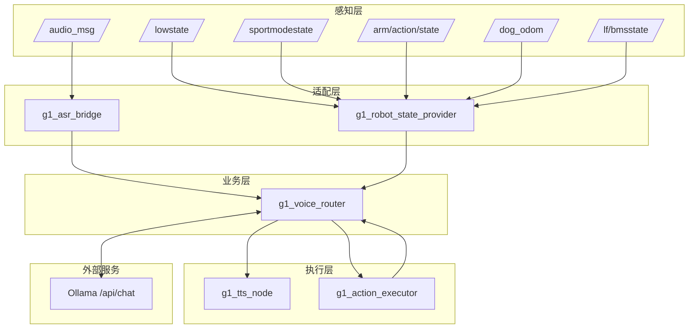
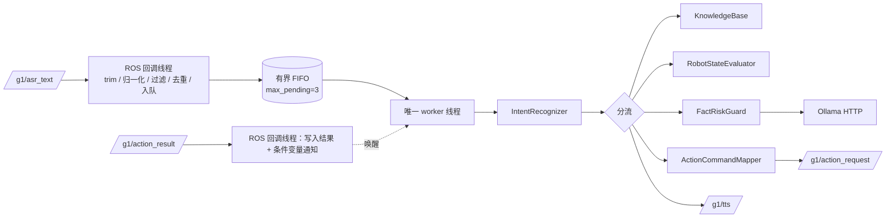

# 总体架构与节点通信

## 1. 分层视图

## 2. 节点与话题矩阵

| 节点 | 订阅 | 发布 |
|---|---|---|
| `g1_asr_bridge` | `/audio_msg` | `/g1/asr_text` |
| `g1_robot_state_provider` | `/lowstate`、`/sportmodestate`、`/arm/action/state`、`/dog_odom`、`/lf/bmsstate` | `/g1/robot_state` |
| `g1_voice_router` | `/g1/asr_text`、`/g1/robot_state`、`/g1/action_result` | `/g1/tts`、`/g1/action_request` |
| `g1_tts_node` | `/g1/tts` | 音频设备（无 ROS 发布） |
| `g1_action_executor` | `/g1/action_request`、`/arm/action/state`、`/sportmodestate`、`/lowstate` | `/g1/action_result` |

消息类型全部为 `std_msgs/msg/String`（`/g1/robot_state` 负载为 JSON 字符串，`schema_version=1`）。

## 3. Router 内部结构

关键线程模型：

- ROS 执行器（单线程）负责所有订阅回调，回调内**不做业务**、不发 TTS。
- worker 线程串行处理请求；HTTP 与动作结果等待都发生在此线程。
- 动作结果回调在 ROS 线程写入共享状态并 `notify`，worker 用条件变量等待，**不会死锁**（worker 不阻塞 ROS 线程）。

## 4. 单实例约束

同一 `ROS_DOMAIN_ID` 下只允许一个 `g1_voice_router`：

- 两个 Router 会同时订阅 `/g1/asr_text`，同一条语音被处理两次；
- 会各自发布 `/g1/action_request`，**同一条口令触发两次动作**（P0-20 测试期间曾真实复现）。

因此部署与排障时必须用 `ps -eo pid,args | grep g1_voice_router/voice_router` 确认进程数为 1。
