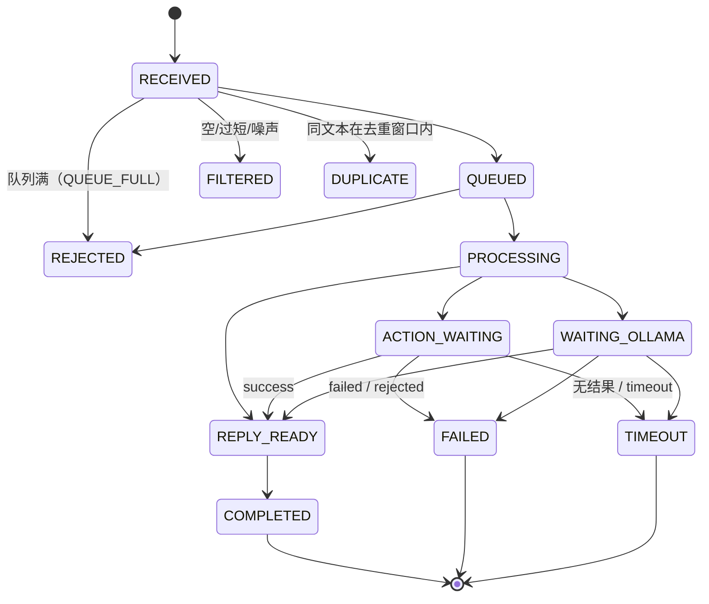

# 交互状态机

## 1. 状态定义

| 状态 | 含义 |
|---|---|
| RECEIVED | 文本已接收 |
| QUEUED | 进入有界 FIFO |
| PROCESSING | worker 正在处理 |
| WAITING_OLLAMA | 已发起 HTTP 请求 |
| ACTION_WAITING | 动作请求已发出，等待 `/g1/action_result` |
| REPLY_READY | 回复已发布到 `/g1/tts` |
| COMPLETED / FAILED / TIMEOUT | 终态 |
| FILTERED / DUPLICATE / REJECTED | 未进入处理的终态 |

## 2. 转移图

转移合法性由 `InteractionManager::can_transition()` 强制校验，非法转移会被拒绝并记录。

## 3. 顺序保证

- **单 worker**：一次只处理一条，回复顺序严格等于接收顺序。
- **忙碌提示不插队**：队列满时生成的提示进入独立有界通知队列（容量 2），只有 `pending_count()==0`（所有已接受请求处理完毕）后才发布。
- **动作串行**：动作任务在 worker 内等待结果（默认 45s，大于执行器最坏 38s），期间后续请求排队。

## 4. 停机行为

`SIGINT` → 置 `shutdown_requested_` → 唤醒动作等待 + curl 进度回调中止传输 → `manager.stop()` → join worker。

实测：空闲 0.29s、HTTP 等待中 0.79s、动作等待中 0.29s 退出（远小于 systemd `TimeoutStopSec=15`）。
