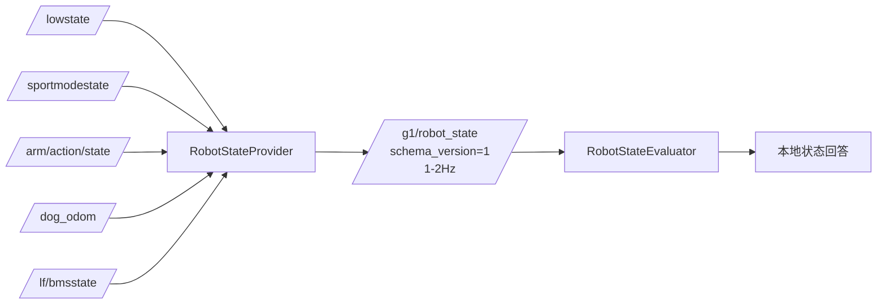
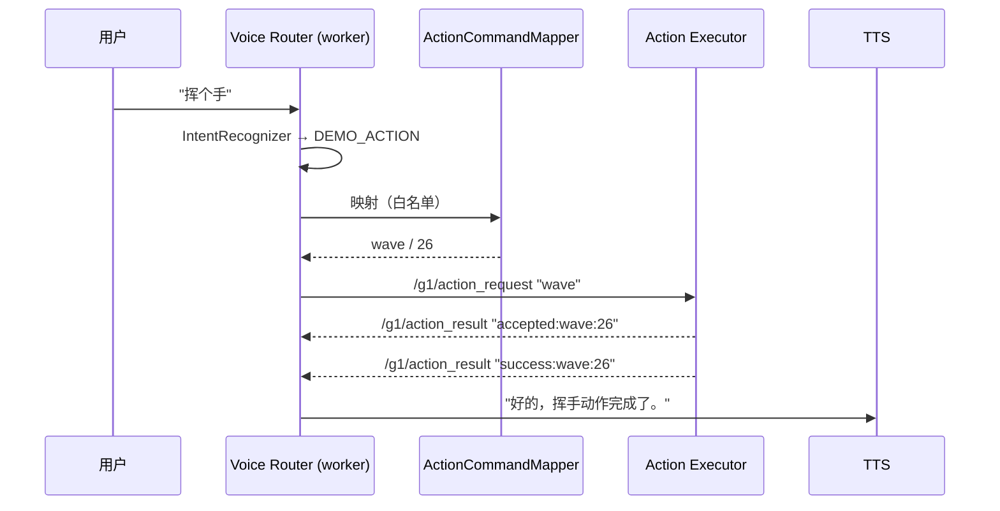

# 状态数据通路与动作执行通路

## 1. 机器人状态数据通路

### 字段与有效性

每个字段携带 `status`（VALID / STALE / UNAVAILABLE / INVALID）、`received_age_ms`、`quality_reason`、`source_topic`。

| 字段组 | 数据源 | 说明 |
|---|---|---|
| `battery` | `/lf/bmsstate` | `soc_percent`（电量百分比）、`soh_percent`、`voltage_mv` |
| `imu` | `/lowstate` | `data_available`：是否持续收到数据（**不代表健康诊断**） |
| `runtime` | `/lowstate`、`/sportmodestate` | 低层与运动状态是否可用 |
| `action` | `/arm/action/state` | `action_id`、`action_name`、`is_executing` |

### 超时策略（分话题差异化）

| 话题 | 实测频率 | 判定 |
|---|---:|---|
| `/lowstate` | ~1053 Hz | 秒级超时 |
| `/sportmodestate` | ~100 Hz | 秒级超时 |
| `/arm/action/state` | ~10 Hz（持续发布） | 数秒超时 |
| `/lf/bmsstate` | ~20 Hz | 数秒超时 |

无消息内时间戳，统一用 ROS 接收时刻判定新鲜度。

## 2. 动作执行通路

### 结果关联与安全

- Router 记录发送前的 `action_result_seq_` 快照，只接受序号更新且**动作名匹配**的结果。
- 执行器先发 `accepted:`，Router 忽略并继续等待最终结果（`success` / `failed` / `timeout` / `rejected`）。
- 超时（默认 45s）→ 播报"未收到结果，不会自动重复执行"，**绝不重试**。
- 无请求 ID，故动作必须串行；同名动作连续执行存在理论上延迟结果误配风险（已记录为限制）。
