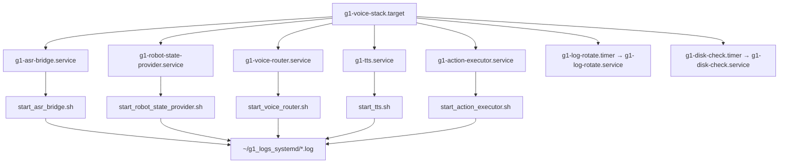

# systemd 部署拓扑

## 关键属性

| 属性 | 值 | 说明 |
|---|---|---|
| `Type` | `simple` | 前台进程 |
| `Restart` | `always` | 崩溃自动拉起 |
| `RestartSec` | `3` | 重启间隔 |
| `KillSignal` | `SIGINT` | 与 Router 自身的优雅停机一致 |
| `TimeoutStopSec` | `15` | 实测停机 < 1s，余量充足 |
| `PartOf` | `g1-voice-stack.target` | 单节点可控，也可整组启停 |
| `StandardOutput` | `append:~/g1_logs_systemd/<name>.log` | 与 logrotate 配合 |

## 操作约束

- 更新业务代码：**只重启 `g1-voice-router.service`**。
- 禁止 `systemctl --user restart g1-voice-stack.target`（会同时重启 ASR/TTS/Executor，影响正在进行的交互）。
- 开机自恢复：整机重启后约 45s 内五节点自动就绪（实测 06:03:48 全部启动）。
