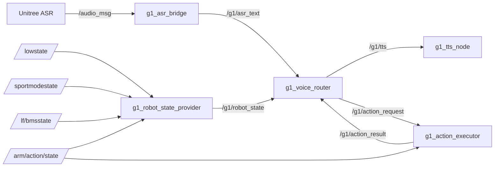

# 节点通信关系

## 1. 话题矩阵（与源码逐项核对）

| 话题 | 类型 | 发布者 | 订阅者 | 说明 |
|---|---|---|---|---|
| `/audio_msg` | `std_msgs/msg/String` | Unitree 原生语音服务 | `g1_asr_bridge` | 原生 ASR 输出（JSON 字符串） |
| `/g1/asr_text` | `std_msgs/msg/String` | `g1_asr_bridge` | `g1_voice_router` | 识别文本 |
| `/g1/tts` | `std_msgs/msg/String` | `g1_voice_router` | `g1_tts_node` | 待播报文本 |
| `/g1/action_request` | `std_msgs/msg/String` | `g1_voice_router` | `g1_action_executor` | 规范动作名（如 `wave`） |
| `/g1/action_result` | `std_msgs/msg/String` | `g1_action_executor` | `g1_voice_router` | `accepted:/success:/failed:/timeout:/rejected:` |
| `/g1/robot_state` | `std_msgs/msg/String` | `g1_robot_state_provider` | `g1_voice_router` | `schema_version=1` 聚合 JSON |
| `/lowstate` | `unitree_hg/msg/LowState` | Unitree 原生 | Provider | 关节/IMU 原始状态 |
| `/sportmodestate` | `unitree_hg/msg/SportModeState` | Unitree 原生 | Provider | 运动模式与 FSM |
| `/lf/bmsstate` | `unitree_hg/msg/BmsState` | Unitree 原生 | Provider | 电池 SOC/SOH/电压 |
| `/arm/action/state` | `std_msgs/msg/String` | Unitree 原生 | Provider、Executor | 机械臂动作状态（JSON） |

> V1.0 的 Provider **只订阅上表四项**（bms / lowstate / sportmode / arm action），**不消费 `/dog_odom`**。里程计在 P0-17 审计中存在，但未纳入 V1.0 状态回答。

## 2. 通信图



## 3. 单实例约束

同一 `ROS_DOMAIN_ID` 下只允许一个 `g1_voice_router`：

- 两个 Router 会同时订阅 `/g1/asr_text`，同一句话被处理两次；
- 会各自发布 `/g1/action_request`，**一条口令触发两次动作**（P0-20 测试期间真实复现过）。

```bash
ps -eo pid,args | grep '[g]1_voice_router/voice_router'
```

## 4. 实测频率

| 话题 | 频率 | 备注 |
|---|---:|---|
| `/lowstate` | 约 1050 Hz | 高频，Provider 只做缓存 |
| `/sportmodestate` | 约 100 Hz | — |
| `/arm/action/state` | 约 10 Hz | 持续发布（非纯事件型） |
| `/lf/bmsstate` | 约 20 Hz | SOC 来源 |
| `/g1/robot_state` | 2 Hz（500 ms 定时） | 聚合后降频 |
