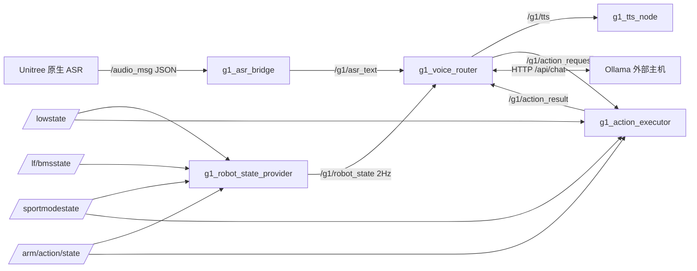

# 节点通信关系

> 依据：各节点 `create_publisher` / `create_subscription` 的实参（话题名、QoS、消息类型），以及 P0-18 的频率实测。

## 1. 话题矩阵

| 话题 | 消息类型 | 发布者 | 订阅者 | QoS | 频率（实测） |
|---|---|---|---|---|---|
| `/audio_msg` | `std_msgs/msg/String` | Unitree 原生语音服务 | `g1_asr_bridge` | 订阅端 BEST_EFFORT / KeepLast(10) | 事件型 |
| `/g1/asr_text` | `std_msgs/msg/String` | `g1_asr_bridge` | `g1_voice_router` | 默认可靠 / KeepLast(10) | 事件型 |
| `/g1/tts` | `std_msgs/msg/String` | `g1_voice_router` | `g1_tts_node` | 可靠 / KeepLast(10) | 事件型 |
| `/g1/action_request` | `std_msgs/msg/String` | `g1_voice_router` | `g1_action_executor` | 可靠 / KeepLast(10) | 事件型 |
| `/g1/action_result` | `std_msgs/msg/String` | `g1_action_executor` | `g1_voice_router` | 可靠 / KeepLast(10) | 事件型（每条请求 1–2 条） |
| `/g1/robot_state` | `std_msgs/msg/String` | `g1_robot_state_provider` | `g1_voice_router` | 可靠 / KeepLast(10) | **2 Hz** |
| `/lowstate` | `unitree_hg/msg/LowState` | Unitree 原生 | Provider、Executor | 订阅端 BEST_EFFORT / KeepLast(1)；Executor 用 SensorDataQoS | **约 1050 Hz** |
| `/sportmodestate` | `unitree_hg/msg/SportModeState` | Unitree 原生 | Provider、Executor | BEST_EFFORT / KeepLast(1) | **约 100 Hz** |
| `/arm/action/state` | `std_msgs/msg/String` | Unitree 原生 | Provider、Executor | BEST_EFFORT / KeepLast(1) | **约 10 Hz** |
| `/lf/bmsstate` | `unitree_hg/msg/BmsState` | Unitree 原生 | Provider | BEST_EFFORT / KeepLast(1) | **约 20 Hz** |

> **不使用的话题**：`/dog_odom` 等在 P0-17 审计中存在，但 V1.0 没有任何节点订阅，因此不属于本项目的接口面。

### 1.1 QoS 选择理由

- 原生状态话题的发布端为 RELIABLE/VOLATILE（P0-17 实测），订阅端用 BEST_EFFORT 与之兼容，且不会因丢包重传增加底层负担；
- `/lowstate` 用 `KeepLast(1)`：状态类数据只关心最新一帧，积压历史无意义，还会放大延迟；
- 业务话题（`/g1/asr_text`、`/g1/tts`、动作请求/结果）用可靠传输：一条命令丢失等于一次交互失败，代价高于带宽。

## 2. 通信图



## 3. 消息负载约定

| 话题 | 负载格式 | 说明 |
|---|---|---|
| `/audio_msg` | JSON，至少含 `"text"` 字符串字段 | 桥接节点自己实现了一个小型 JSON 字符串提取器（支持 `\uXXXX` 与代理对），不引入第三方库 |
| `/g1/asr_text` | 纯 UTF-8 文本 | 不含置信度、不含时间戳 |
| `/g1/tts` | 纯 UTF-8 文本 | 可含多句，由 TTS 节点分句 |
| `/g1/action_request` | 规范动作名：`wave` / `wave_low` / `hands_up` / `clap` / `heart` / `victory` | 传输前已小写、去空白 |
| `/g1/action_result` | `accepted:` / `success:` / `failed:` / `rejected:` / `completion_unknown:` / `completed_with_rpc_error:` 前缀 + `name:id` | 详见 [interaction_sequence.md](interaction_sequence.md) |
| `/g1/robot_state` | `schema_version=1` 的 JSON 对象 | 五段：battery / imu / runtime / action / joints |
| `/arm/action/state` | JSON `{"holding":bool,"id":int,"name":str}` | 字段缺失或解析失败会被判 `INVALID`，不覆盖最近有效值 |

## 4. 单实例约束（重要）

同一 `ROS_DOMAIN_ID` 下只允许一个 `g1_voice_router`：

- 两个 Router 会同时订阅 `/g1/asr_text`，**一句话被处理两次**；
- 两个 Router 会各自发布 `/g1/action_request`，**一条口令触发两次动作**（P0-20 测试期间真实复现过）。

```bash
ps -eo pid,args | grep '[g]1_voice_router/voice_router'   # 期望恰好 1 行
ros2 topic info /g1/action_request                        # 期望 publisher count = 1
```

## 5. 时序边界

| 环节 | 延迟量级 | 来源 |
|---|---|---|
| ASR 出文本 → `/g1/asr_text` | 毫秒级 | 桥接节点纯字符串处理 |
| 入队 → worker 取走 | 取决于前一条请求 | 单 worker 串行 |
| Provider 采样 → Router 缓存 | 0–500 ms | 2 Hz 发布 |
| Router 判定状态过期 | 5000 ms | `kRobotStateCacheTimeoutMs` |
| Ollama 往返 | 5.5–7.0 s（实测） | 真实请求 `total_ms` |
| 动作请求 → 结果 | 约 13 s（wave 实测），上限 38 s | P0-20.1 / 执行器常量 |

## 6. 排障入口

```bash
source /opt/ros/humble/setup.bash
source ~/unitree_ros2/setup.sh
source ~/unitree_ros2/example/install/setup.bash

ros2 node list
ros2 topic list | grep '/g1/'
ros2 topic info /g1/asr_text        # 1 pub / 1 sub
ros2 topic echo /g1/robot_state --once
ros2 topic hz /g1/robot_state       # 期望约 2 Hz
```

若 `ros2 node list` 为空：先确认 `ROS_DOMAIN_ID` 与 `RMW_IMPLEMENTATION`，再确认 `CYCLONEDDS_URI` 指向的网卡与 Unitree 原生应用一致。
