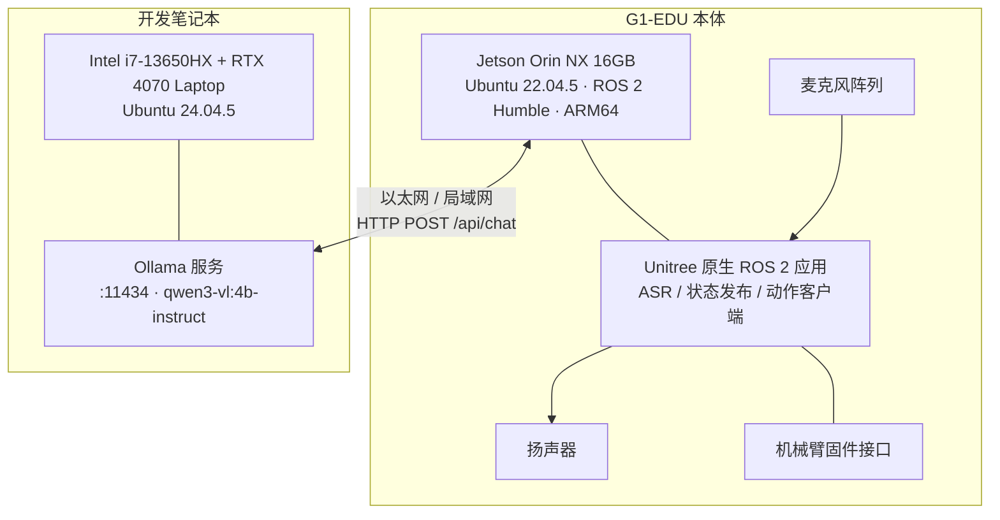

# 部署拓扑

> 依据：`deployment/systemd/*.service` 的 `ExecStart` / `After` / `Restart`、`deployment/scripts/*.sh` 的 source 顺序、`V1.0_RELEASE_NOTES.md` 的二进制路径，以及 P0-18.3 重启验收记录。

## 1. 物理拓扑



| 角色 | 承载内容 | 说明 |
|---|---|---|
| G1 本体（Jetson Orin NX） | 五个 ROS 2 生产节点、systemd 用户管理器、日志目录 | 所有业务与物理接口都在这里 |
| 原生应用 | ASR（`/audio_msg`）、状态发布（`/lowstate` 等）、`G1ArmActionClient` 服务端 | 不随本仓库分发，属于机器人系统 |
| 开发笔记本 | Ollama 模型服务、代码开发、x86 单测 | V1.0 的模型推理**不在** Jetson 上 |

> 网络地址在文档中统一使用 `<LLM_HOST>` 占位；仓库不保存真实内网地址、账号或密钥。

## 2. 机器人侧目录布局

| 路径 | 内容 | 是否随仓库分发 |
|---|---|---|
| `~/unitree_ros2/` | Unitree 官方工作区（`setup.sh`、`example/`、`cyclonedds_ws/`） | 否（第三方） |
| `~/unitree_ros2/example/src/g1_voice_router/` | 主业务包源码 | 是（`ros2_ws/src/g1_voice_router`） |
| `~/unitree_ros2/example/src/g1_asr_bridge/` | ASR 桥源码 | 是 |
| `~/unitree_ros2/example/src/src/g1/audio_client/g1_tts_node.cpp` | TTS 节点 | 是（`integrations/unitree_audio/`） |
| `~/lidar_ws/src/g1_action_executor/` | 动作执行器 | 是（`action_ws/src/`） |
| `~/g1_systemd/scripts/` | 5 个启动脚本（`ExecStart` 指向） | 是（`deployment/scripts/`） |
| `~/g1_systemd/monitor/check_disk.sh` | 磁盘检查 | 是（`deployment/monitoring/`） |
| `~/.config/systemd/user/` | 5 service + 2 timer + 2 oneshot + target | 是（`deployment/systemd/`） |
| `~/.config/logrotate/g1-voice-stack.conf` | 轮转配置 | 是（`deployment/logrotate/`） |
| `~/g1_logs_systemd/` | 五个节点日志 + `disk_check.log` | 否（运行产物） |
| `~/g1_backups/` | 版本备份与回滚点 | 否（本地） |

> 路径按机器人上的 `unitree` 账号书写；若账号不同，需同步修改 unit 的 `ExecStart` 与 `StandardOutput`。

## 3. 启动顺序与依赖

`g1-voice-stack.target` 的 `Wants` 包含全部五个服务，单个 unit 用 `After=` 表达先后：

```text
g1-asr-bridge            After=g1-voice-router.service
g1-robot-state-provider  （无额外 After）
g1-tts                   After=g1-robot-state-provider.service
g1-voice-router          After=g1-robot-state-provider.service g1-tts.service
g1-action-executor       After=g1-asr-bridge.service
```

实际生效顺序：Provider →（TTS ∥ Router）→ ASR Bridge → Action Executor。

**为什么这个顺序不是安全关键**：Router 在拿到状态前会对状态问题走兜底，TTS 未起来时回复只是没人播报，动作执行器后启动也不会触发动作——**启动过程本身不产生任何物理动作**，这是刻意的设计约束（target 描述里写明 `no motion on start`）。

## 4. 服务策略

| 配置 | 值 | 作用 |
|---|---|---|
| `Type` | `simple`（业务）/ `oneshot`（timer 任务） | — |
| `PartOf` | `g1-voice-stack.target` | 停 target 即停全部 |
| `Restart` | `always` | 崩溃自愈 |
| `RestartSec` | `3` | 避免瞬时崩溃循环 |
| `StartLimitIntervalSec` / `Burst` | 60 / 5 | 60 s 内超过 5 次则停止重试，等人介入 |
| `KillSignal` | `SIGINT` | 让 Router 走优雅停机 |
| `TimeoutStopSec` | `15` | 大于实测停机耗时（≤0.79 s） |
| `StandardOutput` | `append:~/g1_logs_systemd/<node>.log` | 与 logrotate 的 `copytruncate` 配合 |
| `WantedBy` | `default.target`（target） | 配合 `loginctl enable-linger` 实现开机启动 |

## 5. 定时任务

| Timer | 周期 | 对应 service | 作用 |
|---|---|---|---|
| `g1-log-rotate.timer` | `OnBootSec=10min`，之后每 1 h | `g1-log-rotate.service`（oneshot，调用 `/usr/sbin/logrotate`） | 日志轮转检查 |
| `g1-disk-check.timer` | `OnBootSec=5min`，之后每 6 h | `g1-disk-check.service`（oneshot） | 磁盘与日志容量只读检查 |

## 6. 网络与端口

| 项 | 值 | 说明 |
|---|---|---|
| DDS 实现 | `rmw_cyclonedds_cpp` | 与 Unitree 原生应用一致 |
| 生产 `ROS_DOMAIN_ID` | 0 | 测试统一用 77 |
| 模型服务端口 | 11434（HTTP） | 仅需 G1 → 模型主机的单向可达 |
| 对外暴露端口 | 无 | 五个节点都不开监听端口 |

DDS 走的是组播/单播发现，若 G1 与开发机在同一网段且都运行 ROS 2 节点，会把彼此的节点也发现进来——这是使用 `ROS_DOMAIN_ID` 隔离测试环境的原因。

## 7. 资源占用与容量

| 项 | 观测值 | 来源 |
|---|---|---|
| 根分区 | 1.9 TB，已用 22 GB（2%） | P0-18.4 |
| 日志量级 | 单个日志约 4 KB–42 KB/天（演示强度） | P0-18.4 轮转前实测 |
| 模型内存 | 约 3.34 GB（Q4_K_M） | 模型侧，非 Jetson |
| Jetson 侧 CUDA/TensorRT | 未使用 | 本项目不跑本地推理 |

> CPU/内存占用曲线未采集，不做估算。

## 8. 拓扑相关的运维约束

1. **同域只能有一个 Router**（双订阅会导致重复回答与双倍动作请求）；
2. **不要在演示中切 Domain**：生产 0，测试 77；
3. **模型主机故障不影响本地能力**：知识库、状态、动作、兜底都可用；
4. **执行器可在演示前单独停掉**：想彻底禁止物理动作时，`systemctl --user stop g1-action-executor.service` 即可，其余功能不受影响（动作口令会退化为“没收到结果”）。
