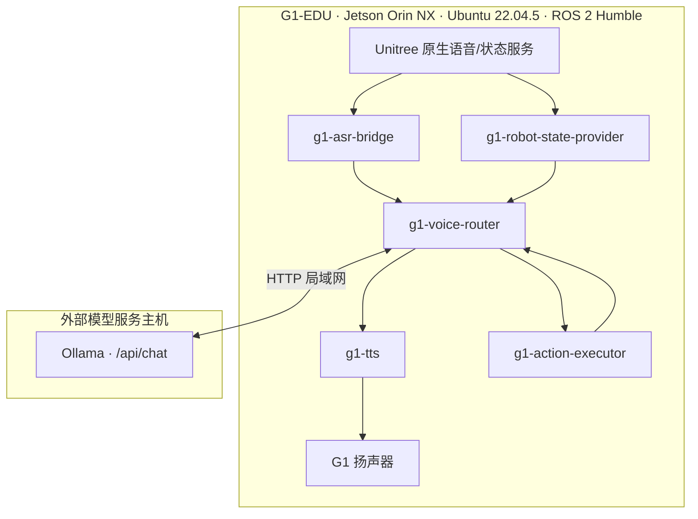
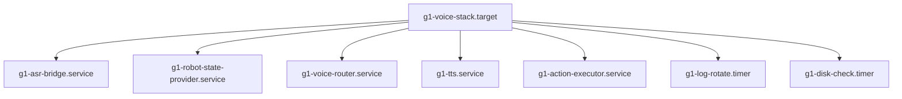

# 部署拓扑

## systemd 结构

| 属性 | 值 |
|---|---|
| `Restart` | `always` |
| `RestartSec` | `3` |
| `KillSignal` | `SIGINT` |
| `TimeoutStopSec` | `15`（实测 SIGINT 退出 < 1s） |
| 启动顺序 | `voice-router` 在 provider 与 tts 之后 |

## 位置说明

- 模型服务运行在**与机器人直连的外部主机**上，不在 Jetson 本地；文档中一律使用 `<LLM_HOST>` 占位。
- `g1_voice_router` 与 `g1_asr_bridge` 属 `unitree_ros2/example` 工作区；`g1_action_executor` 属独立 `lidar_ws` 工作区，需分别构建与 source。
