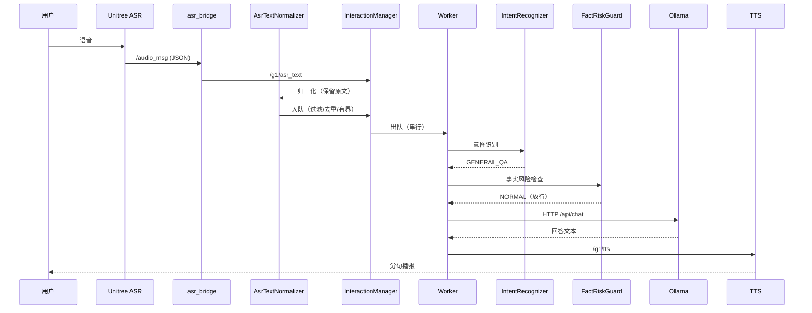
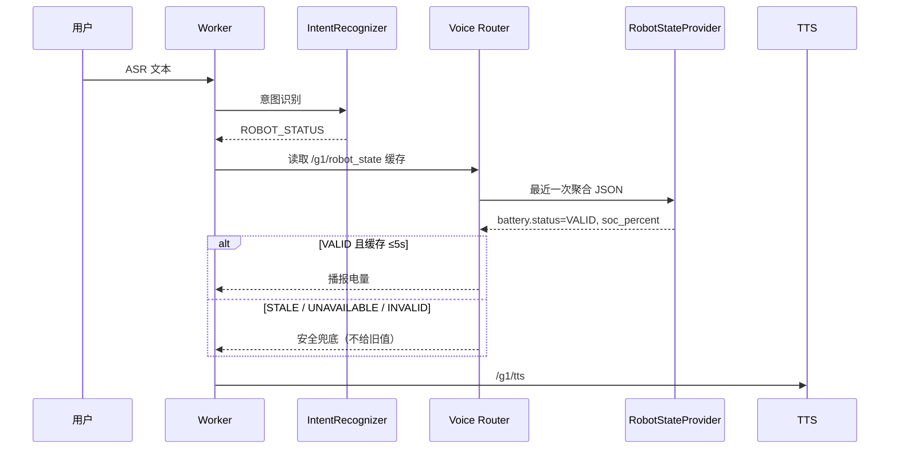
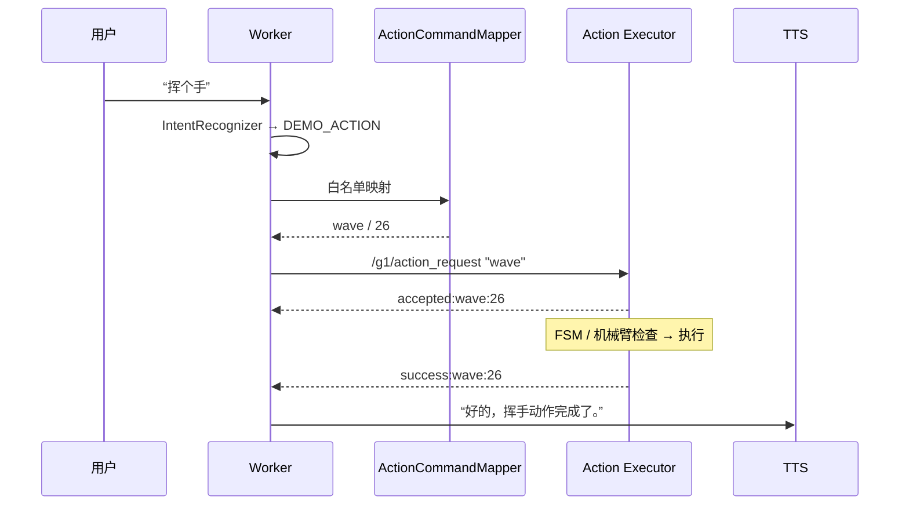

# 交互时序

## 1. 普通知识问答（示例：脑机接口是什么）

## 2. 机器人状态查询（示例：你现在还有多少电量）

**不允许**把过期、缺失或格式错误的数据当作真实数值回答。

## 3. 动作执行（示例：挥个手）

约束：

1. 动作名只能来自白名单，模型不参与决定 ID；
2. 结果按“动作名 + 发送前序号快照”匹配，**协议没有请求 ID**；
3. 所有动作在单个 Worker 中串行，不支持并发；
4. 超时或结果缺失时**不重试**，只播报“未收到结果，不会自动重复执行”。
