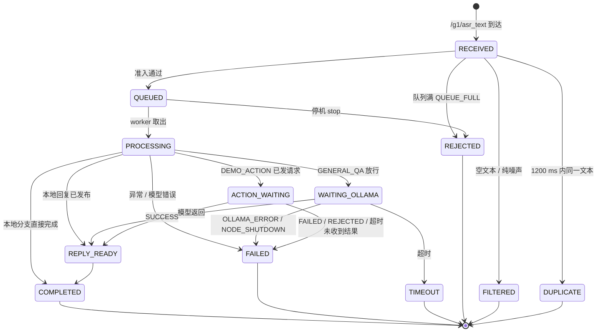
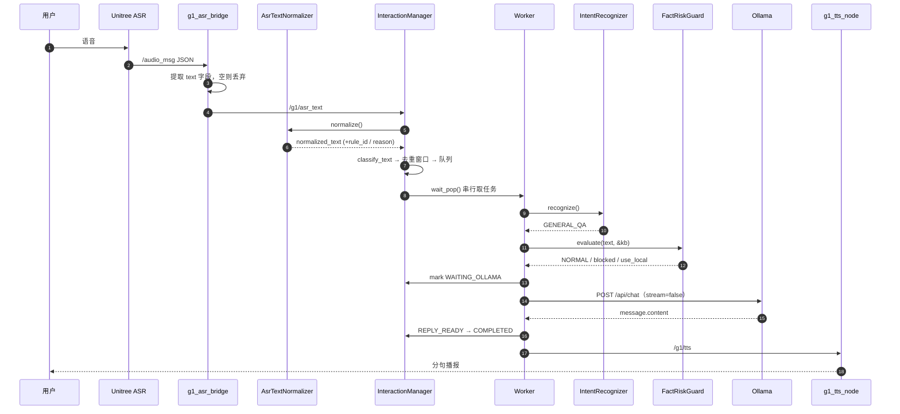
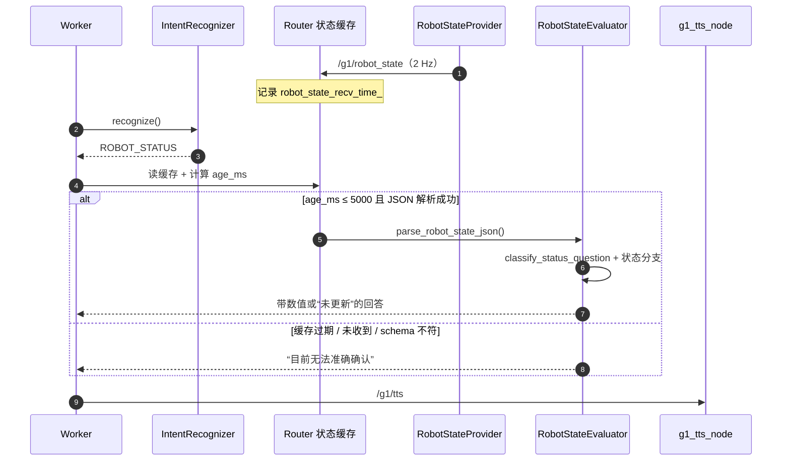
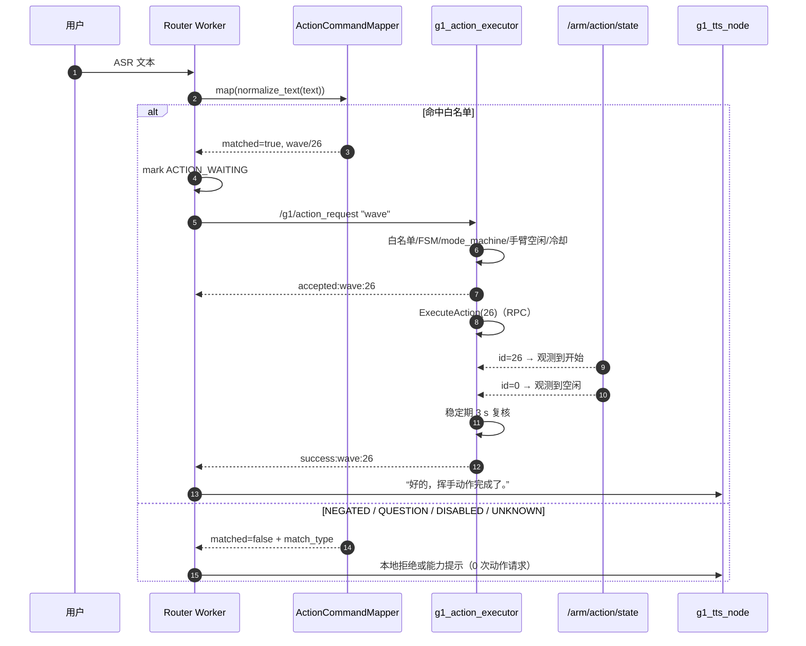

# 交互时序与状态机

> 依据：`voice_router.cpp`（`enqueue_user_text` / `process_request` / `handle_action_request` / `worker_loop`）、`interaction_manager.cpp`（`submit` / `wait_pop` / `mark_status` / `can_transition` / `stop`）、`interaction_types.hpp`（状态枚举）。

## 1. 请求生命周期状态机



实现要点：

- 终态（`COMPLETED` / `FAILED` / `TIMEOUT` / `REJECTED` / `FILTERED` / `DUPLICATE`）不可再转移，`mark_status` 直接返回 `false`；
- `mark_status` 在进入 `COMPLETED` / `FAILED` / `TIMEOUT` 时从 `status_map_` 删除记录并累加统计，所以请求记录**不会长期驻留内存**；
- `SPEAKING` 是保留状态（`REPLY_READY → SPEAKING → COMPLETED` 合法），但当前没有任何代码进入该状态——因为系统拿不到真实播放完成事件，不伪造“正在播报”；
- `process_request` 用 RAII（`CompletionGuard`）保证任何提前 `return`（问候/动作/知识库/状态/兜底）都能落到终态，避免请求卡在 `PROCESSING` 让统计失真。

## 2. 知识问答时序（“脑机接口是什么？”）



日志锚点（真实一轮，P0-21）：

```text
request_id=1 event=QUEUED queue_depth=0 text_len=6
request_id=1 event=PROCESSING intent=GENERAL_QA text_len=6
FactRiskGuard: risk=NORMAL blocked=false use_local=false ...
request_id=1 event=WAITING_OLLAMA
request_id=1 event=COMPLETED total_ms=7021
```

`total_ms` 从 `received_ms` 起算，包含了排队与模型耗时，因此它不等于模型延迟。

## 3. 状态查询时序（“你现在还有多少电量？”）



关键约束（源码可见）：

- `ROBOT_STATUS` 分支在任何路径下都**不会**进入 Ollama；
- `FactRiskGuard` 的 `REALTIME_STATUS` 规则完整保留，作为“被误判成 `GENERAL_QA`”时的第二道防线，两者互不替代；
- 数值只在字段状态为 `VALID` 时进入话术，其余一律说“无法准确确认/未更新”。

## 4. 动作执行时序（“挥个手”）



### 4.1 结果协议与 Router 的匹配规则

`parse_action_result(raw, expected_name, outcome)`：

1. 取第一个 `:` 之前的前缀；
2. `rejected` → 直接判 `REJECTED`（**不校验动作名**）；
3. 其余前缀取第二段作为动作名，必须等于当前期望动作名，否则视为“不是给我的结果”，继续等待；
4. `success` / `failed` / `timeout` 映射为对应结论；其他前缀（`accepted`、`completion_unknown`、`completed_with_rpc_error`）返回 `false` → 继续等待。

因此执行器的六类输出与 Router 的四类结论并不完全对齐：

| 执行器输出 | Router 行为 | 用户听到 |
|---|---|---|
| `accepted:wave:26` | 忽略，继续等 | （无） |
| `success:wave:26` | SUCCESS | “好的，挥手动作完成了。” |
| `failed:wave:26:rpc_error=…` | FAILED | “这个动作暂时没有执行成功。” |
| `rejected: …` | REJECTED | “动作执行器暂时不能执行这个动作…” |
| `completion_unknown:…` | 不识别 → 等满 45 s | “动作执行结果暂时没有收到，我不会自动重复执行。” |
| `completed_with_rpc_error:…` | 不识别 → 等满 45 s | 同上 |

这是 V1.0 已知的协议层缺口，修复方向是给结果加统一终态前缀或请求 ID（见 README §17）。

### 4.2 超时预算

| 阶段 | 上限 | 说明 |
|---|---|---|
| 执行器：等动作开始 | 5 s | RPC 已返回但未观测到 `id=26` |
| 执行器：等回到空闲 | 30 s | 已观测到开始，等待 `id==0` |
| 执行器：稳定期 | 3 s | 空闲后复核 `id`/`holding` 未再变化 |
| 执行器最坏合计 | 约 38 s | 5 + 30 + 3 |
| Router：等结果 | 45 s | 大于执行器最坏，避免误判 |

wave 真机实测约 13 s 完成（P0-20.1），远低于预算。

## 5. 队列与并发行为

| 场景 | 行为 |
|---|---|
| 上一句还在问模型，用户又说一句 | 新请求入队（最多 3 个等待位），不影响进行中的请求 |
| 队列已满仍继续提问 | 新请求 `REJECTED (QUEUE_FULL)`，忙碌提示进独立队列（容量 2） |
| 忙碌提示何时播报 | 仅当 `pending_count() == 0`，由 worker 发布，避免插队 |
| 同一句话在 1.2 s 内重复 | 第二次判 `DUPLICATE`，不回复也不排队 |
| 动作执行中又下动作口令 | 该口令排队等待，等前一个动作结束再处理（Router 侧串行）；即使并发到达执行器，也会被 busy/冷却拒绝 |
| 收到 SIGINT | 置停机标志 → 中断 HTTP → 唤醒动作等待 → 停止队列 → join worker |

## 6. 停机时序（实测）

| 场景 | 停机耗时 | 观测方式 |
|---|---|---|
| 空闲（worker 阻塞在 `wait_pop`） | 0.29 s | `systemctl --user stop` 前后时间差 |
| 正在等 Ollama | 0.79 s | libcurl 进度回调返回 1 中断传输 |
| 正在等动作结果 | 0.29 s | 条件变量被 `shutdown_requested_` 唤醒 |

均 < `TimeoutStopSec=15`，因此 systemd 不会强杀，日志不会被截断。
