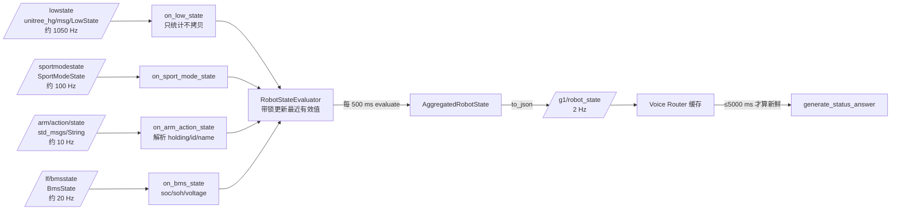

# 机器人状态数据通路

> 依据：`robot_state_provider.cpp`、`robot_state_provider_node.cpp`、`robot_state_evaluator.cpp`、`include/.../robot_state_types.hpp`、`include/.../robot_state_evaluator.hpp`，以及 P0-17 数据源审计、P0-18 频率与 SOC 样本实测。

## 1. 通路总览



设计要点：**高频回调只做轻量缓存，低频定时器才做序列化**。`/lowstate` 回调遍历 35 路电机只统计“有效通道数”和“温度最大值”，不复制数组、不构造 JSON；聚合与字符串化由 2 Hz 定时器完成。

## 2. 数据源与已确认边界

| 数据源 | 消息类型 | 用到的字段 | 已知边界 |
|---|---|---|---|
| `/lf/bmsstate` | `unitree_hg/msg/BmsState` | `soc`、`soh`、`bmsvoltage[0]` | SOC 权威来源，**不用电压反推**；电流与 BMS 温度单位未确认，不进入结构体、不对外播报 |
| `/lowstate` | `unitree_hg/msg/LowState` | `motor_state[]`（q/温度）、`imu_state`（acc/ quaternion 长度） | 35 路电机实测 29 路有效；温度单位未确认、索引与关节名映射未知，仅内部诊断 |
| `/sportmodestate` | `unitree_hg/msg/SportModeState` | 仅用作“数据是否到达” | FSM 数值**不做动作语义推断**（不据数值猜“正在挥手”） |
| `/arm/action/state` | `std_msgs/msg/String` | `{"holding","id","name"}` | 解析失败记 `INVALID(PARSE_ERROR)`，不覆盖最近有效值；`id == 99` 视为放下手臂过渡 |
| `/dog_odom` | — | **未使用** | P0-17 审计中存在，V1.0 不订阅、不播报 |

## 3. 四态判定

| 状态 | 触发条件 | 对外话术示例 |
|---|---|---|
| `VALID` | 收到过有效数据，且 `now - last_ms ≤ 时效窗口` | “我的电池电量大约是百分之 92。” |
| `STALE` | 收到过有效数据，但超过时效窗口 | “电量数据已经有一段时间没有更新了……” |
| `UNAVAILABLE` | 从未收到有效数据 / 来源缺失 | “我目前无法准确确认电池电量……” |
| `INVALID` | 数值越界、SOC 异常跳变、JSON 解析失败、`schema_version` 不匹配 | 同 `UNAVAILABLE`（不暴露内部错误细节） |

时效窗口（`StateTimeouts`，按实测频率取周期的 20–100 倍，容忍瞬时抖动）：

| 话题 | 频率 | 窗口 |
|---|---:|---:|
| `/lowstate` | 约 1050 Hz | 1000 ms |
| `/sportmodestate` | 约 100 Hz | 1000 ms |
| `/arm/action/state` | 约 10 Hz | 1000 ms |
| `/lf/bmsstate` | 约 20 Hz | 2000 ms |

Router 侧再叠加一层缓存上限 `kRobotStateCacheTimeoutMs = 5000 ms`：超过即认为 Provider 掉线，即使 JSON 本身字段都是 `VALID` 也不用。

## 4. SOC 的三道校验

1. **范围**：`soc < 0 || soc > 100` → `INVALID(kInvalidRange)`，不写入最近有效值；
2. **跳变**：距上一有效样本 < 60 s 且差值 ≥ 15 个百分点 → `INVALID(kUnstableSocJump)`；
3. **单调性观察**：P0-18 的 60 秒 1229 个样本窗口内零跳变，跨小时单调下降与电压交叉验证一致——这是把阈值定在 15% 的依据，而不是凭感觉取数。

被拒绝的样本不会污染 `soc_percent_`，但会记录 `quality_reason`，便于区分“没数据”和“数据不可信”。

## 5. `/g1/robot_state` 负载

```json
{
  "schema_version": 1,
  "battery": {
    "status": "VALID", "received_age_ms": 12, "source_topic": "/lf/bmsstate",
    "quality_reason": "none", "soc_percent": 92, "soh_percent": 94, "voltage_mv": 51870
  },
  "imu": {
    "status": "VALID", "received_age_ms": 8, "source_topic": "/lowstate",
    "quality_reason": "none", "data_available": true
  },
  "runtime": {
    "status": "VALID", "received_age_ms": 5, "quality_reason": "none",
    "lowstate_available": true, "sportmode_available": true
  },
  "action": {
    "status": "VALID", "received_age_ms": 33, "source_topic": "/arm/action/state",
    "quality_reason": "none", "is_executing": false, "action_id": 0, "action_name": ""
  },
  "joints": {
    "status": "VALID", "received_age_ms": 8, "source_topic": "/lowstate",
    "quality_reason": "none", "available_motor_count": 29,
    "temperature_max_raw": 41, "unit_confirmed": false
  }
}
```

序列化规则：**非 `VALID` 的数值字段输出 `null`**（例如 `"soc_percent": null`），绝不用 `0` 伪装测量值；这使“没有数据”在 JSON 层就与“电量 0%”区分开。

`quality_reason` 取值：`none`、`source_missing`、`message_timeout`、`invalid_range`、`unstable_soc_jump`、`parse_error`、`schema_mismatch`。

## 6. 从状态到一句话

`generate_status_answer(state, user_text)` 先判断问题子类型，再按字段状态给话术：

| 问题子类型 | 判定依据（示例） | `VALID` 时 | 非 `VALID` 时 |
|---|---|---|---|
| `BATTERY` | 电量/电池/续航 | “电池电量大约是百分之 N” | `STALE` → “数据一段时间没更新”；其余 → “无法准确确认” |
| `IMU` | IMU/惯导/陀螺仪 + 接收/更新/状态 | “能够持续接收到 IMU 数据，但还没有完成完整传感器健康诊断” | “无法确认 IMU 数据状态” |
| `ACTION` | 动作/执行 + 做完了吗/正在执行 | “正在执行 X 动作” / “正在放下手臂” / “没有在执行动作” | “动作状态数据已经过期” / “无法确认” |
| `TEMPERATURE` | 电机温度/关节温度 | **一律**“温度单位未确认，暂时无法回答” | 同左 |
| `RUNTIME` | 整体状态/运行正常吗 | 汇总“核心状态数据正在持续接收 + 电量 + IMU + 动作” | 通用兜底 |

`state == nullptr`（未收到 / 缓存过期 / 解析失败）时按子类型返回对应兜底句，**任何路径都不进 Ollama**。

## 7. 验证记录

| 项目 | 结果 | 来源 |
|---|---|---|
| 四路话题在真机可订阅 | 是 | P0-17 审计 |
| 聚合频率 2 Hz | 是 | P0-18 `ros2 topic hz` |
| SOC 真机读数 | 92%（重启后）、93%（P0-20.1 播报）、49%（P0-18.1） | 各报告原始 JSON / 日志 |
| 重启后数据为全新采样 | 是（SOC 31% → 92%，电压同步变化） | P0-18.3 |
| 单元测试 | 44 项 | `robot_state_evaluator_test` |

## 8. 明确不做的事

- 不做传感器健康诊断：持续收到 ≠ 传感器正常；
- 不做姿态解算：`imu_state` 只用于“数据是否可用”；
- 不播报关节温度数值：单位与索引未确认；
- 不用电压反推 SOC；
- 不在 Provider 内做动作控制或安全决策（那是执行器的职责）。
