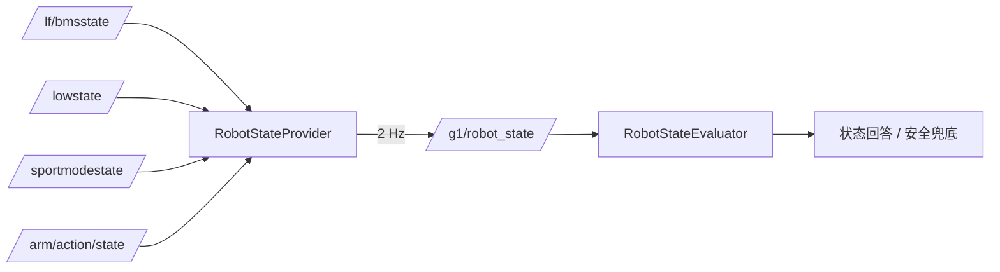

# 机器人状态数据通路

## 1. 数据流



## 2. 输出结构（schema_version = 1）

```json
{
  "schema_version": 1,
  "battery": {"status": "VALID", "soc_percent": 93, "soh_percent": 94,
              "voltage_mv": 50173, "received_age_ms": 120,
              "quality_reason": "", "source_topic": "/lf/bmsstate"},
  "imu":     {"status": "VALID", "data_available": true, "received_age_ms": 90,
              "source_topic": "/lowstate"},
  "runtime": {"status": "VALID", "lowstate_available": true,
              "sportmode_available": true, "received_age_ms": 80},
  "action":  {"status": "VALID", "action_id": 0, "action_name": "",
              "is_executing": false, "received_age_ms": 70,
              "source_topic": "/arm/action/state"}
}
```

四个字段组独立判定，互不覆盖。

## 3. 有效性与回答策略

| 状态 | 含义 | 回答策略 |
|---|---|---|
| `VALID` | 数据存在且年龄在窗口内 | 可以回答具体数值 |
| `STALE` | 有数据但超时 | 明确“数据一段时间未更新”，不给旧值 |
| `UNAVAILABLE` | 从未收到 | “暂时无法确认” |
| `INVALID` | 字段缺失/类型错误 | “暂时无法确认” |

Router 侧另有 5s 缓存超时（`kRobotStateCacheTimeoutMs`）：超过则整份状态视为不可用。

## 4. 边界说明

- `imu.data_available=true` 只表示**持续收到 IMU 消息**，不构成传感器健康诊断，也不代表姿态估计准确。
- `battery.soc_percent` 来自 BMS 的 SOC 字段，是当前唯一可信电量来源；**不用电压反推电量**。
- 电机温度、关节单位等字段在 V1.0 未用于对外回答（P0-17 结论：单位与索引映射未完全确认）。
