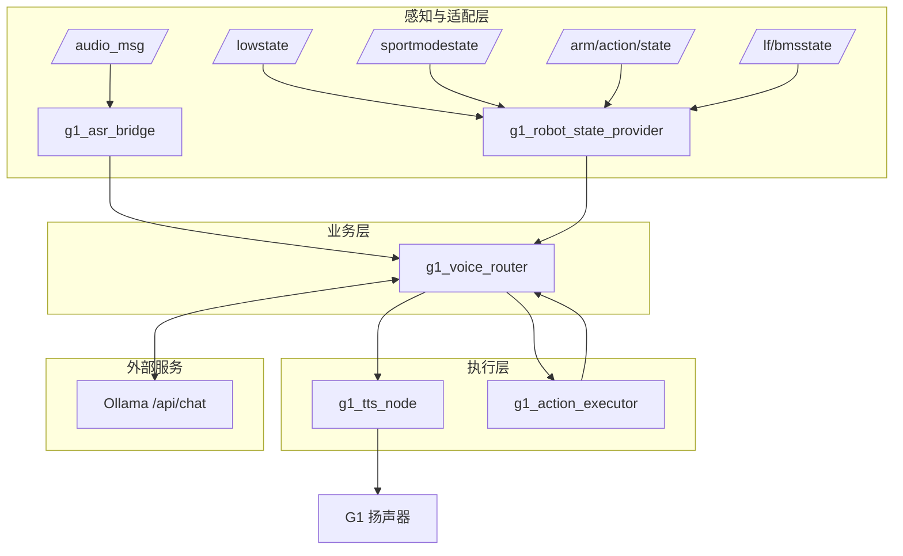

# 系统总体架构

## 1. 分层

## 2. 设计取舍

| 决策 | 原因 | 代价 |
|---|---|---|
| 业务集中在单个 Router 进程 | 意图、知识库、风控、动作映射需共享上下文，跨进程同步成本高 | 单进程故障影响全部业务（由 systemd 兜底） |
| 状态感知独立成 Provider | 状态数据源多、频率高（`/lowstate` 约 1kHz），与语音业务解耦可独立重启 | 多一跳话题，增加 0.5s 级缓存延迟 |
| 动作执行独立成 Executor | 含 FSM/机械臂安全检查与真机超时，必须与业务隔离 | 结果需跨进程关联，且协议没有请求 ID |
| 大模型放在机器人外 | Orin NX 上同时跑 4B 模型会与语音链路抢资源 | 依赖局域网，断网退化为本地能力 |

## 3. 生产进程与失败影响

| 进程 | 作用 | 失败影响 |
|---|---|---|
| `g1_asr_bridge` | 解析原生 ASR JSON → 文本话题 | 无语音输入 |
| `g1_robot_state_provider` | 聚合状态 → `/g1/robot_state` | 状态类问题全部走安全兜底 |
| `g1_voice_router` | 意图、风控、调度、回复 | 全部业务中断 |
| `g1_tts_node` | 文本 → 语音 | 听不到回复（业务仍处理） |
| `g1_action_executor` | 白名单动作执行 | 动作类请求返回失败/超时 |

## 4. 明确不在 V1.0 的范围

视觉感知、人脸识别、自主导航、语义地图、G1 本地大模型。核心交互链路不依赖深度相机。
