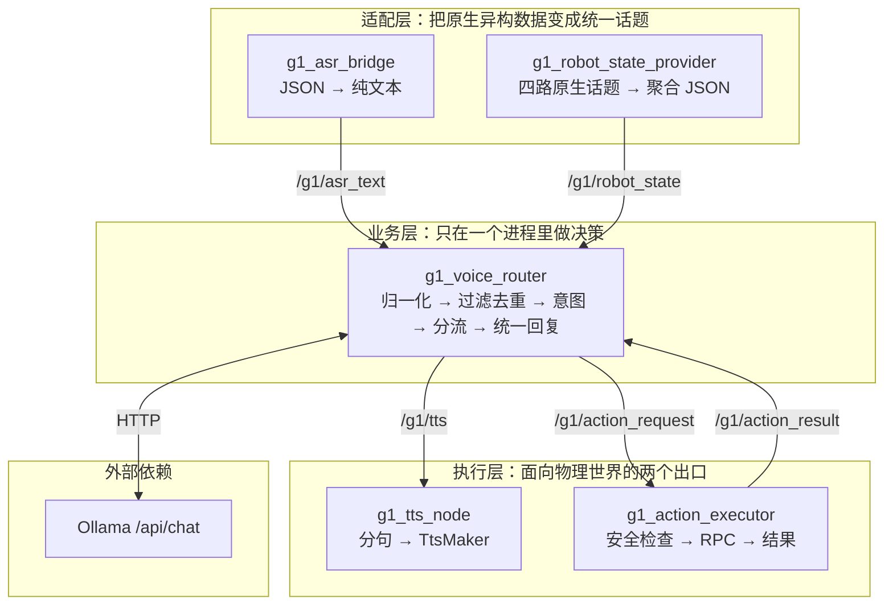

# 系统总体架构

> 依据：`ros2_ws/src/g1_voice_router/src/voice_router.cpp`（节点构建、话题创建、worker 启动顺序）、`robot_state_provider.cpp`、`arm_action_executor.cpp`、`deployment/systemd/*.service`。
> 本文只描述 V1.0 实际运行的组件，不含规划项。

## 1. 分层视图



分层不是审美选择，而是按“变化频率”切的：

| 层 | 变化频率 | 典型改动 | 隔离收益 |
|---|---|---|---|
| 适配层 | 高（ASR 输出格式、状态字段） | 新增状态字段、兼容 ASR JSON 变体 | 改动不影响业务逻辑，可单独重启 |
| 业务层 | 中（话术、规则、阈值） | 补意图规则、调风控、改兜底话术 | 集中在一处，测试覆盖最厚（453 项中 429 项在此层） |
| 执行层 | 低（固件接口稳定） | 新增动作 ID、调整超时 | 物理风险集中在可审计的小文件里 |

## 2. 进程模型

五个用户级 systemd 服务，一个 `target` 聚合：

| 进程 | 职责 | 关键线程 | 崩溃后的影响 |
|---|---|---|---|
| `g1-asr-bridge` | 订阅 `/audio_msg`（BEST_EFFORT），解析 JSON 的 `text` 字段，发布 `/g1/asr_text` | 单线程 executor | 无语音输入，其他功能仍在 |
| `g1-robot-state-provider` | 订阅四路状态，2 Hz 发布聚合 JSON | ROS 回调线程 + 定时器线程 | 状态类问题全部走安全兜底 |
| `g1-voice-router` | 意图、风控、知识库、队列、HTTP、回复发布 | ROS executor 线程 + 1 个 worker 线程 | **全部业务中断**（单点） |
| `g1-tts` | 订阅 `/g1/tts`，分句后调用 `TtsMaker` | ROS executor 线程 + 1 个 TTS worker | 听不到回复，但业务仍处理并记账 |
| `g1-action-executor` | 订阅 `/g1/action_request`，检查后执行，发布结果 | ROS 回调线程 + 1 个动作 worker | 动作请求返回失败或超时，问答不受影响 |

### 2.1 Router 的线程约定

```text
ROS executor 线程：
  /g1/asr_text 回调     → 归一化 + submit()（只入队，不执行业务）
  /g1/action_result 回调 → 写结果缓存 + notify（不解析业务）
  /g1/robot_state 回调   → 写状态缓存 + 时间戳

worker 线程（唯一）：
  wait_pop() → process_request() → publish_reply() → 处理忙碌提示
```

这样切分的直接后果：

- 业务里可以安全地做**阻塞调用**（libcurl 最长 60 s、动作最多等 45 s），不会阻塞 ROS 回调；
- 因为只有一个 worker，`/g1/tts` 的发布顺序**恒等于**请求接收顺序，无需额外排序；
- 停机时只需置一个原子标志 + 唤醒条件变量，就能让阻塞中的 HTTP/动作等待立即返回（实测 0.29–0.79 s）。

## 3. 数据所有权

| 数据 | 拥有者 | 生命周期 | 其他进程如何获得 |
|---|---|---|---|
| ASR 原始文本 | `g1_asr_bridge` | 单条消息 | 话题 `/g1/asr_text`（只传文本，不传元数据） |
| 归一化结果 / 请求记录 | Router（`InteractionManager`） | 队列内 + 处理期间，完成后释放 | 仅日志 |
| 对话上下文（6 轮） | Router（`history_`） | 进程内，成功请求才追加 | 不外传 |
| 知识库 | Router（加载 `lab_knowledge.json`） | 进程启动时加载 | 仅 Router 内部 |
| 机器人状态 | Provider 拥有权威状态；Router 只持有一帧缓存（≤5 s） | 500 ms 一帧 | 话题 `/g1/robot_state` |
| 动作执行状态 | Executor（busy/锁定/冷却） | 跨请求 | 话题 `/g1/action_result` |
| 播放进度 | **无**（TTS 只有估算） | — | — |

“播放进度无所有权”是 V1.0 的重要缺口：TTS 侧不知道一句到底播完没有，只能按字数估算等待，因此 Router 认为“回复已发布”不等于“用户已听到”。

## 4. 关键架构决策

| 决策 | 原因 | 代价 |
|---|---|---|
| 业务集中在单个 Router 进程 | 意图、风控、知识库、动作映射共享同一份上下文与配置，跨进程同步成本高于收益 | 单进程故障影响全部业务（systemd 兜底，3 s 重启） |
| 状态感知独立成 Provider | `/lowstate` 实测约 1050 Hz，与 HTTP 请求混在一个上下文会互相拖累 | 多一跳话题，Router 侧多 0–500 ms 缓存延迟 |
| 动作执行独立成 Executor | FSM/机械臂检查、同步 RPC、失败锁定都属于“危险且需要人工介入”的逻辑 | 结果需跨进程关联，而协议没有请求 ID |
| 大模型放在机器人外 | Orin NX 同时跑 4B 模型会与语音链路争抢资源 | 依赖局域网，断网退化为本地能力 |
| 回复只有一条出口 | 避免“回答 A 的声音配回答 B 的内容” | 本地应答也必须排队，最坏等一个模型请求 |

## 5. 失败模式与降级

| 故障 | 系统行为 | 用户感知 |
|---|---|---|
| Ollama 不可达/超时 | `FAILED reason=OLLAMA_ERROR`，发布本地兜底句 | “抱歉，我暂时无法连接到对话模型。” |
| Provider 未启动 | Router 缓存为空 → `state_ready=false` | “我目前无法准确确认电池电量……” |
| 状态数据过期 | `STALE` → 不播报具体值 | “数据有一段时间没有更新了……” |
| 动作结果缺失 | 45 s 超时 | “动作执行结果暂时没有收到，我不会自动重复执行。” |
| TTS 崩溃 | 文本照常发布，无人消费 | 无声音，但日志有完整回复 |
| 知识库加载失败 | 启动即打 `KnowledgeBase load failed`，LAB_FACT 一律兜底 | 实验室问题答“暂无核实资料” |
| Router 崩溃 | systemd 3 s 后拉起；期间无响应 | 短暂失联 |

## 6. 明确不在 V1.0 范围

视觉感知、人脸识别、自主导航、语义地图、G1 本地大模型、远程管理后台。核心交互链路**不依赖深度相机**。
