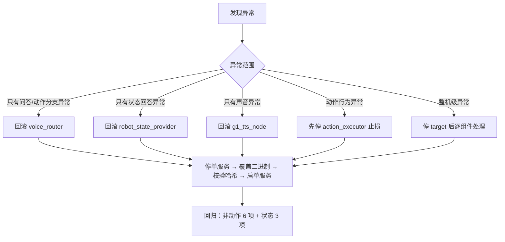

# 回滚指南

> 原则：**只回滚受影响的那一个组件**，不做整套回退；每一步都要有哈希或日志证据。
> 依据：`V1.0_RELEASE_NOTES.md` 的二进制哈希、P0-17.3（Router 单服务切换）、P0-20.1（生产切换）的实际做法。

## 1. 回滚决策树



## 2. 回滚前必做

```bash
# 1) 记录当前版本
sha256sum ~/unitree_ros2/example/build/g1_voice_router/voice_router
systemctl --user show -p MainPID --value g1-voice-router.service
ls -l /proc/$(systemctl --user show -p MainPID --value g1-voice-router.service)/exe

# 2) 备份当前二进制（回滚失败时还能回去）
mkdir -p ~/g1_backups/$(date +%Y%m%d_%H%M%S)_pre_rollback
cp -a ~/unitree_ros2/example/build/g1_voice_router/voice_router \
      ~/g1_backups/$(date +%Y%m%d_%H%M%S)_pre_rollback/

# 3) 确认当前没有动作在执行
ros2 topic echo /arm/action/state --once     # 期望 {"holding":false,"id":0,...}
```

## 3. 回滚 Router（最常见的单服务回滚）

```bash
systemctl --user stop g1-voice-router.service

# 用备份或已知良好版本的构建产物覆盖
cp -a ~/g1_backups/<目标版本>/voice_router \
      ~/unitree_ros2/example/build/g1_voice_router/voice_router

sha256sum ~/unitree_ros2/example/build/g1_voice_router/voice_router
# 与目标版本记录的哈希比对，必须一致

systemctl --user start g1-voice-router.service
journalctl --user -u g1-voice-router.service -n 30 --no-pager
```

V1.0 冻结哈希（供比对）：

| 组件 | SHA256 |
|---|---|
| `voice_router` | `6ab99de8ceb287d1fdb58b66399874c60b41734775a74a0c2745bf64223d6bb7` |
| `robot_state_provider` | `b8195e26a6b7106776f7ec4875ba9150e3964f97d076ff66775a5d00ada943f1` |
| `g1_tts_node` | `816fe70e2c2e0031c0b689d06146b48a61e32645694113e21f4240a6409d9aac` |
| `asr_json_bridge` | `0f098df28d6b266b4f13e8d0e609761b314deb2828ab5cc5dfff7cf78297f810` |
| `g1_action_executor_node` | `2b040188f7979a5f0552e672c7c415d3c96182b019875976fe7c5f725f7148a5` |

## 4. 回滚动作执行器（安全优先）

若动作表现异常（异常后退、锁定不释放）：

```bash
# 第一步永远是止损，不是回滚
systemctl --user stop g1-action-executor.service

# 现场确认机器人姿态与手臂状态
ros2 topic echo /arm/action/state --once      # holding 与 id
# 必要时由人工把手臂恢复到安全状态

# 确认无误后再回滚二进制并启动
cp -a ~/g1_backups/<目标版本>/g1_action_executor_node \
      ~/lidar_ws/build/g1_action_executor/g1_action_executor_node
systemctl --user start g1-action-executor.service
```

> 只要执行器停着，Router 的动作口令会退化为“未收到结果，不会自动重复执行”，问答与状态播报不受影响。这是设计上留给运维的降级开关。

## 5. 回滚源码（需要重新构建时）

```bash
systemctl --user stop g1-voice-router.service
# 用备份源码覆盖后重新构建
colcon build --packages-select g1_voice_router --symlink-install
colcon test --packages-select g1_voice_router && colcon test-result --verbose   # 期望 7/0/0/0
systemctl --user start g1-voice-router.service
```

**源码回滚必须同时跑测试**：V1.0 的 453 项是基线，低于该数量说明测试目标缺失，不能上线。

## 6. 回滚后的回归清单

| # | 输入 | 期望 |
|---|---|---|
| 1 | 你好 | 固定问候 + 触发挥手（若允许动作） |
| 2 | 介绍一下我们的实验室 | 本地知识库回答 |
| 3 | 你现在还有多少电量 | 数值或明确的“无法确认” |
| 4 | 你现在的 IMU 数据接收情况怎么样 | “能持续接收 / 未接收到” |
| 5 | 你现在整体运行状态怎么样 | 聚合播报 |
| 6 | 你会做哪些动作 | 能力介绍，**不执行动作** |
| 7 | 脑机接口是什么 | 走模型，返回技术解释 |

检查 `~/g1_logs_systemd/voice_router.log` 中无 `FAILED`、无 `QUEUE_FULL` 连续出现、`ACTION_SENT` 计数与预期一致。

## 7. 禁止事项

- 不要用未校验哈希的二进制覆盖生产；
- 不要为了“省事”整套重启五个服务（会同时丢失 TTS 与动作侧证据，且掩盖单点问题）；
- 不要在机器人有动作在执行时回滚执行器；
- 不要修改 `ROS_DOMAIN_ID` 来“绕过”问题；
- 回滚后不要忘记更新 `V1.0_RELEASE_NOTES.md` 之外的运维记录（本仓库不覆盖运维台账）。
