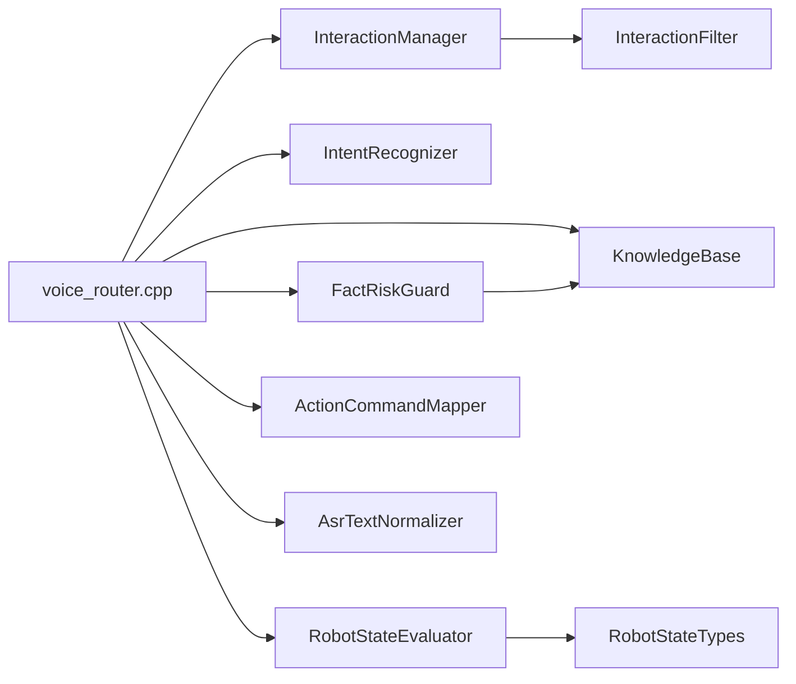

# 代码组织结构

## 1. 三个 ROS 2 包 + 一个 TTS 集成

```text
ros2_ws/src/g1_voice_router/     ← 主业务包（本仓库核心）
├── include/g1_voice_router/     ← 11 个头文件（接口与数据结构）
├── src/                         ← 11 个源文件 + 1 个历史测试副本
├── test/                        ← 7 个测试（453 项断言）
├── config/lab_knowledge.json    ← 知识库数据
├── CMakeLists.txt
└── package.xml

ros2_ws/src/g1_asr_bridge/       ← ASR JSON → /g1/asr_text
action_ws/src/g1_action_executor/← 白名单动作执行（独立工作区）
integrations/unitree_audio/      ← TTS 节点源码与配置（基于官方示例）
```

## 2. 主业务包分层

| 层 | 文件 | 职责 |
|---|---|---|
| 文本层 | `asr_text_normalizer.*` | 专有名词归一化，保留原文 |
| 调度层 | `interaction_types.hpp`、`interaction_manager.*`、`interaction_filter.*` | 有界 FIFO、去重、过滤、状态机、单 Worker |
| 理解层 | `intent_recognizer.*` | 7 类意图分类与语义边界 |
| 知识层 | `knowledge_base.*` | FAQ/结构化事实匹配与兜底 |
| 风控层 | `fact_risk_guard.*` | PRICE / REALTIME_STATUS / LAB_FACT / NORMAL |
| 状态层 | `robot_state_types.hpp`、`robot_state_provider.*`、`robot_state_evaluator.*` | 多源聚合、有效性判定、回答生成 |
| 动作层 | `action_command_mapper.*` | 白名单映射与否定/疑问拦截 |
| 编排层 | `voice_router.cpp` | 节点入口、分流、HTTP、TTS 发布、动作结果等待 |

## 3. 依赖方向（单向，无环）



规则：底层模块不反向依赖 `voice_router.cpp`；`FactRiskGuard` 只依赖 `KnowledgeBase` 的查询接口。

## 4. 推荐阅读顺序

1. `include/g1_voice_router/interaction_types.hpp` — 请求与状态定义
2. `src/interaction_manager.cpp` — 调度与去重
3. `src/intent_recognizer.cpp` — 意图边界（最容易出错的地方）
4. `src/fact_risk_guard.cpp` — 安全边界
5. `src/robot_state_evaluator.cpp` — 状态如何变成一句话
6. `src/action_command_mapper.cpp` — 白名单与拒绝策略
7. `src/voice_router.cpp` — 所有分支如何串起来（约 1000 行，建议对照 `docs/architecture/interaction_sequence.md` 阅读）

## 5. 历史遗留文件说明

`src/intent_recognizer_test.cpp` 是早期放在 `src/` 下的测试副本，**不在 `CMakeLists.txt` 构建目标中**，不参与编译与 `colcon test`；正式测试在 `test/intent_recognizer_test.cpp`。
