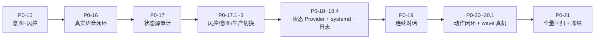

# 阶段报告索引

> 每个阶段都有独立的完整交付报告，正文**保持原样**（包括当时的内网地址与主机路径片段，已在公开前评估）。
> 本目录的 `P0xx.md` 是**导航摘要**，不复制原文，避免同一主题出现多个版本。

## 1. 阶段编号与实际报告对应

| 阶段 | 主题 | 完整报告 | 导航页 |
|---|---|---|---|
| P0-15 | 意图识别 + 事实风险保护初版 | [P015_DELIVERY_REPORT.md](P015_DELIVERY_REPORT.md) | — |
| P0-16 | 真实语音闭环（麦克风 → ASR → Router → TTS → 扬声器） | [P016_DELIVERY_REPORT.md](P016_DELIVERY_REPORT.md) | [P016.md](P016.md) |
| P0-17 | 机器人状态数据源审计 | [P017_ROBOT_STATE_AUDIT_REPORT.md](P017_ROBOT_STATE_AUDIT_REPORT.md) | [P017.md](P017.md) |
| P0-17.1 | 实时状态问答漏放修复 + ROBOT_STATUS 本地兜底 | [P0171_FACT_RISK_GUARD_FIX_REPORT.md](P0171_FACT_RISK_GUARD_FIX_REPORT.md) | [P017.md](P017.md) |
| P0-17.2 | 意图语义边界修复 | [P0172_INTENT_RECOGNIZER_BOUNDARY_FIX_REPORT.md](P0172_INTENT_RECOGNIZER_BOUNDARY_FIX_REPORT.md) | [P017.md](P017.md) |
| P0-17.3 | 生产 Voice Router 单服务切换 | [P0173_PRODUCTION_VOICE_ROUTER_CUTOVER_REPORT.md](P0173_PRODUCTION_VOICE_ROUTER_CUTOVER_REPORT.md) | [P017.md](P017.md) |
| P0-18 | RobotStateProvider + systemd 服务化 | [P018_ROBOT_STATE_PROVIDER_REPORT.md](P018_ROBOT_STATE_PROVIDER_REPORT.md) | [P018.md](P018.md) |
| P0-18.1 | Provider 生产部署 | [P0181_PRODUCTION_ROBOT_STATE_DEPLOYMENT_REPORT.md](P0181_PRODUCTION_ROBOT_STATE_DEPLOYMENT_REPORT.md) | [P018.md](P018.md) |
| P0-18.2 | systemd 生产服务 | [P0182_SYSTEMD_PRODUCTION_SERVICE_REPORT.md](P0182_SYSTEMD_PRODUCTION_SERVICE_REPORT.md) | [P018.md](P018.md) |
| P0-18.3 | 真实重启自动恢复 | [P0183_REAL_REBOOT_AUTO_RECOVERY_REPORT.md](P0183_REAL_REBOOT_AUTO_RECOVERY_REPORT.md) | [P018.md](P018.md) |
| P0-18.4 | 日志轮转与磁盘管理 | [P0184_LOG_ROTATION_AND_DISK_MANAGEMENT_REPORT.md](P0184_LOG_ROTATION_AND_DISK_MANAGEMENT_REPORT.md) | [P018.md](P018.md) |
| P0-19 | InteractionManager（连续对话） | [P019_INTERACTION_MANAGER_REPORT.md](P019_INTERACTION_MANAGER_REPORT.md) | [P019.md](P019.md) |
| P0-20 | 语音动作触发与业务闭环 | [P020_ACTION_INTERACTION_REPORT.md](P020_ACTION_INTERACTION_REPORT.md) | [P020.md](P020.md) |
| P0-20.1 | 生产切换 + 真实 wave 验收 | [P0201_PRODUCTION_DEPLOYMENT_REPORT.md](P0201_PRODUCTION_DEPLOYMENT_REPORT.md) | [P020.md](P020.md) |
| P0-21 | 系统整体验收与 V1.0 冻结 | [P021_SYSTEM_ACCEPTANCE_REPORT.md](P021_SYSTEM_ACCEPTANCE_REPORT.md) | [P021.md](P021.md) |
| P0-21 补充 | ASR001 专项复核 | [P021_FINAL_ACCEPTANCE_SUPPLEMENT.md](P021_FINAL_ACCEPTANCE_SUPPLEMENT.md) | [P021.md](P021.md) |

## 2. 演进主线（一页看懂）

## 3. 阅读建议

- 想了解**为什么这样设计**：先 [P017](P017_ROBOT_STATE_AUDIT_REPORT.md)（数据源真相）→ [P0171](P0171_FACT_RISK_GUARD_FIX_REPORT.md)（风控边界）→ [P0172](P0172_INTENT_RECOGNIZER_BOUNDARY_FIX_REPORT.md)（意图边界）；
- 想了解**怎么保证长期运行**：[P0182](P0182_SYSTEMD_PRODUCTION_SERVICE_REPORT.md) → [P0183](P0183_REAL_REBOOT_AUTO_RECOVERY_REPORT.md) → [P0184](P0184_LOG_ROTATION_AND_DISK_MANAGEMENT_REPORT.md)；
- 想了解**动作安全**：[P020](P020_ACTION_INTERACTION_REPORT.md) → [P0201](P0201_PRODUCTION_DEPLOYMENT_REPORT.md)；
- 想核对**最终状态**：[P021](P021_SYSTEM_ACCEPTANCE_REPORT.md) + [P021 补充](P021_FINAL_ACCEPTANCE_SUPPLEMENT.md)。

## 4. 报告中的历史路径

部分报告写于仓库结构重整之前，正文中出现的 `g1_dev/teach/...` 等路径**现已不存在**；为保证证据可信，正文未改写。路径的当前对应关系见 [code_structure.md](../development/code_structure.md)。
